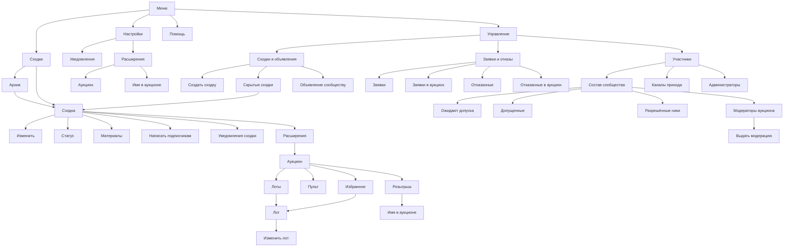
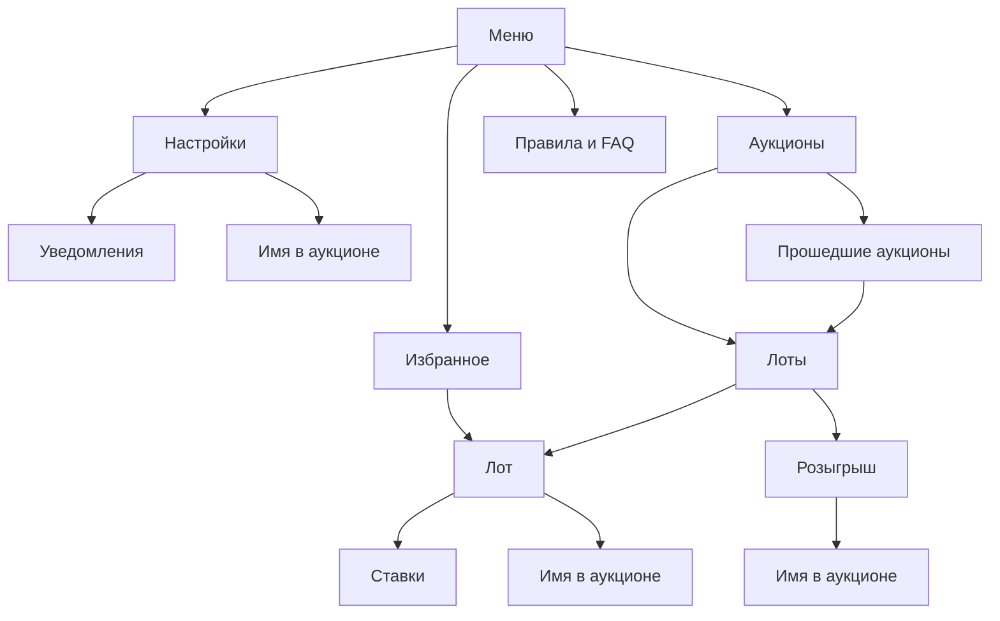

# Дизайн-код экранов бота

> **Статус:** Canonical. **Зрелость:** Accepted — выбор владельца 2 октября 2026 года ([PER-343](https://linear.app/anticnvm/issue/per-343)); на бота аукциона правила распространены решением владельца 3 октября 2026 года ([PER-450](https://linear.app/anticnvm/issue/per-450)), вопросы перевёрстки аукциона закрыты выбором владельца 4 октября 2026 года ([PER-462](https://linear.app/anticnvm/issue/per-462)). **Реализация:** в боте хаба реализовано в [PER-444](https://linear.app/anticnvm/issue/per-444), постеры карточки — в [PER-443](https://linear.app/anticnvm/issue/per-443), отказанные — в [PER-440](https://linear.app/anticnvm/issue/per-440), экраны аукциона сходки — в [PER-307](https://linear.app/anticnvm/issue/per-307); в боте аукциона — ожидание в [PER-464](https://linear.app/anticnvm/issue/per-464), карточка лота в [PER-465](https://linear.app/anticnvm/issue/per-465), оболочка в [PER-463](https://linear.app/anticnvm/issue/per-463); каталог и линтер экранов введены в [PER-451](https://linear.app/anticnvm/issue/per-451); вид тела экранов аукциона — меню, списки, карточка лота, лист ставки, хронология и уведомления — решён владельцем 7 октября 2026 года и переверстан в [PER-472](https://linear.app/anticnvm/issue/per-472), там же появился трек аукциона в раскадровке; корневой экран «Меню» обоих ботов заменён командами разделов решением владельца 10 октября 2026 года и возвращён общим родителем разделов решением владельца по прогону 12 октября 2026 года вместе с приветствием, кнопкой «Подать заявку» и подсказкой на непрочитанное сообщение ([PER-592](https://linear.app/anticnvm/issue/per-592), [«Команды и разделы»](#команды-и-разделы)); раскадровка показывает решения 10 октября, кадры PER-592 в ней согласованы не все; что осталось — [ниже](#расхождения-экранов-аукциона).

Документ задаёт правила экранов двух ботов в личном чате — бота хаба `hub-bot` и бота аукциона `auction-bot`: как устроена навигация, что стоит в клавиатуре, чем приходит результат, как задаётся вопрос, как размечен текст и что человек видит, пока бот ждёт сервис. Отдельные кадры хаба и бота аукциона и их тексты остаются в [раскадровке](storyboard.html), границы компонентов и `callback_data` — в [брифе](../../services/hub-bot.md).

Каждый раздел первой строкой называет свою область: оба бота, только бот хаба или только бот аукциона. В разделе с областью «оба бота» пункт, который касается одного бота, помечен в самом пункте. Правило с областью «оба бота» действует и для экранов аукциона внутри бота хаба: тело аукционного экрана одно на два бота, различается оболочка ([ADR-044](../../decisions/ADR-044-two-telegram-bots-and-shared-auction-screens.md)); на какой слой ложится какое правило — в разделе [«Аукцион: тело, шлюз, оболочка»](#аукцион-тело-шлюз-оболочка).

## Опорные клиенты

> **Область:** оба бота.

Правила рассчитаны на Telegram Desktop и мобильные клиенты. Web K целью не является: в нём не видны ни индикатор на кнопке, ни «печатает…», и вопрос с кнопкой не открывает режим ответа. Механика, которая работает только в Web K или только мимо него, в код не берётся; что на каком клиенте проверено — в разделе [«Что проверено и чем»](#что-проверено-и-чем).

## Три класса сообщений

> **Область:** оба бота.

Каждое сообщение бота принадлежит ровно одному классу. Класс определяет, что происходит с сообщением при нажатии кнопки под ним.

| Класс | Что это | Что делает нажатие |
|---|---|---|
| **Экран** | узел дерева: заголовок, содержимое и клавиатура | правит это же сообщение в следующий экран |
| **Вопрос** | сообщение, на которое бот ждёт ответ текстом, пересылкой или файлом | «Отмена» удаляет вопрос, экран-родитель приходит новым сообщением; ответ человека даёт новое сообщение |
| **След** | факт, который остаётся в истории: уведомление, отправленный файл, предпросмотр рассылки | меняет только собственное состояние следа либо открывает экран новым сообщением; экран след не затирает |

## Дерево экранов

> **Область:** оба бота. Правило одного родителя общее, дерево у каждого бота своё.

У экрана один родитель. Переходов вбок — из раздела в соседний раздел — нет: в другой раздел человек идёт через корень «Меню» — возвратом «‹ Меню» с раздела — или командой из кнопки меню клиента (решение владельца по прогону 12 октября 2026 года, [PER-592](https://linear.app/anticnvm/issue/per-592); с 10 октября до него корня не было, и ходили только командами).

Подтверждение, вопрос и кадр отказа — не узлы дерева, а состояния узла: подтверждение и вопрос возвращают в экран, с которого открыты, кадр отказа — в ближайший живой экран.

### Дерево бота хаба

Корень один — «Меню», общий родитель разделов «Сходки», «Настройки», «Помощь» и «Управление»; разделы открывают и пункты меню, и свои команды, а последний ряд раздела — «‹ Меню» (решение владельца по прогону 12 октября 2026 года, [PER-592](https://linear.app/anticnvm/issue/per-592); с 10 октября до него корнями были сами разделы). «Ближайшая сходка» — пункт меню, а не узел: он открывает карточку сходки. У держателя одной группы «Управления» групп в дереве нет: «Управление» сразу показывает пункты группы, и их возврат ведёт в «Управление» ([«Управление»](#управление)).

К карточке ведут три стрелки, но родитель у конкретной карточки один — список, в котором сходка стоит сейчас, а не путь, которым человек пришёл. У отменённой, состоявшейся и прошедшей это «Архив», и скрытость здесь ничего не меняет: отменённая сходка уходит в архив сразу. У скрытой из остальных — «Скрытые сходки», у всех прочих — «Сходки». Так возврат с карточки из архива ведёт в архив, а карточка, открытая по ссылке из чата или из уведомления, получает тот же возврат, что и открытая из списка. Подпись возврата называет, куда он ведёт, поэтому скрытая сходка, открытая из «Сходок», честно показывает «‹ Скрытые».

«Управление» и пункты в нём бот показывает по правам человека ([ADR-064](../../decisions/ADR-064-two-bots-by-audience-circle-and-rights.md), пункт 6, и [дополнение 2026-10-08](../../decisions/ADR-064-two-bots-by-audience-circle-and-rights.md#дополнение-2026-10-08-заявки-в-аукцион-в-управлении)): «Заявки в аукцион» и «Отказанные в аукцион» — праву модерировать аукцион, «Заявки», «Состав сообщества», «Отказанные» и «Каналы прихода» — праву управлять составом, «Администраторы» — праву назначать администраторов ([PER-521](https://linear.app/anticnvm/issue/per-521)), «Создать сходку», «Скрытые сходки» и «Объявление сообществу» — кругу администратора; правило входа — в [брифе](../../services/hub-bot.md#меню-команд). Кадры без доступа P-14 и P-17 в дерево не входят: у человека за ними нет экранов, и навигации у них нет. P-14 — два состояния: приветствие с одной кнопкой «Подать заявку» — запись каталога `welcome` с правилом `apply` — и кадр ожидания после нажатия без клавиатуры ([PER-592](https://linear.app/anticnvm/issue/per-592)). У кадра ожидания и P-17 клавиатуры нет, и у гостя тоже: намёк на бот аукциона ему не нужен ([бриф](../../services/hub-bot.md#два-входа-аукциона)). Линтер держит это записью каталога `no-access` с правилом `none`. Так же устроен кадр перехода участника в боте аукциона — запись `in-community` каталога этого бота: одна фраза, без ссылки и клавиатуры ([ADR-064](../../decisions/ADR-064-two-bots-by-audience-circle-and-rights.md), пункт 2).

Приветствие человека без права поверхности — тоже не узел дерева, а кадр входа у обоих ботов (решение владельца по прогону 12 октября 2026 года, [PER-592](https://linear.app/anticnvm/issue/per-592); [ADR-060, дополнение 2026-10-12](../../decisions/ADR-060-auction-access-premoderation.md#дополнение-2026-10-12-заявка-только-по-кнопке)). Его получает не заблокированный человек без права на `/start` и на любом другом действии — команде и нажатии. Первое предложение жирным в одной строке с остальным, как у кадра отказа: что за бот, у бота аукциона — что за аукцион, строка «Доступ выдаёт администратор или мейнтейнер.» и «Если заявка уже подана, кнопка покажет, что с ней.». В хабе — «Привет! Это бот сообщества солегуфиков.», «Здесь сходки сообщества: что запланировано, материалы и уведомления. Сходки видят участники сообщества.» и «Чтобы войти, подай заявку. …»; в боте аукциона — «Привет! Это бот аукциона сообщества солегуфиков.», «Здесь проходят аукционы сообщества: лоты, ставки и итоги торгов. Торговать могут допущенные участники.» и «Чтобы участвовать, подай заявку. …». Клавиатура — одна кнопка `[Подать заявку]`, и только она ставит заявку в очередь поверхности; её исходы — кадр ожидания на месте приветствия, отказ, блокировка, меню, если сработал белый список, и кадр недоступности с «Повторить», который несёт ту же кнопку. Запись каталога `welcome` с правилом `apply` у обоих ботов. Кадры ожидания, отказа и блокировки клавиатуры по-прежнему не несут; кадр ожидания называет, кто даёт допуск: в хабе «Заявка на доступ ждёт проверки.» и абзацем «Доступ выдаёт администратор или мейнтейнер. Пока сходки не видны. …», в боте аукциона — «Заявка на рассмотрении. Участие в аукционе пока не открыто. Доступ выдаёт администратор или мейнтейнер.».

### Дерево бота аукциона

Корень один — «Меню», общий родитель разделов «Аукционы», «Настройки», «Правила и FAQ», а у бота с Notifications ещё «Избранное»; разделы открывают пункты меню и команды `/auctions`, `/faq` и `/favorites`, последний ряд раздела — «‹ Меню». «Настройки» — раздел с подпунктами «Уведомления» и «Имя в аукционе» ([PER-595](https://linear.app/anticnvm/issue/per-595)): «Уведомления» — у бота с Notifications, «Имя в аукционе» — пока идёт аукцион; подпункты возвращают «‹ Настройки», а без обоих раздел говорит, что настраивать пока нечего. «Прошедшие» — ребёнок «Аукционов»: кнопка «Прошедшие» последним рядом содержимого списка, перед листанием, а у «Прошедших» возврат «‹ Аукционы»; `/past` из списка команд убран и по старой привычке открывает «Прошедшие» (решение владельца по прогону 12 октября 2026 года, [PER-592](https://linear.app/anticnvm/issue/per-592); с 10 октября до него корнями были сами разделы, и «Прошедшие» среди них).

В поверхности хаба кнопка «Правила и FAQ» стоит в корне аукциона сходки и возвращает в него ([PER-605](https://linear.app/anticnvm/issue/per-605)). Участник приходит к ней только через сходку; «Аукционы» с «Прошедшими» остаются разделом гостевой поверхности.

Лента «Лоты» — тело аукционного дерева, и родителя ей даёт оболочка: в боте аукциона это список аукционов, в котором аукцион стоит сейчас, в боте хаба — корень аукциона «Аукцион» ([PER-307](https://linear.app/anticnvm/issue/per-307), [PER-605](https://linear.app/anticnvm/issue/per-605)). Корень — тоже тело аукционного дерева: стадия и сроки, «Лоты», «Пульт» и «Розыгрыш», «Избранное» и «Правила и FAQ»; вход в него у хаба — меню «Расширения» сходки ([ADR-064, дополнение 2026-10-12](../../decisions/ADR-064-two-bots-by-audience-circle-and-rights.md#дополнение-2026-10-12-меню-расширений-сходки)), у бота аукциона входа нет, но корень он рисует с возвратом в список. Родитель лота в обоих ботах — лента, причём та её страница, с которой лот открыт: номер страницы едет в `callback_data` кнопки возврата. Хронология «Ставки» — дочерний узел лота ([PER-309](https://linear.app/anticnvm/issue/per-309)): кнопка «Ставки» под карточкой, возврат «‹ Лот» на карточку с той же страницей ленты, листание «←» и «→» по восемь ставок. Подписи возврата по правилу [навигации](#навигация): «‹ Лоты» у лота, «‹ Лот» у хронологии, «‹ Аукционы» или «‹ Прошедшие» у ленты, «‹ Аукционы» у «Прошедших», «‹ Меню» у разделов и «‹ FAQ» у состояний FAQ в боте аукциона, «‹ Аукцион» у ленты, избранного, розыгрыша, правил и пульта и «‹ Расширения» у корня в боте хаба. В кнопках домена `auc` сходки нет, поэтому бот хаба помнит сходку аукциона в памяти процесса — из меню «Расширения» и из ответа на включение аукциона — и ставит по ней «‹ Расширения» у корня. После рестарта, пока меню не открыли заново, корень возвращает в «‹ Сходки» ([ADR-030, дополнение 2026-10-04](../../decisions/ADR-030-telegram-bot.md#дополнение-2026-10-04-сходка-аукциона-в-памяти-процесса); [PER-307](https://linear.app/anticnvm/issue/per-307)).

Списков аукционов у бота аукциона два — раздел «Аукционы» и его ребёнок «Прошедшие» ([PER-453](https://linear.app/anticnvm/issue/per-453)): «Аукционы» — активные, от запланированного до финала, «Прошедшие» — завершённые; черновик не виден ни в одном. Список показывается и тогда, когда аукцион один: строка на аукцион, а не сразу его лента. Строку различают день начала онлайн-фазы, этап и число лотов: в теле «• 10 октября, сб — идут ставки, 3 лота», в кнопке «10 октября, сб · идут ставки · 3 лота» ([«Списки аукционов и лента лотов»](#списки-аукционов-и-лента-лотов)); имени у аукциона нет, а сходку список не называет ([ADR-047](../../decisions/ADR-047-auction-trading-domain-vocabulary-and-event-form.md)). Порядок — от ближайшего начала у активных и от свежего у прошедших, по восемь строк на странице с листанием «←» и «→». Пустой список говорит об этом текстом и тупиком не остаётся: пустые «Аукционы» несут «Прошедшие» и «‹ Меню», пустые «Прошедшие» — «‹ Аукционы» (решение владельца по прогону 12 октября 2026 года, [PER-592](https://linear.app/anticnvm/issue/per-592); с 10 октября до него у пустого списка-корня клавиатуры не было). Лента возвращает в тот список, где аукцион стоит сейчас, а не туда, откуда человек пришёл: лента завершённого аукциона ведёт в «‹ Прошедшие», даже если её открыли кнопкой уведомления.

Избранное ([PER-495](https://linear.app/anticnvm/issue/per-495), [ADR-063](../../decisions/ADR-063-auction-favorites-in-notifications.md), дополнение 2026-10-11) — свои отмеченные лоты из любых аукционов, у обоих ботов. Отметку ставит кнопка «Добавить в избранное» под карточкой лота, снимает «Убрать из избранного» на том же месте: голого «Убрать» у избранного нет ([PER-595](https://linear.app/anticnvm/issue/per-595), запись 25 прогона 12 октября 2026 года); карточка после нажатия правится на месте с новой кнопкой. У закрытого лота — проданного, непроданного, снятого — «Добавить в избранное» нет: следить уже не за чем, а реплику такого лота Notifications через 30 дней вычищает, и поздняя отметка отказывала бы всегда. У проданного лота нет и «Убрать из избранного»: итог известен, а отметки закончившегося аукциона Notifications удаляет сам; отмеченный непроданный или снятый лот снимается как любой. Ставка сама кладёт лот в избранное, а снятый вручную лот не возвращает ([ADR-063](../../decisions/ADR-063-auction-favorites-in-notifications.md)): это говорит экран принятой ставки у бота с Notifications. Лот, которого Auction больше не отдаёт, — аукцион удалили до торгов, — из списка выпадает. Список — тело аукционного дерева, а вход в него у каждого бота свой: в боте аукциона — пункт меню и команда `/favorites`, и список там — раздел с возвратом «‹ Меню» ([PER-592](https://linear.app/anticnvm/issue/per-592)), в боте хаба — кнопка «Избранное» в корне аукциона сходки с возвратом «‹ Аукцион» ([PER-605](https://linear.app/anticnvm/issue/per-605)). Лот из списка открывает карточку, чей родитель — лента её аукциона, как у любой карточки. Бот без адреса Notifications избранного не показывает вовсе. Notifications, ещё не знающий лот, — кадр исхода «Лот пока нельзя добавить в избранное» с «‹ Лот».

«Уведомления» — экран частоты сообщений о торгах в боте аукциона ([PER-515](https://linear.app/anticnvm/issue/per-515)), подпункт «Настроек»: его открывают пункт «Настроек» и команда `/notifications`, последний ряд — «‹ Настройки» ([PER-595](https://linear.app/anticnvm/issue/per-595); с [PER-592](https://linear.app/anticnvm/issue/per-592) до неё — раздел меню с «‹ Меню»). Пункт и команда есть, только когда у бота есть Notifications. Сюда же ведёт «Частота уведомлений» под вестью о торгах ([«Уведомления аукциона»](#уведомления-аукциона)). В боте хаба та же частота — узел «Аукцион» под «Расширениями» настроек с возвратом «‹ Расширения», а не корень команды: аукционные уведомления участнику доставляет бот хаба ([ADR-064](../../decisions/ADR-064-two-bots-by-audience-circle-and-rights.md), п. 16, [PER-552](https://linear.app/anticnvm/issue/per-552)), а настройки расширения живут в его месте настроек, не в «Уведомлениях» ядра ([ADR-064, дополнение 2026-10-12](../../decisions/ADR-064-two-bots-by-audience-circle-and-rights.md#дополнение-2026-10-12-меню-расширений-сходки); [PER-605](https://linear.app/anticnvm/issue/per-605)). Кнопка «Аукцион» есть только у бота хаба с Auction. Настройка у человека одна: выбор в одном боте виден в другом.

В поверхности аукциона FAQ — раздел: команда `/faq` открывает его с любого места, пункт «Правила и FAQ» — из меню, последний ряд — «‹ Меню» (решение владельца по прогону 12 октября 2026 года, [PER-592](https://linear.app/anticnvm/issue/per-592); с 10 октября до него FAQ был корнем без ряда навигации). Кнопка «Правила и FAQ» стоит только в меню, под другими экранами этой поверхности её нет. `/faq` проходит ту же проверку доступа, что и любое действие: человек без права получает приветствие, заблокированный — кадр блокировки, а не FAQ; заявку команда не ставит. В поверхности хаба FAQ открывается отдельной кнопкой только из корня аукциона сходки и возвращается в него кнопкой «‹ Аукцион» ([PER-605](https://linear.app/anticnvm/issue/per-605)). Команды `/faq` у хаба нет. Кадры «ссылка на подробные правила не указана» и «куда направлять вопросы, не указано» — состояния FAQ в поверхности аукциона, а не узлы: возврат из них ведёт в FAQ, последний ряд — `[‹ FAQ]`. Общий вид FAQ: заголовок «Правила и FAQ», пустая строка, секции через пустую строку — жирное имя секции и под ним текст организатора строкой; состояние FAQ — тот же заголовок, пустая строка, одна фраза.

Первый допущенный `/start` открывает «Правила и FAQ» раньше остального. Под FAQ стоит кнопка «Аукционы» (решение владельца 10 октября 2026 года), а последним рядом — «‹ Меню» ([PER-592](https://linear.app/anticnvm/issue/per-592)): «Аукционы» открывает список аукционов и ставит отметку ознакомления ([бриф](../../services/hub-bot.md#faq-и-разделы-поверхностей-аукциона)) — как бы FAQ ни был открыт, через `/start`, `/faq` или меню. Отметку ставит только эта кнопка; кнопка стоит под FAQ всегда — экран не знает, есть ли отметка, — и после отметки просто открывает «Аукционы». Меню отметкой не закрыто — иначе «‹ Меню» с FAQ вернула бы в FAQ, — а разделы за ним закрыты, как прежде: без отметки `/auctions`, `/past`, `/favorites`, `/notifications`, `/start` и пункты меню, кроме «Правил и FAQ», показывают FAQ. После отметки `/start` открывает меню. Кадры ожидания допуска, блокировки и приветствие в дерево не входят — так же, как P-14 и P-17 в хабе; ожидание и блокировка клавиатуры не несут, у приветствия одна кнопка «Подать заявку». Лист ставки ([PER-317](https://linear.app/anticnvm/issue/per-317)) добавил под лотом узел «Имя в аукционе» — его правила и остальные экраны листа, подтверждения и вопросы, в разделе [«Лист ставки»](#лист-ставки). Форма заведения лота ([PER-319](https://linear.app/anticnvm/issue/per-319)) живёт в боте хаба. Кадры бота аукциона — трек «Бот аукциона» [раскадровки](storyboard.html#track-l), рядом с треками хаба ([PER-472](https://linear.app/anticnvm/issue/per-472)).

## Навигация

> **Область:** оба бота. Имена разделов и коды кадров в примерах — бота хаба.

- Постоянный вход — кнопка меню клиента с командами бота. Reply-клавиатуры под полем ввода нет: её кнопка отправляет текст в чат и спорит с режимом ответа на вопрос. «Домашнего» сообщения, которое бот находит и правит сам, тоже нет: для него пришлось бы помнить `message_id`, а хранилища у экранов нет ([ADR-030](../../decisions/ADR-030-telegram-bot.md)).
- У каждого бота один корень — экран «Меню», общий родитель разделов: «Сходки», «Ближайшая сходка», «Настройки», «Управление» и «Помощь» в хабе, «Аукционы», «Избранное», «Уведомления» и «Правила и FAQ» в боте аукциона. Разделы открывают и пункты меню, и команды, а `/menu` открывает само меню ([«Команды и разделы»](#команды-и-разделы); решение владельца по прогону 12 октября 2026 года, [PER-592](https://linear.app/anticnvm/issue/per-592), пересматривает решение 10 октября «корневого экрана „Меню“ нет»). У каждого экрана дерева цепочка родителей доходит до меню — экрана дерева без выхода нет.
- Последний ряд клавиатуры экрана — навигация: одна кнопка `[‹ Родитель]`; у разделов это `[‹ Меню]`. Голой кнопки «Меню» нет: в меню ведёт только возврат «‹ Меню». У самого меню ряда навигации нет.
- Подпись возврата — знак «‹», пробел и короткое имя родителя. В обоих ботах: «‹ Меню». В хабе: «‹ Сходки», «‹ Архив», «‹ Настройки», «‹ Управление», «‹ Сходки и объявления», «‹ Заявки и отказы», «‹ Участники», «‹ Скрытые», «‹ Состав», «‹ Сходка», «‹ Материалы», «‹ Изменить лот»; в аукционе: «‹ Лоты», «‹ Лот», «‹ FAQ» и подпись родителя ленты. Слова «Назад», «К списку», «К лотам», «К сходке» и «К управлению» не используются.
- Боковых ссылок нет. «Архив» под «Сходками» — не боковая ссылка, а дочерний экран раздела (решение владельца 10 октября 2026 года: до него «Архив» был разделом меню и под списком не стоял); так же «Прошедшие» под «Аукционами» в боте аукциона ([PER-592](https://linear.app/anticnvm/issue/per-592)); «Настройки уведомлений» под списком и «Общие настройки» под уведомлениями сходки по-прежнему не ставятся. Где соседний раздел важен для понимания, о нём говорит текст экрана.
- «Обновить» стоит только на экране, чьи данные меняются без участия человека, пока он на них смотрит. Таких экранов три: состав сообщества хаба с подэкранами — там меняется очередь, — пульт аукциона, пока состав финала объявлен или идёт финал, — там зал ставит на лот ведущего ([PER-337](https://linear.app/anticnvm/issue/per-337), решение владельца 11 октября 2026 года), — и карточка лота, пока у лота нет итога, — запланированного, в торгах и отложенного в финал: там без участия человека открываются торги, меняются цена и лидер, лот уходит в финал и возвращается из него. Кнопку карточки лота ставит аукционное дерево по состоянию лота; у лота без условий торгов, проданного, непроданного и снятого её нет. Остальные экраны перечитывают данные при каждом открытии ([решение](#решения-перевёрстки)).
- Кадр отказа несёт выход: повтор у отказа сервиса, возврат в ближайший живой экран у остальных. В хабе это «Повторить» у E-05 и возврат у E-01, E-03, E-04, устаревшего вопроса и нечитаемой кнопки. Кадры отказа, устаревший экран и нечитаемая кнопка ведут в основной раздел: в хабе «‹ Сходки», в боте аукциона «‹ Аукционы» (решение владельца 10 октября 2026 года; [PER-592](https://linear.app/anticnvm/issue/per-592) этот выход не пересматривала). Кадр недоступного сервиса несёт «Повторить» и под ним или рядом этот возврат; сбой самого основного раздела — только «Повторить». В боте аукциона исключений два: после сбоя `/start` кадр несёт только `[Повторить]`, после сбоя ответа на вопрос — только `[‹ Аукционы]` ([решение](#решения-перевёрстки)). Экрана без кнопки не остаётся: «Помощь» и пустой список аукционов с [PER-592](https://linear.app/anticnvm/issue/per-592) несут выход. Исключение — кадры без доступа, которые в дерево не входят. Подсказка на сообщение, которое бот не читает ([«Вопросы»](#вопросы)), — кадр вне дерева с выходом «‹ Меню».

## Клавиатура

> **Область:** оба бота. Пределы рядов карточки сходки и примеры подписей — бота хаба.

Ряды идут сверху вниз в одном порядке: действия экрана, содержимое (сходки, материалы, люди), листание, навигация.

- Ряд складывается по смыслу, а не по длине подписей: в один ряд встают кнопки одной логической группы — одного рода действия над одним предметом (решение владельца 13 октября 2026 года, [PER-594](https://linear.app/anticnvm/issue/per-594)). Короткие подписи у такой пары обычно следствие, а не причина: две несвязанные короткие кнопки рядом не ставятся, а группа, которой не хватает ширины, переносится — длинная подпись встаёт своим рядом. Содержимое списков — сходки, лоты, аукционы, люди — стоит по одному в ряду. Каждая пара названа здесь поимённо и держится линтером.
- В ряду одна кнопка. Две — только у пары одной группы: ряд навигации, ряд листания, в хабе ещё «Изменить» и «Статус», материал и «Убрать», «Материалы (N)» и «🧩 Расширения» ([PER-605](https://linear.app/anticnvm/issue/per-605)), «Избранное» и «Правила и FAQ» в корне аукциона сходки ([PER-495](https://linear.app/anticnvm/issue/per-495)), «Пульт» и «Розыгрыш» там же, когда розыгрыш открыт ([«Розыгрыш среди участников»](#розыгрыш-среди-участников)), — под следом перебития и ответа автоставки в обоих ботах «К лоту» и «Частота уведомлений» ([«Уведомления аукциона»](#уведомления-аукциона)), на карточке лота в обоих ботах «Своя сумма» и «Автоставка» (ставки, которые человек задаёт сам) и «Обновить» и «Ставки» (ход торгов лота) ([PER-594](https://linear.app/anticnvm/issue/per-594)), а в обоих ботах — бинарные пары выбора: ответы подтверждения `[✔️ Да, …] [✖️ Нет]`, решение по заявке `[✔️ Допустить] [✖️ Отказать]` и `[✔️ Допустить] [Закрыть]` в «Ожидают допуска». Бинарная пара выбора всегда стоит одним рядом, а не столбиком (решение владельца 10 октября 2026 года). Три и больше — только у заготовок даты и времени.
- Под карточкой сходки не больше пяти рядов, под остальными экранами — не больше двенадцати. Под карточкой лота не больше пяти рядов, в боте хаба у держателя права `manage_meetups` — шести ([PER-317](https://linear.app/anticnvm/issue/per-317), [PER-594](https://linear.app/anticnvm/issue/per-594)): в онлайн-торгах `[По шагу (<цена>)]` своим рядом и `[Своя сумма] [Автоставка]`, «Автоставка» — если лот принимает лимиты, в живом финале — одна «Поставить <цена>» ([PER-336](https://linear.app/anticnvm/issue/per-336)); `[Обновить] [Ставки]` — «Обновить», пока у лота нет итога, «Ставки» у лота, который открывался к торгам ([PER-309](https://linear.app/anticnvm/issue/per-309)); «Добавить в избранное» или «Убрать из избранного», когда у бота есть Notifications и лот не продан ([PER-495](https://linear.app/anticnvm/issue/per-495)); в хабе у держателя права `manage_meetups` — «Изменить лот» ([PER-319](https://linear.app/anticnvm/issue/per-319)); и навигация. Содержимого на странице не больше восьми строк; дальше — листание кнопками «←» и «→», номер страницы стоит в заголовке.
- Словарь закрыт: возврат — «‹ Родитель», выход из вопроса — «Отмена», повтор после сбоя — «Повторить», ответы подтверждения — «✔️ Да, <глагол>» и «✖️ Нет», пояснение под вопросом лимита автоставки — «Как это работает» ([PER-517](https://linear.app/anticnvm/issue/per-517)). «Меню» — только как возврат «‹ Меню»: голая подпись «Меню» вне словаря (решение владельца 10 октября 2026 года; возврат «‹ Меню» вернула [PER-592](https://linear.app/anticnvm/issue/per-592)). Заявку ставит одна кнопка — «Подать заявку» под приветствием. Новое слово для той же функции не заводится.
- Подтверждение — один ряд без ряда навигации: `[✔️ Да, <глагол и предмет>] [✖️ Нет]` («✔️ Да, отменить сходку»; решение владельца 10 октября 2026 года, до него — два ряда). Над ним стоит только ссылка источника, если она есть. «Нет» возвращает в экран, с которого подтверждение открыто, а под только что присланным текстом или файлом ведёт на экран исхода с «Ввести заново» ([«Вопросы»](#вопросы)). Текст подтверждения — заголовок-вопрос с тем же глаголом и предметом («Отменить сходку?», «Поставить 1 300 ₽?»), под ним предмет жирным — название сходки или лота, — затем что отменить нельзя ([«Подтверждение»](#подтверждение)).
- Подтверждение нужно действию, которое (а) необратимо с того же экрана, (б) выходит наружу — уведомляет людей или делает что-то видимым другим — или (в) связано с деньгами. Обратимое внутреннее действие — переключатель, выдача модерации — подтверждения не получает (решение владельца 10 октября 2026 года). Перечень действий хаба по этому правилу — в разделе [«Подтверждение»](#подтверждение). В аукционе через подтверждение идут ставка и автоставка онлайн-недели: они необратимы и связаны с деньгами. Ставка живого финала — исключение: подтверждение съело бы гонку за цену, а от ставки, которой человек не делал, защищает ожидаемая цена в команде ([ADR-049](../../decisions/ADR-049-auction-live-bid-rule.md); [карточка финала](#карточка-финала)).
- `callback_data` кнопки — не больше 64 байт, а не символов. Формат и разбор — в [брифе](../../services/hub-bot.md); у домена `auc` предел держит parser аукционного дерева.
- Переключатель, в хабе, несёт состояние словом в начале подписи. У переключателя уведомлений перед словом стоит колокольчик словаря: «🔔 Вкл · Новые сходки», «🔕 Выкл · Объявления сообщества» (решение владельца 10 октября 2026 года); переключатель финала в пульте — «Вкл · Финал» без знака. Чекбоксов `[x]` нет.
- Цвет у кнопки один — `danger`, и только у «✔️ Да, …» подтверждения, после которого обратного действия нет или тратятся деньги; там он обязателен (решение владельца 10 октября 2026 года, заменяет решения 6 октября, [PER-473](https://linear.app/anticnvm/issue/per-473), и 8 октября, [PER-534](https://linear.app/anticnvm/issue/per-534); признак каталога `irreversible`). Красные: ставка и автоставка, «Да, отказать», «Да, закрыть доступ», «Да, отменить сходку», «Да, отметить состоявшейся», «Да, удалить» (аукцион), «Да, открыть неделю», «Да, отправить» (рассылка и объявление), «Да, убрать материал». Обратимые подтверждения — скрыть сходку, отменить отложенную публикацию, сохранить прошедшую дату, прикрепить материал, «Да, пересмотреть» — обычного цвета. Сами кнопки решения — «Допустить», «Отказать», «Закрыть» — цвета не несут: красное у отказа — его «Да, отказать». `success`, `primary` и `disabled` не используются: смысл обязан читаться из подписи, а `disabled` на клиентах выглядит обычной кнопкой и нажимается.
- Кнопка-ссылка помечается знаком «↗» в конце подписи. Кнопки внутри rich-документа не используются: действия живут в клавиатуре ([ADR-034](../../decisions/ADR-034-telegram-bot-rich-presentation.md)).

## Доставка

> **Область:** оба бота. В следствиях под таблицей экраны названы хабовские, сами следствия общие.

| Что сделал человек | Чем приходит результат |
|---|---|
| нажал кнопку экрана | правкой этого же сообщения |
| отправил команду | новым сообщением с экраном |
| ответил на вопрос | одним новым сообщением: [экран исхода](#экран-исхода) («Изменение сохранено» с возвратом к карточке) |
| нажал кнопку, задающую вопрос | вопрос приходит новым сообщением, экран над ним теряет клавиатуру |
| нажал «Отмена» под вопросом | вопрос удаляется, экран, с которого он задан, приходит новым сообщением |
| нажал кнопку под следом | след остаётся целым; экран приходит новым сообщением |
| нажал кнопку файла | файл приходит новым сообщением-следом |

Следствия, которые меняют сегодняшнее поведение:

- «Управление» и возвраты в него приходят правкой, как любой другой экран.
- После ответа на вопрос в чате остаётся одно сообщение бота — экран исхода. Карточку, на которой исход сказался, открывает его возврат ([PER-472](https://linear.app/anticnvm/issue/per-472)).
- Экран не живёт в сообщении с файлом. Подтверждение прикрепления файла остаётся следом, а «Материалы» после него приходят новым текстовым сообщением: править текст у сообщения с файлом Telegram не даёт.
- «Открыть сходку» под уведомлением открывает карточку новым сообщением. Текст уведомления, в том числе слова организатора, не затирается.
- «К лоту» под уведомлением бота аукциона о перебитии, о том, что автоставка ответила чужой ставке, или о покупке открывает карточку лота новым сообщением тем же правилом: уведомление не правится и не удаляется, даже когда карточка приходит фото ([PER-328](https://linear.app/anticnvm/issue/per-328)). Кнопка лота под сводкой открывает свою карточку так же. «Частота уведомлений» под перебитием, ответом автоставки и сводкой так же присылает новым сообщением экран частоты — «Уведомления» в боте аукциона ([PER-515](https://linear.app/anticnvm/issue/per-515)), «Аукцион» под «Расширениями» настроек в боте хаба ([PER-552](https://linear.app/anticnvm/issue/per-552), [PER-605](https://linear.app/anticnvm/issue/per-605)).
- «Правила и FAQ» под сообщением бота аукциона о допуске «Тебя допустили к аукциону.» и «Сходки» под «Доступ открыт» в хабе — тоже кнопки следа: экран приходит новым сообщением, а весть о допуске остаётся в истории ([PER-442](https://linear.app/anticnvm/issue/per-442); до [PER-592](https://linear.app/anticnvm/issue/per-592) под допуском к аукциону стояло «Открыть аукцион»). Так же «Сходки» под сообщением о правах администратора: «Сходки» приходят новым сообщением, а «Управление» человек открывает командой `/manage`, которую то же сообщение ставит в список его чата ([PER-468](https://linear.app/anticnvm/issue/per-468); решение владельца 10 октября 2026 года, до него кнопка следа «Меню»).
- Если Telegram правку не принял, экран уходит новым сообщением — прежнее правило края из брифа остаётся.
- Вопрос закрывается удалением, а не правкой, — исключение из «нажатие правит своё сообщение». Второе исключение — [карточка финала](#карточка-финала): её правит поток аукциона без нажатия. Мобильный клиент держит режим ответа на сообщение с `force_reply`, пока оно есть в чате: правка его не снимает, и он возвращается при каждом входе в чат (зонд PER-443). Если Telegram удалить сообщение не дал, вопрос правится в экран на месте.

## Вопросы

> **Область:** оба бота. У бота аукциона вопросы — сумма ставки, лимит автоставки и псевдоним ([«Лист ставки»](#лист-ставки)); форма лота живёт в боте хаба ([«Форма лота»](#форма-лота)).

- Вопрос — сообщение с `force_reply` в inline-клавиатуре и кнопкой «Отмена» под ним. Клиент сам открывает режим ответа, а кнопка даёт выход, которого у классического `ForceReply` не было.
- Шаг вопроса лежит в `callback_data` его кнопки и возвращается в `reply_to_message.reply_markup` ответа. Поэтому вопрос переживает рестарт процесса без невидимого маркера в тексте. Там же лежит Telegram id того, кому вопрос задан: после рестарта ответ принимается только от него, как до рестарта, а вопрос без id получает «вопрос устарел». Исключение в хабе — вопрос о названии материала: источник файла в 64 байта не помещается, и этот шаг остаётся в карте вопросов в памяти процесса.
- Текст вопроса называет, что нужно прислать, показывает текущее значение строкой «Сейчас: …» в формах хаба и подписанной строкой в листе ставки и даёт образец формата, если формат есть. В листе ставки подпись говорит, что это за значение: «Минимальная ставка: 1 250 ₽» или «Твой лимит сейчас: 3 000 ₽» ([PER-595](https://linear.app/anticnvm/issue/per-595), запись 29 прогона 12 октября 2026 года). Вопрос листа ставки начинается с жирного заголовка — имени шага («Своя сумма», «Автоставка», «Псевдоним»), после него пустая строка, а что прислать, подписанное значение и образец идут одним абзацем. Причины отказа в тексте вопроса нет: непринятый ответ — [экран исхода](#экран-исхода). Вопросы формы лота и формы сходки в хабе заголовка не несут — это исключение хаба, которое [PER-472](https://linear.app/anticnvm/issue/per-472) не пересматривала, и линтер класс «вопрос» по заголовку не проверяет.
- Экран, с которого вопрос задан, теряет клавиатуру: в чате остаётся одно место, где можно действовать. «Отмена» удаляет вопрос и присылает этот экран новым сообщением.
- Подтверждение над текстом или файлом, которые человек только что прислал ответом на вопрос, по «Нет» ведёт на экран исхода — «Не отправлено», «Не прикреплено» — с `[Ввести заново]` над выходом `[‹ Родитель]`; «Ввести заново» задаёт тот же вопрос с начала цепочки (решение владельца 10 октября 2026 года). Присланное в кнопку не помещается — текст рассылки тем более, — поэтому его присылают заново. В хабе так устроены рассылка подписчикам, объявление сообществу и прикрепление материала.
- После принятого ответа клавиатура вопроса снимается. После отвергнутого бот присылает экран исхода: причина в заголовке, `[Ввести заново]` задаёт тот же вопрос, а `[‹ Родитель]` ведёт туда, куда вела «Отмена»; режима ответа у него нет. Прежний вопрос закрывается после того, как экран ушёл ([PER-472](https://linear.app/anticnvm/issue/per-472)). Цепочка из двух вопросов — код и подпись канала, источник и название материала, цена и шаг лота — по «Ввести заново» начинается с первого вопроса: первый ответ жил в памяти процесса или в кнопке отвергнутого вопроса.
- Ответ без текста — фото, стикер, голос — на вопрос, который ждёт текст, значением не является: приходит экран исхода «Нужен ответ текстом» с «Ввести заново».
- Сообщение, которое бот не читает, без ответа не остаётся (решение владельца по прогону 12 октября 2026 года, [PER-592](https://linear.app/anticnvm/issue/per-592); до него бот молчал, и ответ, у которого клиент потерял реплай, пропадал). Текст без реплая на вопрос, незнакомая команда, файл вне вопроса, а в боте аукциона и реплай на сообщение бота без вопроса получают подсказку — кадр вне дерева с жирным первым предложением и одной кнопкой «‹ Меню», запись каталога `hint` с правилом `exit`. Если у чата в памяти процесса есть открытый вопрос — «Ответ не дошёл до вопроса. Нажми на вопрос бота, выбери «Ответить» и пришли ответ ещё раз.», иначе — «Я отвечаю на кнопки и команды. Разделы — в меню ниже и в кнопке меню рядом с полем ввода.». Личность для подсказки не разрешается. Команда, адресованная другому боту (`/x@other_bot`), остаётся без ответа. Служебные события чата — закрепление, таймер автоудаления — подсказки не получают: человек ничего не писал; на альбом, который приходит сообщением на каждый снимок, подсказка одна.
- Брошенный вопрос удаляется: если человек не ответил и не отменил, а отправил команду или нажал кнопку в другом сообщении, бот удаляет открытые вопросы этого чата. Помнит он их в памяти процесса, поэтому вопрос, заданный до рестарта, остаётся в чате и по-прежнему принимает ответ.
- Дату и время выбирают кнопками на экране без режима ответа, а вопросом спрашивают только дату, которой нет среди заготовок; правило — в разделе [«Дата и время»](#дата-и-время).

## Формат

> **Область:** оба бота.

- Экран начинается с жирного заголовка — имени экрана. У карточки сходки заголовок — название сходки, у карточки лота — название лота. Пустой экран («сходок пока нет», «лотов пока нет») несёт заголовок так же, как заполненный.
- После заголовка — пустая строка. Тело идёт абзацами через пустую строку, строки внутри абзаца — через перенос ([PER-472](https://linear.app/anticnvm/issue/per-472): до неё правило жило только в коде хаба). В rich-карточке абзац — блок `
`, строки внутри — ` `. Исключение — кадр отказа и кадры без доступа: у них жирное первое предложение стоит в одной строке с остальным текстом.
- Над заголовком ничего нет, кроме фото карточки: постеров карточки сходки и фото карточки лота в rich-сообщении (решение владельца 10 октября 2026 года). Исход действия — «Изменение сохранено», «Ставка ниже порога», «Сроки недели сохранены» — свой [экран исхода](#экран-исхода), а не абзац над карточкой: исход и содержимое не смешиваются (решение владельца 7 октября 2026 года, [PER-472](https://linear.app/anticnvm/issue/per-472), отменяет заметку над заголовком).
- Строки-поля тела — «Ключ: значение» без точки в конце: «Статус: идут торги», «Когда: 12 июня, сб, 19:00», «Цена: 1 200 ₽». Точкой заканчивается предложение — пояснение исхода, подсказка, причина отказа в кадре отказа.
- Дата для чтения — «12 июня, сб, 19:00»: месяц в родительном падеже, день недели сокращён. Год называется, только когда он не текущий в поясе сообщества: «12 июня 2027, сб, 19:00». В подписи кнопки списка — «12 июня · Название». Формат ввода в хабе остаётся `ДД.ММ.ГГГГ ЧЧ:ММ`.
- Сущность `date_time` не используется: её готовые форматы клиент рисует на языке своего интерфейса, а не по-русски, и подчёркивает как ссылку.
- Обращение — на «ты» во всех текстах, включая строку автора в карточке сходки и уведомления.
- Эмодзи — только из закрытого словаря и только перед своим словом (решение владельца 10 октября 2026 года, заменяет «эмодзи нет»): «✔️» перед «Да, …» подтверждения и перед «Допустить», «✖️» перед «Нет» и перед «Отказать», «🗑» перед «Убрать» и «Удалить» у кнопки, которая ведёт к удалению (материал, ник, аукцион), «🔔» и «🔕» перед состоянием переключателя уведомлений, «📅 Когда:» и «📍 Где:» в полях карточки сходки «📎 Материалы:» над списком материалов на карточке, «🧩» перед «Расширения» — на карточке сходки и в «Настройках» ([PER-605](https://linear.app/anticnvm/issue/per-605)), — и в полях карточки лота «💰» перед «Цена:», «Стартовая цена:» и «Цена продажи:», «👤» перед «Лидер:» и «Победитель:», «⏳» перед «Торги до:» ([PER-594](https://linear.app/anticnvm/issue/per-594)), «✅» перед «Твой лот» и «твой лот» — у покупателя на карточке лота и в сводке своих лотов, «💡» перед «Подсказка:» — у пояснения автоставки ([PER-595](https://linear.app/anticnvm/issue/per-595)). Словарь — один модуль констант `apps/hub-bot/src/core/pictograms.ts`: из него берут знаки экраны обоих ботов и линтер. Текст организатора — название, описание, рассылка, FAQ — словарём не ограничивается и показывается как есть. Служебные знаки — «‹» у возврата, «↗» у ссылки, «←» и «→» у листания, «• » перед подписью выбранного режима частоты ([PER-598](https://linear.app/anticnvm/issue/per-598)). «·» разделяет поля одной строки — в подписи кнопки и в строке тела с несколькими полями: хронология ставок, строка пульта. В строке списка «• 12 июня, сб — Название» маркер «• » открывает строку, а «—» отделяет дату или название от остального.
- Название сходки, лота или материала и имя человека на экране, который не его карточка, — предмет экрана: жирный абзац под заголовком, без кавычек — **Кружка** под заголовком подтверждения, исхода, принятой команды и хронологии (решение владельца 13 октября 2026 года, [PER-594](https://linear.app/anticnvm/issue/per-594); до него — абзац в кавычках). Кавычки остаются у названия внутри фразы: «Сходка «Встреча» уже отменена».
- Текст организатора показывается дословно, без разметки: в хабе — в уведомлении и предпросмотре рассылки, в боте аукциона — тексты FAQ.

## Ожидание

> **Область:** оба бота. Коды кадров P-08, E-04, E-05 и E-09 — бота хаба.

Человек видит ожидание двумя индикаторами, которые рисует сам клиент: спиннером на нажатой кнопке и строкой «печатает…» в шапке чата.

1. **Ответ на нажатие уходит вместе с результатом**, а не до обращения к сервисам. Пока ответа нет, кнопка крутится. Это отменяет прежний порядок «`answerCallbackQuery` без текста до похода к соседям» ([PER-400](https://linear.app/anticnvm/issue/per-400)): тогда ранний ответ убирал навязчивое всплывающее «Загружаю…», теперь ответ по умолчанию не несёт текста и всплывающего окна нет.
2. **Бюджет действия — 5 секунд на все сервисы вместе.** Он один и у нажатия, и у ответа на вопрос, и у команды. Каждый вызов получает меньшее из своего дедлайна в 3 секунды и остатка бюджета; когда остаток исчерпан, вызов не делается, и человек видит кадр E-05. До этого правила худший случай был 9 секунд тишины.
3. **Сторож — 8 секунд.** Если через 8 секунд после начала обработки нажатия ответ на него ещё не ушёл, он уходит без результата. Telegram принимает ответ через 12,2 секунды и отвергает через 15,3, так что у нажатия, которое бот взял в работу, кнопка не крутится дольше лимита. Время в очереди сторож не видит: момента нажатия в апдейте нет.
4. **«Печатает…» — после 1 секунды.** Если результата нет через секунду после нажатия, ответа на вопрос или команды, бот шлёт `sendChatAction` и повторяет его каждые 4 секунды до результата. На сообщение, которое бот оставляет без ответа, индикатора нет.
5. **Всплывающий текст возвращается там, где несёт смысл, которого на экране нет:** подтверждение переключателя (кадр P-08 — «Включено: новые сходки.») и выбора частоты «перебили» («Теперь: не присылаю.», [PER-515](https://linear.app/anticnvm/issue/per-515), [PER-552](https://linear.app/anticnvm/issue/per-552)), нажатие, после которого экран остался тем же (E-09 — «Без изменений.»), и повтор после сбоя, который снова не удался («Пока не получилось.»). В двух последних случаях сообщение не правится вовсе: править его тем же содержимым Telegram не даёт. Кадр E-04 всплывающего текста не получает: нажатие в устаревшем экране перерисовывает его по текущему состоянию, и то, что версия открыта актуальная, человек видит на самом экране. В остальных случаях ответ на нажатие без текста.
6. **Отказ самого ответа на нажатие действие не отменяет:** он пишется в запись границы, результат всё равно приходит правкой.
7. Экран на время ожидания не правится: промежуточного кадра «Жду ответ…» нет.

Принятый риск: бот обрабатывает апдейты строго по одному, и нажатие ждёт в очереди, пока обрабатывается предыдущее. При зависшем сервисе первое нажатие получает ответ не позже 5 секунд, второе подряд — не позже 10, а третье может получить его позже лимита Telegram и потерять всплывающий текст; само действие при этом выполнится. Параллельная обработка по чатам (`@grammyjs/runner`) не вводится. Дольше всего очередь держит холодная загрузка фото лота в боте аукциона — правило в разделе [«Показ фото лота»](#показ-фото-лота).

## Правила отдельных экранов

> **Область:** оба бота. Только бот хаба — «Управление», «Списки сходок», «Карточка сходки», «Состав сообщества», «Заявки», «Отказанные», «Каналы прихода», «Форма создания», «Дата и время», «Рассылка и объявление». Оба бота — «Команды и разделы» и «Уведомления» с оговоркой внутри, «Списки аукционов и лента лотов», «Карточка», «Карточка лота», «Хронология ставок», «Подтверждение», «Уведомления аукциона»: тело аукционного экрана одно на два бота.

### Команды и разделы

> Решение владельца 10 октября 2026 года отменило «в кнопке меню клиента одна команда `/menu`» ([PER-468](https://linear.app/anticnvm/issue/per-468)) и корневой экран «Меню» в обоих ботах; решение владельца по прогону 12 октября 2026 года ([PER-592](https://linear.app/anticnvm/issue/per-592); [ADR-064, дополнение 2026-10-12](../../decisions/ADR-064-two-bots-by-audience-circle-and-rights.md#дополнение-2026-10-12-корневое-меню-обоих-ботов)) вернуло корневое меню рядом с командами разделов: из точки входа видно всё доступное человеку, а «‹» больше не упирается в раздел.

Корень у каждого бота один — «Меню»: заголовок «Меню», строка «Разделы бота. Те же разделы — в кнопке меню рядом с полем ввода.» и кнопки разделов по одной в ряду; возврата у меню нет. Второй постоянный вход — кнопка меню клиента с командами (`setMyCommands`): `/menu` «Меню» — первая в списке и открывает меню, остальные открывают свой раздел сразу новым сообщением. Разделы — дети меню, их последний ряд — «‹ Меню». `/start` в списке нет: его читают как команду первого запуска.

`/start` в обоих ботах заявку не ставит ([ADR-060, дополнение 2026-10-12](../../decisions/ADR-060-auction-access-premoderation.md#дополнение-2026-10-12-заявка-только-по-кнопке)): он разрешает личность, как любое действие, и белый список Identity гасит тем же вызовом. Допущенному без ссылки на сходку он открывает меню, заблокированному — кадр блокировки, человеку без права поверхности — приветствие с кнопкой «Подать заявку» ([«Дерево бота хаба»](#дерево-бота-хаба)). Заявку ставит только эта кнопка; код канала из `/start s_<код>` едет в её данных, пока они укладываются в 64 байта, иначе кнопка уходит без кода, и заявка — без канала. Команды разделов и нажатия человека без права тоже отвечают приветствием: разрешение личности не знает, подана ли заявка.

В хабе общий список личных чатов — `/menu` «Меню», `/meetups` «Сходки», `/next` «Ближайшая сходка», `/settings` «Настройки», `/help` «Помощь». Держателю права управления список его чата (область `chat`) добавляет `/manage` «Управление» перед «Помощью». Список чата сверяется с правами на каждом действии, где бот разрешил личность, — кнопке, команде, `/start`, «Подать заявку», — после ответа: процесс помнит, какой список записал в чат, и зовёт Telegram (`setMyCommands` или `deleteMyCommands`) только при расхождении; отказ Telegram в память не попадает и повторяется следующим действием. Чат, которого процесс ещё не видел и которому список не нужен, не трогается: иначе каждая выкладка стоила бы вызова на первое действие каждого человека. Цена — список, оставшийся от прав, снятых, пока процесса не было, уходит только когда права снова выдадут и снимут в живом процессе — то же после вытеснения чата из памяти. Сообщение о назначении администратором по-прежнему ставит список сразу ([PER-468](https://linear.app/anticnvm/issue/per-468)). `/manage` без права — кадр отказа «Управление сходками доступно администратору.» с `[‹ Сходки]`. Старые кнопки «Меню» (`v1:nav:start`) в чатах открывают меню — те же данные несёт «‹ Меню». Ссылка `m_<uuid>` на `/start` открывает карточку сходки.

Меню хаба — «Сходки», «Ближайшая сходка», «Настройки», «Управление» держателю права и «Помощь»: тот же источник, что список команд чата, без пункта `/menu`, поэтому кнопки меню и команды одного человека не расходятся.

- **«Сходки»** — бывшие «Ближайшие сходки», основной раздел с возвратом «‹ Меню». Последним рядом содержимого, перед листанием, стоит «Архив» — дочерний экран с возвратом «‹ Сходки».
- **`/next`** открывает карточку ближайшей предстоящей сходки новым сообщением: опубликованной, с датой не раньше сегодняшнего дня сообщества, самой ранней. Скрытая сходка, которую видят автор и администратор, в счёт не идёт: «ближайшая» — та, что объявлена сообществу. Сходки с датой впереди нет — приходит экран «Сходки» с его пустым текстом или списком без дат.
- **«Настройки»** — раздел с возвратом «‹ Меню»: заголовок, строка-пояснение «Что и когда бот тебе присылает, и настройки расширений сходок.» и кнопки «Уведомления» — бывший общий экран уведомлений, только категории ядра, его возврат — «‹ Настройки», — и «🧩 Расширения» ([ADR-064, дополнение 2026-10-12](../../decisions/ADR-064-two-bots-by-audience-circle-and-rights.md#дополнение-2026-10-12-меню-расширений-сходки); [PER-605](https://linear.app/anticnvm/issue/per-605)). «Расширения» — список расширений с настройками у каждого: у бота с Auction — «Аукцион», частота «перебили» ([«Уведомления»](#уведомления)), без него — «Расширений пока нет.».
- **«Помощь»** — раздел с одной кнопкой «‹ Меню» (до [PER-592](https://linear.app/anticnvm/issue/per-592) — корень без кнопок): заголовок «Помощь», текст о боте — приветствие входа, — строка «Расширения сходки, например аукцион, — кнопка «🧩 Расширения» в её карточке.» ([PER-605](https://linear.app/anticnvm/issue/per-605)) и команды человека строками «• /meetups — Сходки». Правил расширений «Помощь» не повторяет: они в корне расширения. Обратная связь из бота — задача [PER-551](https://linear.app/anticnvm/issue/per-551); в тексте бота её нет.
- **«Управление»** — раздел групп с возвратом «‹ Меню», правила — в разделе [«Управление»](#управление).

В боте аукциона список — `/menu` «Меню», `/auctions` «Аукционы», `/faq` «Правила и FAQ». У бота с Notifications между ними стоят ещё `/favorites` «Избранное» и `/notifications` «Уведомления» — подпункт «Настроек» ([PER-495](https://linear.app/anticnvm/issue/per-495), [PER-515](https://linear.app/anticnvm/issue/per-515)); без Notifications их нет ни в списке, ни в меню, а набранная руками команда даёт кадр устаревшего экрана. `/past` из списка убран ([PER-592](https://linear.app/anticnvm/issue/per-592)) и по старой привычке открывает «Прошедшие» — ребёнка «Аукционов». Меню — «Аукционы», «Избранное» у бота с Notifications, «Настройки» ([PER-595](https://linear.app/anticnvm/issue/per-595)), «Правила и FAQ»; разделы несут «‹ Меню». Без отметки ознакомления `/start` и разделы, кроме FAQ, показывают FAQ; само меню отметкой не закрыто ([«Дерево бота аукциона»](#дерево-бота-аукциона)). «Повторить» после сбоя `/start` повторяет тот же `/start` — разрешение личности, а не заявку ([«Решения перевёрстки»](#решения-перевёрстки)).

Эмодзи у команд и подписей разделов нет: словарь [«Формата»](#формат) их не называет.

### Управление

> **Область:** только бот хаба. Решение владельца 10 октября 2026 года: вместо девяти кнопок подряд — три группы.

| Группа | Пункты | Право |
|---|---|---|
| «Сходки и объявления» | «Создать сходку», «Скрытые сходки», «Объявление сообществу» | вести сходки |
| «Заявки и отказы» | «Заявки», «Заявки в аукцион», «Отказанные», «Отказанные в аукцион» | управлять составом — очередь сообщества; модерировать аукцион — очередь аукциона |
| «Участники» | «Состав сообщества», «Каналы прихода», «Администраторы» ([PER-521](https://linear.app/anticnvm/issue/per-521)) | управлять составом; «Администраторы» — назначать администраторов |

Группа видна, если человеку виден хоть один её пункт по прежним правам ([«Дерево бота хаба»](#дерево-бота-хаба)). Подпись кнопки группы — имя группы; экран группы — ребёнок «Управления» с возвратом «‹ Управление», пункты — дети группы с возвратом на неё: «‹ Сходки и объявления», «‹ Заявки и отказы», «‹ Участники». Если видна ровно одна группа — так у модератора аукциона и у того, кто только ведёт сходки, — «Управление» сразу показывает её пункты, а их возврат ведёт в «‹ Управление».

Подписи групп выбраны так, чтобы не спорить с соседями: «Сходки» — уже имя основного раздела, поэтому группа сходок — «Сходки и объявления» (19 знаков, пункт объявления в ней же); «Заявки» — уже имя пункта очереди сообщества, поэтому группа заявок — «Заявки и отказы». Кадры отказа пунктов управления по-прежнему возвращают в «‹ Управление».

### Списки сходок

«Сходки», архив и скрытые устроены одинаково: заголовок, строки «• 12 июня, сб, 19:00 — Название» с прежними секциями, кнопка на сходку «12 июня · Название», листание по восемь, ряд навигации. «Сходки» — раздел под меню: последний ряд — «‹ Меню» ([PER-592](https://linear.app/anticnvm/issue/per-592)), а последним рядом содержимого перед листанием стоит «Архив» (решение владельца 10 октября 2026 года). Страницу режет бот из полного списка Meetups; страница за пределами списка открывает последнюю.

### Списки аукционов и лента лотов

> **Область:** оба бота — лента; списки аукционов есть только у бота аукциона.

Устроены как списки сходок: содержимое стоит и строками в теле, и кнопками. Строка в теле полная, с «—», кнопка короткая, с «·» и обрезанным названием. Списки «Аукционы» и «Прошедшие»: «• 10 октября, сб — идут ставки, 3 лота», кнопка «10 октября, сб · идут ставки · 3 лота». Аукцион с общим дедлайном лотов строка тела отмечает хвостом отсчёта до финала — дня дедлайна в поясе сообщества: «• 10 октября, сб — идут ставки, 3 лота, до финала 3 дня», в сам день — «…, финал сегодня», после него, у завершённого аукциона, у аукциона без финала и у онлайн-фазы, которая лоты не закрывает, хвоста нет; кнопка остаётся короткой ([PER-518](https://linear.app/anticnvm/issue/per-518)). Строка списка аукционов подписывает день: это начало онлайн-торгов — «• Торги с 10 октября, сб — **идут ставки**, 3 лота, **финал сегодня**», этап и отсчёт до финала выделены жирным, а кнопка остаётся «10 октября, сб · идут ставки · 3 лота» ([PER-595](https://linear.app/anticnvm/issue/per-595), запись 22 прогона 12 октября 2026 года). Лента «Лоты» и «Избранное» кнопки строками не повторяют (решение владельца 13 октября 2026 года, [PER-595](https://linear.app/anticnvm/issue/per-595); пересматривает для них решение 7 октября): все лоты — кнопками «Кружка · 1 200 ₽» в порядке ленты, по возрастанию цены, — у лота без торгов «старт 500 ₽», у проданного «продан за 3 000 ₽», дальше «не продан», «снят», «готовится», — а текст — сводка своих лотов и прямо говорит, что в ней не все лоты: «Здесь только твои лоты: где ты лидер и что ты купил. Все лоты аукциона — кнопками ниже.», затем «• Кружка — 1 200 ₽, ты лидер» и «• Плакат — ✅ твой лот за 3 000 ₽», не больше восьми строк и «И ещё N.». Своих лотов нет — одна строка «Ты пока не лидируешь ни в одном лоте этого аукциона. Все лоты — кнопками ниже.». «Перебили» сводка не пишет: снимок лота не говорит, ставил ли на него смотрящий, а отметка избранного бывает и без ставки. Лоты страницы, на которых сейчас действует окно «Счастливых часов», сводка называет строкой «Счастливые часы сейчас: Кружка.» ([PER-505](https://linear.app/anticnvm/issue/per-505)); кнопка остаётся короткой. Довод решения 7 октября — экран над вопросом теряет клавиатуру — сводка закрывает для своих лотов: они видны и без кнопок. Пустая лента — «Лотов пока нет.». «Избранное» — кнопки в порядке отметки, текст — «Лотов в избранном: 4.» и та же сводка; у своего лота в онлайн-торгах строка несёт дедлайн «торги до 12 октября, сб, 19:00»; закрытый лот остаётся в списке со своим итогом. Пустой список говорит, как его пополнить: «Лотов в избранном пока нет. Отметь лот кнопкой «Добавить в избранное» на его карточке или сделай ставку — она добавит лот сама.» Довод за строки в теле: экран над вопросом теряет клавиатуру ([«Вопросы»](#вопросы)), и список с содержимым только в кнопках становится пустым (решение владельца 7 октября 2026 года, [PER-472](https://linear.app/anticnvm/issue/per-472)).

### Карточка

> **Область:** оба бота — карточка сходки в боте хаба и карточка лота в обоих ботах ([PER-594](https://linear.app/anticnvm/issue/per-594)).

Карточка сходки и карточка лота устроены по одному набору правил; их разделы ниже добавляют только своё.

1. **Фото** — первым блоком rich-карточки, над заголовком: постеры сходки, фото лота. Без фото блока нет, остальное не меняется.
2. **Заголовок** — название сходки или лота.
3. **Статус** — первая группа, «Статус: …» словом.
4. **Блок фактов со знаками** — главные поля сущности, каждое со своим знаком словаря [«Формата»](#формат): у сходки «📅 Когда:» и «📍 Где:», у лота «💰 Цена:», «👤 Лидер:», «⏳ Торги до:». Поле, которому нечего сказать, называет это словом — «Когда: дата не задана», «Лидер: пока нет», — а поле, которого у состояния нет вовсе, не пишется.
5. **Дополнительные группы** — то, что поясняет факты: у сходки строка аукциона, у лота ход торгов — следующая ставка, шаг, «Счастливые часы», своя автоставка.
6. **Описание** — последней группой; пустое — «Описание пока не добавлено.», у сходки и у лота одинаково.
7. **Списки содержимого** — у сходки «📎 Материалы:» — после описания.

Группы идут через пустую строку, строки внутри — «Ключ: значение» без точки (решение владельца 7 октября 2026 года, [PER-472](https://linear.app/anticnvm/issue/per-472)). Исход действия карточка не несёт: он — [экран исхода](#экран-исхода).

### Карточка лота

> **Область:** оба бота.

Следует [общим правилам карточки](#карточка): заголовок — название лота; группа статуса; блок цены, лидера и срока со знаками; группа хода торгов; описание или «Описание пока не добавлено.» ([PER-594](https://linear.app/anticnvm/issue/per-594); до неё пустое описание пропускалось). Исход команды после «Да» карточка не несёт: он — [экран исхода](#экран-исхода). Исключение — [карточка финала](#карточка-финала): её исход — строка на ней самой.

| Состояние | Статус | Факты |
|---|---|---|
| черновик | «Статус: готовится к торгам» | — |
| запланирован | «Статус: торги ещё не начались» | «💰 Стартовая цена: 1 000 ₽» |
| в торгах | «Статус: идут торги» | блок фактов: «💰 Цена: 1 200 ₽», «👤 Лидер: @owl» либо «👤 Лидер: пока нет», либо «👤 Лидер: есть», когда имени нет, «⏳ Торги до: 12 июня, сб, 19:00»; группа хода торгов: «Следующая ставка: от 1 300 ₽»; «Шаг: 100 ₽», только когда шаг один на все цены; в окне «Счастливых часов» вместо неё — «Счастливые часы: шаг 10 ₽ до 12 июня, сб, 21:00» и «Обычный шаг: 100 ₽»; объявленное и не начавшееся окно, которое снизит шаг при текущей цене, — «Счастливые часы: с 12 июня, сб, 18:00 до 21:00, шаг 10 ₽», день конца называется, только когда он другой; «Твоя автоставка: до 2 000 ₽ (видишь только ты)» |
| в торгах финала | «Статус: торги финала» | блок фактов: «💰 Цена: 1 200 ₽», «👤 Лидер: …»; группа хода торгов: «Ведущий объявил: 1 500 ₽», пока объявленная цена выше текущей; «Следующая ставка: 1 300 ₽» — ровно, без «от» ([ADR-049](../../decisions/ADR-049-auction-live-bid-rule.md)) |
| ждёт финала | «Статус: ждёт финала» | «💰 Цена: 1 200 ₽», «👤 Лидер: …» |
| продан | «Статус: продан» | «💰 Цена продажи: 3 000 ₽», «👤 Победитель: @owl» либо «👤 Победитель: определён» |
| не продан | «Статус: не продан» | — |
| снят | «Статус: снят с торгов» | — |

Окно и сумма следующей ставки в нём — из снимка лота, который Auction считает на момент чтения: после конца окна карточка показывает обычный шаг при следующем открытии или «Обновить». Рассылки о начале окна нет — тишина бота. Слова статусов — словарь обоих ботов: оболочки держат один и тот же текст, расхождение ловят тесты экранов каждого бота. Фото в rich-карточке — первым блоком, над заголовком ([«Показ фото лота»](#показ-фото-лота)).

### Карточка финала

> **Область:** оба бота — карточка лота в живом финале ([PER-336](https://linear.app/anticnvm/issue/per-336)).

Та же карточка лота, статус «Торги финала». Под ней одна кнопка ставки — `[Поставить 1 300 ₽]` на следующую цену; своей суммы и автоставки в финале нет, лидеру кнопки нет вовсе. Ставка уходит одним нажатием, без подтверждения: сумма кнопки — цена, которую человек видел, и Auction примет ставку только по ней ([ADR-049](../../decisions/ADR-049-auction-live-bid-rule.md)).

Карточка живая: бот правит её по потоку аукциона, без нажатия, — новая цена, лидер, объявленная ведущим цена и смена активного лота. Карточка привязана к аукциону, а не к лоту: со сменой лота она показывает следующий, а между лотами — итог своего. На залпе ставок бот пропускает промежуточные цены, а последнюю доводит: правки одного чата — не чаще раза в секунду, бота — не больше 25 в секунду. Живой карточка остаётся до другого экрана в том же сообщении; после рестарта бота она замирает, и первое нажатие её снова оживляет ([ADR-030, дополнение 2026-10-12](../../decisions/ADR-030-telegram-bot.md#дополнение-2026-10-12-открытые-карточки-финала-в-памяти-процесса)). Фото при правке — то, что Telegram уже знает; без него карточка правится без фото.

Исход ставки — строка на самой карточке, своей группой под ценой, а не экран исхода: экран исхода вытеснил бы живую карточку из чата вместе с кнопкой на новую цену. Строки без точки, как у всей карточки: «Твоя ставка 1 300 ₽ принята»; «Цену уже подняли: следующая ставка — 1 400 ₽» — гонка нажатий, и кнопка карточки уже несёт новую цену; «Аукцион не ответил: ставка могла пройти, смотри лидера»; «Ты уже лидируешь: цена 1 300 ₽ — твоя». Без выбранного имени — тот же экран «Имя в аукционе», что в онлайн-неделе, а выбранное имя возвращает на карточку финала, а не к подтверждению.

### Хронология ставок

> **Область:** оба бота.

Заголовок «Ставки» с номером страницы, название лота жирным абзацем — предметом экрана, строки ставок «• 3 октября, сб, 19:04 · @jay · 1 500 ₽ · вручную» — момент, имя, сумма и способ через «·», как у любой строки тела с несколькими полями. Пустая — «Ставок пока нет.».

### Экран исхода

> **Область:** оба бота — исход действия на карточке сходки и лота, в форме лота и на пульте, отказ команды листа ставки, подтверждение, которое пришлось бы задать заново, и непринятый ответ на любой вопрос ([PER-472](https://linear.app/anticnvm/issue/per-472), решение владельца 7 октября 2026 года).

Исход действия — свой экран, а не строка над карточкой. Заголовок — исход одним предложением без точки: «Изменение сохранено», «Сходка опубликована», «Ставка ниже порога», «Сходка уже изменилась», «Это не сумма». Под ним предмет жирным, без кавычек — название сходки, лота или материала, если он есть ([«Формат»](#формат)). Затем пояснение абзацем: «Сейчас можно от 1 300 ₽.», «Теперь она видна в списке. Ссылка для чата: …», «Твои изменения не сохранены. Проверь актуальные данные и повтори.».

Последний ряд — выход: `[‹ Родитель]`, где родитель — экран, на котором действие сделано: «‹ Сходка», «‹ Материалы», «‹ Пульт», «‹ Лот». У аукционных исходов выход — `[‹ Лот]`, а у принятой команды ещё `[‹ Лоты]` ([PER-595](https://linear.app/anticnvm/issue/per-595); до неё — `[К лоту]`); без «‹» остаётся только «К лоту» перехода из уведомления. Над выходом — действие, которое продолжает начатое: `[Ввести заново]` у непринятого ответа, `[Изменить лот]` после сохранения формы лота, `[Настроить уведомления]` после подписки на сходку, `[Взять псевдоним]`, когда ника нет. Карточку человек открывает возвратом, и она читается заново, поэтому чтение Auction, отстающее от команды, на ней обычно не видно ([PER-471](https://linear.app/anticnvm/issue/per-471)). У принятой ставки и автоставки это гарантия, а не расчёт на время нажатия: «‹ Лот» несёт версию лота из ответа Auction, и карточка дочитывается до неё ([PER-470](https://linear.app/anticnvm/issue/per-470)).

Доставка — по общему правилу: после нажатия экран исхода правит нажатое сообщение, после ответа на вопрос приходит новым сообщением. Подтверждение материала-файла остаётся в чате следом с подписью «Не прикреплено.», а исход приходит новым сообщением. Запись каталога — `outcome` в хабе и `command-result` и `answer-refused` у тел аукциона, навигация `exit`, заголовка в записи нет: его даёт сам исход. «Нет» под подтверждением рассылки и материала — тоже экран исхода: «Не отправлено» и «Не прикреплено» с `[Ввести заново]` ([«Вопросы»](#вопросы)). Кадр отказа сервиса и кадр итога отправленной рассылки устроены так же — жирное первое предложение и выход — и не меняются. Заметки под заголовком списка («Ник добавлен.» над разрешёнными никами, «Канал заведён.» над каналами прихода) и строка над экраном выбора даты PER-472 не пересматривала.

### Подтверждение

> **Область:** оба бота — подтверждения состояния и публикации сходки в хабе и листа ставки в обоих ботах. Остальные подтверждения хаба — материалы, рассылка, открытие недели с заголовком «Онлайн-неделя» — [PER-472](https://linear.app/anticnvm/issue/per-472) не пересматривала; их «Нет» над только что присланным — по правилу [вопросов](#вопросы).

Заголовок — вопрос с глаголом и предметом: «Отменить сходку?», «Поставить 1 300 ₽?», «Включить автоставку до 2 000 ₽?». Под ним предмет жирным, без кавычек — название сходки или лота. Затем абзац о необратимости: «Отменить нельзя: отменённая сходка в план не возвращается.», «Отменить ставку нельзя.», у автоставки — разница цены и лимита и «Лимит видишь только ты.». «Да» несёт версию сходки или материала, которую человек видел на подтверждении, и команда уходит с ней. Подтверждение, которое устарело, пока человек решал, — сходку за это время изменил другой администратор, — заново не задаётся: приходит экран исхода «Сходка уже изменилась» с возвратом к сходке или к материалам, и действие человек повторяет по свежим данным. Подтверждение публикации — «Опубликовать сходку?», название жирным и последствие. С черновика — «Сходка станет видна участникам, подписчики новых сходок получат уведомление.»; из «Статуса» — что уведомление получат подписчики новых сходок, а если сходку уже публиковали, — её подписчики. Так ведёт себя Notifications: первую публикацию он объявляет держателям права хаба с включённой настройкой «Новые сходки», а возврат скрытой сходки — её подписчикам ([Notifications](../../services/notifications.md#адресный-факт-о-новой-сходке)). «Нет» возвращает на черновик или в «Статус». Кадр отказа с кнопками подтверждения — «Проверь данные и подтверди публикацию ещё раз» — остаётся только у кнопки «Опубликовать» без версии из сообщений, отправленных до подтверждения публикации. Кнопки — по правилу [клавиатуры](#клавиатура).

«Нет» подтверждения над состоянием — отменить или скрыть сходку, убрать материал, закрыть доступ — возвращает в экран, с которого подтверждение открыто. «Нет» подтверждения над тем, что человек только что прислал ответом на вопрос, — экран исхода с «Ввести заново» ([«Вопросы»](#вопросы)).

Действия хаба по правилу [клавиатуры](#клавиатура) (решение владельца 10 октября 2026 года):

| Действие | Подтверждение | Почему |
|---|---|---|
| Опубликовать сходку — с черновика и из «Статуса» | да | (б): сходку видят участники, уходят уведомления |
| Отменить сходку | да | (а) и (б): в план не возвращается, подписчики узнают |
| Отметить состоявшейся | да | (а): в план не возвращается |
| Скрыть из списка | да, до решения владельца — ниже | (б): подписчики сходки получают служебное сообщение о снятии с публикации |
| Прикрепить материал | да, «Нет» — исход с «Ввести заново» | (б): подписчики получают уведомление о материале |
| Убрать материал | да | (а): привязку с того же экрана не вернуть |
| Рассылка подписчикам, объявление сообществу | да, «Нет» — исход с «Ввести заново» | (а) и (б) |
| Закрыть доступ | да | (а): вернуть доступ из бота нельзя |
| Отказать по заявке, пересмотреть отказ | да | (а): заявка уходит из очереди |
| Открыть онлайн-неделю, удалить аукцион | да | (а) и (б) |
| Опубликовать позже, перенести публикацию | нет | обратимо из «Статуса» до момента публикации; наружу выходит только сама публикация |
| Отменить отложенную публикацию | нет | обратимо — момент назначается заново, — наружу не выходит |
| Назначить администратора | да, «Нет» — исход с «Ввести заново» | (б): назначенному приходит сообщение о назначении |
| Снять администратора | да, «Да» обычного цвета | решение владельца по [PER-521](https://linear.app/anticnvm/issue/per-521): снятие сразу уносит права набора; оно обратимо — «Назначить» на том же экране возвращает набор по нику |
| Переключатели уведомлений, выдать и снять модерацию | нет | обратимо с того же экрана, внутреннее |
| Поля сходки и формы лота, отметка финалиста | нет | обратимо правкой, внутреннее |
| Допустить по заявке | нет, до решения владельца — ниже | — |

Два действия расходятся с правилом, и их поведение пока прежнее, до решения владельца. «Скрыть из списка» решение называет обратимым внутренним, но снятие уведомляет подписчиков сходки — критерий (б). «Допустить» сообщает заявителю о допуске — тоже (б), — а подтверждения не имеет. Линтер сверяет заголовок с каталогом по началу строки, поэтому сумма в заголовке записи каталога не мешает: «Поставить», «Включить автоставку».

### Уведомления аукциона

> **Область:** оба бота — перебитие, ответ автоставки, сводку и покупку доставляет бот круга получателя: гостю — бот аукциона, участнику — бот хаба ([ADR-064](../../decisions/ADR-064-two-bots-by-audience-circle-and-rights.md), п. 16); допуск к аукциону — бот аукциона, выдачу прав администратора — бот хаба.

Уведомление — след ([«Три класса сообщений»](#три-класса-сообщений)): одна фраза на «ты», без заголовка, шапки и разметки, с одной кнопкой следа — «К лоту» или, под допуском к аукциону, «Правила и FAQ» (решение владельца 7 октября 2026 года, [PER-472](https://linear.app/anticnvm/issue/per-472); подпись допуска — [PER-592](https://linear.app/anticnvm/issue/per-592), до неё «Открыть аукцион»). Кнопки нет у вести о смене круга ([PER-537](https://linear.app/anticnvm/issue/per-537)): в боте аукциона участник дальше экрана перехода в сообщество не пройдёт, и обещать кнопкой нечего, а в боте хаба весть вручает ссылку на бот аукциона текстом — кнопки к чужому боту у хаба нет. Исключение — перебитие и ответ автоставки в боте с Notifications: рядом с «К лоту» одним рядом стоит «Частота уведомлений», вход в настройку частоты (решение владельца 10 октября 2026 года, [PER-515](https://linear.app/anticnvm/issue/per-515); в боте хаба — решение владельца 11 октября 2026 года, [PER-552](https://linear.app/anticnvm/issue/per-552); подпись вместо «Реже» и ответ автоставки — решение владельца 13 октября 2026 года, [PER-598](https://linear.app/anticnvm/issue/per-598)). Покупка и допуск от частоты не зависят и остаются с одной кнопкой. Сводка окна частоты ([PER-596](https://linear.app/anticnvm/issue/per-596)) — второе исключение из «одной фразы»: строка «Сводка по твоим ставкам:», пустая строка и строки «• «Лот» — что случилось, цена» по лоту, не больше десяти лотов, остальные — «…и ещё лотов: N.»; под ней — ряд на каждый лот с его названием и последним рядом «Частота уведомлений» (решение владельца 13 октября 2026 года). Покупка называет лот и следующий шаг — «Как оплатить и забрать — напишет организатор аукциона.»: оплаты и получения в продукте нет. Шапка «Лид: Название» хаба отвергнута: у хаба она отделяет слова организатора, которых в уведомлении аукциона нет, а название лота уже стоит во фразе. Сами фразы — в [брифе](../../services/hub-bot.md#уведомления-аукциона).

### Розыгрыш среди участников

> **Область:** оба бота — экран, регистрация и итог одни; вход в хабе — в корне аукциона, в боте аукциона — в корне ленты.

Розыгрыш среди участников аукциона — [ADR-066](../../decisions/ADR-066-auction-raffle-commit-reveal-with-beacon.md), экраны — [PER-500](https://linear.app/anticnvm/issue/per-500). Вход — кнопка «Розыгрыш»: в боте аукциона — первым рядом ленты над лотами, в хабе — в корне аукциона, у администратора парой к «Пульту» ([PER-605](https://linear.app/anticnvm/issue/per-605)); возврат из розыгрыша в хабе — «‹ Аукцион». Кнопка стоит, только пока Auction отдаёт розыгрыш — с открытия онлайн-торгов; отказ чтения розыгрыша кнопку убирает, а ленту не роняет. Решение владельца 11 октября 2026 года: «в боте аукциона в меню гостя» из ADR-066, п. 2, после отмены экрана «Меню» означает корень ленты, а не команду — розыгрыш у каждого аукциона свой. Меню, возвращённое [PER-592](https://linear.app/anticnvm/issue/per-592), пункта розыгрыша не получило по тому же доводу.

Экран — дочерний узел корня аукциона, заголовок «Розыгрыш среди участников», возврат «‹ Аукцион» (в боте аукциона — «‹ Лоты»: корня у него во входах нет). Что под заголовком, решает статус розыгрыша:

- **регистрация открыта** — правила одним абзацем (один билет за бесплатную регистрацию, ставки и покупки на билет не влияют, приз предоставляет организатор), момент закрытия и «итог — через пару минут после закрытия регистрации», отметка «Ты зарегистрирован» или «Ты пока не зарегистрирован», отпечаток seed и раунд маяка drand ссылкой на раунд. Кнопка — «Зарегистрироваться» или «Отменить регистрацию»;
- **регистрация закрыта, пул фиксируется** — момент закрытия и отпечаток с раундом;
- **жеребьёвка ждёт маяк** — число билетов, свой номер, список «№ — имя» и «жеребьёвка ждёт значение маяка drand»;
- **итог** — выигравший билет с именем и «Это твой билет», если он твой, число билетов, список, seed, значение раунда, V и «Как проверить итог»: четыре шага пересчёта из ADR-066 и однострочник на Python с подставленными значениями;
- **никто не зарегистрировался** — «розыгрыш не состоялся» и раскрытый seed; **не проводится** — одна фраза о причине.

Кнопка регистрации и отмены есть только в окне регистрации; вне окна экран объясняет состояние текстом. Подтверждения у них нет: до закрытия регистрация обратима с того же экрана, и наружу ничего не выходит — список «№ — имя» появляется только после закрытия регистрации, а до него билетов не видит никто ([«Клавиатура»](#клавиатура)). Список показывает первые сорок билетов и «… и ещё N»: свой номер и выигравший билет названы отдельной строкой при любом размере пула. Имени, стёртого через 30 дней, в строке нет — остаётся номер.

Регистрация без выбранного имени ведёт на «Имя в аукционе» — тот же экран, что перед первой ставкой ([«Лист ставки»](#лист-ставки)), с возвратом «‹ Розыгрыш»; вопрос псевдонима и непринятый ответ — те же кадры с возвратом в розыгрыш. Принятое имя сразу регистрирует: человек уже нажал «Зарегистрироваться». Тексты экрана общие у двух ботов, как FAQ.

Язык — «розыгрыш среди участников» ([RFC-007](../../rfcs/RFC-007-auction-scope-and-format-options.md#инварианты-безопасной-лотереи), инвариант 8): слов «гача», «крутка», «шанс», «донат» в любой форме нет ни на одном экране обоих ботов, и это держит линтер ([«Исполнение правил»](#исполнение-правил)).

### Карточка сходки

Следует [общим правилам карточки](#карточка). Под карточкой не больше пяти рядов. У организатора: `[Изменить] [Статус]`, `[Материалы (N)] [🧩 Расширения]`, `[Написать подписчикам]`, `[Уведомления сходки]` и навигация. У участника: `[Материалы (N)]`, если материалы есть, рядом `[🧩 Расширения]` — у всех, — `[Подписаться на сходку]` либо `[Уведомления сходки]` и навигация. Расширения стоят в ряду материалов, потому что отдельным рядом вывели бы карточку организатора за пять рядов (решение владельца 4 октября 2026 года, [PER-307](https://linear.app/anticnvm/issue/per-307)). Кнопка без состояния: включённое расширение, «Включить аукцион» держателю `manage_meetups` у неотменённой сходки, «У этой сходки пока нет расширений.» и сбой Auction с «Повторить» показывает меню «Расширения» с возвратом «‹ Сходка» ([ADR-064, дополнение 2026-10-12](../../decisions/ADR-064-two-bots-by-audience-circle-and-rights.md#дополнение-2026-10-12-меню-расширений-сходки); [PER-605](https://linear.app/anticnvm/issue/per-605)). «Включить аукцион» отвечает кадром исхода «Аукцион включён» с кнопкой «Аукцион» и «‹ Расширения». Кнопок файлов на карточке нет — файлы открываются из «Материалов». «Отметить состоявшейся» живёт в «Статусе».

Строка аукциона — своя группа после «Когда» и «Где» ([PER-594](https://linear.app/anticnvm/issue/per-594); [ADR-064, дополнение 2026-10-12](../../decisions/ADR-064-two-bots-by-audience-circle-and-rights.md#дополнение-2026-10-12-меню-расширений-сходки)): «Аукцион: идут онлайн-торги до 12 июня, сб, 19:00» у онлайн-торгов с дедлайном, у остальных стадий — стадия словом, как в корне аукциона: «Аукцион: готовится», «Аукцион: скоро старт», «Аукцион: завершён». Ради неё карточка читает аукцион у Auction вместе с подпиской, параллельно. Аукциона нет, у бота нет Auction или Auction не ответил — строки нет, без заглушки, как у строки автора: карточка остаётся верной, а «🧩 Расширения» на месте. Строка — текст, рядов кнопок она не добавляет.

Строка статуса — «Статус: запланирована, видна»: видимость, «видна» или «скрыта», видит только тот, кто управляет сходкой; остальным — «Статус: запланирована», потому что скрытая сходка им не показывается, а «видна» ничего не говорит (решение владельца 10 октября 2026 года).

Постеры: материалы-фотографии стоят в rich-карточке первым блоком, над заголовком, — одно фото фотографией, несколько каруселью, не больше десяти, в порядке коллекции ([PER-443](https://linear.app/anticnvm/issue/per-443); место над заголовком — решение владельца 10 октября 2026 года, до него постеры стояли под текстом). Карточка с постерами остаётся rich-сообщением и правится на месте в обе стороны, поэтому правило доставки для неё то же. В постеры попадает только файл, пришедший фотографией: вид записан в Meetups рядом с `file_id`, и фото, прикреплённые до этого, в постеры не попадают. Карусель на мобильном занимает почти весь экран; коллаж ниже, но режет постеры до миниатюр — для нескольких постеров выбрана карусель (решение владельца 3 октября 2026 года). В обычной карточке постеров нет: фото открывается из «Материалов». В списке «📎 Материалы:» карточки пометку «(файл)» несёт только документ: фото, которое стоит постером над заголовком, пометки не несёт, а фото без постера — в обычной карточке, после отказа Telegram принять фото или сверх десяти — помечено «(фото)» ([PER-594](https://linear.app/anticnvm/issue/per-594)).

### Состав сообщества

Корневой экран показывает числа и ведёт в три подэкрана: «Ожидают допуска», «Допущенные» и «Разрешённые ники». Списки листаются по восемь.

«Ожидают допуска» — модерация по одному: экран показывает одного человека и кнопки `[✔️ Допустить] [Закрыть]` одним рядом, под ними «Пропустить» (решение владельца 10 октября 2026 года: бинарная пара выбора — один ряд, без цвета). Курсор — идентификатор следующего человека в `callback_data`, а не номер в очереди: очередь меняется, пока администратор смотрит на экран. Когда очередь пуста, экран говорит об этом и несёт только навигацию. Это новая отрисовка на сегодняшнем Identity; круги и источники прихода из [ADR-060](../../decisions/ADR-060-auction-access-premoderation.md) в неё не входят — их показывает карточка из раздела [«Заявки»](#заявки), основное представление той же очереди. «Ожидают допуска» остаётся видом очереди внутри состава и выдаёт только круг хаба.

«Модераторы аукциона» — держатели права модерировать аукцион ([ADR-064](../../decisions/ADR-064-two-bots-by-audience-circle-and-rights.md), пункт 7): строка «• @ник», без ника — «• id N», у администратора с пометкой «· администратор» — он держит право кругом, и отзыва у него нет. Кнопки — «Отозвать @ник» у выданного права, «Выдать модерацию», «Обновить», затем `[‹ Состав]`. «Выдать модерацию» — список допущенных участников без права, по кнопке «Выдать @ник» на человека, листание по восемь, возврат `[‹ Модераторы]`. Выдача и отзыв не спрашивают подтверждения: каждое снимается обратным действием с того же экрана. Итог — всплывающий ответ, экран перечитывается.

### Администраторы

> **Область:** только бот хаба ([PER-521](https://linear.app/anticnvm/issue/per-521), [ADR-065](../../decisions/ADR-065-circle-presets-and-verb-rights.md)).

Пункт группы «Участники» у держателя права назначать администраторов — мейнтейнера; набора `admin` для этого не нужно, и мейнтейнер без него видит в «Управлении» один этот пункт. Строка списка — «• @ник · мейнтейнер, администратор», без ника — «• id N»; у смотрящего после ника «(ты)». Ник, который ещё носят два профиля, в строке и на кнопке идёт с «· id N», а подтверждение снятия называет человека ником и id всегда. Кнопки — «Снять @ник» у держателя набора `admin`, «Назначить», «Обновить», затем возврат в группу. У держателя одного `maintainer` кнопки «Снять» нет: этот набор из бота не выдаётся и не снимается. «Назначить» задаёт вопрос о нике; ответ бот проверяет по форме и показывает подтверждение «Назначить администратором?» с ником жирным, а «Нет» под ним — исход «Не назначено» с «Ввести заново». «Снять» идёт через подтверждение «Снять администратора?»; снять можно и себя, и другого мейнтейнера — уходит только `admin`. Оба «Да» обычного цвета: действия обратимы. Итог — экран исхода с возвратом `[‹ Администраторы]`: «Администратор назначен», «Администратор снят»; отказы Identity — свои исходы над присланным ником с «Ввести заново»: «Человек ещё не писал боту», «Не участник сообщества», «Профиль заблокирован», «Ник не определяет человека». Отказ по праву — кадр отказа «Назначать и снимать администраторов может только мейнтейнер.».

### Заявки

Карточка заявки «по одному» из управления ([ADR-060](../../decisions/ADR-060-auction-access-premoderation.md), пункты 21–22). Очередей две: «Заявки» — в сообщество, «Заявки в аукцион» — гостей на право аукциона ([ADR-064](../../decisions/ADR-064-two-bots-by-audience-circle-and-rights.md), пункт 12); экраны у них одни, а кнопки каждой несут свою очередь. Заголовок «Заявка N из M · аукцион» или «· хаб», под ним человек — «Имя (@ник)», без ника «Имя · код XXXXXXXX», — и строка «Пришёл: канал «подпись» · 2 дня назад»; неизвестный код подписан «неизвестный канал», вход без кода — «напрямую». Кнопки: `[✔️ Допустить] [✖️ Отказать]` одним рядом и без цвета (решение владельца 10 октября 2026 года, заменяет зелёный и красный по [PER-534](https://linear.app/anticnvm/issue/per-534)), затем при наличии публичного ника — «Профиль ↗» (`https://t.me/<ник>`), «Пропустить», затем `[‹ Заявки и отказы]` (у держателя одной группы — `[‹ Управление]`). Заголовок меняется от заявки к заявке, поэтому в каталоге его нет, как у карточки сходки. Ссылка профиля строится по username, а не числовому Telegram ID: ссылка `tg://user?id=` может привести к отказу Telegram отправить всю карточку, если заявитель не взаимодействовал с ботом хаба или это запрещают настройки приватности. Без username профильная кнопка отсутствует. «Отказать» необратим с того же экрана и идёт через подтверждение `[✔️ Да, отказать] [✖️ Нет]` с красным «Да»; подтверждение называет последствие по кругу — отклонённую заявку в аукцион без блокировки профиля ([ADR-064](../../decisions/ADR-064-two-bots-by-audience-circle-and-rights.md), пункт 15) и отклонённую заявку у хаба. Итог решения — всплывающий ответ, экран правится в следующую карточку. Когда за курсором заявок нет, экран «Заявки» или «Заявки в аукцион» говорит «Очередь кончилась» с числом ещё открытых заявок и кнопкой «С начала», а пустая очередь — «Новых заявок нет».

### Отказанные

Список из управления, у каждой очереди свой: «Отказанные» и «Отказанные в аукцион». Строка «• человек — заявка в хаб или в аукцион, исход», под ней кто и когда отказал. Исход подписан словом — «заблокирован» или «отклонена»: от него зависит, что сделает пересмотр. Кнопка «Пересмотреть» на отказ — с человеком и кругом в подписи, листание по восемь, «Обновить» нет — список перечитывается при каждом открытии и после пересмотра. Подтверждение `[✔️ Да, пересмотреть] [✖️ Нет]` одним рядом называет последствие; «Да, пересмотреть» обычного цвета — пересмотр обратим, отказ можно повторить (решение владельца 10 октября 2026 года, заменяет зелёный).

### Каналы прихода

Список из управления ([ADR-060](../../decisions/ADR-060-auction-access-premoderation.md), пункты 17–18): строка «• подпись · код», под ней готовые ссылки `s_<код>` для пересылки — в бот хаба и, когда имя бота аукциона задано конфигурацией, в бот аукциона. Кнопка «Завести канал» задаёт два вопроса подряд: код, затем подпись. Код бот проверяет сам и переспрашивает до вопроса о подписи, подпись проверяет Identity, и отказ переспрашивает её. Заведённый канал открывает список на своей странице со строкой «Канал заведён.» сверху. Листание по восемь, «Обновить» нет, удаления канала нет: заявка ссылается на канал.

### Форма создания

Бот спрашивает только название. Дальше черновик показывается карточкой с кнопками полей — дата и время, место, описание — и кнопками «Опубликовать» и «Опубликовать позже». «Опубликовать» идёт через [подтверждение](#подтверждение), «Нет» возвращает на черновик. «Опубликовать позже» подтверждения не получает: назначенную публикацию снимают в «Статусе» до её момента, а подтверждение момента пришлось бы встроить в оба пути выбора — заготовкой и текстом. Заполненное видно всё время, отдельного превью нет, порядок полей человек выбирает сам. Выйти из формы можно в любой момент: черновик остаётся в «Скрытых».

### Дата и время

Дата выбирается на экране заготовок: кнопки дня (ближайшие дни и выходные), после выбора дня — кнопки времени и «Другой день», возврат к выбору дня; «Другая дата» и «Отмена» стоят на обоих шагах. Это экран, а не вопрос: режима ответа у него нет, он правится на месте, а выбор времени правит его в результат. Под заготовками стоят «Другая дата» и «Отмена». «Другая дата» удаляет экран и задаёт обычный вопрос с режимом ответа — текст в формате `ДД.ММ.ГГГГ ЧЧ:ММ` для любой даты, которой нет среди заготовок. «Отмена» возвращает правкой на экран, с которого дату открыли. Режим ответа убран с экрана заготовок намеренно: ответ кнопкой не снимает его в клиенте (решение владельца 3 октября 2026 года, вариант с отдельной кнопкой для текста). Тем же экраном выбирается момент отложенной публикации. Точность расписания дизайн-код не меняет: форма, как и сегодня, принимает день со временем начала, а «только день» и интервал из [продуктовой модели](../../product/overview.md) в неё по-прежнему не входят.

### Уведомления

Заголовок, одна-две строки пояснения и переключатели по одному в ряд. Общие настройки и настройки сходки — разные узлы дерева; экран сходки на общие не ссылается кнопкой.

В боте аукциона «Уведомления» — выбор одного режима из пяти, а не переключатели ([PER-515](https://linear.app/anticnvm/issue/per-515)): «О каждом перебитии», «Не чаще раза в 5 минут», «Не чаще раза в 15 минут», «Не чаще раза в час», «Не присылать» — по одному в ряд, и под ними переключатель анонса финала «🔔 Вкл · Анонс финала» или «🔕 Выкл · Анонс финала» — настройки уведомлений аукциона самодостаточны, аукционной категории среди общих нет ([PER-539](https://linear.app/anticnvm/issue/per-539), решение владельца 13 октября 2026 года); экран — раздел под меню, его открывают пункт меню и команда `/notifications`, последний ряд — «‹ Меню» ([PER-592](https://linear.app/anticnvm/issue/per-592)). Выбранный режим отмечен на своей кнопке маркером «• », строки «Сейчас: …» в теле нет (решение владельца 13 октября 2026 года по записи 33 прогона 12 октября, [PER-598](https://linear.app/anticnvm/issue/per-598); до него — строка в теле без метки). Пояснение — две строки: что частота правит перебития и ответы своей автоставки, а режим с интервалом присылает одну сводку за это время, затем что такое анонс финала и что о покупке бот пишет всегда. Выбор отменяется с того же экрана, поэтому подтверждения «Да» у него нет: что сработало, говорит всплывающий ответ на нажатие — «Теперь: …» у частоты, «Включено: анонс финала.» или «Выключено: анонс финала.» у переключателя, — а экран перерисовывается на месте тем, что ответил сервис, и отметка встаёт на сохранённый режим. Отказ сервиса — кадр «Настройка уведомлений сейчас недоступна.» с «Повторить» того же выбора и «‹ Аукционы». В боте хаба экран тот же, но это узел «Аукцион» под «Расширениями» настроек с возвратом «‹ Расширения» ([PER-605](https://linear.app/anticnvm/issue/per-605)), «Частота уведомлений», прежняя «Реже» и старые кнопки частоты открывают его там же, а отказ — общий кадр сбоя хаба с «Повторить» того же выбора и «‹ Сходки» ([PER-552](https://linear.app/anticnvm/issue/per-552)).

Подписка и отписка на карточке сходки отвечают [экраном исхода](#экран-исхода), а не перерисовкой карточки (решение владельца 10 октября 2026 года, по правилу [PER-472](https://linear.app/anticnvm/issue/per-472)). Подписка — «Подписка включена», под ним название сходки жирным, затем пояснение — какие категории по этой сходке будут приходить и, если напоминание выключено, где его включить; когда Notifications вернул неполный перечень категорий, пояснения нет. Кнопки — `[Настроить уведомления]`, которая открывает «Уведомления сходки» (их возврат ведёт к карточке), над `[‹ Сходка]`. Отписка — «Подписка выключена», название сходки и «Уведомления по этой сходке больше не придут.», кнопки `[‹ Сходка]`. Обновлённую кнопку подписки человек видит на карточке, открыв её возвратом.

### Рассылка и объявление

Вопрос с «Отменой», затем предпросмотр — текст автора отдельным следом — и подтверждение `[✔️ Да, отправить] [✖️ Нет]` одним рядом с красным «Да»: отправленное не вернуть. После отправки подтверждение правится в кадр итога с возвратом к сходке или в «Управление». «Нет» правит подтверждение в экран исхода «Не отправлено» с `[Ввести заново]`, который задаёт вопрос о тексте снова, над тем же возвратом.

## Экраны, которые плохо ложатся на чат

> **Область:** только бот хаба.

Проверка условия возврата Mini App из [mini-app.md](../../services/mini-app.md): «вводится только для сценариев, которые неудобно или невозможно качественно реализовать в интерфейсе бота».

| Экран | Почему неудобен | Ход внутри чата |
|---|---|---|
| Ввод даты и времени | выбора даты в Bot API нет; сегодня только текст строгого формата | экран с кнопками-заготовками дня и времени, текст — через «Другая дата» |
| Форма создания сходки | девять–одиннадцать сообщений на сходку, заполненное не видно до превью, шага назад нет | один вопрос о названии и черновик-карточка с кнопками полей |
| Состав сообщества при росте | ряд кнопок на каждого человека и ник; уже при одиннадцати людях больше двенадцати рядов | три подэкрана с листанием и модерация по одному |
| Архив дальше сорока записей | искать и фильтровать нечем | листание по восемь; поиска нет |

Настройки уведомлений, материалы и рассылка на чат ложатся без оговорок.

Решение владельца: Mini App не вводится, каждый из четырёх экранов улучшается внутри чата. Ближайший повод вернуться к вопросу — поиск или фильтр по архиву или составу: листание такой сценарий не закрывает.

### Форма лота

> **Область:** только бот хаба ([PER-319](https://linear.app/anticnvm/issue/per-319); [ADR-057](../../decisions/ADR-057-auction-lot-catalog-as-state.md), дополнение 2026-10-05).

Форма устроена как [форма создания](#форма-создания) сходки: бот спрашивает только название, а дальше показывает экран «Изменить лот» с рядами «Название», «Описание», «Фото» и «Цена и шаг». Заполненное видно всё время, порядок человек выбирает сам, а выйти можно в любой момент: лот уже стоит в ленте и ждёт цены.

- **Входы видит держатель права `manage_meetups`.** В ленте «Лоты» первым рядом над лотами стоит «Добавить лот», под карточкой лота — «Изменить лот». Бот показывает их по праву `manage_meetups` — тому же, что ведёт сходки и пульт, — а не по набору: по нему Auction пускает в каталог лотов ([ADR-065](../../decisions/ADR-065-circle-presets-and-verb-rights.md#дополнение-2026-10-11-аукцион-без-отдельной-выдачи)), и отдельного права администрировать аукцион нет. Право даёт набор `admin`, поэтому его держатель видит и «Пульт», и входы в форму, а мейнтейнер без набора — ни того, ни другого. Оба ряда добавляет оболочка хаба: тело пакета у двух ботов одно, а отдельного списка лотов для правки нет — им служит лента. «Добавить лот» стоит, пока онлайн-неделя не открыта; после старта торгов ряда нет, а старая кнопка получает отказ «Торги уже начались» после вопроса о названии — защита от устаревшей кнопки остаётся ([PER-468](https://linear.app/anticnvm/issue/per-468)). Статус бот читает у пульта; не прочитал — ряд остаётся.
- **Родитель экрана — карточка лота.** Последний ряд — `[‹ Лот]`. После названия нового лота приходит экран исхода «Лот добавлен» с напоминанием задать цену и шаг — без них лот на торги не выйдет — и `[Изменить лот]` над `[‹ Лот]`. Так же после каждого сохранённого ряда: «Изменение сохранено», «Цена и шаг сохранены», «Фото сохранено».
- **Цена и шаг — один ряд и два вопроса подряд.** Auction принимает условия торгов только парой, поэтому цена сохраняется вместе с шагом, а между вопросами едет в кнопке вопроса о шаге. Вопрос о шаге называет принятую цену строкой «Стартовая цена: …».
- **Суммы — целые рубли**, от 1 до 9 999 999, без копеек; пробелы между разрядами допустимы. Не число и число вне границ — экран исхода с причиной и «Ввести заново». Шаг один на все цены: сетку шагов форма не задаёт.
- **После старта торгов ряда «Цена и шаг» нет.** Вместо цены экран говорит, что торги начались. Старая кнопка и старый вопрос получают кадр «Торги уже начались» с возвратом к лоту; название, описание и фото правятся и дальше: это каталог, а не условия торгов ([ADR-057](../../decisions/ADR-057-auction-lot-catalog-as-state.md)).
- **Фото — ответ фотографией** ([PER-452](https://linear.app/anticnvm/issue/per-452)). Экран показывает строку «Фото: есть» или «Фото: нет», вопрос — «Сейчас:» и просьбу прислать фото ответом. Принимается одна фотография; новое фото заменяет прежнее, после сохранения приходит экран исхода «Фото сохранено». Текст, файл и стикер — экран исхода «Нужна фотография, а не текст, файл или стикер», альбом — «Нужна одна фотография, альбом не подходит», и альбому отказ приходит один раз. Фото сверх предела Auction — причина «Фото больше …, аукцион его не принял.», и предел в ней — число из отказа Auction, а не из кода бота. Telegram не отдал файл — «Не получилось получить фото у Telegram» и «Ввести заново». Скачивание фото — вызов Telegram, а не сервиса, поэтому в бюджет действия из [«Ожидания»](#ожидание) не входит; его держит свой предел в 10 секунд.
- **«Глазами участника» — предпросмотр лота** ([PER-512](https://linear.app/anticnvm/issue/per-512)). Последний ряд экрана перед `[‹ Лот]` — «Глазами участника», и до старта торгов, и после. Он открывает карточку лота той же вёрсткой и с тем же фото, что у участника: тело то же, своей вёрстки у предпросмотра нет, и расхождение с карточкой — дефект. Смотрящий — участник без своего лимита и отметки избранного. Кнопок у предпросмотра нет — ни ставки, ни «Обновить», ни «Ставки», ни избранного, ни «Изменить лот»; последний абзац — «Предпросмотр: так лот видят участники.», над заголовком по-прежнему только фото. Родитель — экран правки: последний ряд `[‹ Изменить лот]`. С пульта предпросмотр открывается через ленту, карточку лота и «Изменить лот»: рядов по лоту на пульте нет.
- **Описание не обязательно.** Шаг пропуска не нужен: описание пусто, пока его ряд не нажат. Стереть заданное описание формой нельзя: пустой ответ — экран исхода с «Ввести заново».

### Пульт аукциона

> **Область:** только бот хаба ([PER-320](https://linear.app/anticnvm/issue/per-320); [ADR-047](../../decisions/ADR-047-auction-trading-domain-vocabulary-and-event-form.md#дополнение-2026-10-06-отметка-финалиста-через-аукцион), дополнение 2026-10-06).

Пульт — экран администратора сходки над аукционом: сроки онлайн-недели, финал, момент розыгрыша, открытие недели и отбор лотов в финал по её статистике, а в финале — пульт ведущего ([PER-337](https://linear.app/anticnvm/issue/per-337)): третьего экрана управления нет. Отметку лота для финала видит только он: в ленте и карточке её нет, пока состав не объявлен.

- **Вход видит администратор.** В корне аукциона под «Лоты» стоит ряд «Пульт», при открытом розыгрыше — парой с «Розыгрыш»; добавляет его оболочка хаба ([PER-605](https://linear.app/anticnvm/issue/per-605)). Право на чтение пульта и на каждую команду решают Auction и Meetups, и отказ приходит кадром «Это действие тебе недоступно.» с `[‹ Сходки]`.
- **Родитель — корень аукциона.** Последний ряд — `[‹ Аукцион]`. Перед списком — три коротких переключателя `[Ставки] [Люди] [Рост]`; активное направление показано строкой сортировки. Первый показ — по ставкам по убыванию. Нажатие другой метрики включает убывание, повторное нажатие выбранной меняет направление; текущая страница сохраняется. Сортируется полный список до разбиения по восемь лотов на страницу; равные значения идут по UUIDv7 лота, а отсутствие роста всегда ставится последним. Лоты — строками «название — цена · N ставок · N уч.» и, если рост определён, «рост сумма»; финалист с пометкой «в финал». Лоты, просроченные, но не закрытые, — отдельной строкой «Просрочены, не закрыты: …».
- **Ряды по состоянию аукциона.** После сортировки, пока неделя не открыта — «Сроки недели»; когда сроки заданы — ещё переключатель финала, «Счастливые часы», «Розыгрыш», при заданном моменте — «🗑 Убрать розыгрыш» своим рядом, и «Открыть онлайн-неделю»; пока неделя не открыта, последним рядом перед выходом — «Удалить аукцион». В онлайн-торгах — ряд на каждый лот в торгах: «В финал · Название» или «Снять из финала · Название»; у недели без финала «В финал» нет, а отказ сервиса приходит строкой «У недели нет финала: отбирать лоты некуда.». Удержанный финалист стоит строкой с пометкой «в финал» и кнопок не несёт. Окна «Счастливых часов» пульт показывает строкой «Счастливые часы: 2 окна.» под финалом, и в онлайн-торгах ряд «Счастливые часы» остаётся, пока окна есть.
- **Статистика — только из чтения Auction.** Число ставок, уникальных участников и абсолютный рост цены показываются у каждого лота. Если чтение статистики не удалось, пульт показывает отказ; частичный список и нулевые значения вместо отказа запрещены. Статистика участникам не показывается, автоматического отбора финалистов нет.
- **Сроки — один вопрос.** Начало и конец недели одним ответом в формате даты формы сходки, во времени сообщества: «20.10.2026 18:00 — 27.10.2026 00:00». Не разобрано, такого времени нет, конец не позже начала или уже прошёл — экран исхода с причиной и «Ввести заново». Финал у первых сроков есть: формат Ф-4 его подразумевает; переключатель меняет его повторным планированием с теми же сроками. Окно, которое новые сроки отрезают, называет экран исхода «Окно 1 счастливых часов не помещается в новые сроки» с «Ввести заново»: сам бот окно не выбрасывает. Так же сроки, которые отрезают момент розыгрыша, называет экран исхода «Момент розыгрыша не помещается в новые сроки».
- **Розыгрыш — один вопрос** ([PER-593](https://linear.app/anticnvm/issue/per-593); правила — [ADR-066](../../decisions/ADR-066-auction-raffle-commit-reveal-with-beacon.md), п. 5). «Розыгрыш» спрашивает момент закрытия регистрации в формате даты формы сходки, во времени сообщества: «22.10.2026 18:00»; вопрос называет сроки недели строкой «Неделя: …» и текущий момент строкой «Сейчас: …». Не разобрано, такого времени нет, момент не строго внутри недели или уже прошёл — экран исхода с причиной и «Ввести заново». Принятый момент — экран исхода «Момент розыгрыша сохранён». «🗑 Убрать розыгрыш» снимает момент без подтверждения: его можно задать заново, — исход «Розыгрыш убран» с пояснением «Неделя пройдёт без него.». Пульт показывает момент строкой «Розыгрыш: регистрация до …» под финалом и окнами, а без момента — «Розыгрыш: нет.»: участникам кнопку «Розыгрыш» ставит только аукцион с моментом.

- **Счастливые часы — свой экран** ([PER-504](https://linear.app/anticnvm/issue/per-504); домен — [ADR-047](../../decisions/ADR-047-auction-trading-domain-vocabulary-and-event-form.md#дополнение-2026-10-08-окно-сниженного-шага), дополнение 2026-10-08). Экран «Счастливые часы» — окна строками «1. с … до …, шаг 50 ₽ · лотов 7 из 12» и пометкой «не в реестре: N», если в окне есть лоты вне реестра; ряд «Окно N» на каждое окно и `[‹ Пульт]`, а пока неделя не открыта и окон меньше восьми — ещё «Добавить окно»; после открытия окно открывается только для просмотра своих лотов. Девятое окно пульт не принимает: экран исхода «Окон уже 8» предлагает удалить лишнее. «Добавить окно» — один вопрос: сроки окна в формате сроков недели и шаг целыми рублями через запятую, «21.10.2026 18:00 — 21.10.2026 21:00, 50»; вопрос называет сроки недели. Новое окно рождается со всеми лотами реестра (решение владельца 11 октября 2026 года): «все» — выбор всех, лишние организатор снимает на экране окна. Экран «Окно N» — сроки, шаг и лоты реестра переключателями «Вкл · Название» постранично, «🗑 Удалить окно» и `[‹ Счастливые часы]`; переключатель подтверждается всплывающим текстом, удаление — без подтверждения: окно задаётся заново одним ответом. Последний лот окна не снимается — экран исхода предлагает удалить окно. Окно вне недели, пересечение с другим окном по общему лоту и неверный шаг — экран исхода с причиной и «Ввести заново»; исходы команд над окнами возвращают `[‹ Счастливые часы]`. Кнопка со старого экрана, чьё окно с тех пор удалили, получает «Окна изменились, пока был открыт экран.». Показ окна участникам — лист бота аукциона, а не этот экран.
- **Открытие — с подтверждением.** «Открыть онлайн-неделю» ведёт на подтверждение «Онлайн-неделя» с `[✔️ Да, открыть неделю] [✖️ Нет]` одним рядом и красным «Да»: отменить открытие нельзя, и это говорят и текст, и цвет (решение владельца 10 октября 2026 года, заменяет обычный цвет). Подтверждение называет, сколько лотов откроется и сколько останется без торгов без цены и шага. Конец недели прошёл или открывать нечего — подтверждения нет, а приходит экран исхода с причиной. Ключ команды едет в кнопке «Да», поэтому повторное нажатие той же кнопки неделю второй раз не открывает, а ответ «неделя не запланирована» на уже открытом аукционе — экран исхода «Неделя уже открыта». Торги идут у другого аукциона сообщества (отказ `AnotherAuctionActive`, [PER-603](https://linear.app/anticnvm/issue/per-603)) — пульт со строкой исхода «Торги уже идут у другого аукциона…»; кадр, который называет идущий аукцион и ведёт обратно в пульт, приносит [PER-606](https://linear.app/anticnvm/issue/per-606).
- **Удаление — с подтверждением.** «🗑 Удалить аукцион» ведёт на подтверждение «Удалить аукцион?» с `[✔️ Да, удалить] [✖️ Нет]` одним рядом и красным «Да»: лоты и сроки пропадают безвозвратно (решение владельца 10 октября 2026 года, заменяет обычный цвет). Подтверждение называет, сколько лотов уйдёт из аукциона, и говорит «Лоты и сроки пропадут. Включить аукцион у сходки можно заново.». После «Да» — экран исхода «Аукцион удалён» с пояснением «Включить его у сходки можно заново.» и `[‹ Сходка]`; сходку бот знает по памяти процесса, как родителя ленты, и после рестарта выход — `[‹ Сходки]`. Неделя открылась — подтверждения нет, а старая кнопка получает экран исхода «Онлайн-неделя уже открыта» с «Удалить аукцион нельзя.» ([ADR-047](../../decisions/ADR-047-auction-trading-domain-vocabulary-and-event-form.md#дополнение-2026-10-09-удаление-аукциона-до-торгов)).
- **Исход — свой экран.** Принятая команда и именованный отказ — [экран исхода](#экран-исхода) с `[‹ Пульт]`: «Сроки недели сохранены», «Онлайн-неделя открыта» с пояснением «Лоты принимают ставки.», «Лот отмечен для финала», «Отметка финала снята», «Дедлайн лота прошёл» с пояснением «Отметку финала уже не изменить.». Переключатель финала подтверждается всплывающим текстом, как кадр P-08. До PER-472 исход стоял абзацем над заголовком пульта.
- **«Обновить» — только в финале.** До объявления состава цены и просрочка тоже меняются без человека, но пульт недели «Обновить» не несёт: свежий пульт — «‹ Лоты» и снова «Пульт». В финале ведущий держит темп по ставкам зала, и правило [навигации](#навигация) называет пульт с объявленным составом и в финале экраном с «Обновить» (решение владельца 11 октября 2026 года). Запись каталога у пульта одна, и признак «Обновить» в ней стоит на весь экран: линтер не различает вид недели и вид финала, а кнопку ставит только вид финала.
- **Финал — тот же пульт.** Когда состав объявлен, пульт вместо реестра и сортировки показывает состав в порядке выхода строками «N. Название — цена», активный лот — с пометкой «· торгуется»; заморозка состава — работа перерыва ([PER-334](https://linear.app/anticnvm/issue/per-334)), а не этого экрана. Под составом — торги активного лота: «Сейчас: Название.», «Цена: 1 200 ₽, следующая: 1 300 ₽.», «Лидер: Имя.» или «Ставок нет.» и до пяти последних ставок «сумма — имя», новые первыми, — ставки недели в них тоже, это одна хронология лота, а хронологию длиннее тысячи записей бот не дочитывает и ставок тогда не показывает; имя ставит Auction, и без имени строка — одна сумма. Ставки и имена — подсказка, а не условие команд: не прочитались — лидер остаётся строкой «Лидер: имя не получено.», ставок нет, а «Продать» доступно. Между лотами — «Сейчас лот не открыт.».
- **Ряды финала по состоянию.** Состав объявлен — «Начать финал». Финал идёт и лот торгуется — «Поднять цену» и «Продать», а у лота без ставок вместо «Продать» — «Закрыть без продажи». Финал идёт, лот не открыт — «Открыть следующий лот». Затем «Обновить» и `[‹ Лоты]`. Кнопки называют лот номером в составе: токен лота рядом с аукционом и ключом в 64 байта не помещается, а состав после объявления не меняется.
- **Цена — один вопрос.** «Поднять цену» спрашивает новую следующую цену целыми рублями и называет лот и его следующую цену сейчас. Цену не выше текущей решает Auction, а не бот: отказ `AskBelowCurrentPrice` — экран исхода «Новая цена должна быть выше 1 200 ₽» с порогом из ответа и «Ввести заново». Принятая цена видна сразу: ответ показывает пульт ведущего с новой следующей ценой, без экрана исхода.
- **Продажа — с подтверждением.** «Продать» ведёт на подтверждение «Закрыть лот «Название»?» с ценой и покупателем и `[✔️ Да, продать] [✖️ Нет]` одним рядом, красным «Да»; без ставок — «Ставок нет: лот закроется без продажи.» и `[✔️ Да, закрыть] [✖️ Нет]`. Ключ закрытия рождается, когда подтверждение показано, и едет в «Да»: повторное нажатие той же кнопки Auction отвечает исходным закрытием, и второй продажи нет. В «Да» едет и названное — цена продажи либо «без продажи»: перед закрытием бот сверяет его со свежим чтением, и если зал успел поставить, закрывать не стал, а показывает подтверждение заново с первой строкой «Лот изменился, пока было открыто подтверждение. Проверь заново.». `CloseLot` ожидаемой цены не несёт, поэтому окно между чтением и командой остаётся.
- **Исход в финале.** Продажа и закрытие без продажи — экран исхода «Лот продан» с названием лота, ценой и покупателем либо «Лот закрыт без продажи» и `[‹ Пульт]`: необратимое подтверждается явно. «Начать финал» — экран исхода «Финал начат». «Открыть следующий лот» и принятая новая цена экрана исхода не дают: ответ — сам пульт ведущего, где изменение видно, как переключатель финала подтверждается всплывающим текстом (решение владельца 11 октября 2026 года). Отказы — «Лот ещё торгуется», «Все лоты финала проведены», «Торги по лоту уже закрыты» и прочие — экраны исхода, как везде. Завершённый аукцион состава не несёт, поэтому повтор «Да» после закрытия последнего лота — экран исхода «Финал завершён» с итогами в пульте.

### Лист ставки

> **Область:** оба бота — карточка лота в боте аукциона и в боте хаба ([PER-317](https://linear.app/anticnvm/issue/per-317)). Тело, кнопки и шаги вопросов — общий пакет, тексты и доставка — оболочка каждого бота, слова у двух ботов одни.

- **Ставка из бота в онлайн-торгах** — «По шагу (1 250 ₽)» с порогом, который человек видел, «Своя сумма» и «Автоставка», если лот принимает лимиты. В живом финале — одна кнопка «Поставить 1 300 ₽» без подтверждения: правила — [карточка финала](#карточка-финала).
- **Каждая команда онлайн-недели идёт через подтверждение**: `[✔️ Да, поставить 1 300 ₽] [✖️ Нет]` или `[✔️ Да, включить автоставку] [✖️ Нет]` одним рядом (решение владельца 10 октября 2026 года), «Да» с `danger`, «Нет» возвращает на карточку. Текст — по правилу [подтверждения](#подтверждение): заголовок «Поставить 1 300 ₽?» или «Включить автоставку до 2 000 ₽?», название лота жирным, затем «Отменить ставку нельзя.», у автоставки — разница цены и лимита: «Цена сейчас 1 200 ₽: бот будет перебивать чужие ставки по шагу и поднимет её не больше чем на 800 ₽.» и «Лимит видишь только ты.».
- **`op_id` рождается, когда показано подтверждение**, и едет в «Да»: повторное нажатие той же кнопки несёт тот же ключ, и Auction второй ставки не создаёт. Ответа нет — дедлайн или обрыв — бот повторяет вызов один раз тем же ключом, в пределах бюджета действия. Именованный отказ окончателен и не повторяется ([RFC-011, П-06](../../rfcs/RFC-011-auction-trading-domain-model.md)).
- **Отказ, видный по карточке, — до «Да».** «По шагу» и ответ на «Своя сумма» от лидера лота и сумма ниже порога подтверждения не получают: приходит экран исхода с отказом, Auction не зовётся. Остальные отказы — и эти же, если карточка устарела, — называет Auction после «Да» ([PER-473](https://linear.app/anticnvm/issue/per-473)).
- **Принятая команда — свой экран.** После «Да» приходит кадр исхода «Ставка 1 300 ₽ принята» или «Автоставка до 2 000 ₽ включена» с названием лота жирным и выходами `[‹ Лот]` и `[‹ Лоты]` ([PER-595](https://linear.app/anticnvm/issue/per-595)); у бота с Notifications под названием — строка «Ставка сама добавляет лот в избранное. Лот, который ты оттуда убрал, она не вернёт.» ([ADR-063](../../decisions/ADR-063-auction-favorites-in-notifications.md), запись 34 прогона 12 октября 2026 года); «‹ Лот» перечитывает карточку не старее команды: кнопка несёт версию лота из ответа Auction, бот дочитывает лот до неё в бюджете действия и, не догнав, показывает последний прочитанный снимок, а не отказ ([PER-470](https://linear.app/anticnvm/issue/per-470)). Строкой над карточкой исход не пишется ни у принятой команды, ни у отказа: чтение Auction отстаёт от команды, и карточка сразу после «Да» показывала бы прежнюю цену ([PER-470](https://linear.app/anticnvm/issue/per-470), [PER-473](https://linear.app/anticnvm/issue/per-473)).
- **Отказ и неизвестный исход — экран исхода** с названием лота жирным и `[‹ Лот]` ([PER-472](https://linear.app/anticnvm/issue/per-472)). Отказ называет цену сам, из ответа Auction:

| Отказ | Заголовок | Пояснение |
|---|---|---|
| торги не идут | «Торги по лоту не идут» | — |
| лот ждёт финала | «Лот ждёт финала» | «Ставки сейчас не принимаются. Цена: 1 200 ₽.» |
| ниже порога | «Ставка ниже порога» | «Сейчас можно от 1 300 ₽.» |
| не ровно следующая цена финала | «Ставка не по цене финала» | «В финале ставят ровно 1 300 ₽.» |
| ставит лидер | «Ты уже лидируешь» | «Цена 1 200 ₽ — твоя.» |
| другая валюта | «Лот торгуется в другой валюте» | — |
| лимит ниже нижней границы | «Лимит ниже текущей цены» | «Нужно от 1 200 ₽.» |
| лимиты у лота выключены | «Автоставка на этом лоте выключена» | — |
| ответа не было и после повтора | «Аукцион не ответил» | «Проверь цену на карточке: команда могла пройти.» |

- **Своя сумма и лимит — вопрос** по правилам [вопросов](#вопросы): жирный заголовок «Своя сумма» или «Автоставка», под ним одним абзацем что прислать, «Минимальная ставка: 1 250 ₽» у ставки, «Твой лимит сейчас: 3 000 ₽» или порог у автоставки, образец «Например: 1 500». Сумма — в рублях, разряды через пробел, до двух знаков копеек, знак рубля по желанию. Не число, другая валюта, ноль, лишние знаки копеек и сумма больше 604 661,75 ₽ — экран исхода с причиной («Это не сумма», «Сумма слишком большая» с пределом в пояснении), `[Ввести заново]` и `[‹ Лот]`; до Auction такой ответ не доходит. Отказ имени — «Этот псевдоним уже занят», «Такой псевдоним не подходит» с «Ввести заново», «Ника в Telegram у тебя нет» с «Взять псевдоним», «Имя уже не поменять» только с выходом. Потолок — то, что помещается в кнопку «Да» вместе с лотом, `op_id` и страницей ленты.
- **Пояснение автоставки — до первой принятой.** Вопрос «Автоставка» объясняет разницу цены и лимита голосом помощника отдельным абзацем над тем, что прислать: «💡 Подсказка: платишь цену, а не лимит. Лимит — твой потолок: бот перебивает чужие ставки по шагу, пока не дойдёт до него.» и пример на этом лоте — «Например: цена сейчас 1 200 ₽, шаг 50 ₽, твой лимит 1 350 ₽. Бот сразу поставит за тебя 1 250 ₽ и будет отвечать на чужие ставки, но не выше 1 350 ₽. Никто не перебьёт — заплатишь 1 250 ₽, а не 1 350 ₽.». Пример считается из цены и шага в силе, лимит — на три шага выше, а первая ставка — порог, который посчитал Auction; лидеру сразу бот не ставит, и пример называет его цену: «цена сейчас 1 200 ₽ — твоя … заплатишь 1 200 ₽». Ответов по шагам пример не расписывает: у ступенчатого лота шаг на следующей цене другой. У лота без шага или порога примера нет. После первой принятой автоставки пояснения нет, а над «Отменой» встаёт `[Как это работает]`: нажатие удаляет вопрос, как «Отмена», и задаёт его заново с пояснением ([PER-517](https://linear.app/anticnvm/issue/per-517)). Не знает бот, видел ли человек пояснение, — объясняет. Картинку или стикер маскота бот не рисует.
- **Свой лимит виден на карточке** строкой «Твоя автоставка: до 2 000 ₽ (видишь только ты)» в группе цены и лидера. Чужих лимитов Auction не отдаёт.
- **Имя в аукционе спрашивается при первой ставке — до подтверждения и один раз** ([PER-595](https://linear.app/anticnvm/issue/per-595), запись 27 прогона 12 октября 2026 года). Перед подтверждением ставки или автоставки бот читает своё имя `GetDisplayNames`: заглушка — имя не выбрано ([ADR-059](../../decisions/ADR-059-auction-participant-display-name.md)), и вместо подтверждения приходит экран имени; лидеру и держателю лимита имя не читается — они уже ставили. Бот сам ничего не хранит. Отказ чтения подтверждение не прячет, а отказ Auction «имя не выбрано» после «Да» по-прежнему открывает выбор имени: это страховка от гонки, и только в ней подтверждение бывает вторым. Экран «Имя в аукционе» под лотом: имя видно всем участникам рядом со ставками и после первой ставки не меняется; кнопки «Ник @owl_fan», если ник есть, и «Взять псевдоним» — вопрос. Выбранное имя ведёт к подтверждению той же команды с новым `op_id`, и «Да» человек жмёт сам. Имя, которое закрепила ставка из другого окна, пока висел экран выбора, — не отказ: человек идёт к подтверждению. То же имя выбирается заранее в «Настройках»: «Имя в аукционе» идущего аукциона — у бота аукциона подпункт «Настроек», у бота хаба — пункт «Расширений» настроек рядом с «Аукционом». Пока имя не закреплено, экран называет его и даёт сменить ником или псевдонимом; после первой ставки — только называет: признак заморозки отдаёт `GetDisplayNames`.

## Аукцион: тело, шлюз, оболочка

> **Область:** оба бота — экраны аукциона в боте аукциона и в боте хаба.

Экран аукциона собирают три слоя ([ADR-044](../../decisions/ADR-044-two-telegram-bots-and-shared-auction-screens.md)). Аукционное дерево `apps/hub-bot/src/auction-ui` за шлюзом `handleAuctionUpdate` отдаёт тело `AuctionScreenBody` — семантические блоки и кнопки-действия без текста. Оболочка приложения — `AuctionEntryScreen` в боте аукциона, `HubScreen` в боте хаба — переводит блоки в текст, а действия в подписи, и добавляет свою навигацию. Адаптер Telegram приложения отправляет результат. У каждого правила назван слой, который его держит; два слоя названы там, где правило делится между ними:

| Правило | Слой-владелец | Что это значит |
|---|---|---|
| Состав и порядок кнопок тела: содержимое, листание, возврат к ленте | аукционное дерево | кнопка, которой правило не допускает, уходит из тела, а не прячется оболочкой; оба бота получают одно и то же |
| 64 байта `callback_data` домена `auc`, номер страницы в кнопке возврата | аукционное дерево | состояние экрана едет в кнопке, хранилища нет ([ADR-030](../../decisions/ADR-030-telegram-bot.md)) |
| Подписи кнопок тела, словарь, знаки «‹», «←», «→», «↗» | рендерер оболочки | пакет называет действие (`lot.back`), подпись «‹ Лоты» выбирает приложение; словарь у обоих ботов один |
| Заголовок, HTML, экранирование, дата, обращение на «ты» | рендерер оболочки | заголовок ленты — «Лоты» с номером страницы, заголовок карточки — название лота |
| Ряд навигации и родитель ленты | оболочка | последний ряд — `[‹ Родитель]` (решение владельца 10 октября 2026 года: голой «Меню» нет); родителя ленты пакет не знает. Возврат с лота — кнопка тела `lot.back`, и ряд навигации им и кончается |
| Экраны вне тела: меню, списки аукционов, FAQ, приветствие, подсказка, кадры отказа и ожидания допуска | оболочка | тексты принадлежат боту и между ботами не делятся |
| Кнопка избранного на карточке и список «Избранное» | аукционное дерево; входы в список — оболочки | кнопку и список получают оба бота; вход в список — пункт меню и команда `/favorites` у бота аукциона и кнопка в корне аукциона у хаба, возврат из списка тела — только у хаба, а «‹ Меню» у бота аукциона ставит оболочка ([PER-495](https://linear.app/anticnvm/issue/per-495), [PER-592](https://linear.app/anticnvm/issue/per-592)) |
| Кнопка «Розыгрыш» в корне аукциона и ленты и экран розыгрыша | аукционное дерево; тексты — общий модуль оболочек | кнопку ставит тело, пока Auction отдаёт розыгрыш; тексты правил, итога и пересчёта у двух ботов одни (`src/auction-raffle.ts`), навигацию и момент даёт оболочка ([«Розыгрыш среди участников»](#розыгрыш-среди-участников)) |
| Форма лота и входы в неё | оболочка хаба | «Добавить лот» в ленте и «Изменить лот» под карточкой — ряды оболочки, а не тела; экран правки и вопросы — экраны хаба под доменом `lot`, а не `auc` ([«Форма лота»](#форма-лота)) |
| Доставка: правка на месте, новое сообщение после команды, запасной путь при отказе Telegram | адаптер Telegram приложения | в хабе — единый отправитель `showScreen`, боту аукциона нужен свой с теми же правилами |
| Ожидание: ответ на нажатие с результатом, бюджет, сторож, «печатает…» | адаптер Telegram приложения | бюджет один на личность, тело и чтение изображения у Auction; загрузка байтов в Bot API в него не входит ([«Показ фото лота»](#показ-фото-лота)); пакет о бюджете не знает |
| Вопросы и подтверждения | оболочка и адаптер | шаг вопроса — в `callback_data` его кнопки; у действий домена `auc` его кодирует пакет |
| Медиа карточки лота | тело называет лот и версию изображения, адаптер достаёт байты и `file_id` | правило — в разделе [«Показ фото лота»](#показ-фото-лота) |

Шлюз правил экрана не несёт: он применяет политику поверхности и отдаёт тело, отказ доступа либо нечитаемую кнопку. Каким кадром показать отказ и нечитаемую кнопку, решает оболочка, и кадр подчиняется правилам [навигации](#навигация).

## Показ фото лота

> **Область:** оба бота — карточка лота.

Решение владельца 3 октября 2026 года ([PER-450](https://linear.app/anticnvm/issue/per-450)): карточка лота — rich-сообщение, изображение стоит в нём через `media`, как постеры в карточке сходки. Лот без изображения и лот, чьё изображение не получилось, — та же rich-карточка без `media`. Лента остаётся текстовым экраном без фото.

- **Одно сообщение.** Лента и карточка делят сообщение: нажатие на лот правит ленту в карточку, «‹ Лоты» правит карточку обратно. Удаления и нового сообщения при смене вида нет — правило [доставки](#доставка) для карточки лота то же, что для остальных экранов. Для отправителя это не «сообщение с файлом»: у сообщения под нажатием поле `rich_message`, а `photo` и `document` нет. Сообщение-фото, оставшееся в чате от прежней версии бота, в текст не правится: под ним экран приходит новым сообщением по правилу края.
- **Фото над текстом.** Фото — первым блоком, над заголовком; за ним заголовок, группы статуса и цены и абзацы описания идут блоками ([«Карточка лота»](#карточка-лота)). Место фото — решение владельца 10 октября 2026 года: до него по PER-450 фото стояло последним блоком, под текстом. Предела подписи в 1024 символа у rich-карточки нет: описание в 2,3 тысячи символов пришло целиком. Перенос строки в `html` rich-сообщения не рисуется, абзацы и заголовок размечаются блочными тегами.
- **Откуда фото.** Носитель не меняется ([ADR-057](../../decisions/ADR-057-auction-lot-catalog-as-state.md), дополнение): байты лежат в каталоге Auction, бот загружает их в rich-сообщение и держит `file_id` из ответа в кэше памяти процесса под ключом «лот и версия изображения». `file_id` приходит в ответе и отправки, и правки, поэтому кэш греется с любого показа.
- **Изображение не роняет карточку.** Изображение, которое не получилось взять у Auction или которое Telegram не принял, карточку не роняет: она приходит без фото, отказ пишется на `warn`. Отказ Telegram на правку с загрузкой сообщение не меняет, и бот следом правит его в ту же карточку без `media` — обычной правкой, без загрузки.
- **Холодный показ — загрузка без обрыва по времени.** Решение владельца 4 октября 2026 года ([PER-462](https://linear.app/anticnvm/issue/per-462)). Загрузка — тот же вызов Bot API, который доставляет карточку, и обрывать её по времени нельзя. Обрыв закрывает соединение только у бота: Telegram доводит правку сам и может применить её позже, поверх экрана, который человек открыл после, а `file_id` из такой правки к боту уже не придёт. Поэтому вызов Bot API с загрузкой байтов в бюджет действия из раздела [«Ожидание»](#ожидание) не входит и своего предела по времени не имеет: бот ждёт ответа Telegram, а время загрузки ограничивает предел размера ниже. Бюджет 5 секунд по-прежнему делят Identity, чтение лота и `GetLotImage`. Исчерпан он на Identity или на чтении лота — человек видит кадр недоступного сервиса, как на любом экране; исчерпан на `GetLotImage` — карточка уходит без фото. Остальные правила ожидания действуют как есть: «печатает…» после секунды и каждые 4 секунды, сторож отвечает на нажатие через 8 секунд, даже если загрузка ещё идёт.
  - *Что видит человек.* Загрузка прошла — карточка с фото правкой того же сообщения; до 8 секунд кнопка крутится, дальше остаётся «печатает…». Telegram загрузку отверг или соединение оборвалось — лента правится в карточку без фото, отказ пишется на `warn`.
  - *Когда `file_id` попадает в кэш.* Из ответа вызова, который загрузил байты, — отправки или правки, — сразу после успешного ответа. Отказ Telegram на изображение ложится в тот же кэш под тем же ключом отметкой «без фото»: эта версия изображения больше не загружается до рестарта процесса, а новая версия загружается заново. Обрыв соединения отметки не оставляет, и следующее открытие лота загружает изображение снова.
  - *Правило края.* Если правка не прошла по причине, не связанной с изображением, экран уходит новым сообщением, и это сообщение загрузку не повторяет: карточка идёт по `file_id` из кэша либо без фото.
  - *Принятый риск.* Бот обрабатывает апдейты по одному на весь процесс, а не на чат, и холодная загрузка держит очередь всех людей, пока Telegram не ответит; верхней границы у этого ожидания нет. Нажатие, простоявшее в очереди дольше лимита Telegram на ответ, теряет всплывающий текст, но само действие выполняется — тот же риск, что в «Ожидании», с другим числом. Обрыв соединения сетью защиты не имеет: Telegram может применить правку с фото уже после того, как бот поправил ленту в карточку без фото, — этот случай остаётся без сверки. Для масштаба: загрузка 0,6 МБ шла 1,5–12,8 секунды, на проходе владельца — 1,9 и 3,7 секунды ([«Что проверено и чем»](#что-проверено-и-чем)).
- **Размер изображения — 1 МБ.** Решение владельца 4 октября 2026 года. Предел держит Auction по ADR-057 и отвечает на превышение именованным отказом; форма заведения лота ([PER-319](https://linear.app/anticnvm/issue/per-319)) показывает его организатору. Основание — замер: файл в 0,6 МБ загружался за 1,5–12,8 секунды, в 5,7 МБ — за 13–62, то есть несколько мегабайт держат очередь десятки секунд. Хранится фото, уже сжатое Telegram при приёме; что такое фото укладывается в 1 МБ — допущение, его проверяет форма лота на живых фотографиях.
- **Второй рендерер.** При `BOT_PRESENTATION=plain` у бота аукциона карточка лота уходит обычным сообщением с HTML: жирное название, описание и строки статуса, описание режется под 4096 символов ([ADR-034](../../decisions/ADR-034-telegram-bot-rich-presentation.md#дополнение-2026-10-03-область--оба-бота)). Фото в `plain` нет, и `GetLotImage` бот в этом режиме не зовёт ([PER-465](https://linear.app/anticnvm/issue/per-465)). Режим — откат на случай клиента, который режет rich-блоки, и держит карточку текстом без исключений из правил: фото отдельным сообщением нарушило бы правило одного сообщения, а подпись к фото вернула бы строки 3 и 4 расхождений.
- **В боте хаба** тело аукциона идёт через единый отправитель: подключение аукциона ([PER-307](https://linear.app/anticnvm/issue/per-307)) научило его принимать загрузку и возвращать сообщение из ответа, а `file_id` бот берёт из блока фото в `rich_message`. Отказ Telegram отправитель в строгом режиме отдаёт вызывающему, и карточка лота правится без фото обычной правкой. В режиме `plain` карточка лота — HTML-сообщение без фото.

Цена выбранного варианта: у бота аукциона появляются rich-рендерер карточки, второй рендерер и тогл; единый отправитель хаба учится загрузке; карточка размечается блочными тегами; холодная загрузка держит очередь апдейтов, пока Telegram не ответит. Взамен снимаются строки 3 и 4 [расхождений](#расхождения-экранов-аукциона) и предел подписи.

Отвергнуто:

| Вариант | Почему нет |
|---|---|
| Как сегодня: сообщение-фото с подписью, смена вида — новое сообщение и удаление прежнего | постоянное исключение из двух правил доставки: нажатие не правит своё сообщение, а экран живёт в сообщении с файлом; описание режется под 1024 символа |
| Фото отдельным следом по кнопке, карточка текстом | правил не нарушает и зонда не требует, но фото уходит с карточки за лишнее нажатие; остаётся запасным, если rich придётся снять |
| Лента с фото каждого лота | восемь загрузок одним вызовом шли от 9 до 53 секунд, а одно фото занимает около половины высоты окна — страница из восьми лотов растягивается на несколько экранов; долговечный кэш для неё потребовал бы дополнения к ADR-057 |
| Двухшаговая отправка: `sendPhoto` ради `file_id`, затем rich по нему | лишнее сообщение и его удаление; не нужна, раз rich принимает загрузку сам |

Отвергнуто для холодного показа и размера ([PER-462](https://linear.app/anticnvm/issue/per-462)):

| Вариант | Почему нет |
|---|---|
| Карточка сразу без фото, загрузка следом правит её в карточку с фото | две правки на каждый холодный показ, и фото, появившееся позже, может сдвинуть экран на мобильном. Вынести вторую правку из обработчика нельзя: хранилища `message_id` нет, и догоняющая правка затёрла бы экран, который человек открыл после |
| Прогрев кэша до показа | `file_id` выдаётся только в ответ на отправку в чат: прогреву нужен чат-склад или отправка с удалением, а склад ADR-057 уже отверг; после рестарта кэш снова холодный, и в боте хаба тоже |
| Свой предел холодной загрузки, 30 секунд, с обрывом | обрыв останавливает только бота: Telegram применяет правку позже и затирает экран, открытый после обрыва, а `file_id` из неё не приходит. Выбран сначала и снят ревью того же дня |
| Предел 512 КБ | загрузка быстрее, но выше риск отказать организатору на крупном сжатом фото |
| Предел 2 МБ | загрузка уходит к десятку секунд и дальше, и очередь апдейтов ждёт её дольше |

Что именно подтверждено и на каком клиенте — в разделе [«Что проверено и чем»](#что-проверено-и-чем).

## Расхождения экранов аукциона

> **Область:** только бот аукциона.

Расхождений нет. Список был снимком кода на коммите `73ec8841` от 3 октября 2026 года, и его сняли три задачи перевёрстки: строки 1 и 2 — ожидание — [PER-464](https://linear.app/anticnvm/issue/per-464), строки 3 и 4 — смена вида сообщения и карточка подписью к фото — [PER-465](https://linear.app/anticnvm/issue/per-465), строки 5–15 — навигация, кадры отказа, клавиатура и формат оболочки — [PER-463](https://linear.app/anticnvm/issue/per-463). Строка 8 жила в теле общего пакета, и её правка сняла «Обновить» под лотом с итогом в обоих ботах сразу. Исключений `waive` в каталоге экранов бота аукциона не осталось ([«Исполнение правил»](#исполнение-правил)). Второй список — расхождения вида тела, которые нашёл живой прогон [PER-468](https://linear.app/anticnvm/issue/per-468): лист ставки без пустой строки после заголовка, списки без строк в теле, карточка с описанием выше цены и точками в строках, подтверждение существительным с полями, дата без года, заметка под заголовком у формы лота и пульта, «вы» в брифе уведомлений, — сняла [PER-472](https://linear.app/anticnvm/issue/per-472) правилами [«Формата»](#формат) и подразделами аукциона в [«Правилах отдельных экранов»](#правила-отдельных-экранов).

Что из раздела остаётся верным и после перевёрстки:

- отправок у бота аукциона по-прежнему нет в одной функции-отправителе, как `showScreen` в хабе, но путь один: команды `/start` и `/faq` и нажатие уходят через `deliver`, вопрос листа ставки — через `ask`, уведомление из шины — через отправителя доставки. Все несут метку экрана, поэтому линтер видит каждую отправку;
- всплывающий текст у бота аукциона один — подтверждение выбора частоты «перебили» ([«Уведомления»](#уведомления)); повтор после сбоя, который снова не удался, сообщение не правит и текстом «Пока не получилось.» на нажатие не отвечает — это правило [ожидания](#ожидание), а не оболочки;
- уведомления бота аукциона — следы: заголовка и HTML у них нет, обращение — на «ты» ([«Уведомления аукциона»](#уведомления-аукциона)).

### Открытые вопросы перевёрстки

Нерешённых вопросов нет: владелец ответил на все 4 октября 2026 года ([PER-462](https://linear.app/anticnvm/issue/per-462)), решения — ниже и в разделе [«Показ фото лота»](#показ-фото-лота). Фото в режиме `plain` перевёрстка карточки ([PER-465](https://linear.app/anticnvm/issue/per-465)) решила по поручению: его там нет, пункт «Второй рендерер».

### Решения перевёрстки

Холодный показ фото и предел размера изображения записаны в разделе [«Показ фото лота»](#показ-фото-лота), остальное — здесь.

**Выход из кадра «недоступно»** (строка 9). Решение владельца 5 октября 2026 года ([PER-463](https://linear.app/anticnvm/issue/per-463)). «Повторить» несёт `callback_data` действия, на котором случился отказ: хранилища у экранов нет ([ADR-030](../../decisions/ADR-030-telegram-bot.md)), и повтор едет в кнопке, как в хабе. Под нажатием это данные нажатой кнопки, под следом — кнопка внутри следа без его префикса, чтобы повтор правил кадр, а не плодил сообщения. Повтор, который задаёт вопрос, — «Своя сумма» после сбоя — кадр отказа удаляет: вопрос приходит новым сообщением, а кадр без кнопок остался бы в чате мёртвым. У двух действий исходной кнопки нет:

- *Сбой на `/start`.* «Повторить» — кнопка оболочки `v1:entry:start` с кодом канала прихода из payload хвостом, которая повторяет тот же `/start`: разрешение личности, а не заявку (решение владельца по прогону 12 октября 2026 года, [PER-592](https://linear.app/anticnvm/issue/per-592); до него кнопка звала вход `RequestAccess`, как прежний `/start`). Код едет в кнопке, пока данные укладываются в 64 байта, и доезжает до кнопки «Подать заявку» приветствия; длиннее — повтор идёт без канала. Заявку ставит только «Подать заявку» — её сбой несёт «Повторить» с той же кнопкой.
- *Сбой на «Подать заявку».* «Повторить» несёт данные той же кнопки — `v1:entry:apply` с кодом канала: заявка идемпотентна, и повтор второй заявки не поставит.
- *Сбой на ответе на вопрос.* Текст ответа в 64 байта кнопки не помещается. Кадр просит прислать ответ ещё раз и несёт только `[‹ Аукционы]` (решение владельца 10 октября 2026 года; до него `[Меню]`); вопрос остаётся открытым и принимает тот же ответ. Это единственный кадр недоступного сервиса без «Повторить».

| Отвергнуто | Почему нет |
|---|---|
| После сбоя `/start` — только `[Меню]`, как в хабе | выбор 5 октября: «Меню» разрешало личность без заявки, а `/start` тогда заявку ставил, и новичок видел бы «Заявка на рассмотрении» без заявки. С [PER-592](https://linear.app/anticnvm/issue/per-592) `/start` заявку не ставит, и довод снят; «Повторить» осталось, потому что повторяет само действие |
| «Повторить» под сбоем ответа задаёт вопрос заново | повтор вопроса — действие листа ставки, а не оболочки, и человек набирал бы ответ второй раз там, где достаточно прислать его ещё раз |

**Возврат из состояний FAQ**: «‹ FAQ» — коротко и совпадает с командой `/faq`.

| Отвергнуто | Почему нет |
|---|---|
| «‹ Правила» | первое слово заголовка, но команда и пункт меню узнаются по «FAQ» |
| «‹ Правила и FAQ» | имя узла дословно; длинная подпись |

**Снятый лот — без «Обновить»**: снятие закрывает лот, и без человека он больше не меняется; правило [навигации](#навигация) называет его рядом с проданным и непроданным.

**«Обновить» на карточке лота** (строка 8): кнопка остаётся в теле аукционного дерева, пока у лота нет итога, и правило [навигации](#навигация) называет карточку лота экраном с «Обновить». Признак исключения — данные меняются без участия человека, пока он смотрит на экран: у запланированного лота сами открываются торги, у лота в торгах меняются цена и лидер, лот уходит в финал и возвращается из него. Цена: условие по состоянию лота в теле пакета и ряд под карточкой, который делит предел рядов с листом ставки ([PER-317](https://linear.app/anticnvm/issue/per-317)).

| Отвергнуто | Почему нет |
|---|---|
| Кнопка в любом состоянии лота | у лота без условий торгов, проданного и непроданного данные без человека не меняются, и кнопка занимает ряд без пользы |
| Кнопка только в торгах | переход «запланирован → торги» и возврат из финала происходят без человека, и он их не увидит, пока не откроет лот заново. Выбран сначала и расширен ревью того же дня |
| Кнопка уходит из тела, карточка перечитывается при открытии | свежая цена во время торгов стоит двух нажатий — «‹ Лоты» и снова лот — ровно там, где она нужна |

**«Правила и FAQ»**: у гостя FAQ — раздел под меню, его открывают пункт меню и команда `/faq` из кнопки меню клиента (решение владельца по прогону 12 октября 2026 года, [PER-592](https://linear.app/anticnvm/issue/per-592); с 10 октября до него — только команда); у участника хаба — из корня аукциона сходки. В поверхности аукциона боковой кнопки под другими экранами нет ([дерево](#дерево-бота-аукциона)); в хабе есть только кнопка в корне аукциона, и она возвращает в него. Команда `/faq` остаётся только у гостя. Это сохраняет один шаг от корня аукциона у сходки, не добавляя пункты списков или команд в меню участника.

| Отвергнуто | Почему нет |
|---|---|
| Исключение оболочки: «Правила и FAQ» под каждым экраном любой поверхности | боковая ссылка в обход дерева; занимает ряд под лотом. В хабе кнопка ограничена корнем ленты и возвращает в этот же аукцион |
| FAQ только через меню, без команды | два нажатия с любого экрана, и требование брифа о переходе в один шаг пришлось бы снять; с [PER-592](https://linear.app/anticnvm/issue/per-592) есть и пункт меню, и команда |

**Имя пункта меню и возврата**: «Лоты» — заголовок ленты и «‹ Лоты» называют одно и то же. Имя «Аукционы» решение оставляло за списком аукционов, если такой узел появится; он появился в [PER-453](https://linear.app/anticnvm/issue/per-453), и пункт меню «Аукционы» ведёт теперь в список, а не в ленту одного аукциона.

| Отвергнуто | Почему нет |
|---|---|
| «Аукционы» у пункта, ведущего в ленту | подпись обещает список аукционов, а открывает ленту одного; пункт меню расходится с заголовком экрана, в который ведёт |

## Из чего выбирали

> **Область:** только бот хаба — история выбора 2 октября 2026 года. Варианты показа фото лота — в разделе [«Показ фото лота»](#показ-фото-лота).

Владельцу показаны три варианта; в код вошла смесь, а не один из них.

| Вариант | Суть | Цена перевёрстки | Что взято |
|---|---|---|---|
| A. Узаконить сложившееся | записать то, что есть: «Назад» и «К списку», «Обновить» остаётся, ответ на нажатие по-прежнему до сервисов, к ожиданию добавляется «печатает…» | 7 срезов; не лечит навигацию, тишину до 9 секунд и возврат из архива | цвет только `danger` |
| B. Дерево с одним якорем | один родитель у экрана, возврат назван по родителю, вопрос с кнопкой «Отмена», HTML-заголовки, «Вкл ·» | 11 срезов; больше нажатий на переход между разделами | дерево и возврат, карточка, подтверждения, вопрос, переключатели, формат |
| C. Проверяемый код | те же цели, но каждое правило держит линтер экрана и каталог; ответ на нажатие уходит с результатом, бюджет 5 секунд | 13 срезов, первым идёт каркас проверки | правило ожидания, линтер и каталог |

Рекомендация была за C с подтверждениями из B и переключателями из A. Владелец выбрал навигацию, вопрос и переключатели из B, ожидание и исполнение из C. Отвергнуто во всех трёх: постоянная reply-клавиатура, «домашнее» сообщение и промежуточный кадр «Жду ответ…» с `disabled`-кнопками — клиенты рисуют такую кнопку обычной.

## Исполнение правил

> **Область:** оба бота и аукционное дерево. Единый отправитель — только бот хаба.

Правила держит не ревью, а тесты ([PER-444](https://linear.app/anticnvm/issue/per-444), для бота аукциона — [PER-451](https://linear.app/anticnvm/issue/per-451)):

- **каталог экранов** — таблица-данные у каждого бота рядом с его экранами: идентификатор экрана, заголовок, родитель, класс сообщения. Форма записи одна на оба бота;
- **линтер экрана** — проверка каждого отправленного экрана в харнессе тестов: заголовок в первой строке, каркас тела — заголовок первой строкой, пустая строка после него и ничего над ним (правило `body`, [PER-472](https://linear.app/anticnvm/issue/per-472)), — последний ряд по каталогу, число кнопок в ряду и рядов, цвет по каталогу — только и обязательно у «✔️ Да, …» подтверждения с признаком `irreversible`, 64 байта `callback_data`, отсутствие слов вне словаря и эмодзи вне словаря (правило `emoji`). Текст организатора линтер от слов бота не отличает, поэтому знак он проверяет там, где его ставит бот, — в начале подписи или строки перед пробелом; знак без пробела за ним, как в названии «🦉🦉🦉», он не читает. Чем тело заполнено — строки списка, порядок групп карточки, точки, год в дате — линтер не читает: это свойства экранов бота, их держит тест каталога. У карточки сходки и карточки лота заголовка в записи каталога нет намеренно: его даёт содержимое — название, — и линтер сверяет только, что жирная строка есть и каркас вокруг неё верен. Линтер и форма каталога общие — `apps/hub-bot/testkit/lint/`; частное для дерева поверхности — каталог, родитель из нескольких экранов, именованные пары кнопок — test kit передаёт линтеру настройкой поверхности (`testkit/screen-lint.ts`). Экран, которого нет в каталоге, роняет тест так же, как нарушение. Правило последнего ряда записи задаёт её навигация: `root` — корневое меню без возврата, `tree` — `[‹ Родитель]`, у разделов `[‹ Меню]`, `exit` — выход кадра исхода и подсказки, `apply` — приветствие: последний ряд ровно `[Подать заявку]`, без «‹» ([PER-592](https://linear.app/anticnvm/issue/per-592)). Голая подпись «Меню» по-прежнему вне словаря;
- **граф каталога** — проверка `inspectCatalog` (`testkit/lint/graph.ts`, правило `graph`, [PER-592](https://linear.app/anticnvm/issue/per-592)) по записям, а не по отправленным экранам: в каталоге ровно один корень, у каждого экрана дерева есть родитель — запись или группа родителей поверхности, — у родителя есть имя для «‹ …», а цепочка родителей доходит до корня без обрыва и цикла. Так экран, который ни один тест не отрисовал, тоже не остаётся тупиком. Подтверждения, кадры исхода, кадры без доступа и приветствие деревом не являются и в граф не входят. Её зовут тесты каталогов обеих поверхностей через `inspectCatalog(поверхность)` из `testkit/screen-lint.ts`;
- **правила тела** — аукционное дерево проверяет тело, которое шлюз отдаёт обоим ботам, по правилам своего слоя ([«Аукцион: тело, шлюз, оболочка»](#аукцион-тело-шлюз-оболочка)): 64 байта `callback_data`, по кнопке в ряду и пара только у листания, ответов подтверждения и групп карточки лота ([«Клавиатура»](#клавиатура)), место под ряды оболочки;
- **единый отправитель** — экран уходит в Bot API через одну функцию; клавиатура, отправленная мимо неё, роняет тест. В боте аукциона экран и вопрос уходят двумя функциями адаптера, а уведомление из шины — отправителем доставки с меткой следа `notification`, и мимо метки экрана не проходит ни одна отправка.

В каталоге бота хаба непереведённых экранов нет. Пометка `legacy` осталась механизмом: экран, который вводится раньше своих правил, помечается, и тест падает, когда помеченный экран уже проходит правила, — пометка не переживает свою причину.

Экран, который вводится раньше своей перевёрстки, снимает нарушенное правило в каталоге именованным исключением `waive`: какое правило и какая задача его снимет. Исключение снимает только своё правило; 64 байта, цвет кнопки, словарь эмодзи и запретные слова розыгрыша исключением не снимаются вовсе.

Запретные слова инварианта 8 RFC-007 — «гача», «крутка», «шанс», «донат» в любой форме — линтер ищет в тексте и подписях каждого экрана обоих ботов (правило `forbidden-word`, [PER-500](https://linear.app/anticnvm/issue/per-500)). Линтер видит тексты шаблонов с данными тестов, поэтому название лота и текст организатора в проде его не задевают: правило держит слова бота, а не чужие. Тест каталога показывает каждый экран во всех его видах без исключений и требует, чтобы сработавшие правила совпали с исключениями записи: перевёрстка, которая исправила экран и не сняла исключение, роняет тест так же, как новое нарушение. В каталоге бота аукциона исключений нет с [PER-463](https://linear.app/anticnvm/issue/per-463).

Правила, которых линтер по записи каталога не видит, у бота аукциона держит тот же тест каталога сквозной проверкой по всем видам экранов: знак «↗» у кнопки-ссылки и только у неё, кнопка «Правила и FAQ» только в меню, обращение на «ты», разметка у каждой отправки и экранирование названия лота и текста организатора, строка «• …» в теле на каждую кнопку содержимого у списков и ленты, строки карточки лота без точки и статус первой группой. Год в дате вне текущего и совпадение текстов карточки, подтверждения и вопросов у двух оболочек держат тесты экранов каждого бота с одинаковыми ожиданиями. «Обновить» по состоянию лота держат contract cases общего пакета — по строке на каждое состояние.

## Что проверено и чем

> **Область:** оба бота. Возможности клиента и Bot API от бота не зависят; замеры пульта провода — бота хаба.

Возможности Bot API подтверждены [документацией](https://core.telegram.org/bots/api) версии 10.3 от 24 августа 2026 года и живым ботом. Живьём проверял одноразовый бот-зонд на токене локального dev-бота: Web K — агент через Chrome, Desktop и мобильный клиент — владелец руками. Как устроена такая проверка и почему не тестовая среда Telegram — в [cookbook пультов](../../development/bot-consoles.md#живая-проверка).

| Возможность | Документация | Web K | Desktop и мобильный | Вывод |
|---|---|---|---|---|
| Цвет кнопки `style` | Bot API 9.4 | рисуется: `danger` красная, `success` зелёная, `primary` в цвет темы | рисуется | берём только `danger`; `success` у допуска с [PER-534](https://linear.app/anticnvm/issue/per-534) снят решением владельца 10 октября 2026 года |
| `disabled` у кнопки | Bot API 10.3 | выглядит обычной, не нажимается | выглядит обычной и нажимается | не берём |
| Всплывающий текст ответа на нажатие | есть | виден | виден | берём точечно |
| Спиннер кнопки до ответа | «progress bar until you call answerCallbackQuery» | не рисуется | крутится; Desktop владельца на «Обновить» карточки лота (PER-468, 6 октября 2026 года) ни спиннера, ни «печатает…» не показал | основной индикатор |
| Лимит ответа на нажатие | числа нет | принят через 12,2 с, отвергнут через 15,3 с | отдельно не мерили: отказ выдаёт Bot API, а не клиент | сторож 8 с |
| `sendChatAction` | статус на 5 с | не виден | виден перед новым сообщением и перед правкой; Desktop владельца на «Обновить» карточки лота (PER-468, 6 октября 2026 года) ни спиннера, ни «печатает…» не показал | второй индикатор |
| Rich-сообщение: заголовок, таблица, `details` | Bot API 10.1–10.3 | рисуется | рисуется | карточка остаётся rich |
| Правка одного сообщения rich ↔ текст | `editMessageText` с `rich_message` | принимается в обе стороны | принимается; решает Bot API, а не клиент | карточка и подменю делят сообщение |
| Правка текста у сообщения с файлом | — | отвергается: `there is no text in the message to edit`; `editMessageCaption` принимается | отдельно не проверяли: отказ выдаёт Bot API, а не клиент | экран не живёт в файле |
| Сущность `date_time` | Bot API 9.5 | подчёркнутая ссылка, готовые форматы на языке клиента | не проверялось | не берём |
| `force_reply` в inline-клавиатуре | Bot API 10.3 | принимается, режим ответа не открывается | Desktop: режим ответа открывается сам, в `reply_to_message` приходит клавиатура вопроса; мобильный: режим ответа открывается сам, «Отмена» видна, после ответа клавиатура вопроса снимается | берём, мобильный проверяется до вёрстки вопросов |
| Классический `ForceReply` | есть | режим ответа открывается; клавиатуры в `reply_to_message` нет | — | заменяется |
| Фото по `file_id` и карусель в rich | `tg://photo?id=` и `media`, `<tg-slideshow>`, `<tg-collage>` | блок фото не рисуется, карточка видна текстом (PER-468, 6 октября 2026 года) | Desktop и мобильный: карусель листается, одно фото и коллаж рисуются; на мобильном карусель занимает почти весь экран | постеры в карточке |
| Правка rich с медиа ↔ текст ↔ rich без медиа | `editMessageText` с `rich_message` | правка принимается, карточка приходит, но блок фото не рисуется — видна текстом (PER-468, 6 октября 2026 года) | принимается во все стороны на том же сообщении, 110–400 мс; замена одной клавиатуры медиа не трогает; Desktop владельца, PER-468, 6 октября 2026 года: карточка лота с фото под текстом во всю ширину, пришла без заметной задержки | карточка с постерами правится на месте |
| Сообщение под нажатием у карточки с постерами | — | не проверялось | `rich_message` с блоками, полей `photo` и `document` нет | для отправителя это не «сообщение с файлом» |
| Загрузка байтов в rich: `media` с `attach://` | `InputRichMessageMedia` принимает загрузку | загрузка принимается, карточка приходит, но блок фото не рисуется — видна текстом (PER-468, 6 октября 2026 года) | принимается в `sendRichMessage` и в `editMessageText`; решает Bot API, а не клиент. Фото под текстом во всю ширину сообщения, длинный текст не обрезан — снимок владельца, клиент не назван; Desktop владельца, PER-468, 6 октября 2026 года: карточка лота с фото под текстом во всю ширину, пришла без заметной задержки | карточка лота грузит фото сама |
| `file_id` в ответе rich-сообщения | `RichBlockPhoto.photo` | не проверялось | есть в ответе отправки и правки — правка возвращает сообщение, а не `true`; принимается следующей правкой за 0,15 с | кэш греется с любого показа |
| Время правки текст → rich с фото | — | не проверялось | загрузка 0,6 МБ — 1,5–12,8 с, по `file_id` — 0,11–0,29 с, загрузка 5,7 МБ — 13–62 с; замер Bot API с машины разработчика, четыре прогона | загрузка вне бюджета и без обрыва по времени, изображение не больше 1 МБ |
| Отказ на изображение в правке rich | — | не проверялось | `file must be non-empty`, `IMAGE_PROCESS_FAILED`, `too big for a photo` выше 10 МБ — ответ через 53–182 с, `wrong remote file identifier`; сообщение после отказа прежнее | карточка без фото вместо отказа экрана |
| Rich-лента с восемью фото | — | не проверялось | принимается одним вызовом за 9–53 с; фото во всю ширину, около половины высоты окна каждое | лента остаётся текстом |
| Перенос строки в `html` rich-сообщения | — | не проверялось | не рисуется: строки сливаются в абзац | блочные теги |
| Проход ботом аукциона «лента → карточка → лента» | — | не проверялось | на живом Telegram не проверялось; на пульте провода 6 октября 2026 года ([PER-468](https://linear.app/anticnvm/issue/per-468)) Auction отдал изображение по `GetLotImage`, карточка пришла правкой ленты rich-сообщением с одним фото, возврат — правкой в ленту, второй показ — без загрузки; что принял бы Telegram, пульт не видит. Владелец отложил живой проход 4 октября 2026 года ([PER-465](https://linear.app/anticnvm/issue/per-465)) | код держат тесты бота аукциона и провод; живой проход — за владельцем |
| Документ в роли фото | — | не проверялось | отвергается: `can't use file of type Document as Photo`, и для JPEG, присланного файлом | вид файла хранится, а не выводится из MIME |
| Снятие режима ответа у вопроса | — | не проверялось | мобильный: правка вопроса любым способом режим ответа не снимает, и он переживает перезаход, пока человек не ответит или не закроет его сам; удаление сообщения снимает сразу. `force_reply: false` в правке Bot API игнорирует | отменённый вопрос удаляется |
| Неотвеченный классический `ForceReply` | — | не проверялось | мобильный: всплывает при каждом входе в чат, ручное закрытие не помогает; снимается сообщением с `remove_keyboard` | бот классических вопросов не задаёт |

Пульт провода L2 дал измерения до и после перевёрстки. До: ответ на нажатие всегда первый вызов и без текста; сервис, медленный на 1,5 секунды, даёт 1,5 секунды тишины без индикатора; сервис дольше дедлайна — кадр E-05 через 3 секунды; два медленных сервиса подряд — экран через 5,2 секунды. После, 3 октября 2026 года: ответ на нажатие уходит вместе с результатом; при Meetups, медленном на 1,5 секунды, бот шлёт `sendChatAction`, а экран приходит через 1,5 секунды; при Identity, медленном на 1,5 секунды, состав сообщества приходит через 3 секунды — личность и экран читаются двумя вызовами; сервис дольше дедлайна — кадр отказа с «Повторить» через 3 секунды. Линтер экранов на проходе формы создания, заготовок даты, публикации и состава сообщества нарушений не нашёл. Чего пульт не видит: отказ Telegram на вызов, вид экрана у клиента и экраны, которым нужен Notifications.

Перевёрстку тела экранов аукциона ([PER-472](https://linear.app/anticnvm/issue/per-472)) пульт провода прошёл 7 октября 2026 года обоими ботами на одном аукционе: меню, оба списка, лента, карточка запланированного и торгуемого лота с фото, подтверждение и принятая ставка, выбор имени, вопросы с причиной отказа, отказ над карточкой, автоставка, хронология, пульт с заметкой над заголовком, кадры недоступного сервиса и устаревшего экрана — линтер нарушений не нашёл, тексты кадров трека «Бот аукциона» раскадровки взяты из этого прогона. Чего пульт не видит — уведомления и вид rich-блоков у клиента; обоих не проверял и живой прогон после перевёрстки.

[Экран исхода](#экран-исхода) прошёл живой прогон 7 октября 2026 года: профиль `hub-auction`, продакшн-среда Telegram, dev-боты, клиент Web K одного аккаунта. Подтверждены «Сходка опубликована» с ссылкой для чата и «Аукцион включён» с `[‹ Сходка]`, «Лот добавлен» и «Цена и шаг сохранены» с `[Изменить лот]`, отказ «Нужно целое число рублей» с «Ввести заново», после которого тот же вопрос пришёл снова, а у прежнего снята «Отмена», «Сроки недели сохранены» и «Онлайн-неделя открыта» с `[‹ Пульт]`, в боте аукциона — «Это не сумма» с «Ввести заново» и «Ставка ниже порога» с `[К лоту]`; «‹ Сходка», «‹ Лот» и «‹ Пульт» открывают экран заново прочитанным. Тем же вечером совместный прогон с владельцем на втором аккаунте подтвердил ещё: заявку в аукцион с «Допустить» и «Доступ открыт», «Подписка включена», «Нужен ответ текстом» и «Это не похоже на ник Telegram» с «Ввести заново», «Ставка 390 ₽ принята» и «Твою ставку перебили» с «К лоту», отказ после «Да» — подтверждение, открытое до закрытия торгов, правится в «Торги по лоту не идут», — и «Сходка уже изменилась» после правки другого администратора между подтверждением скрытия и «Да», когда версия сходки поехала в кнопке. До этой правки «Да» применял действие поверх чужой правки.

Зонд rich-карточки лота ([PER-450](https://linear.app/anticnvm/issue/per-450)) шёл 3 октября 2026 года на том же dev-боте; серверную часть читал агент из лога зонда, вид — владелец. Проход «лента → карточка с загрузкой → лента → карточка из кэша» владелец прошёл руками 4 октября на Desktop: сообщение правится на месте, индикатор на кнопке крутится, пока идёт загрузка, из кэша карточка открывается заметно быстрее, поведение в целом приемлемо. По логу того же прохода правка с загрузкой заняла 1,9 секунды, из кэша — 0,29, а ответ на нажатие, отправленный после правки, Bot API принял на всех четырёх нажатиях. Тот же проход владелец повторил на Android: индикатор на кнопке крутится всю загрузку, сообщение сменяется карточкой на месте после ожидания, чат не прыгает, карточка с фото читается, возврат в ленту без рывка; по логу — 3,7 секунды с загрузкой и 0,11 из кэша, ответ на нажатие снова принят на всех четырёх. В первом прогоне он отверг его на всех пяти: кнопки нажимались, пока зонд гонял серию замеров, причину зонд не записал — похоже на устаревшее нажатие, но это не подтверждено.

Не проверено для карточки лота: проход на iOS; карточка с длинным описанием на мобильном клиенте; время загрузки с сети прода.

Не проверено: гаснет ли «печатает…» сразу после правки сообщения — документация обещает сброс только при новом сообщении; всплывает ли при входе в чат брошенный вопрос с «Отменой», заданный до рестарта бота; новое поведение вопросов — удаление при отмене и при уходе от вопроса, экран заготовок без режима ответа — на живом мобильном клиенте.
