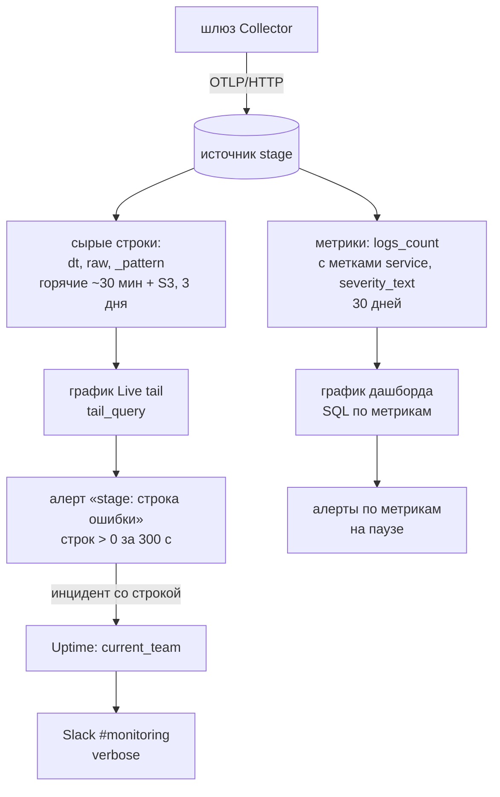

# Better Stack: источник, сырые логи, метрики и алерты

Разбор объясняет, что Better Stack делает с телеметрией, которую ему шлёт Collector stage: как она хранится, чем отличаются запросы по сырым логам и по метрикам, почему алерт на графике метрик не видит текста строки и как устроен алерт, который видит. Опора — работа с источником stage 23.10.2026 через MCP-сервер Better Stack (PER-630):

- запросы к источнику stage и их результаты: состав сервисов и уровней, шум `heartbeatAlarm`, события наблюдателя;
- созданные дашборды «Stage — наблюдение» и «Stage — строки ошибок», их графики и алерты;
- живой прогон: остановка Auction в 12:24:50 UTC, строка наблюдателя в 12:25:33, инциденты после неё;
- отказы MCP и API, по которым видны границы инструмента.

Как телеметрия попадает в источник — в [opentelemetry/collector.md](../opentelemetry/collector.md). Решение о бэкенде — [ADR-053](../../decisions/ADR-053-production-observability-otlp-better-stack.md). Правила stage — [stage.md](../../development/stage.md).

## Механика

### Источник: адрес приёма, токен и срок хранения

Источник — именованный приёмник телеметрии со своим адресом, токеном и сроком хранения. У проекта их два, `stage` и `prod`, оба платформы `open_telemetry`: они принимают OTLP по HTTP, и шлюз Collector шлёт каждой среде в её источник своим экспортёром. У источника stage логи и трейсы хранятся 3 дня, метрики — 30. Это видно в деталях источника (`source` в MCP).

Внутри Better Stack разделён на два продукта, и их стоит различать. **Telemetry** хранит логи, трейсы и метрики, считает запросы и графики, проверяет алерты. **Uptime** (он же Incidents) ведёт инциденты, дежурства, escalation policies и интеграции вроде Slack. Алерт живёт в Telemetry, а инцидент, который он открывает, — в Uptime. Ссылки на них ведут в разные адреса: `telemetry.betterstack.com/.../dashboards/...` и `incidents.betterstack.com/.../incidents/...`.

### Строка лога: `dt`, `raw` и `_pattern`

Каждая запись источника — строка ClickHouse. Полезных колонок три:

- `dt` — время записи;
- `raw` — вся запись OTLP одним JSON: тело, уровень, атрибуты, атрибуты ресурса;
- `_pattern` — хеш шаблона сообщения, из которого вычищены переменные части вроде чисел и идентификаторов.

Поле достаётся из `raw` функцией ClickHouse `JSONExtract`, вложенность — отдельными аргументами, тип — всегда `Nullable`, иначе запрос падает на записи без поля:

```sql
SELECT
  JSONExtract(raw, 'resource', 'attributes', 'service.name', 'Nullable(String)') AS service,
  JSONExtract(raw, 'level', 'Nullable(String)') AS level,
  count() AS rows
FROM {{source}}
WHERE dt >= {{start_time}} AND dt < {{end_time}}
GROUP BY service, level
```

`service.name` с точкой в имени — один аргумент, а не путь из трёх. Так запрос и показал состав stage за 6 часов: `identity DEBUG 11230`, `meetups Debug 4990`, `auction ERROR 21583`, `stage-watch ERROR 1`.

`_pattern` группирует похожие строки без регулярных выражений. Группировка по нему сразу показала, что 21 тысяча «ошибок» Auction — две строки `heartbeatAlarm` NATS-клиента, повторённые десять тысяч раз, а не тысячи разных отказов.

### Горячее и холодное хранение: шаблон `{{source}}`

Сырые строки лежат в двух местах. Свежие, примерно за последние 30 минут, — в горячей коллекции, которая читается функцией `remote(t604512_stage_logs)`. Остальные — в объектном хранилище, оно читается `s3Cluster(primary, t604512_stage_s3)` с фильтром `_row_type = 1`: там вперемешку лежат все типы строк. Запрос к одной `remote()` за 6 часов вернул бы только последние полчаса и выглядел бы как «данных мало».

Шаблон `FROM {{source}}` снимает эту заботу: сервер сам подставляет обе коллекции и нужный фильтр по указанному типу данных и окну времени. Все запросы этого разбора написаны шаблоном. Ручные `remote` и `s3Cluster` нужны, только когда шаблон не выражает запрос, например при чтении двух источников сразу.

### Метрики: заранее посчитанные счётчики с метками

Кроме сырых строк, источник ведёт коллекцию **метрик**. Это заранее агрегированные строки: сколько записей пришло за интервал и с какими метками. Для логов главный столбец — `logs_count`, а метки читаются функцией `label('…')`. Метки извлекаются автоматически, и их набор ограничен: `service`, `severity_text`, `span_name`, `http_status` и подобные. Текста записи среди них нет.

```sql
SELECT
  {{time}} AS time,
  label('service') AS series,
  sum(logs_count) AS "Ошибки"
FROM {{source}}
WHERE dt >= {{start_time}} AND dt < {{end_time}}
  AND logs_count > 0
  AND lower(label('severity_text')) IN ('error', 'fatal', 'critical', 'panic')
GROUP BY time, series
```

У метрик две формы столбцов. Счётчики строк по типу — `logs_count`, `spans_count` — обычные числа и складываются `sum`. Значения метрик приложений — `value_avg`, `value_sum` — состояния агрегатных функций ClickHouse и читаются парной функцией `-Merge`: `avgMerge(value_avg)`. Обычный `AVG` по состоянию — ошибка. Аналог из .NET — разница между готовым числом и частично посчитанным аккумулятором, который надо довести своим методом.

Уровень в метках — тот же текст, что написал процесс: `DEBUG`, `Debug`, `Information`, `warn`, `FATAL`. Числа уровня в метках нет, поэтому сравнение идёт по тексту без учёта регистра и со списком синонимов ([collector.md](../opentelemetry/collector.md#уровень-текст-и-число)).

### График дашборда читает метрики, а не строки

Главное ограничение: **график дашборда читает только коллекцию метрик**, какой бы тип источника ни стоял в `{{source}}`. `JSONExtract(raw, …)` в таком графике не работает — в коллекции метрик нет `raw`. Исключение одно — график Live tail (`tail_chart`): он читает сами строки.

Отсюда выбор, который пришлось сделать в PER-630. Алерт на графике метрик видит сервис и число строк, но не их текст. Шум `heartbeatAlarm` Auction в метриках неотличим от настоящей ошибки Auction: и то и другое — `service = auction`, `severity_text = ERROR`. Метрический алерт «больше 0 ошибок» горел бы непрерывно, а в инциденте нельзя показать причину и память из строки наблюдателя.

### Алерт на графике: окно, проверка и подтверждение

Алерт вешается на график и проверяет результат его запроса. У порогового алерта (`threshold`) несколько времён, и они отвечают на разные вопросы:

- `check_period` — как часто проверять: раз в 60 секунд;
- `aggregation_interval` — по данным за какой отрезок судить («on data from» в интерфейсе);
- `confirmation_period` — сколько условие должно держаться, прежде чем открыть инцидент;
- `recovery_period` — сколько условие должно отсутствовать, прежде чем инцидент закроется сам;
- `on_missing_data` — что делать без данных; у созданных алертов это `dont_fire`, и тишина — норма, а не сбой.

Серии выбираются `series_names` или `series_names_except`. `incident_per_series` открывает отдельный инцидент на каждую серию, а не один общий.

Живой прогон показал, как одиночное событие проходит мимо узкого окна. Первый алерт стоял с `aggregation_interval: 60`. Строка наблюдателя пришла в 12:25:33, точка в метриках появилась в минуте 12:25, а инцидента не было и через три минуты. После расширения окна до 300 секунд инцидент открылся почти сразу, с началом в 12:25. Объяснение — точка метрики доезжает с задержкой больше минуты и к проверке уже вне 60-секундного окна. Это гипотеза: задержку отдельно не замеряли. Проверь сам, когда будет чем: запиши одиночную строку `ERROR` и запрашивай метрику раз в 15 секунд, засекая, когда появится точка её минуты. Вывод для одиночных событий не зависит от причины: окно должно быть шире задержки доставки.

Ещё одно наблюдение того же прогона: включение `incident_per_series` на алерте с открытым инцидентом открыло второй инцидент по той же серии. Меняй этот флаг, пока инцидентов нет.

### Алерт Live tail: фильтр строк и текст в инциденте

График Live tail читает сырые строки, а запрос у него — не SQL, а фильтр на языке Live tail. В API это `query_type: tail_query` с условием в `where_condition`:

```text
level =~ /^(error|fatal|critical|panic)$/i AND fulltext !: "heartbeatAlarm" AND message !: "WARNING:"
```

- `=~` — совпадение с регулярным выражением, `/i` — без учёта регистра;
- `:` — «содержит», `!:` — «не содержит»;
- `fulltext` — особая колонка, поиск по всей строке целиком;
- условия соединяются `AND` и `OR`, скобки задают порядок.

Тот же отбор сначала проверен SQL-запросом по сырым строкам: за 6 часов осталось 5 настоящих строк — остановка Auction, `cloudflared не готов`, `FATAL` PostgreSQL, `store setup failed` Identity и пустая строка Auction на старте.

Алерт на таком графике считает совпавшие строки за `query_period` — здесь 300 секунд — и сравнивает с порогом. Открытый им инцидент несёт в метаданных «Surrounding logs» — сами строки. Инцидент живого прогона пришёл с текстом `auction: остановлен, реплик 0 (было 1), 23.10 15:25 мск`: сервис, событие и время — то, чего не мог дать метрический алерт.

### Инцидент, команда и Slack

Алерт с `escalation_target: current_team` отдаёт инцидент дежурству команды. Escalation policy у проекта нет ни одной: доставку делает Slack-интеграция `#monitoring` в режиме «Single channel (verbose)» с включённым «Notify alongside the primary responder». В этом режиме, судя по настройкам, в канал идёт каждый инцидент команды. То, что сообщения действительно появились в канале, этим разбором не проверено: канал Slack через MCP не читается. Проверь сам: открой `#monitoring` и найди сообщения от 23.10 около 12:27 UTC с именами алертов.

### Что умеет MCP-сервер, а чего нет

MCP-сервер Better Stack покрывает почти всё: запросы, источники, дашборды, графики, алерты, инциденты, Slack-интеграции. Две границы встретились в работе:

- **`tail_chart` напрямую не создаётся**: в типах `add_chart_to_dashboard` его нет. Обход — `import_dashboard` с JSON дашборда, где у графика `chart_type: tail_chart` и запрос `tail_query`. Импорт создаёт новый дашборд, поэтому «Stage — строки ошибок» — отдельный дашборд, а не график на «Stage — наблюдение».
- **Escalation policy не создаётся**: инструменты только читают их. Новую policy заводит человек в интерфейсе Uptime.

Отказ импорта сам называет правило: `Query type must be log filtering for live tail charts`, а для неизвестного типа — `Query type is not included in the list`.

## Урок

- **Сначала посмотри на данные, потом ставь порог.** Порог «больше 0 ошибок Auction» выглядел очевидным. Один запрос по `_pattern` показал, что такой алерт горел бы без перерыва. Шум, который никто не видит, ломает первый же алерт.
- **Агрегат теряет то, ради чего алерт нужен.** Метрика отвечает «сколько», а человеку ночью нужно «что». Алерт, по которому действуют, должен нести текст события. Счётчик годится для обзора и всплесков.
- **Окно проверки шире задержки доставки.** Одиночное событие в узком окне пропускается молча. Это общее правило любой системы алертов поверх конвейера с задержкой: Prometheus с `for:`, Grafana, Datadog.
- **Шум лечится у источника, а не фильтром навсегда.** Исключение `heartbeatAlarm` в фильтре алерта — временная мера с записанным сроком жизни ([PER-697](https://linear.app/anticnvm/issue/per-697)): иначе фильтр однажды скроет настоящую ошибку с тем же словом.

## Почему так, а не иначе

- **Метрический алерт без Auction плюс порог всплеска Auction.** Был первым вариантом и работал: инцидент живого прогона пришёл с него. Но в нём нет текста строки, а одиночная ошибка Auction за шумом не видна. Оставлен на паузе как обзорный график.
- **Свой наблюдатель шлёт вести в Telegram вызовом Bot API.** Без Better Stack и задержки его метрик. Но тогда два канала тревог, свой код доставки и второй секрет на хосте, а ошибки сервисов в логах всё равно видит только Better Stack. Владелец выбрал алерты Better Stack в Slack (дополнение ADR-053 от 2026-10-15).
- **Обнаружение аномалий (`anomaly_rrcf`) вместо порога.** Справилось бы с постоянным фоном Auction само. Но модели нужно время на обучение — по умолчанию неделя данных, — а неделя теста короче. И аномалия — не ответ на вопрос «упал ли сервис».
- **Отбросить шум уже в Collector'е.** Источник стал бы чище, а квота — свободнее. Но правка конвейера прятала бы неисправность потребителя Auction от всех, а не только от алерта.

## Схема



## Первоисточники

- [Better Stack: Alerts](https://betterstack.com/docs/logs/dashboards/alerts/) — типы алертов, подтверждение и восстановление, инцидент на серию, поведение без данных.
- [Better Stack: Live tail query language](https://betterstack.com/docs/logs/using-logtail/live-tail-query-language/) — операторы `:`, `!:`, `=~`, колонка `fulltext`, соединение условий.
- [Better Stack: Create a chart (API)](https://betterstack.com/docs/logs/api/charts/create/) — типы запросов `sql_expression`, `tail_query`, `static_text` и `where_condition` у `tail_query`.
- [Better Stack: How to write a dashboard JSON](https://betterstack.com/docs/logs/dashboards/json/) — формат, который принимает `import_dashboard`.
- [Better Stack: Create a dashboard alert (API)](https://betterstack.com/docs/logs/api/dashboard-alerts/create/) — поля алерта, которые видны в MCP.
- [Better Stack: Slack integration](https://betterstack.com/docs/uptime/slack/) — режимы канала и escalation policy с шагом Slack.
- [Better Stack: MCP server](https://betterstack.com/docs/getting-started/integrations/mcp/) — какие инструменты отдаёт сервер и как ограничить их набор.
- [ClickHouse: JSONExtract](https://clickhouse.com/docs/sql-reference/functions/json-functions#jsonextract) и [-Merge combinator](https://clickhouse.com/docs/sql-reference/aggregate-functions/combinators#-merge) — функции, на которых стоят запросы по `raw` и по состояниям метрик.

## Проверь себя

Запросы — инструментом `query` MCP-сервера к источнику stage (id 2789034).

1. **Кто шлёт логи в stage и с какими уровнями?** Запрос по `raw` с группировкой по `service.name` и `level` за 6 часов. 23.10 это 7 сервисов: `auction`, `hub-bot`, `identity`, `meetups`, `notifications`, `postgres`, `stage-watch`.
2. **Почему у Auction тысячи ошибок?** Группировка ошибок Auction по `_pattern`: верхние два шаблона содержат `heartbeatAlarm`, `log.iostream = stderr`, `logger_name` пустой.
3. **Видит ли график дашборда поле из `raw`?** По справке `add_chart_to_dashboard` и `metrics_query_help` — нет: в коллекции метрик нет `raw`. Сам такой график в PER-630 не создавался. Проверь сам: добавь на тестовый дашборд график с `JSONExtract(raw, 'level', 'Nullable(String)')` и посмотри на ошибку.
4. **Чем запрос по метрикам отличается от запроса по строкам при равных условиях?** Один и тот же отбор ошибок по сервисам за 6 часов: в метриках `auction ERROR 21475`, в строках `21583` — окна сдвинуты на минуту. Числа сходятся с точностью до границ окна, но у метрик нет текста.
5. **Что попадает в инцидент алерта Live tail?** `incident` по id инцидента такого алерта — поле «Surrounding logs» со строкой. 23.10: `auction: остановлен, реплик 0 (было 1), 23.10 15:25 мск`.
6. **Найдётся ли одиночное событие в окне 60 секунд?** Не проверено отдельно (см. «Алерт на графике»). Повтори опыт с одной строкой `ERROR` и двумя алертами с `aggregation_interval` 60 и 300.
