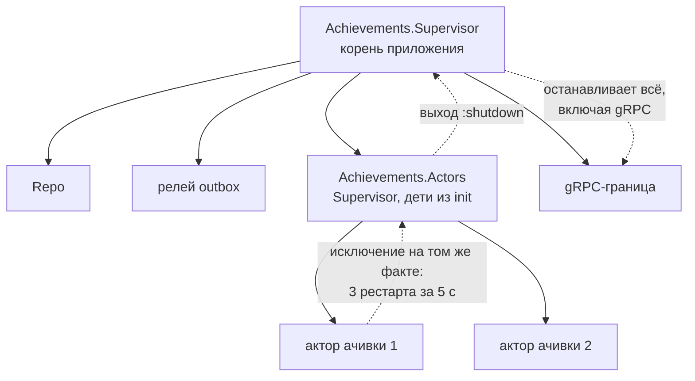

# OTP: процессы, супервизоры и цена падения

Achievements написан на Elixir поверх OTP — библиотеки и соглашений Erlang для долгоживущих систем. Файл объясняет три механизма, на которых держится актор ачивки: что такое процесс и супервизор, когда «пусть падает» гасит весь узел, почему супервизор с детьми из `init` надёжнее пустого `DynamicSupervisor`, и как метаданные лога живут внутри процесса. Опора — код `apps/achievements/lib/achievements/` и вывод эксперимента на Elixir 1.20.4 / OTP 28 в образе `hexpm/elixir` из `apps/achievements/Containerfile`.

## Механика

### Процесс — не поток, супервизор — не try/catch

Процесс BEAM — лёгкая единица исполнения со своей кучей и почтовым ящиком; общей памяти у процессов нет, общаются они сообщениями. Ближе всего в .NET — актор Orleans или `Channel` с одним читателем, а не `Thread`: процесс стоит килобайты, и их тысячи. `GenServer` — процесс с циклом «получить сообщение — обработать — ждать следующее»; актор ачивки — `GenServer`, и его цикл выборки — это сообщения самому себе:

```elixir
def handle_info(:connect, state), do: connect(state)
def handle_info(:pull, state), do: pull(state)
```

Процесс, в котором случилось исключение, умирает. Ловить исключения «на всякий случай» в Elixir не принято: за процессом следит **супервизор** и перезапускает его по своей стратегии. `:one_for_one` перезапускает только упавшего ребёнка. Отсюда «let it crash»: процесс не лечит сбой сам, а возвращается в известное начальное состояние рестартом.

### Интенсивность рестартов: когда «пусть падает» гасит узел

Рестарт лечит сбой, который рестартом и лечится: оборванное соединение, гонку, переполнение. У супервизора есть предохранитель: больше `max_restarts` рестартов за `max_seconds` — и он сам завершается, передавая сбой своему супервизору. Умолчания проверены экспериментом:

```
1 default flags: %{intensity: 3, period: 5}
1 supervisor exited after ms: {:shutdown, 13}
```

Ребёнок, который падает на каждом старте, исчерпал три рестарта за 13 миллисекунд, и супервизор вышел с `:shutdown`. Дальше то же повторяется уровнем выше: супервизор акторов Achievements — ребёнок `Achievements.Supervisor`, а тот — корень приложения. Его выход останавливает приложение, вместе с gRPC-границей.

Поэтому сбой, который **повторится на том же входе**, рестартом не лечится, а размножается. Актор читает стрим по одному сообщению и после рестарта получает то же сообщение. Если правило ачивки бросает исключение на этом факте, каскад рестартов погасил бы весь узел. Такой отказ реестр возвращает значением, а не падением:

```elixir
defp evaluate(rule, fact, states) do
  {recipients, states} = rule.evaluate(fact, states)
  ...
rescue
  error -> {:error, Exception.message(error)}
end
```

Актор пишет отказ записью, повторяет то же сообщение с задержкой и живёт. Ачивка стоит до поставки с исправлением, соседние читают дальше. Широкий `rescue` здесь стоит вокруг чистой функции правила, а не вокруг базы: отказ базы ловится отдельно, своим видом, и записывается другой категорией.

### Дети из `init` против пустого `DynamicSupervisor`

`DynamicSupervisor` заводится пустым, и детей ему добавляют вызовом `start_child/2` извне. `Supervisor` называет детей в своём `init/1`. Разница видна, когда рестартуют сам супервизор:

```
2 children before: 1
2 restarted?, children after: {true, 0}
2b restarted?, children after: {true, 1}
```

`DynamicSupervisor`, убитый и перезапущенный родителем, вернулся пустым. Тот, кто добавлял детей, о рестарте не узнал. `Supervisor`, чей `init` строит список, вернул своего ребёнка: `init` выполняется на каждом старте. Поэтому супервизор акторов строит детей сам — загружает каталог поставки и возвращает по актору на ачивку:

```elixir
def init(opts) do
  Catalog.load!(Definitions.all())
  ...
  Supervisor.init(children, strategy: :one_for_one)
end
```

Аналог в .NET — разница между `IHostedService`, который регистрирует фоновые задачи в `StartAsync`, и списком задач, который кто-то однажды добавил в контейнер вручную: перезапуск хоста первые восстанавливает, вторые теряет.

### Метаданные `Logger` — состояние процесса

`Logger.metadata/1` кладёт поля в словарь текущего процесса, и каждая следующая запись этого процесса их несёт. В другом процессе их нет:

```
3 here vs another process: {[caller: "hub-bot"], []}
```

gRPC-сервер обрабатывает вызов в одном процессе, и цепочка интерцепторов идёт в нём же. Поэтому проверка вызывающего не пишет свою запись, а кладёт поля, и их подхватывает запись границы, стоящей снаружи цепочки:

```elixir
Logger.metadata([caller_refusal: Atom.to_string(refusal)] ++ caller_field(caller))
raise GRPC.RPCError, status: :unauthenticated, message: message(refusal)
```

У записи об отказе один автор, а поля приходят из того места, которое знает причину. В .NET это похоже на `ILogger.BeginScope`, но scope живёт до `Dispose`, а метаданные — до конца процесса или до явной перезаписи. В процессе, который обрабатывает много вызовов подряд, их пришлось бы снимать. Что поля доходят до записи границы, доказывает L1 `ServerIntegrationTest`: в захваченном логе отказа есть `caller_refusal=missing_token`. Что процесс адаптера `grpc_server` не переживает вызов и чужие поля не протекают в следующий, я не проверял. Проверь сам: два вызова по одному каналу, напечатай `self()` в обработчике и сравни.

## Урок

- Падение — инструмент для сбоя, который рестарт лечит. Сбой, который повторится на том же входе — битые данные, дефект кода, — в цикле «прочитал — упал — перезапустился — прочитал» размножается до каскада. Такой вход нужно либо пропустить записью, либо держать с задержкой, но не падать.
- Состав детей, который можно вычислить при старте, вычисляется в `init` супервизора: тогда его рестарт восстанавливает систему целиком. Внешний шаг, который однажды заводит детей, переживает рестарт супервизора только по случайности.
- Контекст записи лога можно передать без прокидывания аргументов, если граница и место знания причины живут в одном процессе. В долгоживущем процессе с чужими вызовами поля нужно снимать, иначе они протекут в следующую запись.

## Почему так, а не иначе

- **Пусть актор падает на дефекте правила.** Цена: каскад за миллисекунды — эксперимент выше — и остановка узла вместе с чтениями ботов. Отвергнуто.
- **Пропустить факт с дефектом правила, сдвинув позицию.** Цена: выдача, положенная по этому факту, теряется навсегда, а исправленное правило его уже не увидит. Битое тело так и пропускается: его не исправит никакая поставка. Дефект правила исправит, поэтому факт ждёт.
- **Поднять `max_restarts` супервизора.** Цена: каскад откладывается, а не исчезает, и узел крутит рестарты вместо работы.
- **`DynamicSupervisor` с отдельным стартером.** Цена: рестарт супервизора оставил бы узел живым, но без единого актора, и снаружи это выглядело бы как тихий стрим. Отвергнуто после того, как тест рестарта показал проблему.
- **Отдельная запись об отказе в интерцепторе проверки вызывающего.** Цена: две записи на один отказ — интерцептора и границы. Норматив требует одного автора.

## Схема



## Первоисточники

- [Supervisor](https://hexdocs.pm/elixir/Supervisor.html) — стратегии, `max_restarts` и `max_seconds`, `init/1`; зачем идти: определение интенсивности рестартов, на котором держится каскад.
- [DynamicSupervisor](https://hexdocs.pm/elixir/DynamicSupervisor.html) — дети, добавленные `start_child/2`; зачем идти: чем он отличается от `Supervisor` и почему рестартует пустым.
- [Logger.metadata/1](https://hexdocs.pm/logger/Logger.html#metadata/1) — метаданные процесса; зачем идти: область видимости полей записи.
- [OTP Design Principles: Supervision Principles](https://www.erlang.org/doc/system/sup_princ.html) — интенсивность рестартов и эскалация на уровень выше; зачем идти: первоисточник поведения, которое `Supervisor` Elixir наследует.
- [Норматив Elixir](../../standards/languages/elixir.md), разделы «Процессы и супервизия» и «Потребитель стрима и транзакция на факт»; зачем идти: какие из этих механизмов в репозитории обязательны — разбор их объясняет, а не задаёт.

## Проверь себя

Команды идут в образе `hexpm/elixir` той же версии, что в `apps/achievements/.tool-versions`, или на машине с этими версиями.

1. **Через сколько рестартов `Supervisor` со стратегией `:one_for_one` и умолчаниями сдаётся и с каким исходом?** Ответ: больше трёх за пять секунд, выход `:shutdown`. Проверка: `elixir -e '{:ok, s} = Supervisor.init([], strategy: :one_for_one); IO.inspect(elem(s, 0))'` печатает `intensity: 3, period: 5`.
2. **Сколько детей будет у `DynamicSupervisor` после того, как его убили и родитель его перезапустил?** Ответ: ноль. Проверка: `DynamicSupervisor.count_children/1` до и после `Process.exit(pid, :kill)` у супервизора под родителем.
3. **Что случится с узлом Achievements, если правило ачивки бросает исключение на факте?** Ответ: узел живёт, ачивка стоит на этом факте, соседние ачивки выдаются. Проверка: `ACHIEVEMENTS_INTEGRATION_TESTS=1 mix test test/integration/actor_test.exs` в `apps/achievements`, тест «a defective rule holds only its own achievement and grants once it is fixed».
4. **Видит ли процесс, запущенный `Task.async`, метаданные `Logger` процесса, который его запустил?** Ответ: нет. Проверка: `elixir -e 'Logger.metadata(a: 1); IO.inspect(Task.await(Task.async(&Logger.metadata/0)))'` печатает `[]`.
