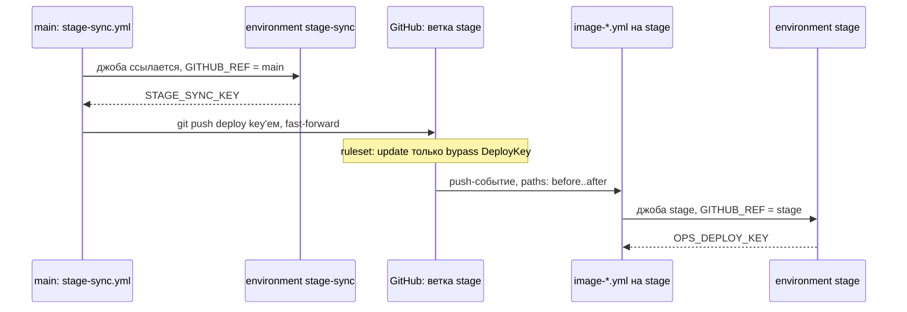

# GitHub Actions: что запускает workflow и кому достаётся ключ

Разбор объясняет, как ночной перенос `develop` → `stage` запускает публикации образов и почему ключ для него выдаётся только одной ветке. Опора:

- дифф [PR #460](https://github.com/Solguficky/solguficky-hub/pull/460): новый `.github/workflows/stage-sync.yml` и переключение `image-*.yml` и `chart-publish.yml` с push в `develop` на push в `stage`;
- настройки репозитория, созданные в той же сессии и прочитанные обратно через `gh api`: ruleset `stage`, environment `stage-sync`, deploy key `stage-sync (CI, write)`;
- дифф [PR #541](https://github.com/Solguficky/solguficky-hub/pull/541): `stage-bump.yml` переименован в `ops-bump.yml`, и среда выбирается выражением от ветки; environment `prod` и ключ `solguficky-prod-bump`, прочитанные обратно через `gh api` и `gh repo deploy-key list`;
- документация GitHub, сверенная при записи. Цитаты ниже дословные.

Решение — дополнение [ADR-055](../../decisions/ADR-055-k3s-runtime-from-aspire-chart.md) от 2026-10-18. Как устроены reusable workflow, выходы джоб и секреты environment, разобрано в [reusable-workflows.md](reusable-workflows.md), здесь это не повторяется.

## Механика

### Push под `GITHUB_TOKEN` не запускает другие workflow

Каждая джоба получает временный токен `GITHUB_TOKEN`. Кажется естественным пушить им: `actions/checkout`, затем `git push`. Но у GitHub на это правило:

> events triggered by the `GITHUB_TOKEN` will not create a new workflow run

Так GitHub защищается от бесконечных циклов: workflow на push пушит, и push снова запускает тот же workflow. Для этого репозитория следствие прямое: перенос `stage` под `GITHUB_TOKEN` сдвинул бы ветку, но `image-*.yml` с `on: push: branches: [stage]` не стартовали бы, и до stage ничего бы не доехало. Причём молча: зелёная джоба синхронизации и ни одной публикации.

Исключения документация называет сама: «`workflow_dispatch` and `repository_dispatch` events always create workflow runs». Поэтому `gh workflow run` из джобы под `GITHUB_TOKEN` работает, а `git push` — нет.

`stage-sync.yml` пушит не токеном, а SSH-ключом:

```yaml
export GIT_SSH_COMMAND="ssh -i $key_file -o IdentitiesOnly=yes -o StrictHostKeyChecking=yes -o UserKnownHostsFile=$RUNNER_TEMP/known_hosts"
...
git push --quiet origin "$develop:refs/heads/stage"
```

Ключ — deploy key этого репозитория с правом записи. Push им GitHub считает обычным push'ем, и workflow на нём запускаются. Документация называет как замену токену GitHub App и personal access token. Deploy key она здесь не упоминает: то, что push им запускает workflow, подтвердит только первый живой прогон (см. «Проверь себя»).

Аналогия из .NET: событие, которое обработчик поднимает сам себе, и флаг «не реагировать на собственные изменения». Отличие в том, что флаг здесь не выключается: обойти его можно только другой учёткой.

### `schedule` и `workflow_dispatch` живут на default branch

Расписание в `stage-sync.yml`:

```yaml
on:
  schedule:
    - cron: '7 0 * * *'
  workflow_dispatch:
```

Документация событий:

> Scheduled workflows run on the latest commit on the default branch.

и для ручного запуска:

> This event will only trigger a workflow run if the workflow file exists on the default branch.

Default branch этого репозитория — `main`, а разработка идёт в `develop`. Поэтому файл, слитый в `develop`, по расписанию не срабатывает и вручную не запускается, пока не попадёт в `main` релизом. Тот же механизм уже встречался: `workflow_run` тоже требует файл на default branch ([reusable-workflows.md](reusable-workflows.md), «Почему так, а не иначе»). Это общее правило для событий, которые не привязаны к конкретному коммиту ветки.

Ещё три свойства расписания:

- cron задаётся в UTC: `7 0 * * *` — это 03:07 по Москве;
- «The `schedule` event can be delayed during periods of high loads», поэтому минута взята не нулевой: на начало часа приходится больше всего расписаний;
- «In a public repository, scheduled workflows are automatically disabled when no repository activity has occurred in 60 days». Репозиторий публичный: месяц без коммитов — и ночной перенос выключится сам.

### Фильтр `paths` на push сравнивает «до» и «после» push

Публикации пересобирают только то, что изменилось:

```yaml
on:
  push:
    branches: [stage]
    paths:
      - 'apps/identity/**'
```

Для push в существующую ветку документация говорит: «A two-dot diff compares the head and base SHAs directly with each other». Сравниваются состояние ветки до push и после него, а не последний коммит. Ночной перенос сдвигает `stage` сразу на все мержи за сутки, поэтому `image-identity.yml` стартует, если Identity задел хотя бы один из них, и не стартует, если не задел ни один.

Два следствия:

- **Первый перенос после PR #460 опубликует всё.** Он меняет сами `image-*.yml` и `chart-publish.yml`, а они перечислены в своих же `paths`.
- **У ветки, созданной push'ем, база другая**: «A two-dot diff against the parent of the ancestor of the deepest commit pushed». Ветку `stage` создали на коммите, в котором workflow ещё слушали `develop`, поэтому её рождение ничего не запустило: GitHub берёт workflow из пушнутого коммита, а не с default branch.

Лимиты: больше 1 000 коммитов в push — workflow запускается всегда; больше 3 000 изменённых файлов, и нужные среди первых 3 000 не нашлись — не запускается.

### Branch policy environment — замок на секрет

Environment в настройках репозитория отвечает на вопрос «каким джобам отдать секреты». Секрет environment джоба видит, только если ссылается на него: «Secrets stored in an environment are only available to workflow jobs that reference the environment». А branch policy решает, какие ветки вообще могут на него сослаться: «Only branches and tags that match your specified name patterns can deploy to the environment». Проверяется `GITHUB_REF` запуска.

В репозитории два environment с двумя ключами, и у каждого своя ветка:

| Environment | Секрет | Допущенная ветка | Почему эта |
|---|---|---|---|
| `stage-sync` | `STAGE_SYNC_KEY` | `main` | `schedule` и `workflow_dispatch` идут с default branch |
| `stage` | `OPS_DEPLOY_KEY` | `stage` | публикации идут на push в `stage` |

Ссылку делает строка `environment: stage-sync` на джобе. Без branch policy любой, кто может запустить workflow, запустил бы его со своей ветки со своим скриптом и получил бы ключ записи. С policy ключ получает только код, прошедший ревью и релиз в `main`.

`stage-sync.yml` дублирует замок условием на джобе:

```yaml
    if: ${{ github.ref == 'refs/heads/main' }}
```

Без условия ручной запуск с другой ветки упал бы на отказе environment. С ним он пропускается без красной джобы.

### Одно имя секрета, две среды: environment выражением

Прод собирается с `main`, stage — с ветки `stage`, а запись в ops у них одна: `ops-bump.yml` ([PR #541](https://github.com/Solguficky/solguficky-hub/pull/541), дополнение ADR-055 от 2026-10-22). Среду джоба выбирает сама:

```yaml
    environment: ${{ github.ref == 'refs/heads/main' && 'prod' || 'stage' }}
    steps:
      - env:
          OPS_DEPLOY_KEY: ${{ secrets.OPS_DEPLOY_KEY }}
```

Два свойства делают это возможным.

- **Имя environment может быть выражением.** Синтаксис workflow: «The value of `name` can be an expression», из контекстов доступны `github`, `inputs`, `vars`, `needs`, `strategy` и `matrix`. Контекстов `env` и `steps` там нет: среда выбирается до старта джобы, и выбрать её по результату шага нельзя.
- **Секрет ищется в environment джобы.** В `stage` и в `prod` лежит секрет с одним именем `OPS_DEPLOY_KEY`, но значения у них разные. Строка `secrets.OPS_DEPLOY_KEY` одна, а ключ приходит тот, что лежит в выбранной среде. Код джобы не знает, каким ключом пишет, и не может перепутать среды.

Тернарного оператора в выражениях GitHub нет, и `a && 'prod' || 'stage'` его заменяет: `&&` возвращает второй операнд при истинном первом, `||` — первый истинный. Приём работает, пока среднее значение истинно. Непустая строка `'prod'` истинна, а пустая строка или `0` на её месте молча выдали бы `'stage'`.

Замок остаётся прежним: выражение лишь называет среду, а пустит ли она, решает branch policy. Ручной запуск `ops-bump` с чужой ветки получит имя `stage`, и environment `stage` его отвергнет. Ключ прода выражением не достать: имя `prod` выходит только при `GITHUB_REF = refs/heads/main`, и только этой ветке его отдаёт policy.

Аналогия из .NET: `IOptionsSnapshot<T>` с именованными опциями, где код просит «ключ записи», а какой экземпляр придёт, решает конфигурация среды. Отличие в том, что здесь выбор ещё и проверяется: среда может отказать запросившему.

### Ключ на среду: как заводится и чего не закрывает

Deploy key — SSH-ключ одного репозитория ([autodeploy.md](../self-hosting/autodeploy.md), «Deploy key: ключ на один репозиторий»). У ops их теперь три (`gh repo deploy-key list -R Solguficky/solguficky-ops`):

| Заголовок | Право | Где закрытая часть |
|---|---|---|
| `solguficky-stage-autodeploy` | read-only | на хосте, таймер выкладки stage |
| `solguficky-stage-bump` | read-write | секрет `OPS_DEPLOY_KEY` environment `stage` |
| `solguficky-prod-bump` | read-write | секрет `OPS_DEPLOY_KEY` environment `prod` |

Ключ записи для прода заводят так (README ops, «Ключ записи CI для прода»):

```bash
key=$(mktemp -u) && ssh-keygen -q -t ed25519 -N '' -C solguficky-prod-bump -f "$key"
gh repo deploy-key add "$key.pub" -R Solguficky/solguficky-ops -t solguficky-prod-bump --allow-write
gh secret set OPS_DEPLOY_KEY --env prod -R Solguficky/solguficky-hub < "$key"
rm -f "$key" "$key.pub"
```

Здесь важна каждая деталь:

- `mktemp -u` печатает свободное имя, но файл не создаёт. На существующий файл `ssh-keygen` спросил бы «Overwrite (y/n)?», а без `-u` файл уже существовал бы. Проверено: имя напечатано, `[ -e ]` ложно.
- `-N ''` создаёт ключ без пароля. Его читает джоба без человека, и вводить пароль там некому. Защиту ключа без пароля держат environment и branch policy, а не шифрование файла.
- `gh secret set` без `--body` читает значение со стандартного ввода («reads from standard input if not specified»). Ключ поэтому не попадает ни в историю оболочки, ни в список процессов, как попал бы аргументом.
- `rm` в конце оставляет закрытую часть только в секрете. Из секрета GitHub её уже не прочитать, поэтому потерянный ключ не восстанавливают, а выпускают новый той же командой.

Отдельный ключ на среду стоит одной строки в списке и даёт независимый отзыв: если удалить `solguficky-prod-bump`, запись stage продолжит работать.

Чего он не закрывает: deploy key нельзя сузить ни до ветки, ни до каталога. Документация говорит прямо: «Deploy keys with write access can perform the same actions as an organization member with admin access», а сужения по веткам и путям на странице нет. Ключ прода технически может переписать `envs/stage/` и любую ветку ops. Раздельность сред держится на коде `ops-bump.yml`, который выбирает каталог по той же ветке, что и environment, и на ревью этого файла. Сам ключ её не держит. Это та же граница, что у bypass `DeployKey` в ruleset ниже: правило про deploy key'и действует на все ключи репозитория сразу.

### Ruleset: ветка, которую двигает только бот

Ruleset — набор правил на ветки по шаблону имени. У `stage` три правила (`gh api repos/Solguficky/solguficky-hub/rulesets/25353447`):

```json
"rules": ["deletion", "non_fast_forward", "update"],
"bypass": [{"actor_id": null, "actor_type": "DeployKey", "bypass_mode": "always"},
           {"actor_id": 5, "actor_type": "RepositoryRole", "bypass_mode": "always"}]
```

- `update` — «Only allow users with bypass permission to update matching refs»: двигать ветку может только тот, кто в списке bypass;
- `non_fast_forward` — «Prevent users with push access from force pushing to refs»;
- `deletion` — удалить ветку может тоже только bypass.

Bypass `DeployKey` идёт с `actor_id: null`: так его требует REST API, и это значит «все deploy key'и репозитория», а не один конкретный. Пока deploy key один, это то же самое. Второй ключ с правом записи получит тот же обход. `RepositoryRole` с id 5 — роль администратора, это ручной вход на случай поломки.

Похоже на protected branch в Azure DevOps с исключением для build service. Отличие: исключение выдаётся типу учётки, а не конкретной.

## Урок

- **Учётка, которой workflow пушит, решает, будет ли продолжение.** Цепочка «workflow пушит → следующий workflow стартует» под `GITHUB_TOKEN` рвётся молча. Где нужна цепочка, нужна другая учётка или явный `workflow_dispatch`.
- **Событие без коммита ветки читается с default branch.** `schedule`, `workflow_dispatch` и `workflow_run` смотрят на `main`, а не на `develop`. В gitflow такие workflow заработают только после релиза. Это закладывается в план выкладки, а не обнаруживается после мержа.
- **Ключ привязывают к ветке, а не к файлу workflow.** Файл workflow может переписать любой, у кого есть ветка. Ветку, с которой выдаётся ключ, — только тот, кто мержит в неё. Поэтому секрет кладут в environment с branch policy, а не в секреты репозитория.
- **Среда выбирается именем, а ключ подставляется по нему.** Одно имя секрета в нескольких environment и имя среды выражением от ветки дают общий код записи без ветвления по средам. Перепутать ключи такой код не может, потому что ключа он не выбирает. Перенос на любой стек: код просит роль, конкретную учётку подставляет окружение.
- **Ключ узок по репозиторию, но не внутри него.** Deploy key с записью — администратор одного репозитория. Если среды делят репозиторий, их раздельность держит код, который пишет, а не ключ. Нужна граница внутри репозитория — нужен другой механизм: отдельный репозиторий на среду или GitHub App.

## Почему так, а не иначе

- **Перенос под `GITHUB_TOKEN` и `gh workflow run` каждой публикации.** Не нужен ключ. Отвергнут: ручной запуск не применяет фильтр `paths`, и каждую ночь каждый сервис пересобирался бы и перезапускался с новым digest.
- **GitHub App вместо deploy key.** Токен App тоже запускает workflow, и его можно сузить до одного репозитория и прав `contents: write`. Отвергнут ценой настройки: регистрация App, установка, два секрета и шаг выпуска токена. Deploy key — одна пара SSH-ключей, по образцу `OPS_DEPLOY_KEY`.
- **Personal access token.** Действует от имени человека: уходит человек — ломается CI, а права токена шире одного репозитория.
- **Один ключ записи на обе среды.** Завести только один секрет. Отвергнут: ключ stage пришлось бы отдать и ветке `main`, а отозвать одну среду без другой стало бы нельзя.
- **Разные имена секретов (`OPS_DEPLOY_KEY_STAGE`, `OPS_DEPLOY_KEY_PROD`) и выбор в коде.** Явнее при чтении. Отвергнут: выражение выбора имени повторилось бы и в вызывающих workflow, которые передают секрет по имени ([reusable-workflows.md](reusable-workflows.md)), а ошибка в нём отдала бы чужой ключ, если бы оба секрета были видны джобе.
- **Отдельный ops-репозиторий для прода.** Только так ключ прода физически не достанет до stage. Отвергнут ценой: второй репозиторий, вторая копия `stage/` и `bin/` и их синхронизация ради угрозы, которую уже закрывают branch policy и ревью `ops-bump.yml`.
- **Секрет репозитория вместо environment.** Короче. Отвергнут: секрет репозитория видит джоба с любой ветки, и ключ записи получил бы код из любого PR, который запускает workflow.

## Схема



## Первоисточники

- [GITHUB_TOKEN](https://docs.github.com/en/actions/concepts/security/github_token) — правило «will not create a new workflow run» и исключения `workflow_dispatch` и `repository_dispatch`.
- [Events that trigger workflows](https://docs.github.com/en/actions/writing-workflows/choosing-when-your-workflow-runs/events-that-trigger-workflows) — `schedule` на default branch, задержки и отключение через 60 дней, `workflow_dispatch` только с файлом на default branch.
- [Workflow syntax](https://docs.github.com/en/actions/reference/workflows-and-actions/workflow-syntax) — как `paths` сравнивает коммиты push'а, база новой ветки и лимиты 1 000 коммитов и 3 000 файлов.
- [Deployments and environments](https://docs.github.com/en/actions/reference/workflows-and-actions/deployments-and-environments) — branch policy и доступ джобы к секретам environment.
- [REST API: repository rules](https://docs.github.com/en/rest/repos/rules) — правила `deletion`, `non_fast_forward`, `update` и `actor_type: DeployKey` с `actor_id: null`.
- [Managing deploy keys](https://docs.github.com/en/authentication/connecting-to-github-with-ssh/managing-deploy-keys) — что такое deploy key и право записи, фраза о правах администратора у ключа с записью.
- [Workflow syntax: `jobs.<job_id>.environment`](https://docs.github.com/en/actions/reference/workflows-and-actions/workflow-syntax#jobsjob_idenvironment) — имя среды выражением и список доступных контекстов.
- [Evaluate expressions](https://docs.github.com/en/actions/reference/workflows-and-actions/expressions) — операторы `&&` и `||` и замена тернарного оператора.
- `gh secret set --help` — значение со стандартного ввода без `--body`, флаг `--env`.

## Проверь себя

Ночного прогона ещё не было: `stage-sync.yml` ждёт релиза в `main`. Вопросы 1 и 4 до него проверяются только чтением.

1. **Запустит ли push deploy key'ем публикации?** Должен: документация запрещает это только `GITHUB_TOKEN`. Проверь сам после первого ночного прогона: `gh run list --branch stage --event push` показывает публикации с тем же коммитом, что `gh run list --workflow stage-sync.yml`.
2. **Почему создание ветки `stage` ничего не опубликовало?** В пушнутом коммите workflow слушали `develop`. Проверь: `gh run list --branch stage` до первого переноса пуст.
3. **Кому достанется `STAGE_SYNC_KEY`?** Только джобе с `GITHUB_REF = refs/heads/main`. Проверь: `gh api repos/Solguficky/solguficky-hub/environments/stage-sync/deployment-branch-policies --jq '.branch_policies[].name'` печатает одну строку `main`.
4. **Что будет, если закоммитить прямо в `stage`?** Ruleset пустит только администратора, а следующий перенос упадёт с «fast-forward невозможен». Проверь сам, когда будет чем: лог джобы `stage-sync` после такого коммита.
5. **Какой ветке environment `prod` отдаст `OPS_DEPLOY_KEY`?** Только `main`. Проверь: `gh api repos/Solguficky/solguficky-hub/environments/prod/deployment-branch-policies --jq '.branch_policies[].name'` печатает одну строку `main`, а для `stage` — `stage`.
6. **Сколько ключей записи у ops и можно ли отозвать прод отдельно?** Два, у каждой среды свой. Проверь: `gh repo deploy-key list -R Solguficky/solguficky-ops` показывает `solguficky-stage-bump` и `solguficky-prod-bump` с `read-write`.
7. **Каким ключом пишет джоба `ops` после мержа в `main`?** Ключом прода, в `envs/prod/`. Прогона с `main` ещё не было. Проверь сам после первого мержа `develop → main`: в логе джобы `ops` строки `ops-bump prod:`, а в ops — коммит `chore: Pin … for prod from hub …` (`git -C ~/solguficky-ops log --oneline -3 origin/main`).
