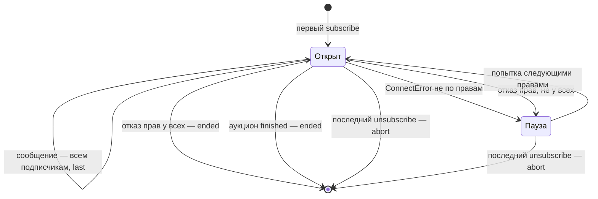

# Клиент server-streaming gRPC

Как бот читает поток `WatchAuction` у Auction: один вызов, много ответов, без конца по расписанию. Код — `apps/hub-bot/src/core/auction/watch.ts`, клиент — Connect-ES 2.1.2 поверх HTTP/2 (`@connectrpc/connect-node`). Унарный вызов и статус-коды разобраны в [unary-server.md](unary-server.md), серверная сторона того же потока на Pekko — в [scala/pekko-http-boundary.md](../scala/pekko-http-boundary.md).

## Механика

### Четыре вида вызова, и этот — «один запрос, много ответов»

В `.proto` вид вызова виден по слову `stream`:

```proto
rpc WatchAuction(WatchAuctionRequest) returns (stream AuctionWatch);
```

Unary — запрос и ответ, как обычный HTTP-вызов. Server-streaming — один запрос и сколько угодно ответов, пока сервер не закроет поток или клиент не откажется. Есть ещё client-streaming и bidirectional, здесь они не встречаются. На проводе это один запрос HTTP/2: сервер шлёт заголовки сразу, затем сообщения кадрами, а статус — трейлером в самом конце. Поэтому отказ потока приходит не на открытии, а когда сервер его закрывает.

Аналог из .NET — `IAsyncEnumerable<T>` от `Grpc.Net.Client` (`call.ResponseStream.ReadAllAsync()`): то же «пока есть элементы» и то же исключение `RpcException` в момент, когда поток кончился отказом.

### Поток — это `AsyncIterable`, и читается он `for await`

Connect-ES генерирует клиенту метод, который возвращает не `Promise`, а асинхронный итератор:

```ts
for await (const message of rpc.watchAuction(
  { viewer: wireViewer(request.viewer), auctionId: request.auctionId },
  options(signal),
)) {
  yield watchStateOf(message);
}
```

`for await` берёт следующее сообщение, когда оно пришло, и ждёт без потока ОС — так же, как `await foreach` в C#. Цикл заканчивается сам, когда сервер закрыл поток со статусом OK. Если статус не OK, следующий шаг итератора бросает `ConnectError`, и исключение вылетает из `for await` в окружающий `try`. В `watch.ts` весь поток обёрнут в один `try`: и отказ на открытии, и обрыв посреди потока попадают в одну ветку `catch`.

Функция с `async function*` — генератор: каждое `yield` отдаёт значение наружу, а тот, кто читает, продолжает её с места остановки. Так `watchSourceOf` переводит сгенерированные сообщения `AuctionWatch` в свой тип `AuctionWatchState` на лету и ничего не копит.

### Отмена — только через `AbortSignal`

У потока нет метода `close()`. Остановить его можно одним способом: передать в вызов `signal` и отменить его.

```ts
type Feed = {
  subscribers: Map<number, Subscriber>;
  controller: AbortController;
  last?: AuctionWatchState;
};
// …
own.controller.abort();
```

`AbortController` — пара «пульт и сигнал»: сигнал отдают вызову, пульт оставляют себе. Это `CancellationTokenSource` и `CancellationToken` из .NET с теми же ролями. После `abort()` транспорт рвёт HTTP/2-поток, а ждущий `for await` бросает `ConnectError` с кодом `Canceled` (`setupSignal` в `node_modules/@connectrpc/connect/dist/esm/protocol/run-call.js`). Поэтому `catch` в `watch.ts` сначала смотрит на свой сигнал: отменили мы сами — это не отказ, а выход.

```ts
} catch (cause) {
  if (signal.aborted) return;
  options.onError?.(auctionId, cause, "stream");
```

### Дедлайн транспорта убил бы поток через три секунды

Транспорт бота хаба создан с `defaultTimeoutMs: 3_000`. Для унарных вызовов это бюджет ответа, а для потока, который должен жить весь финал, — гарантированный обрыв. Вызов потока снимает дедлайн явно:

```ts
watch: watchSourceOf(rpc, (signal) => ({ signal, timeoutMs: 0 })),
```

Почему `0` снимает дедлайн, а не обрывает вызов сразу, видно только в исходнике. Сигнал дедлайна сам по себе на `timeoutMs <= 0` срабатывает немедленно (`createDeadlineSignal` в `protocol/signals.js`). Но gRPC-транспорт заранее заменяет неположительное значение на «без дедлайна», а отсутствующее — на значение по умолчанию (`protocol-grpc/transport.js`, метод `stream`):

```js
timeoutMs =
  timeoutMs === undefined
    ? opt.defaultTimeoutMs
    : timeoutMs <= 0
      ? undefined
      : timeoutMs;
```

Значит, `undefined` в вызове — это «как у транспорта, три секунды», а `0` — «без дедлайна». Транспорт бота аукциона дедлайна по умолчанию не задаёт, и там хватило бы и `undefined`. Поэтому параметр функции в `watch.ts` — фабрика опций вызова, а не готовая константа.

### Код отказа решает, что делать дальше

`ConnectError.code` — это gRPC-статус числом. Поток падает по двум разным причинам, и лечатся они по-разному:

```ts
function deniedRights(cause: unknown): boolean {
  return (
    cause instanceof ConnectError &&
    (cause.code === Code.PermissionDenied ||
      cause.code === Code.Unauthenticated)
  );
}
```

`Unavailable`, `Internal` или обрыв сети — сосед или сеть временно плохи, и тот же вызов через паузу может пройти. `PermissionDenied` — у смотрящего, чьими правами открыт поток, больше нет `place_bids`, и повтор с теми же правами бессмыслен. Поэтому следующая попытка идёт правами другого подписчика (`turn += 1`), а когда права отказали у всех подряд, поток закрывается и подписчики получают `ended`. Без этого различения бот переподключался бы к недоступному ему потоку бесконечно.

### Пауза переподключения и обработчики на общем сигнале

Между попытками стоит пауза с растущим шагом. Её можно прервать тем же сигналом потока, иначе отписка ждала бы конца паузы:

```ts
const realSleep: Sleep = (ms, signal) =>
  new Promise((resolve) => {
    const abort = () => {
      clearTimeout(timer);
      resolve();
    };
    const timer = setTimeout(() => {
      signal.removeEventListener("abort", abort);
      resolve();
    }, ms);
    timer.unref?.();
    signal.addEventListener("abort", abort, { once: true });
  });
```

`{ once: true }` снимает обработчик, только если событие произошло. Пауза, которая закончилась сама, оставляет его висеть на сигнале. А сигнал у потока один на все переподключения, и долгий отказ соседа накапливал бы обработчики, каждый со своим замыканием. Поэтому таймер снимает обработчик сам. Первая версия так не делала — это нашло внешнее ревью. `timer.unref()` говорит Node, что этот таймер не держит процесс живым: остановка бота не ждёт конца паузы.

### Поток один на аукцион, подписчиков много

Сообщение `AuctionWatch` одинаково для всех смотрящих, поэтому `createAuctionWatches` держит один поток на аукцион и раздаёт каждое состояние всем подписчикам. Последний ушедший отменяет поток. Каждое сообщение — состояние целиком, а не разница. Поэтому у подписки нет курсора, а подписчик, пришедший к уже открытому потоку, получает сохранённое последнее состояние (`feed.last`) отдельной микрозадачей, чтобы не вызываться изнутри `subscribe`.

## Урок

**Поток — это ресурс с владельцем, а не вызов.** Унарный вызов кончается сам, поток — нет. У каждого открытого потока должно быть ровно одно место, которое его отменит: здесь это последняя отписка или `close()` поверхности. Разделяемый поток со счётчиком подписчиков — тот же приём, что общий `HttpClient` или пул соединений.

**Умолчания транспорта рассчитаны на unary.** Дедлайн по умолчанию, повторы, бюджет действия — всё это нужно проверить на потоковом вызове отдельно и по исходнику, а не по названию опции. «`0` значит без таймаута» здесь правда, но только потому, что транспорт нормализует значение раньше, чем сигнал дедлайна его увидит.

**Отказ потока делится на «повторить» и «повторить нечем».** Временная недоступность лечится паузой, отказ прав — другими правами или концом. Петля переподключения без такого деления превращается в вечный фон из ошибок в логе.

**Слушатель на долгоживущем сигнале снимается в обе стороны.** Всё, что подписывается на `AbortSignal`, `EventEmitter` или `CancellationToken` дольше одной операции, снимает подписку и по событию, и по нормальному окончанию.

## Почему так, а не иначе

| Вариант | Цена |
|---|---|
| Поток на каждого подписчика | десятки одинаковых потоков на финал: сервер перечитывает read model на каждый повод для каждого, а сообщение у всех одно |
| Опрос `GetLot` по таймеру вместо потока | задержка — шаг таймера, нагрузка растёт с числом карточек, и ask ведущего, который не меняет цену, легко пропустить |
| Курсор возобновления в подписке | контракт его не даёт: сообщение — состояние целиком, и переподключение теряет только промежуточные шаги, которые карточке и не нужны |
| `timeoutMs: undefined` у хаба | транспорт подставит свои три секунды, и поток оборвётся посреди финала |
| Повтор тем же смотрящим на любой отказ | на `PermissionDenied` — бесконечный цикл с паузой до восьми секунд и запись в лог на каждом круге |
| `{ once: true }` без `removeEventListener` в таймере | обработчики копятся на сигнале, пока сосед недоступен; проверено: 12 пауз без снятия оставляют 12 обработчиков |

## Схема



## Первоисточники

- [Connect-ES: Using clients, Server-Streaming](https://connectrpc.com/docs/web/using-clients#server-streaming) — `for await` по ответу и отмена через `AbortSignal`.
- [Connect-ES: Timeouts](https://connectrpc.com/docs/web/timeouts) — `timeoutMs` в опциях вызова и `defaultTimeoutMs` транспорта.
- `apps/hub-bot/node_modules/@connectrpc/connect/dist/esm/protocol-grpc/transport.js`, метод `stream` — нормализация `timeoutMs`, по которой `0` снимает дедлайн. Документация этого прямо не говорит, поэтому опора — исходник версии 2.1.2.
- `apps/hub-bot/node_modules/@connectrpc/connect/dist/esm/protocol/run-call.js` и `signals.js` — сигнал дедлайна и `Canceled` при отмене.
- [gRPC: Core concepts, RPC life cycle](https://grpc.io/docs/what-is-grpc/core-concepts/#server-streaming-rpc) — server-streaming и то, что статус приходит после сообщений.
- [gRPC: Status codes](https://grpc.io/docs/guides/status-codes/) — смысл `PERMISSION_DENIED`, `UNAUTHENTICATED`, `UNAVAILABLE`, `CANCELLED`.
- [Node.js: AbortSignal и EventTarget](https://nodejs.org/api/globals.html#class-abortsignal) — `addEventListener` с `once` и `removeEventListener`.
- [Каталог интеграций, `WatchAuction`](../../architecture/integration.md) — что несёт сообщение и почему у потока нет курсора.

## Проверь себя

Проверялось на `@connectrpc/connect@2.1.2` и Node 26.4 из `apps/hub-bot`.

- Что сделает транспорт gRPC с `timeoutMs: 0` в вызове потока? Снимет дедлайн: `protocol-grpc/transport.js` заменяет `timeoutMs <= 0` на `undefined` до `runStreamingCall`. Прочитано в исходнике. Живым потоком дольше трёх секунд не проверено — проверь сам на проводе с Auction: открой карточку финала в боте хаба через `just contour-bot-console` и подожди дольше трёх секунд без ставок.
- А `createDeadlineSignal(0)` сам по себе? Сразу отменяет сигнал с `DeadlineExceeded`: `protocol/signals.js`, ветка `timeoutMs <= 0`. Прочитано в исходнике.
- Сколько обработчиков `abort` остаётся на сигнале после 12 пауз с `{ once: true }` без снятия? 12, со снятием — 0: `node -e` с `getEventListeners(signal, "abort")` из `node:events`. Проверено. Предупреждения `MaxListenersExceededWarning` на `AbortSignal` в Node 26.4 при этом не было — проверено тем же скриптом.
- Закрывается ли поток, когда права отказали у всех подписчиков? Да, и оба получают `ended`: тест `ends the stream when the rights of every subscriber are refused` в `apps/hub-bot/src/core/auction/watch.test.ts`, `npx vitest run src/core/auction/watch.test.ts`. Проверено на подменённом источнике потока.
- Переподключается ли поток, пока сосед только недоступен? Да, без конца: тест `keeps reconnecting while the neighbour is only unavailable` там же. Проверено на подменённом источнике.

Открытые вопросы, из-за которых статус «вернуться»:

- Что приходит в `catch` при обрыве HTTP/2-сессии посреди потока — `ConnectError` с `Unavailable` или `Internal`? От этого кода зависит только запись в лог, не поведение, но проверь на проводе: `just contour-bot-console`, открытая карточка финала, затем «рвать» Auction командой пульта.
- Отдаёт ли Auction `PermissionDenied` трейлером после заголовков, когда права отозвали посреди потока, или только на открытии? Сервер проверяет право на открытии (`integration.md`), и случай посреди потока не проверялся.
