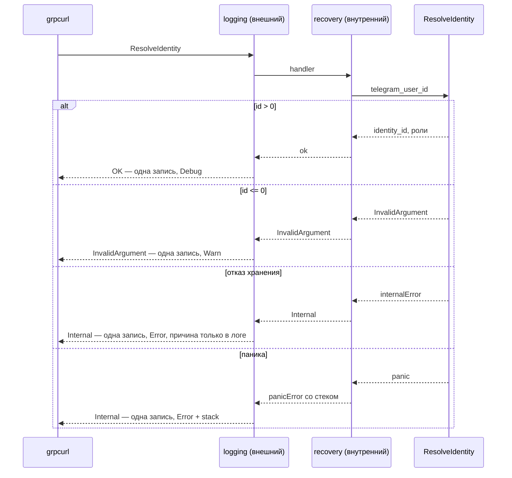

# Unary gRPC-сервер

Скелет Identity поднимает процесс, который слушает gRPC и разрешает Telegram-личность во внутренний идентификатор. Файл объясняет, из чего вообще состоит gRPC-сервер, как устроены его сквозные механизмы и что из этого переносится на следующий сервис. Устройство контракта — в [identity.md](../../services/identity.md) и [integration.md](../../architecture/integration.md); раскладка модуля, горутины и ошибки Go — в [service-layout.md](../go/service-layout.md).

## Механика

### Что такое gRPC и откуда берётся код

gRPC — RPC поверх HTTP/2 с бинарной сериализацией Protobuf. Схема описывается в `.proto`: сервис, его методы, типы сообщений. По схеме генератор делает две вещи — типы сообщений (`identity_service.pb.go`) и обвязку вызовов (`identity_service_grpc.pb.go`). Первое даёт структуры и сериализацию, второе — интерфейс сервера, который надо реализовать, и клиент, которым надо пользоваться.

Ближайший знакомый аналог — WCF или gRPC в .NET; отличие в том, что здесь генерируется всё, включая интерфейс, и никакой рефлексии по атрибутам во время выполнения нет.

Поля читаются через геттеры `GetTelegramUserId()`, а не напрямую. Причина не в стиле: у `optional`-полей proto3 генератор делает указатель, и геттер безопасно возвращает нулевое значение вместо разыменования `nil`. Линтер `protogetter` следит, чтобы прямого обращения к полю в коде не осталось.

### Реализация сервиса и встраивание

Сервис реализуется типом, у которого есть методы из сгенерированного интерфейса. Тип **встраивает** заготовку:

```go
type identityService struct {
	identityv1.UnimplementedIdentityServiceServer
	db *sql.DB
}
```

Встраивание (embedding) — композиция без наследования: методы вложенного типа становятся методами внешнего, но переопределяются объявлением своего метода с тем же именем. Практический смысл здесь такой: когда в `.proto` появится новый RPC, тип по-прежнему удовлетворит интерфейсу — недостающий метод придёт из заготовки и вернёт `Unimplemented`, — вместо ошибки компиляции в неожиданном месте. Встраивание даёт методы, а не запрещает другие поля: пул `*sql.DB` лежит в том же `struct`.

Интерфейсы в Go удовлетворяются **неявно**: `identityService` нигде не объявляет, что реализует `IdentityServiceServer`. Компилятор проверяет соответствие в точке, где значение передаётся как интерфейс, — здесь в `RegisterIdentityServiceServer`.

### Статус-коды как контракт

Отказ возвращается не сырой ошибкой, а статусом:

```go
return nil, status.Error(codes.InvalidArgument, "telegram_user_id must be positive")
```

Сырой `error` уехал бы к клиенту кодом `Unknown`, и вызывающий не отличил бы «ты прислал мусор» от «у меня всё сломалось». Набор кодов фиксирован спецификацией и делится на вину клиента (`InvalidArgument`, `NotFound`, `PermissionDenied`) и вину сервера (`Internal`, `Unavailable`, `DataLoss`). Это тот же водораздел, что 4xx и 5xx в HTTP, и он определяет, кого будить по алерту.

Кодом можно управлять из своего типа ошибки: если тип реализует метод `GRPCStatus() *status.Status`, gRPC отдаст клиенту именно его. Это используется ниже.

### Интерцепторы — это middleware

Интерцептор получает вызов и следующий обработчик и решает, что с ним делать:

```go
func unaryLogging(log *slog.Logger) grpc.UnaryServerInterceptor {
	return func(ctx context.Context, req any, info *grpc.UnaryServerInfo, handler grpc.UnaryHandler) (any, error) {
		start := time.Now()
		resp, err := handler(ctx, req)
		logRPC(ctx, log, info.FullMethod, start, req, err)
		return resp, err
	}
}
```

Внешняя функция — фабрика: она замыкает зависимость (логгер) и возвращает сам интерцептор. Это стандартный способ внедрить зависимость там, где сигнатура задана библиотекой.

Цепочка задаётся `ChainUnaryInterceptor`, и **первый аргумент — самый внешний**. Ровно как порядок `app.Use(...)` в ASP.NET.

Важная асимметрия: unary и streaming — две независимые цепочки. `ChainUnaryInterceptor` не видит потоковых методов вовсе, а потоковые в этом сервисе есть, хотя своих мы не писали: `Health/Watch` и `ServerReflectionInfo` приходят вместе с библиотечными сервисами. Поэтому `ChainStreamInterceptor` обязателен, иначе паника в потоковом обработчике не будет перехвачена и унесёт процесс.

### Кто звонит: metadata и два вида токена

**Metadata** — заголовки HTTP/2, которые едут рядом с сообщением: пары «ключ — список значений», ключи в нижнем регистре. Аналог из .NET — `ServerCallContext.RequestHeaders` в ASP.NET Core gRPC. Отличие в том, что у ключа список значений, и сервер сам решает, что делать с несколькими. Identity читает `metadata.ValueFromIncomingContext(ctx, "authorization")` и считает два значения неоднозначными: отказ, а не выбор первого (`decide` в `callers.go`, условие `len(authorization) != 1`).

На одном заголовке `authorization: Bearer <токен>` Identity держит две разные проверки.

**Токен вызывающего** ([ADR-056](../../decisions/ADR-056-service-calls-per-caller-token-and-closed-network.md)). У каждого вызывающего свой токен: например, параметр AppHost `hub-bot-service-token` бот хаба получает как `BOT_SERVICE_TOKEN` и шлёт в заголовке, а Identity знает то же значение как `IDENTITY_CALLER_TOKEN_HUB_BOT` (снимок `infra/apphost/AppHost.UnitTests/TestUtilities/Snapshots/hub.run.txt`). Интерцептор `unaryCallerGate` находит по токену вызывающего в таблице и пускает к методу, только если этот вызывающий объявлен для метода (`methodAccess`). Таблица хранит не токены, а их SHA-256, и обходит все строки без раннего выхода:

```go
func (c Callers) identify(token string) (Caller, bool) {
	presented := sha256.Sum256([]byte(token))
	var found Caller
	for _, row := range c.rows {
		if subtle.ConstantTimeCompare(presented[:], row.digest[:]) == 1 {
			found = row.caller
		}
	}
	return found, found != ""
}
```

Обычное `==` над строками возвращает ответ на первом несовпавшем байте, и время ответа подсказывает, сколько первых символов угадано. `subtle.ConstantTimeCompare` тратит время, зависящее только от длины, но при разной длине выходит сразу — так говорит `go doc crypto/subtle.ConstantTimeCompare`. Поэтому сравниваются digest фиксированной длины: время не выдаёт ни длину токена, ни номер совпавшей строки. Любой отказ гейт отдаёт кодом `Unauthenticated`: `PermissionDenied` в этом сервисе занят доменным «у человека права нет».

**Секрет мейнтейнера** ([ADR-037](../../decisions/ADR-037-identity-maintainer-shared-secret.md)). `GrantPreset` и `RevokePreset` вызывает не сервис, а человек через `grpcurl`, и это единственный путь к набору `maintainer`. В таблицу вызывающих такой «вызывающий» не входит. Гейт эти методы пропускает (`gated` возвращает `false` для `maintainerMethods`), а секрет `IDENTITY_MAINTAINER_TOKEN` проверяет сам метод первой строкой:

```go
func (s identityService) authenticateMaintainer(ctx context.Context) error {
	provided := ""
	if values := metadata.ValueFromIncomingContext(ctx, "authorization"); len(values) == 1 {
		provided = values[0]
	}
	expected := "Bearer " + s.maintainerToken
	providedHash := sha256.Sum256([]byte(provided))
	expectedHash := sha256.Sum256([]byte(expected))
	valid := subtle.ConstantTimeCompare(providedHash[:], expectedHash[:]) == 1
	if s.maintainerToken == "" || !valid {
		return status.Error(codes.Unauthenticated, "unauthenticated")
	}
	return nil
}
```

`maintainer.go`. Пустой секрет метод закрывает, а не открывает: условие `s.maintainerToken == ""` стоит рядом с несовпадением. Две проверки разведены намеренно: токен бота не открывает выдачу наборов, а старт Identity отказывает, если токен какого-то вызывающего совпал с секретом (`loadCallers`: `%s equals IDENTITY_MAINTAINER_TOKEN`). Иначе сервис, чей токен случайно равен секрету, получил бы право выдавать наборы.

### Recovery и владелец записи в лог

Паника в обработчике должна стать ответом `Internal`, а не смертью процесса. Перехват делает `recover` внутри `defer`, и тут работает деталь языка: **именованное возвращаемое значение**.

```go
func unaryRecovery() grpc.UnaryServerInterceptor {
	return func(ctx context.Context, req any, info *grpc.UnaryServerInfo, handler grpc.UnaryHandler) (resp any, err error) {
		defer func() {
			if rec := recover(); rec != nil {
				resp, err = nil, &panicError{value: rec, stack: debug.Stack()}
			}
		}()
		return handler(ctx, req)
	}
}
```

`(resp any, err error)` в сигнатуре объявляет возвращаемые значения как переменные. Отложенная функция выполняется **после** вычисления `return`, но **до** фактического выхода, поэтому присваивание в `err` внутри `defer` подменяет то, что увидит вызывающий. Без именованных результатов перехватить панику и вернуть вместо неё ошибку невозможно — это не стилистический выбор, а единственный работающий способ.

Дальше вопрос, кто пишет запись в лог. Наивно логировать панику прямо в recovery, но тогда внешний logging увидит ошибку и напишет вторую запись: одна паника — две строки уровня ERROR и двойной счёт в алерте. [logging.md](../../standards/observability/logging.md) требует обратного: «логируй его один раз на boundary». Поэтому recovery ничего не пишет, а переносит панику вверх собственным типом ошибки:

```go
type panicError struct {
	value any
	stack []byte
}

func (e *panicError) GRPCStatus() *status.Status { return status.New(codes.Internal, "internal") }
```

Клиенту такой тип виден как `Internal, "internal"` — ни значение паники, ни стек по проводу не уходят. Интерцептор логирования достаёт из него подробности через `errors.AsType[*panicError](err)` (дженерик-форма `errors.As`, добавленная в стандартную библиотеку недавно) и пишет **одну** запись с `error_category: panic` и стеком.

### Health и reflection

Health — это не HTTP-эндпоинт, а стандартный gRPC-сервис `grpc.health.v1.Health` со своим `.proto`. Пустое имя сервиса означает «процесс целиком», конкретное — отдельный сервис внутри процесса. Неизвестное имя даёт `NotFound`, и это ожидаемый ответ здорового процесса, а не отказ.

Reflection — ещё один библиотечный сервис: он отдаёт клиенту описание схемы во время выполнения, поэтому `grpcurl` умеет `list` и `describe` без локальных `.proto`.

Тесты гоняют `server.New` через `bufconn` — listener поверх памяти вместо TCP. Полный стек сериализации и интерцепторов работает, но порт не занимается: ни гонок за `:50051`, ни зависимости от файрвола.

## Урок

**Порядок вывода из-под нагрузки важнее скорости остановки.** `GracefulStop` сначала зовёт `health.Shutdown()` — все имена уходят в `NOT_SERVING` — и только потом сливает соединения. Иначе балансировщик весь слив читает `SERVING` и продолжает слать трафик в сокет, который его уже не примет. Механизм одинаков для gRPC health, readiness-пробы Kubernetes и HTTP-балансировщика: сначала перестать быть выбираемым, потом перестать отвечать.

**У записи об отказе должен быть ровно один владелец.** Ловушка middleware-цепочек в том, что каждый слой знает только про себя, поэтому «залогировать ошибку» выглядит локально правильным на каждом уровне, а на выходе получается кратный счёт в алертах. Лечится тем, что право писать error-запись явно закреплено за одним слоем, а остальные передают контекст вверх — здесь через тип ошибки. Тот же дефект в .NET выглядит как exception filter и logging middleware, пишущие один и тот же exception.

**Тип ошибки — способ передать контекст, не жертвуя контрактом наружу.** `panicError` и `internalError` одновременно отдают клиенту скупой `Internal` и отдают своему логгеру причину. Приём переносится всюду, где внутренняя диагностика и внешний ответ должны расходиться. Текст pgx в `status.Errorf` уехал бы на открытый reflection-порт вместе с DSN.

**Секрет человека и токен сервиса — разные роли на разных путях проверки.** Разовая привилегированная операция, которую делает человек, не встраивается в таблицу межсервисных токенов: тогда ошибка в таблице или совпавшее значение открыли бы её сервису. Отдельная проверка в самом методе плюс отказ старта при совпадении значений держат роли раздельно. Секрет сравнивается по digest и за постоянное время в любом стеке: в .NET это `CryptographicOperations.FixedTimeEquals`. Ведёт ли он себя при разной длине так же, как Go, здесь не проверялось: проверь сам, когда будет чем, по исходнику `CryptographicOperations.FixedTimeEquals` в репозитории dotnet/runtime.

**Инвариант проверяется счётчиком, а не поиском.** Тест, который ищет запись с нужным сообщением, проходит и когда записей две. Тест, который требует ровно одну запись, ловит регрессию двойного логирования. Формулировка утверждения важнее покрытия строк.

## Почему так, а не иначе

| Вариант | Цена |
|---|---|
| HTTP `/health` рядом с gRPC | второй порт и второй протокол на скелете, у которого единственный клиентский путь — gRPC. Для gRPC это [health checking protocol](https://github.com/grpc/grpc/blob/master/doc/health-checking.md) |
| Логировать панику в recovery | две записи ERROR на одну панику и двойной счёт в алерте; [logging.md](../../standards/observability/logging.md) требует одну запись на boundary |
| Отдать панику наружу как есть | значение паники и стек уезжают клиенту; `GRPCStatus()` даёт скупой `Internal` и оставляет диагностику внутри |
| Сырой `status.Errorf(Internal, "%v", err)` | текст pgx и DSN уезжают любому клиенту; `logRPC` уже пишет полный `error` |
| Выключить reflection | `grpcurl list` без локальных `.proto` не видит сервисы. В проде её обычно гасят: она отдаёт полный список методов |
| Случайный UUIDv7 на каждый вызов | `grpcurl` без сохранённого id недетерминирован; повтор с тем же Telegram user id возвращает тот же внутренний идентификатор |
| Экспортировать поле `health` ради теста | расширяет API пакета ради теста; `GracefulStop` проверяет белый ящик через неэкспортируемое поле |
| `result` = код gRPC | запрос «все отказы среза» собирает три несовпадающих словаря; код транспорта живёт в `grpc_code` |
| `error_category` = код gRPC | дублирует `grpc_code` слово в слово; категория нужна как грубый класс, по которому группируется алерт |
| Вывести `use_case` из имени метода | Identity обслуживает все сценарии сразу и о сценарии ничего не знает; значение приходит с края |
| Писать пустой `use_case` | пустое значение неотличимо от заполненного при запросе на существование поля |
| Только unary-интерцепторы | `Health/Watch` и `ServerReflectionInfo` остаются без recovery: паника в них уронит процесс |
| Логировать username из запроса | нарушает [logging.md](../../standards/observability/logging.md): в лог идёт технический идентификатор, не атрибут профиля Telegram |
| Тест через реальный порт | гонки за `:50051`, зависимость от файрвола; `bufconn` проверяет тот же `New` |
| Не встраивать `Unimplemented*` | компилятор не заставит заметить новый RPC контракта |
| Сравнивать токен через `==` | время ответа выдаёт длину угаданного префикса; `ConstantTimeCompare` по digest фиксированной длины этого не даёт |
| Из нескольких `authorization` брать первое значение | молчаливый выбор: прокси или клиент, добавивший второй заголовок, меняет, чей токен проверен; Identity читает это как отсутствие токена |
| Секрет мейнтейнера — ещё одна строка таблицы вызывающих | одна проверка на оба вида доступа: токен сервиса и секрет человека различает только строка таблицы. Отдельная проверка в методе плюс отказ старта при совпадении значений |
| mTLS, подписанный токен, закрытая сеть, второй порт вместо общего секрета | разобраны в [ADR-037](../../decisions/ADR-037-identity-maintainer-shared-secret.md): нужны CA и TLS вместо h2c или выпуск токена перед каждым вызовом; сеть и второй порт дают «удобно локально» без доказательства права |

## Схема



## Первоисточники

- [gRPC health checking protocol](https://github.com/grpc/grpc/blob/master/doc/health-checking.md) — `Check`, пустое имя сервиса, `SERVING` / `NOT_SERVING` / неизвестный сервис.
- [Status codes](https://grpc.io/docs/guides/status-codes/) — фиксированный набор и деление на вину клиента и сервера.
- [`google.golang.org/grpc/health`](https://pkg.go.dev/google.golang.org/grpc/health) — `NewServer`, `SetServingStatus`, `Shutdown`.
- [`google.golang.org/grpc/reflection`](https://pkg.go.dev/google.golang.org/grpc/reflection) — почему `grpcurl` без `-proto` отвечает на `list`.
- [`grpc.ChainUnaryInterceptor`](https://pkg.go.dev/google.golang.org/grpc#ChainUnaryInterceptor) — порядок: первый аргумент снаружи.
- [Go spec: defer](https://go.dev/ref/spec#Defer_statements) — почему отложенная функция может изменить именованный результат.
- [`errors.AsType`](https://pkg.go.dev/errors#AsType) — дженерик-форма `errors.As`, которую подсказал линтер `modernize`.
- [`bufconn`](https://pkg.go.dev/google.golang.org/grpc/test/bufconn) — in-memory transport в `server_test.go`.
- [gRPC metadata](https://grpc.io/docs/guides/metadata/) — зачем идти: что такое metadata, регистр ключей и несколько значений у одного ключа.
- [`crypto/subtle.ConstantTimeCompare`](https://pkg.go.dev/crypto/subtle#ConstantTimeCompare) — зачем идти: гарантия постоянного времени и ранний выход при разной длине, ради которого сравниваются digest.
- [ADR-037](../../decisions/ADR-037-identity-maintainer-shared-secret.md) и [ADR-056](../../decisions/ADR-056-service-calls-per-caller-token-and-closed-network.md) — зачем идти: почему секрет мейнтейнера и токены вызывающих — два механизма, и какие варианты отвергнуты.
- [Proto3 JSON mapping](https://protobuf.dev/programming-guides/json/) — почему `grpcurl` печатает `identityId`, а в `.proto` поле `identity_id`.
- Скилл `.skillshare/skills/golang/golang-grpc/SKILL.md` — из него взяты пара интерцепторов, статус-коды вместо сырых ошибок и `bufconn` в тестах; `golang-observability/SKILL.md` — состав полей записи доступа; `golang-testing/SKILL.md` — табличные тесты и `t.Parallel`.

## Проверь себя

- `grpcurl -plaintext 127.0.0.1:50051 list` показывает `identity.v1.IdentityService` и `grpc.health.v1.Health`. Проверено на живом `just identity-run`.
- `Health/Check` без `service` и с `identity.v1.IdentityService` → `SERVING`. С `no.such.Service` → `NotFound` / `unknown service`. Проверено.
- `ResolveIdentity` на закрытом `*sql.DB` отдаёт клиенту `Internal` с текстом `internal`, без DSN. Причина остаётся в логе. Проверено `TestResolveIdentityHidesStorageErrors` и `TestUnaryChainLogsInternalWithoutLeakingCause`.
- Тип `identityService` компилируется с полем `db` рядом с встроенным `UnimplementedIdentityServiceServer`. Встраивание закрывает интерфейс сервиса, а пул остаётся обычным полем. Проверено сборкой пакета `internal/server`.
- `-H 'x-request-id: learn-1'` на отказе даёт в stdout поле `request_id":"learn-1"`. Проверено. `IDENTITY_LOG_LEVEL=debug` покрыт тестом, живым процессом не проверялся.
- `result` принимает только `ok` и `error`, код транспорта живёт в `grpc_code`: `TestUnaryLoggingLevelByCode` и `TestUnaryLoggingRecordsSuccess`. Проверено `go test`.
- `-H 'x-use-case: start'` даёт в записи `use_case":"start"`; без заголовка и с пустым значением поле отсутствует, а не пишется пустым. Проверено `TestUnaryLoggingRecordsUseCaseWhenPresent` и `TestUnaryLoggingOmitsEmptyUseCase`.
- Запись без поля каркаса валит тест: `assertFrame` требует `service`, `operation`, `result`, `duration_us`, `grpc_code` и при отказе ещё `error_category` и `error`. Проверено мутацией: уберите `grpc_code` из `logRPC` — краснеют все тесты, которые зовут `assertFrame`.
- Одна паника даёт **одну** запись: `TestUnaryChainLogsPanicOnce` и `TestStreamChainLogsPanicOnce` собирают ту же пару интерцепторов, что и `New`, и требуют ровно одну запись через хелпер `sole`. Проверено мутацией: добавьте в панической ветке `logRPC` вторую строку `log.Log(ctx, slog.LevelError, "rpc failed", attrs...)` — оба теста падают с `records: got 2 [ERROR rpc panic ERROR rpc failed] want 1`. Граница проверки: `sole` считает записи, прошедшие через инжектированный логгер, поэтому запись мимо него — например через `slog.Default()` — тестом не ловится.
- Клиент не видит стека: `status.FromError` в `grpc@v1.83.2/status/status.go:100` приводит ошибку к интерфейсу `GRPCStatus() *Status`, а сервер вызывает его на `server.go:1445` для unary и `:1739` для stream. Проверено чтением исходника библиотеки.
- `NotFound` от Health пишется на `Warn`, `Internal` — на `Error`: `TestUnaryLoggingLevelByCode`. Проверено `go test`.
- Потоковая ветка логирования покрыта: `TestStreamLoggingRecordsOutcome` проверяет успех и `NotFound` на `ServerReflectionInfo`. Проверено `go test`.
- `GracefulStop` переводит `""` и `identity.v1.IdentityService` в `NOT_SERVING`: `TestGracefulStopMarksHealthNotServing`. Проверено `go test`, в том числе мутацией — без `health.Shutdown()` тест падает.
- **Откроет ли токен бота хаба `GrantPreset`?** Нет: `Unauthenticated`, и в записи границы нет полей `caller` и `caller_refusal` — гейт метод пропустил, отказал сам метод. Проверено `go test ./internal/server -run TestCallerTokenDoesNotOpenMaintainerMethods`.
- **Запустится ли Identity, если `IDENTITY_CALLER_TOKEN_HUB_BOT` равен `IDENTITY_MAINTAINER_TOKEN`, даже с переводом строки в конце?** Нет: `LoadCallers` отказывает с `IDENTITY_CALLER_TOKEN_HUB_BOT equals IDENTITY_MAINTAINER_TOKEN`, называя переменные, но не значения. Проверено `go test ./internal/server -run TestLoadCallersRefusesAmbiguousOrIncompleteTable`.
- **Что ответит `GrantPreset` без заголовка?** `Code: Unauthenticated`, состояние не меняется, а `grpcurl` выходит с кодом 80 — это 64 плюс номер статуса `Unauthenticated` (16). Проверено на stage 2026-10-15 через `kubectl port-forward` и `grpcurl -plaintext -d '{…}' 127.0.0.1:<порт> identity.v1.IdentityService/GrantPreset; echo $?`.
- `kill -TERM` по pid `just identity-run` пишет `shutdown signal received` и `graceful shutdown complete` — живым процессом не проверялось: msys `kill` на Windows не доставляет сигнал в обработчик Go.
