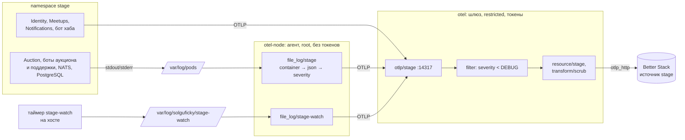

# OpenTelemetry Collector: агент, шлюз, файлы подов и пол логов

Разбор объясняет, как телеметрия stage доходит до Better Stack: что такое Collector, почему он стоит двумя процессами, как он читает логи из файлов подов и как решает, какую запись пропустить. Опора:

- конфигурация Collector в ops-репозитории: `cluster/system/otel/agent.yaml` и `gateway.yaml` в редакции PER-630 ([solguficky-ops#17](https://github.com/Solguficky/solguficky-ops/pull/17));
- прогон `bash tests/collector.sh` — 37 проверок на образе `otel/opentelemetry-collector-contrib:0.161.0` по digest;
- эксперимент 23.10.2026 с отдельным Collector'ом в docker: `start_at` и пол фильтра;
- записи источника stage в Better Stack 23.10.2026 — как они выглядят после конвейера.

Решения — в [ADR-053](../../decisions/ADR-053-production-observability-otlp-better-stack.md) и его дополнениях 2026-10-08 и 2026-10-15. Как телеметрию пишут сами сервисы — в [metrics.md](metrics.md) и [tracing.md](tracing.md). Что Better Stack делает с принятым — в [better-stack/telemetry.md](../better-stack/telemetry.md).

## Механика

### Collector — конвейер, а не хранилище

OpenTelemetry Collector — отдельный процесс, который принимает телеметрию, обрабатывает её и отправляет дальше. Сам он ничего не хранит. Конфигурация — три вида компонентов и конвейеры из них:

- **receiver** принимает или добывает данные: `otlp` слушает порт, `file_log` читает файлы, `host_metrics` читает `/proc`, `prometheus` скрейпит адрес;
- **processor** меняет поток: фильтрует, переписывает атрибуты, копит батчи;
- **exporter** отправляет: `otlp_http` в Better Stack, `otlp_grpc` в другой Collector, `file` в файл.

Конвейер (`pipeline`) — цепочка для одного сигнала: логов, метрик или трейсов. Из `gateway.yaml`:

```yaml
logs/stage:
  receivers: [otlp/stage]
  processors: [memory_limiter, filter/stage-logs, resource/stage, transform/scrub, batch]
  exporters: [otlp_http/stage]
```

Порядок processors — порядок обработки: сначала ограничитель памяти, потом пол логов, потом метка среды, потом чистка персональных данных, потом батч. Ближайший аналог из .NET — конвейер middleware ASP.NET: каждый шаг получает запись от предыдущего и решает, что отдать следующему.

### Агент и шлюз: два процесса с разными правами

Collector стоит двумя процессами. **Агент** — DaemonSet в namespace `otel-node`, по экземпляру на узел. Он читает то, что принадлежит узлу: файлы логов подов `/var/log/pods` и метрики хоста через корень хоста, смонтированный только на чтение в `/hostfs`. **Шлюз** — Deployment в namespace `otel`. Он принимает OTLP от сервисов и от агента, чистит атрибуты и единственный держит токены Better Stack и выход в интернет.

Разделение — граница безопасности. Агенту нужен root и hostPath, чтобы читать файлы чужих подов, а такой под при взломе отдаёт узел. Поэтому у агента нет ни токенов, ни выхода наружу, ни токена API Kubernetes (`automountServiceAccountToken: false`). Шлюз работает под Pod Security `restricted`, без hostPath, но с токенами. Взлом одного не даёт того, что есть у другого.

Среду записи шлюз определяет по порту, а не по атрибуту отправителя. NetworkPolicy пускает namespace `stage` только на порт 14317, прод — только на 4317, и конвейер каждого порта сам ставит `deployment.environment.name`. Подделать среду из stage нельзя: атрибут, присланный сервисом, перезаписывается.

### OTLP или файл: два пути записи в конвейер

OTLP — протокол OpenTelemetry. Сервис с SDK сам отправляет логи, метрики и трейсы в шлюз по gRPC: так делают Identity, Meetups, Notifications и бот хаба. У остальных SDK логи не шлёт: Auction отдаёт по OTLP только метрики, боты аукциона и поддержки, NATS и PostgreSQL — ничего. Их логи берутся из файлов, которые kubelet пишет за каждый контейнер: всё, что процесс вывел в stdout и stderr.

Файлы читает агент белым списком (`agent.yaml`):

```yaml
file_log/stage: &pod_logs
  include:
    - /var/log/pods/stage_auction-deployment-*/auction/*.log
    - /var/log/pods/stage_nats-*/nats/*.log
```

Белый список, а не «все файлы»: сервисы с OTLP-логами пишут те же записи и в stdout, и чтение их файлов задвоило бы каждую запись. `tests/collector.sh` держит это проверкой «логи hub-bot и identity из файлов не читаются».

### Операторы `file_log`: строка файла → запись лога

Строка файла пода — не запись лога, а строка в формате CRI: время, поток, флаг и тело:

```text
2026-10-08T10:00:00.000000000Z stderr F TypeError: marker-stderr-crash
```

`file_log` превращает её в запись цепочкой операторов. Каждый оператор берёт запись, меняет её и передаёт дальше. Условие `if` пропускает оператор, если выражение ложно:

- `container` разбирает формат CRI и берёт namespace, под и контейнер из пути файла `/var/log/pods/<namespace>_<под>_<uid>/<контейнер>/` в атрибуты ресурса `k8s.*`. Поэтому `include_file_path: true` обязателен.
- `json_parser` с `if: body matches "^\\{"` раскладывает JSON-тело в атрибуты: logback Auction и pino ботов пишут JSON, а стек упавшего процесса — нет.
- `regex_parser` достаёт уровень из текстовых строк NATS: `[1] 2026/10/08 10:00:00.000000 [WRN] сообщение`.
- `move` переносит `message` или `msg` в тело записи.
- `severity_parser` переводит текст уровня в число по таблице `mapping`.
- `add` и `copy` ставят поля: `service.name` из имени контейнера.

### Уровень: текст и число

У записи лога OpenTelemetry два поля уровня. `severity_text` — строка, как её написал процесс: `DEBUG`, `Debug`, `Information`, `warn`. `severity_number` — число по общей шкале модели данных OpenTelemetry: TRACE 1–4, DEBUG 5–8, INFO 9–12, WARN 13–16, ERROR 17–20, FATAL 21–24. Ноль значит «уровень не указан».

`severity_parser` ставит число и не трогает текст. Поэтому в источнике stage уровни разнобойные — по тексту каждого языка: `DEBUG` у Identity (Go, `slog`), `Debug` и `Information` у Meetups (.NET), `warn` у бота (pino), `LOG` и `FATAL` у PostgreSQL. Сравнивать уровни надёжно по числу. По тексту — только без учёта регистра и со списком синонимов, как сделано в запросе алерта: `lower(level) IN ('error', 'fatal', 'critical', 'panic')`.

Строка stderr без уровня получает уровень `ERROR` правилом агента:

```yaml
- type: add
  if: attributes.level == nil and attributes["log.iostream"] == "stderr"
  field: attributes.level
  value: ERROR
```

Правило ради падений: стек упавшего процесса Node или `OutOfMemoryError` JVM уровня не несёт, и без правила пол stage отбросил бы ровно их. У правила есть цена, и она видна в источнике stage 23.10. Java-клиент NATS пишет свои предупреждения через `java.util.logging` прямо в stderr, без JSON. Раз в секунду это `heartbeatAlarm` потребителя Auction ([PER-697](https://linear.app/anticnvm/issue/per-697)), и каждая такая строка становится `ERROR`: 3 600 в час. Стартовые `WARNING:` JVM — тоже `ERROR`.

### Пол логов: фильтр отбрасывает, но не добавляет

Пол stage — фильтр на шлюзе с условием на языке OTTL:

```yaml
filter/stage-logs:
  error_mode: ignore
  logs:
    log_record:
      - severity_number < SEVERITY_NUMBER_DEBUG
```

Фильтр отбрасывает запись, для которой условие истинно. Пол `Debug` отбрасывает TRACE и записи вовсе без уровня — у них `severity_number` 0, а это меньше 5. Эксперимент это подтверждает: строка `plain-no-level` и строка с `TRACE` не дошли, строка `INFO` дошла.

Фильтр умеет только отбрасывать. `Debug` в источнике появится, лишь если процесс его пишет. .NET-сервис с `Default=Information` запись уровня `Debug` не создаёт вовсе, и пол Collector'а тут ничего не изменит. Поэтому пол стоит в двух местах: уровень процесса — переменные из `envs/stage/env.yaml` ([helm/hooks-and-rollout.md](../helm/hooks-and-rollout.md#post-renderer-правка-манифестов-после-рендера)) — и фильтр конвейера.

### `start_at` и смещения: что читается после рестарта

`file_log` не перечитывает файлы с нуля при каждом старте. Смещение по каждому файлу хранит расширение `file_storage` в каталоге хоста, и рестарт агента продолжает с места остановки. `tests/collector.sh` держит это проверками «лог из файла ушёл один раз» и «после рестарта агента старая строка не задвоилась».

`start_at` решает, откуда читать файл, о котором агент ничего не знает. Эксперимент 23.10 с `start_at: end`:

| строка | когда появилась | дошла |
|---|---|---|
| `before-start` | в файле до старта Collector'а | нет |
| `appended-to-old` | дописана в тот же файл после старта | да |
| `new-file-line` | в новом файле, созданном после старта | да |

`end` пропускает только содержимое, которое лежало в файле при первом опросе, — архив 14 дней логов подов не уходит в Better Stack разом. Файл, созданный позже, читается с начала. Наблюдатель stage (`file_log/stage-watch`) всё равно читает с `beginning`. Его файл дня может появиться, пока агент перекатывается. Тогда для агента после рестарта это незнакомый файл при первом опросе, и `end` пропустил бы ровно первую строку дня. Этот сценарий с рестартом не прогонялся. Проверь сам, когда будет чем: запусти Collector с `file_storage` и `start_at: end`, останови его, создай файл со строкой, запусти снова — по описанию строки не будет.

## Урок

- **Права по обязанности, а не по удобству.** Процесс, который читает узел, не держит секретов, а процесс с секретами не читает узел. Та же граница работает для любого сборщика: Fluent Bit, Vector, Promtail.
- **Классификация «по умолчанию» — решение с ценой.** «stderr без уровня — ошибка» ловит падения и одновременно превращает чужие предупреждения в ошибки. Правило по умолчанию нужно сопровождать знанием, кто ещё пишет в этот поток.
- **Фильтр на конвейере — верхняя граница, а не источник.** Дать больше, чем пишет процесс, конвейер не может. Решение «больше подробностей» всегда двухместное: процесс и путь доставки.
- **Уровни сравниваются по числу.** Текст уровня у каждого языка свой. Где числа нет — например, в метках Better Stack, — сравнение по тексту требует списка синонимов без учёта регистра.

## Почему так, а не иначе

- **Один Collector вместо агента и шлюза.** Меньше конфигурации, но тогда процесс с root и hostPath держит токены Better Stack и выход в интернет (ADR-053, дополнение 2026-10-08).
- **Логи всех сервисов из файлов, без OTLP.** Один путь вместо двух. Но SDK шлёт структуру — атрибуты, связь с трейсом, — а файл даёт строку, которую надо разобрать операторами. Где SDK логи умеет, он и шлёт.
- **Состояние подов через `k8s_cluster` receiver вместо строк наблюдателя.** Стандартный путь, рестарты и причина завершения пришли бы метриками. Но шлюзу понадобился бы токен API Kubernetes с ролью на чтение, а изоляцию шлюза владелец 19.10 сохранил. Память пода всё равно потребовала бы ещё `kubeletstats` на агенте с root. Выбран таймер на хосте, который пишет переход строкой в файл (дополнение ADR-053 от 2026-10-15).
- **Пол на агенте, а не на шлюзе.** Меньше трафика между процессами, но OTLP-логи сервисов идут мимо агента прямо в шлюз. Пол на шлюзе — одно место для обоих путей.
- **Выключить правило «stderr → ERROR» ради тишины.** Шум `heartbeatAlarm` пропал бы, а вместе с ним — стеки падений Node и `OutOfMemoryError` JVM. Шум лечится у источника ([PER-697](https://linear.app/anticnvm/issue/per-697)), а до этого — фильтром алерта по тексту.

## Схема



## Первоисточники

- [OpenTelemetry: Collector, Architecture](https://opentelemetry.io/docs/collector/architecture/) — receivers, processors, exporters и конвейеры по сигналам.
- [OpenTelemetry: Collector deployment patterns](https://opentelemetry.io/docs/collector/deployment/) — агент и шлюз, зачем их разделять.
- [filelog receiver, README](https://github.com/open-telemetry/opentelemetry-collector-contrib/tree/main/receiver/filelogreceiver) — `include`, `start_at`, `storage`, `include_file_path` и формат CRI.
- [Stanza operators](https://github.com/open-telemetry/opentelemetry-collector-contrib/tree/main/pkg/stanza/docs/operators) — `container`, `json_parser`, `regex_parser`, `move`, `severity_parser`, `add`, `copy` и выражение `if`.
- [filter processor, README](https://github.com/open-telemetry/opentelemetry-collector-contrib/tree/main/processor/filterprocessor) — условия OTTL, отбрасывание по истинному условию, `error_mode`.
- [OpenTelemetry: Logs Data Model, Severity Fields](https://opentelemetry.io/docs/specs/otel/logs/data-model/#field-severitynumber) — `SeverityText` и `SeverityNumber`, диапазоны 1–24 и ноль как «не указано».
- [ADR-053](../../decisions/ADR-053-production-observability-otlp-better-stack.md) — почему Better Stack, агент и шлюз, пол stage.

## Проверь себя

Команды — на control node из корня ops-репозитория, с запущенным Docker.

1. **Читает ли агент файлы сервисов с OTLP-логами?** `bash tests/collector.sh` — строка `ok логи hub-bot и identity из файлов не читаются`.
2. **Проходит ли пол `Debug` уровни Info и Debug и режет ли Trace?** Там же: `ok Info и Debug stage доходят` и `ok Trace stage отброшен`.
3. **Что пол делает с записью без уровня?** Collector с фильтром `severity_number < SEVERITY_NUMBER_DEBUG` и строкой файла без поля уровня: строка не доходит. Так и вышло в эксперименте 23.10 (`plain-no-level: нет`).
4. **Читает ли `start_at: end` файл, созданный после старта?** Тот же эксперимент: `new-file-line: дошло`, `before-start: нет`.
5. **Задваивает ли рестарт агента строку файла?** `bash tests/collector.sh` — `ok после рестарта агента старая строка не задвоилась`.
6. **Почему в источнике stage у Auction тысячи `ERROR`?** Запрос к источнику по `_pattern` за час: верхние шаблоны — `heartbeatAlarm` с `log.iostream = stderr` и без `logger_name`, то есть строки `java.util.logging`, которым уровень поставило правило агента.
