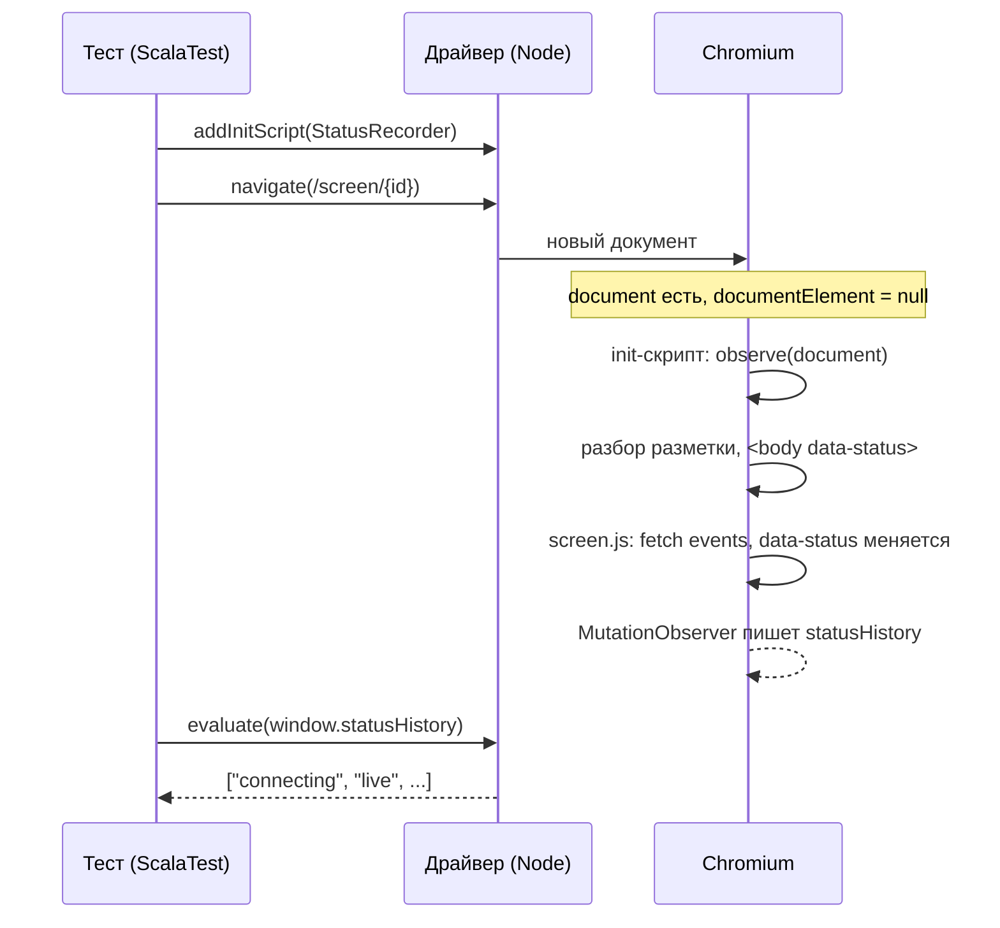

# Браузерные сценарии на Playwright

Playwright — библиотека, которая управляет настоящим браузером из теста: открывает страницу, ждёт состояния, читает DOM и выполняет в странице JavaScript. В репозитории она живёт в двух местах. E2e сайта сообщества идёт на `@playwright/test` (TypeScript, `apps/community-site-api/e2e/`). Страницу экрана зала Auction проверяет Playwright for Java, вызванный из ScalaTest (`apps/auction/src/test/scala/auction/screen/ScreenPageBrowserSpec.scala`).

Файл объясняет две ловушки, из-за которых сценарий экрана зала дважды проходил на заведомо сломанной странице, и устройство драйвера, из-за которого браузер не скачивался на машине с перехватом TLS. Что страница делает и почему так решено — [ADR-040](../../decisions/ADR-040-auction-screen-sse.md), дополнение 2026-10-19, и [integration.md](../../architecture/integration.md#экран-зала); где сьют стоит среди уровней — [testing-strategy.md](../../standards/testing/testing-strategy.md).

## Механика

### Java-библиотека — тонкий клиент, браузером управляет Node-драйвер

Playwright написан на TypeScript. Привязки для Java, .NET и Python не переписывают его, а запускают тот же драйвер — процесс Node, который едет внутри jar (`driver-bundle`) — и говорят с ним по каналу. `Playwright.create()` поднимает этот процесс, и он же при первом запуске скачивает браузеры в общий кэш `ms-playwright`:

```text
Downloading Chrome for Testing 153.0.8010.12 (playwright chromium v1243) from https://cdn.playwright.dev/...
Downloading Chrome Headless Shell 153.0.8010.12 (playwright chromium-headless-shell v1243) from https://cdn.playwright.dev/...
```

Аналог в .NET — Microsoft.Playwright: тот же драйвер, тот же кэш, тот же скрипт установки. Отличие от привычного NuGet-пакета в том, что сеть и сертификаты здесь — забота Node, а не JVM. Поэтому на машине, где антивирус подменяет сертификаты HTTPS, скачивание падает ошибкой Node `SELF_SIGNED_CERT_IN_CHAIN`, хотя sbt через ту же сеть работает. Лечит это переменная `NODE_USE_SYSTEM_CA=1`: драйвер берёт корни из хранилища Windows, куда антивирус положил свой. Тот же драйвер ставит браузер и явно — так делает шаг CI:

```sh
sbt -batch "Test/runMain com.microsoft.playwright.CLI install --with-deps chromium"
```

Версия браузера привязана к версии библиотеки: `chromium v1243` знает только Playwright 1.63. Поэтому `build.sbt` закрепляет ту же версию, что `@playwright/test` у сайта, и два компонента делят один скачанный Chromium.

`launch()` без параметров запускает не обычный Chrome, а Headless Shell — отдельную сборку без окна, поэтому драйвер качает обе. После отказа в кэше лежал полный Chrome с отметкой `INSTALLATION_COMPLETE`, а Headless Shell — нет. Почему одно скачивание прошло, а другое нет, мы не выясняли.

### Init-скрипт выполняется до разметки, и корневого элемента ещё нет

`page.addInitScript(script)` выполняет скрипт в каждом новом документе страницы до её собственных скриптов. Нужен он, когда тест должен застать страницу с самого начала, например записывать каждое изменение атрибута. Сценарий экрана зала записывает каждую запись `data-status` на `<body>`:

```js
window.statusHistory = [];
new MutationObserver((records) => {
  for (const record of records) window.statusHistory.push(record.target.dataset.status);
}).observe(document, { subtree: true, attributes: true, attributeFilter: ["data-status"] });
```

`MutationObserver` — браузерный API, который вызывает функцию на каждое изменение DOM под наблюдаемым узлом. Ближайший аналог в .NET — `FileSystemWatcher`: подписка на изменения под корнем, а не опрос.

Документ к моменту init-скрипта уже создан, а разметка ещё не разобрана: `document.documentElement` — корень `<html>` — равен `null`. Первая версия наблюдала `document.documentElement`, и `observe` бросал исключение. Опыт на Chromium Playwright 1.63:

```text
document.documentElement {"root":"null","error":"TypeError: Failed to execute 'observe' on 'MutationObserver': parameter 1 is not of type 'Node'.","history":[]}
document {"root":"null","error":null,"history":["live"]}
```

Исключение init-скрипта до теста не доходит: `addInitScript` ничего не возвращает, а страница продолжает работать. История молча оставалась пустой, и проверка «в истории нет `live`» проходила на пустом списке. `document` же существует всегда, и `subtree: true` ловит атрибуты элементов, которые появятся позже.

Отсюда вторая строка сценария, которая без этого урока выглядит лишней:

```scala
// История пишется: без неё проверка окна ниже прошла бы на пустом списке.
history(page) should contain("live")
```

### Ожидающая проверка видит итог, а не путь

Проверки Playwright ожидающие: `assertThat(locator).hasAttribute("data-status", "stale")` перепроверяет условие, пока оно не станет истинным или не выйдет таймаут. Это снимает гонки с асинхронной страницей, и это же делает такую проверку слепой к промежуточным состояниям.

Критерий приёмки экрана: после восстановления сети предупреждение снимает только новый снимок, а не открытое соединение. Мутант страницы снимал его при открытии соединения: `stale → live`, затем через предел тишины сторож страницы возвращал `live → stale`. Проверка `hasAttribute("data-status", "stale")` с таймаутом в 10 секунд дожидалась второго перехода и проходила. Мутант выжил.

Поэтому окно «соединение открыто, снимка нет» проверяется по записанной истории, а не по итогу:

```scala
val mark = history(page).size
proxy.headersOnly()
eventually(proxy.headersOnlyResponses should be > 0)
Thread.sleep(silence.toMillis)
history(page).drop(mark) should not contain "live"
```

С этой проверкой мутант падает ровно на ней: `List("live") contained element "live"`.

### Обрыв сети — замолкшее соединение, а не закрытое

Закрытое соединение браузер видит сразу: TCP присылает FIN или RST, и `fetch` отказывает. Обрыв в зале выглядит иначе: Wi-Fi пропал, а соединение формально открыто и молчит. Такой обрыв замечает только сторож тишины страницы, и только его сценарий и проверяет.

Поэтому между браузером и узлом стоит TCP-прокси `testkit/StallingProxy`, а не `page.setOffline` и не остановка сервера. У прокси три режима:

- открыто — байты идут в обе стороны;
- тишина — ни байта и без закрытия, в том числе на уже открытых соединениях;
- только заголовки — ответ доходит до конца HTTP-заголовков и замолкает, так что `fetch` получает ответ, а снимка нет.

Режимы «открыто» и «только заголовки» закрывают все соединения прежних режимов. Без этого браузер отдал бы следующий запрос замороженному соединению из своего пула keep-alive, и восстановление ждало бы сторожа на каждом таком соединении.

## Урок

- Тест, который ни разу не падал, не доказывает ничего. Сценарий здесь дважды проходил на мутанте, и оба раза дефект был в самом тесте. Мутант — одна строка, ломающая проверяемое правило, — переносится на любой стек и стоит одного прогона.
- Ожидающие проверки — это «когда-нибудь станет», а не «ни разу не было». Правило вида «в этом окне X не происходит» проверяется записью истории за всё окно.
- Запись, на которую опирается отрицательная проверка, проверяется положительно: «история пишется» до «в истории нет».
- Код, встроенный в страницу из теста, падает молча. Его исход читается обратно из страницы, а не предполагается.
- Обрыв, который должен заметить код по тишине, моделируется тишиной. Закрытие проверяет другую ветку кода.

## Почему так, а не иначе

- **Playwright for Java против Node-пакета рядом с Auction.** Node-пакет с заглушкой SSE дешевле по тулингу и даёт линт JS, но заглушка пишет JSON сама и не ловит расхождение страницы с настоящим потоком. Сьют на JVM поднимает настоящий узел, и второго языкового тулинга у Auction не появляется. Выбор владельца на чекпоинте PER-485.
- **Прокси против `page.setOffline`.** `setOffline` переводит браузер в офлайн, и уже открытый поток он может оборвать закрытием, а не тишиной. Как он ведёт себя на открытом `fetch` с телом-потоком, мы не проверяли: прокси делает тишину явно и одинаково на любой платформе.
- **История против перехвата `fetch` в странице.** Подмена `window.fetch` из init-скрипта поймала бы момент ответа, но проверяла бы внутренность страницы, а не то, что видит зал. `data-status` — наблюдаемое состояние экрана.
- **`MutationObserver` против опроса.** Опрос атрибута из теста раз в N миллисекунд пропускает переходы короче N. Наблюдатель записывает каждый.

## Схема



## Первоисточники

- [Playwright: `Page.addInitScript`](https://playwright.dev/java/docs/api/class-page#page-add-init-script) — когда выполняется скрипт: после создания документа, до скриптов страницы.
- [Playwright: Assertions](https://playwright.dev/java/docs/test-assertions) — ожидающие проверки и их таймаут.
- [Playwright: Browsers](https://playwright.dev/java/docs/browsers) — установка через CLI, кэш браузеров, `--with-deps` и Headless Shell.
- [MDN: `MutationObserver.observe`](https://developer.mozilla.org/en-US/docs/Web/API/MutationObserver/observe) — `subtree`, `attributeFilter` и `TypeError` на не-`Node`.
- [Node.js: `--use-system-ca`](https://nodejs.org/api/cli.html#--use-system-ca) — корневые сертификаты из хранилища системы; переменная `NODE_USE_SYSTEM_CA=1` включает то же самое.

## Проверь себя

1. Что вернёт `document.documentElement` внутри init-скрипта? Ответ: `null`. Проверка — опыт выше: страница через `page.route`, init-скрипт пишет `document.documentElement === null` в `window`, тест читает его `evaluate`.
2. Пройдёт ли сценарий, если `observe(document)` снова заменить на `observe(document.documentElement)`? Ответ: нет, упадёт строка `history(page) should contain("live")`. Проверка — замена и `NODE_USE_SYSTEM_CA=1 AUCTION_BROWSER_TESTS=1 sbt "testOnly auction.screen.ScreenPageBrowserSpec"` в `apps/auction`.
3. Поймает ли сценарий страницу, которая снимает предупреждение на открытии соединения? Ответ: да, на строке `history(page).drop(mark) should not contain "live"`. Проверка — вставить в `screen.js` после `if (!response.ok ...) return "lost";` строку `if (current.view !== null) apply({ status: "live", view: current.view });` и прогнать сьют.
4. Почему скачивание браузера падает на `SELF_SIGNED_CERT_IN_CHAIN`, а `sbt update` по той же сети проходит? Ответ: скачивает Node-драйвер со своим хранилищем корней, а не JVM. Проверка — тот же прогон с `NODE_USE_SYSTEM_CA=1` и без неё на машине с перехватом TLS.
