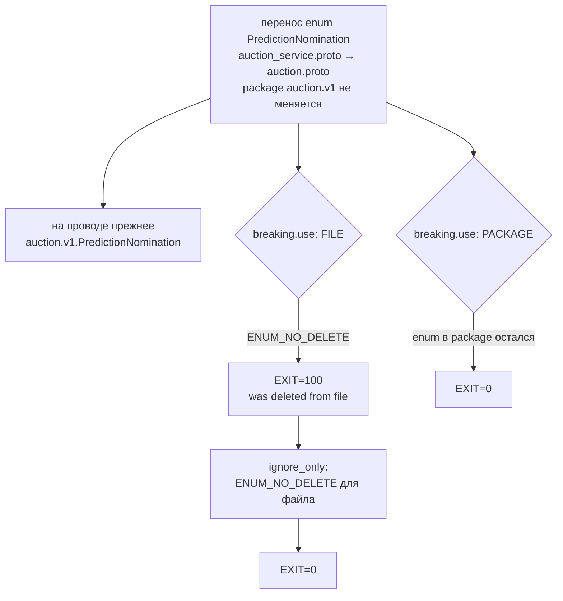

# `buf breaking` и категория `FILE`: перенос enum краснеет как удаление

Контракт `auction.v1` получил итоги прогнозов, и enum `PredictionNomination` переехал из `auction_service.proto` в `auction.proto`, чтобы его называл и факт шины, а не только сервис. Значение на проводе не изменилось — fully-qualified имя `auction.v1.PredictionNomination` осталось тем же, — но `buf breaking` покраснел как на удалении. Файл объясняет, почему правило категории `FILE` не отличает перенос от удаления, почему это не дефект проверки и как снимается документированным `ignore_only`. Норматив — [protobuf.md](../../standards/contracts/protobuf.md), соседние темы — [enum-openness.md](enum-openness.md) и [field-presence.md](field-presence.md).

## Механика

### `buf breaking` сравнивает не провода, а файлы

`buf breaking` берёт две версии схем — текущую и базу из `--against` — и прогоняет набор правил. Набор задаёт категория в `breaking.use`; в репозитории это `FILE` (`contracts/proto/buf.yaml`). Категория — не уровень строгости, а область сравнения: правила категории `FILE` сравнивают **содержимое файла** с его прежним содержимым. Что из этого следует, видно по `buf config ls-breaking-rules` у закреплённой версии (1.54.0):

```text
ENUM_NO_DELETE          CSR, FILE   Checks that enums are not deleted from a given file.
PACKAGE_ENUM_NO_DELETE  PACKAGE      Checks that enums are not deleted from a given package.
```

Оба правила про одно — «enum не удалён», — но `ENUM_NO_DELETE` смотрит на файл, а `PACKAGE_ENUM_NO_DELETE` — на package. Перенос enum из одного файла в другой в той же package для второго правила ничего не удаляет, для первого — удаляет из файла.

### Полное имя на проводе — package и имя, не файл

Protobuf не знает файла как адреса типа: fully-qualified имя — это package и имя, `auction.v1.PredictionNomination`, и именно оно уходит в дескрипторы и генерируемый код. Файл — единица компиляции, а не идентичности. Поэтому перенос между файлами одной package не меняет ни имя на проводе, ни номера значений, ни сгенерированный тип потребителя: enum в `auction.proto` и прежний в `auction_service.proto` — одно и то же значение `auction.v1.PredictionNomination` (у обоих файлов `package auction.v1;`).

### Проверка: перенос краснеет только на категории `FILE`

Проверено на конфигурации репозитория, buf 1.54.0. С базой `origin/develop` перенос enum — единственная ломающая правка в `auction_service.proto`, и она видна:

```text
$ buf breaking contracts/proto --against '.git#branch=origin/develop,subdir=contracts/proto'
contracts\proto\auction\v1\auction_service.proto:1:1:Previously present enum "PredictionNomination" was deleted from file.
EXIT=100
```

Тот же прогон с `breaking.use: [PACKAGE]` вместо `[FILE]` — зелёный (`EXIT=0`): в package enum остался, `PACKAGE_ENUM_NO_DELETE` молчит. Значит, красный даёт именно выбранная категория, а не потеря типа. Категория `FILE` выбрана осознанно — комментарий в `buf.yaml` называет причину: она ловит удаление, переименование и смену типа поля, которые `WIRE` пропустил бы.

### `ignore` против `ignore_only`

`breaking.ignore` исключает файл из всех правил; `breaking.ignore_only` — только названные правила для названных файлов, остальные продолжают действовать. В репозитории оба: `ignore` для `notifications/v1/notifications_service.proto` (целиком ломающий переход, PER-539) и `ignore_only` для `auction/v1/auction_service.proto`:

```yaml
breaking:
  use:
    - FILE
  ignore:
    - notifications/v1/notifications_service.proto
  ignore_only:
    ENUM_NO_DELETE:
      - auction/v1/auction_service.proto
```

Что `ignore_only` именно правило-специфичен, проверено: с `ignore_only: MESSAGE_NO_DELETE` вместо `ENUM_NO_DELETE` тот же прогон снова краснеет на enum (`EXIT=100`) — имя правила в ключе решает. С `ENUM_NO_DELETE` прогон зелёный (`EXIT=0`).

### Цена исключения и его срок

`ignore_only` глушит `ENUM_NO_DELETE` для `auction_service.proto` целиком, не только для этого переноса: если из файла удалят другой enum, правило промолчит. Поэтому исключение названо временным — «снимает следующее изменение схем»: когда база сравнения (`origin/develop`) уже несёт enum в `auction.proto`, перенос перестаёт быть ломающим, и строку убирают. Тот же приём уже стоял для `notifications_service.proto`.

## Урок

- Категория `FILE` сравнивает файлы, и перенос типа между файлами одной package для неё неотличим от удаления. Прежде чем спорить с красным, посмотри, какая категория включена: `buf config ls-breaking-rules` печатает, какие правила в `FILE`, какие в `PACKAGE`.
- Перенос типа внутри package wire-совместим, но это не значит, что проверка неверна: она защищает от настоящего удаления и по файлу не может знать о переносе. Исключение — правильный ответ, а не отключение правила.
- `ignore_only` предпочтительнее `ignore`, когда ломается одно правило: файл остаётся под остальными проверками. Исключение называет правило и файл, а не «этот файл не проверять».
- Временность исключения записывается в самом `buf.yaml`: без строки «снимает следующее изменение схем» следующая сессия не знает, когда её убирать.

## Почему так, а не иначе

- **Вернуть enum в `auction_service.proto`.** Красный исчез бы, но `auction.proto` — схема фактов шины, и общий enum там на месте: его называет и `PredictionResultsEvent`. Цена возврата — либо дубль enum в двух файлах, либо зависимость факта шины от схемы сервиса.
- **Добавить enum в `auction.proto`, оставив в `auction_service.proto`.** Два одинаковых имени `auction.v1.PredictionNomination` в одной package — конфликт дескрипторов, `buf` отвергнет сборку.
- **`breaking.use: [PACKAGE]` вместо `[FILE]`.** Убрало бы этот красный, но ослабило бы проверку для всех: `PACKAGE` не видит переименование поля внутри файла. Цена выше выгоды.
- **`ignore` всего файла.** Проще, но `auction_service.proto` остаётся без остальных проверок на время до следующего изменения схемы. Отвергнуто в пользу `ignore_only`.
- **`breaking: except: [ENUM_NO_DELETE]`.** Глушит правило для всего модуля, а не для одного файла. Цена — потеря правила везде.

## Схема



## Первоисточники

- [buf: Detecting breaking changes — Rules and categories](https://buf.build/docs/breaking/rules/) — зачем идти: состав категорий `FILE`, `PACKAGE` и `WIRE` и текст правил `ENUM_NO_DELETE` и `PACKAGE_ENUM_NO_DELETE`; первоисточник формулировок раздела «Механика».
- [buf: `buf.yaml` v2 config file](https://buf.build/docs/configuration/v2/buf-yaml/) — зачем идти: семантика `breaking.use`, `ignore` и `ignore_only` («excluded from specific breaking change detection categories or rules»).
- `buf config ls-breaking-rules` — зачем идти: точный список правил и их категорий у закреплённой версии buf (1.54.0), без пересказа.
- `contracts/proto/buf.yaml` и `contracts/proto/auction/v1/auction.proto` — зачем идти: сама конфигурация с `ignore_only` и enum в новой схеме.
- [protobuf.md](../../standards/contracts/protobuf.md) — зачем идти: норматив о совместимости и порядке изменения контракта, которому подчиняется перенос.

## Проверь себя

- **Почему перенос enum внутри одной package краснеет, хотя значение на проводе не изменилось?** Ответ: `buf breaking` в категории `FILE` сравнивает содержимое файла, и enum, которого в файле больше нет, читается как удалённый (`ENUM_NO_DELETE`); провод и fully-qualified имя при этом прежние. Проверка: удалить `ignore_only` из `buf.yaml` и прогнать `buf breaking contracts/proto --against '.git#branch=origin/develop,subdir=contracts/proto'` — `EXIT=100`.
- **Что изменится, если `breaking.use` заменить `FILE` на `PACKAGE`?** Ответ: прогон станет зелёным (`EXIT=0`): в package enum остался, `PACKAGE_ENUM_NO_DELETE` молчит. Проверка: временно поставить `use: [PACKAGE]` и прогнать ту же команду.
- **Чем `ignore_only` отличается от `ignore`?** Ответ: `ignore` исключает файл из всех правил, `ignore_only` — только названные. Проверка: заменить в `ignore_only` ключ `ENUM_NO_DELETE` на `MESSAGE_NO_DELETE` — прогон снова краснеет на enum (`EXIT=100`), значит правило в ключе действительно выбирает, что глушить.
- **Что осталось непроверенным?** Поведение категории `PACKAGE` на удалении enum из всей package прогоном не проверялось — проверь сам, когда будет чем: временно убрать enum и из `auction.proto`, поставить `use: [PACKAGE]` и ждать `PACKAGE_ENUM_NO_DELETE`.
