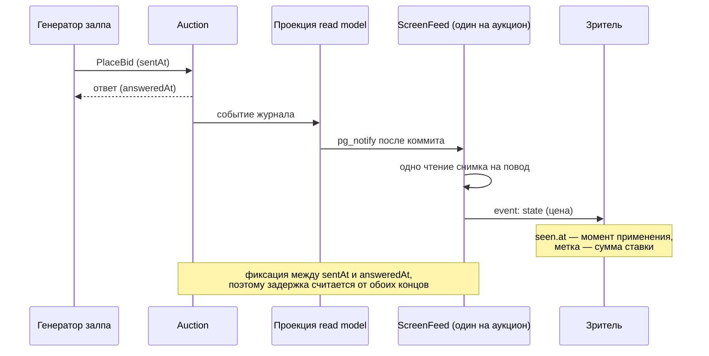

# Замер задержки экрана зала под нагрузкой

Разбор объясняет, как устроен замер пути «ставка → применение у зрителя» и что означают его числа, а не пересказывает результаты. Опора — прогон экрана зала: инструмент `just auction-screen-load` ([PER-486](https://linear.app/anticnvm/issue/per-486), влит PR #532) и правка общего снимка (`ScreenFeed`, PER-695). Метод, переменные и числа прогонов живут в одном месте — [auction-screen-load.md](../../services/auction-screen-load.md); здесь механика замера.

Бюджет, который проверяется, — [ADR-040](../../decisions/ADR-040-auction-screen-sse.md): «p95 не более 1 секунды от фиксации принятой ставки до обновления видимой страницы при нагрузке до 100 подключений».

## Механика

### Перцентиль методом ближайшего ранга

**p95** — значение, которое не превышают 95 % наблюдений: из 200 ставок две сотни делятся так, что 190-я по порядку и есть p95. Средняя для бюджета не годится: она прячет хвост, а раздражение вызывает именно хвост.

```
val rank = math.ceil(q * sorted.size).toInt.max(1)
Some(sorted(rank - 1))
```

`ScreenLatency.percentile` ([ScreenLatency.scala:37-42](../../../apps/auction/src/test/scala/auction/screen/load/ScreenLatency.scala)) берёт не интерполяцию между соседями, а сам наблюдённый замер с номером `ceil(q·n)`. Отсюда два следствия, которые надо помнить, читая таблицы: p95 всегда равен числу, которое действительно было, а на маленькой выборке он консервативнее интерполяции — при `n ≤ 20` это попросту максимум.

В .NET ближайший аналог — распределение в BenchmarkDotNet или гистограмма `System.Diagnostics.Metrics`: и там, и здесь p95 считается по выборке, а не по среднему.

### Фиксация ставки лежит между двумя наблюдаемыми моментами

Сервер не сообщает наружу момент коммита ставки. Наблюдаются два: отправка команды `PlaceBid` и её ответ. Фиксация — где-то между ними, поэтому замер публикует два конца:

```
final case class BidMark(amount: Long, sentAt: Long, answeredAt: Long)
final case class Delay(fromSent: Long, fromAnswer: Long)
```

`ScreenLatency.scala:8-14`. Задержка «от отправки» — верхняя оценка (считает и время до фиксации), «от ответа» — нижняя. Публиковать одну из них без подписи значит выдавать оценку за факт: верхняя завышает, нижняя занижает, и обе честны только вместе.

Оба конца читаются часами машины прогона (`System.currentTimeMillis`), потому что генератор, сервис и зрители живут на ней же. Цена — стенные часы, а не монотонные: перевод времени посреди прогона (NTP) дал бы выброс, а не задержку. В .NET та же развилка между `DateTimeOffset.UtcNow` и `Stopwatch`.

### Метка наблюдения: сумма ставки

Чтобы сопоставить ставку с реакцией зрителя, нужна метка, видимая в состоянии экрана. Её роль играет сумма:

```
def applied(bid: BidMark, seen: Seq[Seen]): Option[Long] =
  seen.find(s => s.at >= bid.sentAt && s.price >= bid.amount).map(_.at)
```

`ScreenLatency.scala:26-29`. Работает это потому, что суммы залпа растут — правило живого финала ([ADR-049](../../decisions/ADR-049-auction-live-bid-rule.md)) требует ровно следующую цену. Первое состояние зрителя не раньше отправки с ценой не ниже суммы и есть момент применения.

Отсюда следует важное: **склейка поводов не занижает замер**. Если зритель пропустил промежуточную цену, ставку закроет следующая, более высокая — задержка выйдет больше, а не меньше. Метка обязана быть монотонной; на убывающей метке метод сломался бы.

### Два вида зрителей и одна метка времени

- **Лёгкий зритель** — HTTP-клиент, читающий поток `/screen/{auction_id}/events` по строке; на каждое событие `state` он пишет пару «момент, цена» (`Seen(System.currentTimeMillis(), price)`, [ScreenViewers.scala:138-142](../../../apps/auction/src/test/scala/auction/screen/load/ScreenViewers.scala)). Цена есть только в фазе `lot`, поэтому прогон идёт в живом финале.
- **Страница** — настоящий Chromium под Playwright; инструментация вешает на отрисовку наблюдатель и пишет пару только тогда, когда статус `live` и цена действительно сменилась ([ScreenViewers.scala:257-261](../../../apps/auction/src/test/scala/auction/screen/load/ScreenViewers.scala)).

Разница принципиальная и не косметическая: лёгкий зритель отмечает *применение состояния*, страница — *применение в отрисовке*. Сколько стоит пиксель, замер не доказывает; он доказывает, что данные дошли и применились. Playwright на Java сам ничего не рисует: это клиент Node-драйвера, как WebDriver у Selenium ([playwright/browser-scenarios.md](../playwright/browser-scenarios.md)).

### Отбор: что не считается задержкой

```
val measured = accepted
  .filter(_.amount > opening)
  .filter(bid => restarted.forall((killed, _) => bid.answeredAt < killed - RestartMargin))
```

`ScreenLoad.scala:509-515`. Две причины выбросить ставку, и обе — про честность метки, а не про удобство:

- сумма не выше цены до залпа — у зрителя неотличима от стартовой цены, первое же состояние засчиталось бы до фиксации;
- при рестарте — ставки, принятые за 5 секунд до убийства: их зритель увидит только после подъёма, и простой сервиса попал бы в задержку пути.

Пробные страницы (замолкшая сеть, замороженная вкладка) в замер не входят. Пустой замер — отдельная строка отчёта: пустая таблица иначе читалась бы как «задержек нет».

### Четверти залпа: очередь против цены пути

Задержка под залпом может быть большой по двум разным причинам, и различить их одной цифрой нельзя: путь стал дороже (каждая ставка идёт медленнее одинаково) или копится очередь (к концу залпа хуже, чем в начале). Поэтому отчёт делит ставки на четыре части по времени отправки и считает p95 в каждой:

```
val quarters = measured.sortBy(_.sentAt).grouped((measured.size + 3) / 4 max 1).toVector
```

`ScreenLoad.scala:555-562`, с комментарием: «Растущая от четверти к четверти задержка — очередь, которая копится под залпом; ровная — цена пути.» До правки общего снимка четверти давали 1123, 1130, 1456, 1948 мс — это очередь; после — 455, 344, 442, 478 мс — ровно, это цена пути.

### Две метрики на одном прогоне

`PlaceBid`, p50/p95 (`stats(answers)`) — время ответа сервиса; «до зрителя» — путь плюс применение. Они отвечают на разные вопросы, и подмена одной другой пропускает дефект: до правки экранная задержка росла, но диагноз дало именно `PlaceBid` p95 526–637 мс при 100 зрителях против 23 мс без них. Ставки стали медленнее не из-за табло, а потому что чтения снимка на каждого зрителя отбирали общий пул journal, snapshot и проекций.

Правка — одно чтение на повод и аукцион, раздача подписчикам ([ScreenFeed.scala:86-137](../../../apps/auction/src/main/scala/auction/screen/ScreenFeed.scala)); у подписчика буфер на одно состояние с вытеснением прежнего — на полном буфере «drops the oldest element from the buffer to make space for» новый ([Pekko OverflowStrategy](https://pekko.apache.org/api/pekko/1.6.0/org/apache/pekko/stream/OverflowStrategy$.html)), то есть медленный видит свежее состояние, а не очередь. Число чтений держит тест `auction.screen.ScreenFeedSpec`: пять потоков на один повод — одно чтение.

## Урок

- Бюджет задержки проверяется **парой прогонов в одном окне**: базовая линия без зрителей и нагрузка. Абсолютное число, снятое на загруженной машине, отвечает не на тот вопрос: базовая линия там вышла 162–279 мс вместо 23, а на тихой — 19 и 16.
- Если момент, который интересует, ненаблюдаем (фиксация ставки), публикуй обе оценки — верхнюю и нижнюю — и подписывай, какая какая.
- Метка наблюдения должна быть монотонной и видимой потребителю; тогда склейка промежуточных состояний не занижает замер.
- Разделяй «сервер» и «путь»: деградация ответа под зрителями — это отбор общего ресурса, и искать надо его, а не запись в поток.
- Растущий по частям прогона p95 — очередь; ровный — цена пути. Одна общая цифра этого не говорит.
- Цена умножения видна только под потоками: чтение, умноженное на зрителей, не меняет ни одного ответа в тесном тесте и роняет и экран, и ставки под сотней подключений.

## Почему так, а не иначе

- **Диагностическое подтверждение браузера на сервере** (спан от коммита до подтверждения отрисовки) — точнее по пикселям, но меняет продукт: решение владельца на чекпоинте PER-486 — обойтись без него. Цена: замер консервативен и не доказывает появление пикселей.
- **`PerformanceObserver`, `requestAnimationFrame` вместо наблюдателя DOM** — ближе к пикселям, но результат зависит от браузера и отрисовки, а не от применения состояния; цена — менее воспроизводимо и труднее отличить от тормозов страницы.
- **Средняя вместо p95** — дешевле считать, но прячет хвост, ради которого бюджет и написан.
- **Один прогон вместо пары** — дешевле, но на общей машине разброс между прогонами двукратный; замеры хоста это уже показали ([host-benchmarks.md](../self-hosting/host-benchmarks.md), «Хвосты и шумные соседи»).
- **Склейка чтения в полёте** (второй подписчик ждёт начатое чтение, а не заводит своё) — меньше правки, но один к одному не даёт: подписчики приходят разнесённо, и каждый, кто пришёл после окончания чтения, заводит новое. Отвергнуто счётом «одно чтение на повод».
- **Генератор в той же JVM, что и сервис** — проще, но рестарт сцены `restart` требует убийства без `CoordinatedShutdown`, поэтому сервис живёт отдельным процессом `java auction.Main`.

## Схема



## Первоисточники

- [ADR-040](../../decisions/ADR-040-auction-screen-sse.md), раздел «Задержка и проверка» — бюджет p95 и требование будущей приёмки, а не измеренная гарантия.
- [auction-screen-load.md](../../services/auction-screen-load.md) — метод, переменные `SCREEN_LOAD_*`, сценарии и все числа прогонов; сюда за числами, а не в этот разбор.
- [Pekko `OverflowStrategy`](https://pekko.apache.org/api/pekko/1.6.0/org/apache/pekko/stream/OverflowStrategy$.html) — что именно делает `dropHead` на полном буфере.
- [Pekko `Source.actorRef`](https://pekko.apache.org/api/pekko/1.6.0/org/apache/pekko/stream/scaladsl/Source$.html) — источник с буфером, который материализуется в `ActorRef`; им сделан буфер подписчика.
- [Playwright for Java, `Page`](https://playwright.dev/java/docs/api/class-page) — `addInitScript` и наблюдатель DOM на странице прогона.
- [`System.currentTimeMillis`](https://docs.oracle.com/en/javase/21/docs/api/java.base/java/lang/System.html#currentTimeMillis()) — часы, которыми размечены оба конца; рядом `nanoTime` как монотонная альтернатива.
- [PER-486](https://linear.app/anticnvm/issue/per-486) — прогон и его метод; [PER-695](https://linear.app/anticnvm/issue/per-695) — дефект умноженного чтения и его правка.

## Проверь себя

1. **Почему «от отправки» — верхняя оценка?** Фиксация ставки лежит между отправкой и ответом, поэтому `fromSent = at - sentAt` включает время до коммита, а `fromAnswer = at - answeredAt` его уже не включает. Проверка: `cd apps/auction && sbt -batch "testOnly auction.screen.load.ScreenLatencySpec"` — тест «measures each bid from the send and from the answer and counts the missed ones».
2. **Что вернёт перцентиль на выборке из трёх значений при q = 0,95?** Максимум: ранг `ceil(0,95 × 3) = 3`. Проверка: тот же сьют, тест «returns the nearest-rank value».
3. **Очередь или цена пути?** Прогони `SCREEN_LOAD_SCENARIO=load just auction-screen-load` и посмотри строку «p95 от отправки по четвертям залпа»: рост от первой к последней — очередь. Для сравнения — числа в [auction-screen-load.md](../../services/auction-screen-load.md).
4. **Сколько чтений снимка на повод при пяти потоках?** Одно. Проверка: `cd apps/auction && sbt -batch "testOnly auction.screen.ScreenFeedSpec"` — тест «read the read model once per change for every stream of the auction».
5. **Почему ставка не выше цены до залпа не входит в замер?** Её нельзя отличить от стартовой цены у зрителя. Проверка: в отчёте `SCREEN_LOAD_SCENARIO=load` строка «Ставок в замере N» меньше «ставок 200», а правило — `ScreenLoad.scala:509-515`.
