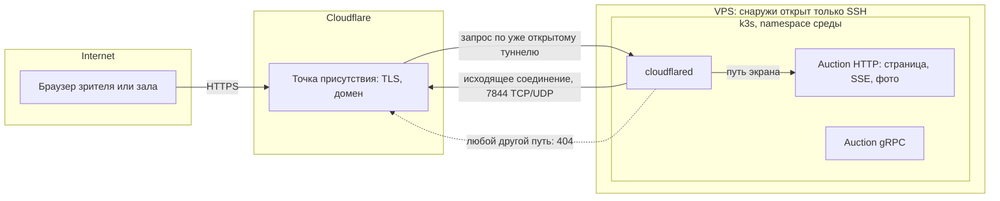
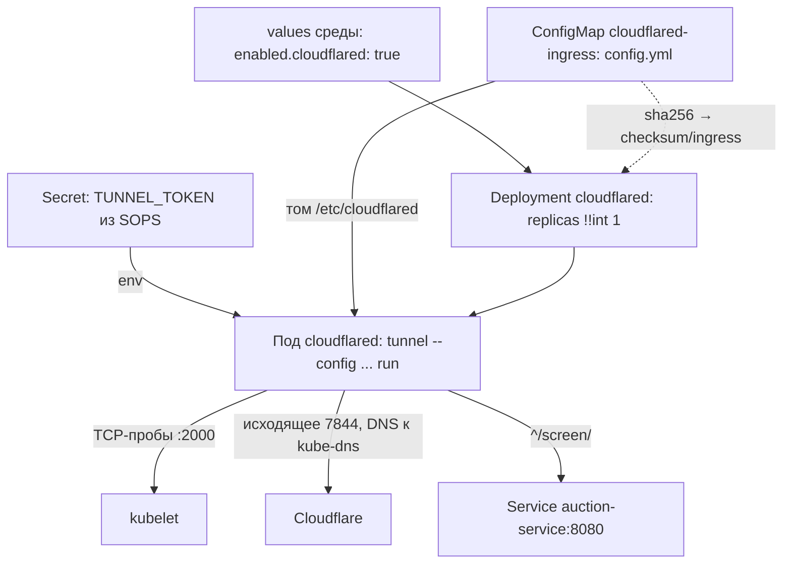

# Вход из интернета

До экрана зала платформа не отдавала в интернет ничего: снаружи хоста открыт только SSH, а сервисы живут в подах за закрытой сетью ([k3s.md](k3s.md), [service-access.md](service-access.md)). Экран зала открывает любой по ссылке, поэтому его маршрутам понадобился путь из интернета ([ADR-071](../../decisions/ADR-071-public-entry-through-cloudflare-tunnel.md)). Файл объясняет, из чего такой путь собирается — прокси, TLS, сертификат, входящий порт или исходящий туннель — и какую развилку прошли, прежде чем выбрать Cloudflare Tunnel. Вторая половина механики — как туннель лёг в чарт прода ([PER-661](https://linear.app/anticnvm/issue/per-661)): правила файлом, токен, готовность пода и выключатель среды. Правила и готовность проверены запуском настоящего `cloudflared` в контейнере. Живого туннеля с доменом ещё не было, поэтому поведение edge Cloudflare взято из документации и помечено, где проверить самому.

## Механика

### Почему сервис кластера сам по себе недостижим

Под слушает порт на своём адресе внутри сети подов. Снаружи этого адреса не видно, а Service типа ClusterIP — это правило DNAT на узле, которое тоже действует только изнутри ([k3s.md](k3s.md)). Чтобы запрос из интернета дошёл до пода, кто-то должен принять соединение на адресе, который виден снаружи, и переслать его внутрь. Снимок чарта прямо говорит, что такого места нет:

```
auction: ContainerResource
  endpoint: grpc http port= target=8081 proxied=True external=False
  endpoint: http http port= target=8080 proxied=True external=False
```

`external=False` у обоих эндпоинтов Auction: генератор чарта не публикует их наружу (`infra/apphost/AppHost.UnitTests/TestUtilities/Snapshots/cluster.publish.txt`).

### Ingress-контроллер и почему его выключили

В Kubernetes «принять снаружи и раздать по сервисам» делает **ingress-контроллер**: reverse proxy, который слушает 80 и 443, смотрит на имя хоста и путь запроса и пересылает его нужному Service. В .NET ближайший аналог — YARP или IIS ARR перед несколькими приложениями. k3s приносит такой контроллер с собой: «Traefik is deployed by default when starting the server», и он поднимает Service типа LoadBalancer на портах 80 и 443. Без облака LoadBalancer реализует встроенный ServiceLB, который «uses available host ports» — то есть открывает эти порты прямо на адресе узла ([k3s: Networking Services](https://docs.k3s.io/networking/networking-services)).

На хосте оба выключены в `config.yaml` ещё до первого старта:

```yaml
disable:
  - traefik
  - servicelb
```

Поэтому ADR-055 и пишет «снаружи хоста по-прежнему открыт только SSH»: того, кто слушал бы 80 и 443, в кластере нет.

### TLS и сертификат: что нужно собственному входу

Браузер откроет страницу по `https://` только с сертификатом, подписанным доверенным центром. Бесплатный автоматический путь — Let's Encrypt по протоколу **ACME**: центр выдаёт сертификат, только если сервер докажет, что владеет доменом. Traefik умеет три способа доказательства ([Traefik: ACME](https://doc.traefik.io/traefik/reference/install-configuration/tls/certificate-resolvers/acme/)):

- **HTTP-01** — Let's Encrypt приходит на порт 80 за файлом-ответом;
- **TLS-ALPN-01** — то же через порт 443;
- **DNS-01** — ответ кладётся записью в DNS, порты не нужны, и только так выпускаются wildcard-сертификаты.

Выпущенные сертификаты Traefik хранит в файле `acme.json` и продлевает сам. Вывод для развилки: свой вход — это не только «открыть 443», а ещё порт или доступ к DNS для доказательства, файл с ключами, который надо пережить при рестарте, и продление, за которым надо следить.

### Входящий порт против исходящего туннеля

Обычный вход — **входящий**: на хосте открыт порт, и любой в интернете может к нему подключиться. Туннель переворачивает направление. Процесс внутри сети сам устанавливает **исходящее** соединение к чужой точке присутствия и держит его открытым, а запросы зрителей приходят к нему уже по этому соединению. Cloudflare описывает это так: «cloudflared initiates an outbound connection through your firewall from the origin to the Cloudflare global network» ([Cloudflare Tunnel](https://developers.cloudflare.com/cloudflare-one/connections/connect-networks/)). Входящих портов `cloudflared` не требует. Исходящим ему нужен порт 7844 по TCP (HTTP/2) и UDP (QUIC) к `region1.v2.argotunnel.com` и `region2.v2.argotunnel.com`, а 443 — только для проверки обновлений ([Tunnel with firewall](https://developers.cloudflare.com/cloudflare-one/connections/connect-networks/configure-tunnels/tunnel-with-firewall/)). Именно это стоит в NetworkPolicy листа PER-661.

Аналог из мира разработчика — `ngrok` или dev tunnels Visual Studio: локальный порт становится публичным адресом без открытия порта на роутере. Отличие в том, что здесь это постоянный путь прода, а не отладка: от доступности Cloudflare в день финала зависит экран.

### Правила туннеля как первый фильтр

Что туннель пропускает, задают правила `ingress` в конфигурации `cloudflared`. Правило совпадает по `hostname`, по `path` — регулярному выражению в синтаксисе Go — или по обоим и называет `service`, куда переслать. Последним обязано стоять правило без условий, и его типичная форма — `service: http_status:404` ([Configuration file](https://developers.cloudflare.com/cloudflare-one/connections/connect-networks/configure-tunnels/local-management/configuration-file/)). Так ADR-071 получает «только маршруты экрана»: одно правило с префиксом пути экрана на HTTP-порт Auction и 404 на всё остальное, поэтому `/health` и gRPC наружу не выходят ещё до кода Auction.

### Что прокси делает с SSE

SSE — один долгий HTTP-ответ, который сервер пишет кусками. Любой прокси на пути может сломать его двумя способами: копить куски и отдавать пачкой (буферизация) или оборвать ответ, который долго молчит. У Cloudflare документирован только первый таймаут: если origin не начал отвечать за 125 секунд, клиент получает ошибку 524 ([Error 524](https://developers.cloudflare.com/support/troubleshooting/http-status-codes/cloudflare-5xx-errors/error-524/)). Это ожидание **начала** ответа, а не тишина внутри уже идущего потока; про потоки страница молчит. Поэтому экран шлёт heartbeat — комментарий SSE, строку с двоеточием, которую браузер пропускает, — и его период берётся с запасом, а поведение маршрута проверяется на stage (ADR-040).

Ловушка: быстрые туннели trycloudflare.com, которые поднимаются одной командой без аккаунта, «do not support Server-Sent Events (SSE)» ([Quick Tunnels](https://developers.cloudflare.com/cloudflare-one/connections/connect-networks/do-more-with-tunnels/trycloudflare/)). Проверять поток экрана на них бессмысленно: нужен именованный туннель на своём домене.

### Из чего туннель состоит в чарте

В чарте туннель — это три объекта Kubernetes и ни одного Service:

- **Deployment `cloudflared`** — под с образом `cloudflare/cloudflared` по digest и командой `tunnel --config /etc/cloudflared/config.yml run`. Service ему не нужен: к поду никто не подключается, он сам звонит наружу.
- **ConfigMap `cloudflared-ingress`** — файл `config.yml` с правилами. ConfigMap — это словарь «имя файла → текст», который Kubernetes умеет смонтировать в под каталогом. Ближайший аналог в .NET — `appsettings.json`, только он лежит не в образе, а рядом с ним, и меняется без пересборки.
- **Secret со значением `TUNNEL_TOKEN`** — токен туннеля. В чарте у него только имя: значение кладёт среда через SOPS ([stage.md](../../development/stage.md#публичный-вход)).

Все три собирает узел графа AppHost (`infra/apphost/AppHost/Configuration/Services/CloudflaredSetup.cs`):

```csharp
.WithArgs("tunnel", "--config", $"{ConfigMount}/{TunnelIngress.FileName}", "run")
.WithEnvironment("TUNNEL_TOKEN", token)
.WithEnvironment("TUNNEL_METRICS", MetricsAddress)
```

`token` — секретный параметр графа, поэтому генератор чарта кладёт его в Secret, а не в текст манифеста. Токен идёт переменной окружения, а не аргументом `--token`: аргументы видны в спецификации пода любому, у кого есть `kubectl get pod -o yaml`, а значение из Secret там видно только как ссылка. `check-chart.py` отказывает чарту, где токен оказался в аргументах или прямо в `env`.

### Туннель с правилами в файле против туннеля из дашборда

Туннель Cloudflare создаётся двумя способами. **Локально управляемый** создаётся командой `cloudflared tunnel create`, и правила он читает из своего файла конфигурации. **Удалённо управляемый** создаётся в дашборде Cloudflare, и правила ему отдаёт сам Cloudflare. Токен запуска есть у обоих, и снаружи эти туннели одинаковы. Выбран первый: правила лежат в репозитории, проходят ревью и проверку чарта, а не живут в чужом интерфейсе, где их меняют без следа в Git.

Ловушка в том, что это свойство самого туннеля, а не чарта. Если туннель для среды создать в дашборде, наш `config.yml` перестанет определять, что выходит наружу, и ни один тест этого не заметит. Поэтому [stage.md](../../development/stage.md#публичный-вход) требует создавать туннель только через CLI. Что именно делает `cloudflared` с локальным файлом при туннеле из дашборда, взято из документации и не проверено. Проверь сам, когда будет чем: создай пробный туннель в дашборде с правилом на другой путь, запусти его с нашим `config.yml` и посмотри `curl -i https://<домен>/screen/x`.

### Якорь в правиле пути

`path` в правиле — регулярное выражение Go, и совпадением считается вхождение где угодно в пути, а не весь путь целиком. Это обратная привычка к маршрутам ASP.NET, где шаблон описывает путь полностью. Проверка настоящим `cloudflared` из образа чарта командой `tunnel --config <файл> ingress rule https://h<путь>`:

```
правило ^/screen/:  /screen/a/events → #0   /x/screen/y → #1 (404)   /screen → #1 (404)
правило /screen/:   /screen/a/events → #0   /x/screen/y → #0          /screen → #1 (404)
```

Без `^` правило пропускает к Auction любой путь, в середине которого встретилось `/screen/`. Поэтому в чарте `path: ^/screen/`, а конфигурацию без последнего правила `cloudflared tunnel ingress validate` отвергает сам: «The last ingress rule must match all URLs». Имени хоста в правилах нет: домен — свойство среды, и один и тот же файл годится для test и prod.

### Правила файлом и перекат пода по checksum

ConfigMap монтируется в под файлом, и cloudflared читает его при старте. Правка правил меняет ConfigMap, но шаблон пода остаётся прежним, а Deployment перекатывает под только тогда, когда меняется шаблон пода. Без дополнительного шага новые правила дождались бы случайного рестарта. Приём из советов Helm — положить хэш конфигурации в аннотацию шаблона пода:

```csharp
pod.Metadata.Annotations["checksum/ingress"] = TunnelIngress.Checksum;
```

Другой текст правил даёт другой хэш, хэш меняет шаблон, и Deployment перекатывает под. Перечитывает ли cloudflared файл без рестарта, в этой сессии не проверялось. Проверь сам, когда будет чем: поправь правило в смонтированном файле работающего пода и посмотри, изменился ли ответ `ingress rule` у живого процесса. Аннотация всё равно нужна, потому что Kubernetes обновляет смонтированный ConfigMap с задержкой.

### Готовность туннеля: `/ready` против TCP-пробы

У пода три пробы. **startup** ждёт, пока процесс поднимется. **liveness** перезапускает зависший процесс. **readiness** решает, считается ли под готовым: Service шлёт трафик только готовым подам, а `helm upgrade --wait` ждёт, пока готовы все Deployment'ы релиза ([hooks-and-rollout.md](../helm/hooks-and-rollout.md)).

У `cloudflared` есть порт метрик (здесь 2000) и на нём `/ready`. Проверка с недействительным токеном при открытой сети:

```
t=5s   status=[Up 5 seconds]   /ready → 503 {"readyConnections":0}
t=15s  status=[Up 18 seconds]  /ready → 503 {"readyConnections":0}
```

Процесс жив, порт метрик слушает, а `/ready` отвечает 503, пока нет ни одного соединения с Cloudflare. Если сделать readiness на `/ready`, то пока Cloudflare недоступен, токен не тот или ещё не применена NetworkPolicy, под не станет готовым, и `helm --wait` повалит выкладку **всего** релиза, включая Auction и ботов. Трафик к поду туннеля через Service не идёт, поэтому его готовность ничего не маршрутизирует. Значит, все три пробы — TCP на порт метрик: «процесс жив и слушает». Связь с Cloudflare после включения проверяют по логу (`Registered tunnel connection`).

Граница этого решения проверена отдельно. В контейнере без сети, где не работает даже DNS, cloudflared не ждёт связи, а выходит с кодом 1 на поиске адресов edge. Такой под уходит в рестарты, и TCP-проба его тоже не спасёт. Поэтому в NetworkPolicy из [stage.md](../../development/stage.md#публичный-вход) DNS к kube-dns разрешён вместе с портом 7844.

### Выключатель среды: число реплик из шаблона

Узел один на чарт, а включать туннель надо в каждой среде отдельно: в test раньше, в prod после репетиции. Выключатель — ключ `enabled.cloudflared` в values среды, и он задаёт `replicas` Deployment'а: 1 или 0. Без ключа объекты чарта есть, но пода нет.

Шаблон Helm — это текст, а не YAML: Helm сначала подставляет `{{ … }}` как строку, потом разбирает результат. Генератор чарта пишет любую строку в кавычках, и `replicas: "{{ … }}"` после подстановки становится `replicas: "1"`. Kubernetes такое отвергает: проверка на `sigs.k8s.io/yaml`, библиотеке Helm и kubectl, дала `cannot unmarshal string into Go struct field .replicas of type int32`. Выход — явный тег типа YAML. Он говорит парсеру «это число», даже если значение в кавычках:

```yaml
replicas: !!int "{{ if eq (toString (dig `enabled` `cloudflared` false .Values.AsMap)) `true` }}1{{ else }}0{{ end }}"
```

После подстановки получается `replicas: !!int "1"`, и та же библиотека читает его как 1. `helm template` 4.3.0 без ключа даёт `!!int "0"`, с `--set enabled.cloudflared=true` — `!!int "1"`. `dig` читает вложенный ключ с умолчанием `false` и не падает, если секции `enabled` в values нет вовсе. `toString` и сравнение со строкой `true` означают, что включает только `true`, а `yes` или `1` тихо оставят ноль. Тег испускает свой сериализатор (`SwitchedReplicas` в `infra/apphost/AppHost/Configuration/Publish/SwitchedDeployment.cs`), и `replicas` стоит последним полем спецификации: после нестандартного скаляра генератор начинал брать в кавычки следующие ключи.

### Адрес Cloudflare в NetworkPolicy: только сети, не имена

Под туннеля ходит наружу, а NetworkPolicy namespace по умолчанию выход запрещает ([k3s.md](k3s.md)). Разрешение выхода называет получателя одним из трёх способов: `podSelector`, `namespaceSelector` или `ipBlock`. `kubectl explain networkpolicy.spec.egress.to` на хосте других полей не печатает. Имени хоста среди них нет: политику исполняет сеть узла по адресам пакетов, а DNS-ответ пода она не видит. Аналог — правило Windows Firewall по адресу, а не по имени.

Поэтому `region1.v2.argotunnel.com` и `region2.v2.argotunnel.com` разрешаются вручную и записываются сетями. 22 октября 2026 года и при повторной проверке 23 октября (`getent ahostsv4`) они дали `198.41.192.*` и `198.41.200.*`, отсюда правило `allow-cloudflared-edge` с двумя `/24` на 7844 по TCP и UDP в `cluster/env/networkpolicy.yaml` ops. Сети IPv6 у Cloudflare тоже есть, но поды k3s получают только IPv4: `status.podIPs` у подов stage — один адрес `10.42.*`. Правило для IPv6 было бы мёртвым.

Цена записи сетью в том, что сломается она молча. Если Cloudflare перенесёт edge, под туннеля останется Ready: проба TCP смотрит на свой порт метрик (раздел про `/ready` выше). Зритель получит ошибку Cloudflare, а в логе пода не будет строки `Registered tunnel connection`. Алерта на это нет.

### Что внутри токена туннеля

`cloudflared tunnel token <туннель>` печатает одну строку. Это base64 от JSON с тремя полями: `a` — аккаунт, `t` — id туннеля, `s` — секрет. Секретно всё вместе, а id туннеля сам по себе не секрет, он есть в имени DNS-записи `<id>.cfargotunnel.com`. Формат не обещан документацией: он взят из исходников `cloudflared`, где структура токена сериализуется с такими полями. Проверь сам, когда будет чем: `cloudflared tunnel token solguficky-stage | base64 -d`.

Выкладка пользуется этим дважды (`tunnel_id` в `stage/deploy.sh` ops). Строка, из которой не достаётся `t`, — не токен: пустая, заглушка `disabled` или обрезанная при вставке. Включённый туннель с такой строкой выкладка отвергает до кластера. Без этой проверки под стартовал бы, раз за разом получал отказ Cloudflare и стоял Ready по TCP-пробе. Второй случай — id совпадает с id туннеля соседней среды. Коннекторы, запущенные с токеном одного туннеля, Cloudflare считает репликами и раздаёт между ними запросы. Stage с токеном прода отдавала бы зрителям прода часть страниц из своего аукциона. Документация описывает реплики как способ отказоустойчивости. Как именно делится трафик, на живом туннеле не проверялось.

Выключатель выкладка читает так же, как шаблон чарта: включает только `true` или строка `"true"`. Проверка, которая понимает «включено» иначе, чем шаблон, пропустила бы заглушку к поду или отвергла бы среду, где пода нет.

## Урок

- Публичный вход раскладывается на четыре вопроса: кто принимает соединение, кто держит TLS и выпускает сертификат, кто фильтрует пути и кто гасит атаки. Варианты различаются тем, на чьей стороне каждый ответ.
- Направление соединения — граница безопасности. Исходящий туннель сохраняет «снаружи открыт только SSH» буквально, потому что слушающего порта нет вовсе; цену платят зависимостью от посредника.
- Фильтр путей стоит ставить в первом звене, а не только в коде сервиса: тогда ошибка маршрута в сервисе не открывает лишнего наружу.
- Долгие ответы — SSE, WebSocket, gRPC-стримы — первыми ломаются на прокси. Любой новый прокси на пути потока проверяется по реальному маршруту, а не по документации.
- Фильтр, который держит границу, проверяется самим инструментом, а не похожим движком. Вхождение без якоря против совпадения целиком — разница, которую легко перенести из привычного фреймворка ложно.
- Readiness — это «можно слать трафик», а не «внешняя зависимость жива». Процесс, к которому трафик не идёт, но который стоит в общем релизе, с пробой на чужую зависимость роняет выкладку всего релиза.
- Конфигурация, смонтированная файлом, не перекатывает под сама. Её хэш в аннотации шаблона пода связывает правку конфигурации с выкладкой.
- Шаблонизатор поверх YAML работает с текстом. Тип поля после подстановки задаёт не шаблон, а то, как его записал сериализатор, и явный тег YAML — способ сказать парсеру тип сквозь кавычки.
- Правило сети, записанное адресами за чужим именем, — снимок. Оно ломается без сигнала, поэтому рядом нужна дата резолва и способ увидеть поломку, лучше алерт, чем строка лога.
- Структурный секрет стоит разобрать до выкладки: формат отличает настоящее значение от заглушки, а неслучайная часть, такая как id, позволяет поймать повтор между средами, не сравнивая сами секреты.

## Почему так, а не иначе

- **Ничего не открывать, экран только в зале по `ssh -L`** ([service-access.md](service-access.md)). Ноль новой поверхности, но ноутбуку зала нужен ключ хоста, а зритель дома видит экран только в кадре стрима. Владелец выбрал страницу для любого по ссылке — вариант отпал.
- **Свой вход: Traefik, Let's Encrypt, 443 в firewall хоста.** Никакого посредника, всё в своих руках. Цена: хост открыт интернету целиком, ACME требует порта или доступа к DNS, `acme.json` и продление — наша эксплуатация, а наплыв и атаки ложатся на тот же хост, что принимает ставки.
- **Cloudflare Tunnel** — выбран. Порты хоста не меняются, TLS и сертификат держит Cloudflare, сетевые атаки гасит его сеть, изображения с версией в адресе кэшируются у него. Цена: внешняя зависимость, домен на Cloudflare и риск, что из части сетей зрителей Cloudflare открывается плохо. Он записан сигналом пересмотра.
- **Страница на сайте сообщества (Netlify).** Сайт снаружи уже есть, но состояние торгов лежит в закрытой сети Auction, и сайту понадобился бы тот же вход плюс посредник к Auction (ADR-040, дополнение 2026-10-19).

Наплыв на сам поток туннель не гасит: SSE не кэшируется, и каждый зритель — отдельный поток до Auction. От этого торги защищает предел потоков экрана, а не Cloudflare.

Как туннель лёг в чарт:

- **Где правила.** Выбран ConfigMap в чарте при локально управляемом туннеле. Правила из дашборда не требуют ConfigMap и перекатов, но живут вне Git и ревью, и проверка чарта их не видит. Цена выбора — туннель надо создавать через CLI, а ошибку «создали в дашборде» механически не поймать.
- **Как включать по среде.** Выбрано `replicas: 0/1` по ключу values. Обернуть весь Deployment в `{{ if }}` было бы привычнее для Helm, но генератор чарта пишет каждый объект целиком и условий вокруг объекта не умеет. Отдельный чарт или ручной манифест в ops-репозитории вывели бы туннель из графа AppHost, и снимок чарта перестал бы его видеть. Цена выбора — объекты туннеля есть в каждой среде, просто без пода, а значение ключа кроме `true` молча выключает.
- **Какая проба.** HTTP `/ready` честнее говорит о связи с Cloudflare, но роняет `helm --wait` всего релиза, пока связи нет. Без проб вовсе Kubernetes не заметил бы зависший процесс. Выбрана TCP-проба на порт метрик, а связь проверяется логом.
- **Как передать токен.** `--token` в аргументах проще всего, но открывает токен в спецификации пода. Файл учётных данных из `tunnel create` требует монтировать ещё один Secret файлом. Выбрана переменная `TUNNEL_TOKEN` из Secret.

Публичный вход stage:

- **Адреса edge в политике.** Выбраны две `/24` по резолву. Разрешить выход на 7844 куда угодно (`0.0.0.0/0`) проще и не ломается при переезде Cloudflare, но открывает поду туннеля любой адрес на этом порту. Под с токеном — привлекательная точка выхода, и широкое правило сделало бы её ещё удобнее. Цена выбора — ручное обновление и молчаливая поломка, описанная выше. Пересмотр — с SOPS и Flux или с первым алертом по логу.
- **Чем отличать «нет туннеля».** Пустая строка проходила бы так же, как заглушка, и выкладка принимает обе, пока туннель выключен. `init` кладёт `disabled`, потому что явное значение видно при чтении файла, а пустую строку легко принять за забытую.
- **Один туннель на среду против одного на хост.** Общий туннель с двумя hostname и правилами по имени хоста экономит шаг владельца, но токен одной среды тогда открывает другую, а коннекторы двух сред делят запросы. Выбран туннель на среду, а выкладка отказывает на чужом id.
- **Быстрый туннель вместо домена.** `trycloudflare.com` бесплатен и не требует зоны, но не поддерживает SSE (вопрос 4 ниже), даёт случайный адрес на каждый запуск и не читает файл правил. Экран зала стоит на SSE, поэтому нужен свой домен в Cloudflare.

## Схема



gRPC Auction на схеме ни с чем не связан намеренно: правила туннеля к нему не ведут.

Объекты чарта и путь от ключа среды до соединения:



## Первоисточники

- [Cloudflare Tunnel](https://developers.cloudflare.com/cloudflare-one/connections/connect-networks/) — исходящее соединение и модель «закрой весь вход».
- [Tunnel with firewall](https://developers.cloudflare.com/cloudflare-one/connections/connect-networks/configure-tunnels/tunnel-with-firewall/) — порт 7844, TCP и UDP, адреса для правил выхода.
- [Configuration file](https://developers.cloudflare.com/cloudflare-one/connections/connect-networks/configure-tunnels/local-management/configuration-file/) — правила `ingress`, `path` как регулярное выражение, обязательное последнее правило.
- [Quick Tunnels](https://developers.cloudflare.com/cloudflare-one/connections/connect-networks/do-more-with-tunnels/trycloudflare/) — ограничения быстрого туннеля, в том числе отказ от SSE.
- [Error 524](https://developers.cloudflare.com/support/troubleshooting/http-status-codes/cloudflare-5xx-errors/error-524/) — 125 секунд до начала ответа.
- [k3s: Networking Services](https://docs.k3s.io/networking/networking-services) — встроенные Traefik и ServiceLB и их выключение.
- [Traefik: ACME](https://doc.traefik.io/traefik/reference/install-configuration/tls/certificate-resolvers/acme/) — способы доказательства владения доменом и порты каждого.
- [WHATWG: Server-sent events](https://html.spec.whatwg.org/multipage/server-sent-events.html) — комментарий как строка с двоеточием, переподключение браузера.
- [Locally-managed tunnels](https://developers.cloudflare.com/cloudflare-one/connections/connect-networks/configure-tunnels/local-management/) — `tunnel create`, `tunnel route dns` и файл конфигурации против туннеля из дашборда.
- [Tunnel run parameters](https://developers.cloudflare.com/cloudflare-one/connections/connect-networks/configure-tunnels/tunnel-run-parameters/) — `--token` и переменная `TUNNEL_TOKEN`, `--metrics` и `TUNNEL_METRICS`.
- [Tunnel metrics](https://developers.cloudflare.com/cloudflare-one/connections/connect-networks/monitor-tunnels/metrics/) — порт метрик и эндпоинт `/ready`.
- [Kubernetes: liveness, readiness and startup probes](https://kubernetes.io/docs/tasks/configure-pod-container/configure-liveness-readiness-startup-probes/) — чем три пробы отличаются и что делает каждая при отказе.
- [Helm: Automatically Roll Deployments](https://helm.sh/docs/howto/charts_tips_and_tricks/#automatically-roll-deployments) — хэш конфигурации в аннотации пода.
- [Helm: template function list](https://helm.sh/docs/chart_template_guide/function_list/) — `dig` и `toString`.
- [YAML 1.2.2](https://yaml.org/spec/1.2.2/) — теги узлов: `!!int` как сокращение `tag:yaml.org,2002:int`, явный тег сильнее стиля скаляра.
- [sigs.k8s.io/yaml](https://pkg.go.dev/sigs.k8s.io/yaml) — библиотека Helm и kubectl: YAML переводится в JSON, и тип поля задаёт результат этого перевода.
- [Kubernetes: Network Policies](https://kubernetes.io/docs/concepts/services-networking/network-policies/) — три вида получателя и `ipBlock`. Имён хостов в политике нет.
- [Deploy cloudflared replicas](https://developers.cloudflare.com/cloudflare-one/connections/connect-networks/deploy-tunnels/deploy-cloudflared-replicas/) — что значат несколько коннекторов одного туннеля.
- [cloudflared: исходники](https://github.com/cloudflare/cloudflared) — структура токена с полями `a`, `t`, `s`. Документация её не описывает.

## Проверь себя

1. Почему вход на stage сейчас закрыт, даже если в поде Auction слушает порт 8080?
   *Ответ:* `sudo cat /etc/rancher/k3s/config.yaml` на хосте показывает `disable: [traefik, servicelb]`, а `grep external= infra/apphost/AppHost.UnitTests/TestUtilities/Snapshots/cluster.publish.txt` — только `external=False`.
2. Что увидит зритель, если запросит через туннель `/health` Auction?
   *Ответ:* 404 от `cloudflared` по последнему правилу. Проверь сам, когда будет чем: после PER-661 `curl -i https://<домен>/health`.
3. Обрывает ли Cloudflare SSE-поток, в котором 3 минуты нет ни байта?
   *Ответ:* документация не говорит. Проверь сам, когда будет чем: на stage после PER-661 и PER-484 временно выключить heartbeat и смотреть `curl -N https://<домен>/<путь потока>`, в какой момент поток закроется.
4. Почему для этой проверки нельзя взять `cloudflared tunnel --url http://localhost:8080`?
   *Ответ:* быстрый туннель не поддерживает SSE — это прямо написано в [Quick Tunnels](https://developers.cloudflare.com/cloudflare-one/connections/connect-networks/do-more-with-tunnels/trycloudflare/).
5. Пропустит ли правило `path: /screen/` запрос `/x/screen/y`?
   *Ответ:* да. Файл с этим правилом и catch-all 404 в каталоге `<каталог>`, затем `docker run --rm -v "<каталог>:/c:ro" cloudflare/cloudflared:2026.9.3 --no-autoupdate tunnel --config /c/config.yml ingress rule https://h/x/screen/y` печатает `Matched rule #0`. С `^/screen/` — `#1`, то есть 404.
6. Что отвечает `/ready`, если сеть у пода есть, а соединения с Cloudflare нет?
   *Ответ:* 503 с `"readyConnections":0`, при этом процесс жив. Запусти `cloudflared tunnel run` с выдуманным токеном и `TUNNEL_METRICS=0.0.0.0:2000`, затем `docker run --rm --network container:<имя> curlimages/curl:8.10.1 -s http://127.0.0.1:2000/ready`.
7. Сколько реплик туннеля в среде, где values не задают `enabled`?
   *Ответ:* ноль. `helm template` чарта без ключа печатает `replicas: !!int "0"`, с `--set enabled.cloudflared=true` — `!!int "1"`; то же проверяет `python3 tools/apphost/check-chart.py` в режимах `--rendered` и `--rendered-enabled`.
8. Перекатится ли под туннеля после правки правил в `CloudflaredSetup.cs`?
   *Ответ:* да: меняется `checksum/ingress` в шаблоне пода. `grep -A1 checksum/ingress` по отрисованному чарту до и после правки показывает разные хэши.
9. Можно ли в NetworkPolicy разрешить выход на `region1.v2.argotunnel.com` по имени?
   *Ответ:* нет. `kubectl explain networkpolicy.spec.egress.to` печатает только `ipBlock`, `namespaceSelector` и `podSelector`.
10. Что увидит владелец, если Cloudflare сменит адреса edge, а политика останется прежней?
   *Ответ:* под `cloudflared` Ready, в `bin/stage logs cloudflared` нет `Registered tunnel connection`, а публичный адрес отвечает ошибкой Cloudflare. Проверь сам, когда будет чем: на stage временно удалить одну `/24` из `allow-cloudflared-edge` и смотреть лог.
11. Пропустит ли выкладка stage с `enabled.cloudflared: true` и `CLOUDFLARED_TUNNEL_TOKEN=disabled`?
   *Ответ:* нет, отказ до кластера с текстом «не токен туннеля Cloudflare». Это кейс `tunnel-on-placeholder` в `bash tests/stage.sh` ops.
