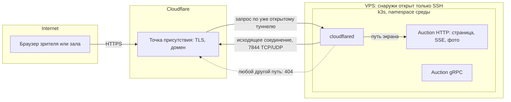

# Вход из интернета

До экрана зала платформа не отдавала в интернет ничего: снаружи хоста открыт только SSH, а сервисы живут в подах за закрытой сетью ([k3s.md](k3s.md), [service-access.md](service-access.md)). Экран зала открывает любой по ссылке, поэтому его маршрутам понадобился путь из интернета ([ADR-071](../../decisions/ADR-071-public-entry-through-cloudflare-tunnel.md)). Файл объясняет, из чего такой путь собирается — прокси, TLS, сертификат, входящий порт или исходящий туннель — и какую развилку прошли, прежде чем выбрать Cloudflare Tunnel. Кода туннеля ещё нет ([PER-661](https://linear.app/anticnvm/issue/per-661)): поведение Cloudflare здесь взято из его документации, а не из прогона, и помечено, где проверить самому.

## Механика

### Почему сервис кластера сам по себе недостижим

Под слушает порт на своём адресе внутри сети подов. Снаружи этого адреса не видно, а Service типа ClusterIP — это правило DNAT на узле, которое тоже действует только изнутри ([k3s.md](k3s.md)). Чтобы запрос из интернета дошёл до пода, кто-то должен принять соединение на адресе, который виден снаружи, и переслать его внутрь. Снимок чарта прямо говорит, что такого места нет:

```
auction: ContainerResource
  endpoint: grpc http port= target=8081 proxied=True external=False
  endpoint: http http port= target=8080 proxied=True external=False
```

`external=False` у обоих эндпоинтов Auction: генератор чарта не публикует их наружу (`infra/apphost/AppHost.UnitTests/TestUtilities/Snapshots/cluster.publish.txt`).

### Ingress-контроллер и почему его выключили

В Kubernetes «принять снаружи и раздать по сервисам» делает **ingress-контроллер**: reverse proxy, который слушает 80 и 443, смотрит на имя хоста и путь запроса и пересылает его нужному Service. В .NET ближайший аналог — YARP или IIS ARR перед несколькими приложениями. k3s приносит такой контроллер с собой: «Traefik is deployed by default when starting the server», и он поднимает Service типа LoadBalancer на портах 80 и 443. Без облака LoadBalancer реализует встроенный ServiceLB, который «uses available host ports» — то есть открывает эти порты прямо на адресе узла ([k3s: Networking Services](https://docs.k3s.io/networking/networking-services)).

На хосте оба выключены в `config.yaml` ещё до первого старта:

```yaml
disable:
  - traefik
  - servicelb
```

Поэтому ADR-055 и пишет «снаружи хоста по-прежнему открыт только SSH»: того, кто слушал бы 80 и 443, в кластере нет.

### TLS и сертификат: что нужно собственному входу

Браузер откроет страницу по `https://` только с сертификатом, подписанным доверенным центром. Бесплатный автоматический путь — Let's Encrypt по протоколу **ACME**: центр выдаёт сертификат, только если сервер докажет, что владеет доменом. Traefik умеет три способа доказательства ([Traefik: ACME](https://doc.traefik.io/traefik/reference/install-configuration/tls/certificate-resolvers/acme/)):

- **HTTP-01** — Let's Encrypt приходит на порт 80 за файлом-ответом;
- **TLS-ALPN-01** — то же через порт 443;
- **DNS-01** — ответ кладётся записью в DNS, порты не нужны, и только так выпускаются wildcard-сертификаты.

Выпущенные сертификаты Traefik хранит в файле `acme.json` и продлевает сам. Вывод для развилки: свой вход — это не только «открыть 443», а ещё порт или доступ к DNS для доказательства, файл с ключами, который надо пережить при рестарте, и продление, за которым надо следить.

### Входящий порт против исходящего туннеля

Обычный вход — **входящий**: на хосте открыт порт, и любой в интернете может к нему подключиться. Туннель переворачивает направление. Процесс внутри сети сам устанавливает **исходящее** соединение к чужой точке присутствия и держит его открытым, а запросы зрителей приходят к нему уже по этому соединению. Cloudflare описывает это так: «cloudflared initiates an outbound connection through your firewall from the origin to the Cloudflare global network» ([Cloudflare Tunnel](https://developers.cloudflare.com/cloudflare-one/connections/connect-networks/)). Входящих портов `cloudflared` не требует. Исходящим ему нужен порт 7844 по TCP (HTTP/2) и UDP (QUIC) к `region1.v2.argotunnel.com` и `region2.v2.argotunnel.com`, а 443 — только для проверки обновлений ([Tunnel with firewall](https://developers.cloudflare.com/cloudflare-one/connections/connect-networks/configure-tunnels/tunnel-with-firewall/)). Именно это стоит в NetworkPolicy листа PER-661.

Аналог из мира разработчика — `ngrok` или dev tunnels Visual Studio: локальный порт становится публичным адресом без открытия порта на роутере. Отличие в том, что здесь это постоянный путь прода, а не отладка: от доступности Cloudflare в день финала зависит экран.

### Правила туннеля как первый фильтр

Что туннель пропускает, задают правила `ingress` в конфигурации `cloudflared`. Правило совпадает по `hostname`, по `path` — регулярному выражению в синтаксисе Go — или по обоим и называет `service`, куда переслать. Последним обязано стоять правило без условий, и его типичная форма — `service: http_status:404` ([Configuration file](https://developers.cloudflare.com/cloudflare-one/connections/connect-networks/configure-tunnels/local-management/configuration-file/)). Так ADR-071 получает «только маршруты экрана»: одно правило с префиксом пути экрана на HTTP-порт Auction и 404 на всё остальное, поэтому `/health` и gRPC наружу не выходят ещё до кода Auction.

### Что прокси делает с SSE

SSE — один долгий HTTP-ответ, который сервер пишет кусками. Любой прокси на пути может сломать его двумя способами: копить куски и отдавать пачкой (буферизация) или оборвать ответ, который долго молчит. У Cloudflare документирован только первый таймаут: если origin не начал отвечать за 125 секунд, клиент получает ошибку 524 ([Error 524](https://developers.cloudflare.com/support/troubleshooting/http-status-codes/cloudflare-5xx-errors/error-524/)). Это ожидание **начала** ответа, а не тишина внутри уже идущего потока; про потоки страница молчит. Поэтому экран шлёт heartbeat — комментарий SSE, строку с двоеточием, которую браузер пропускает, — и его период берётся с запасом, а поведение маршрута проверяется на stage (ADR-040).

Ловушка: быстрые туннели trycloudflare.com, которые поднимаются одной командой без аккаунта, «do not support Server-Sent Events (SSE)» ([Quick Tunnels](https://developers.cloudflare.com/cloudflare-one/connections/connect-networks/do-more-with-tunnels/trycloudflare/)). Проверять поток экрана на них бессмысленно: нужен именованный туннель на своём домене.

## Урок

- Публичный вход раскладывается на четыре вопроса: кто принимает соединение, кто держит TLS и выпускает сертификат, кто фильтрует пути и кто гасит атаки. Варианты различаются тем, на чьей стороне каждый ответ.
- Направление соединения — граница безопасности. Исходящий туннель сохраняет «снаружи открыт только SSH» буквально, потому что слушающего порта нет вовсе; цену платят зависимостью от посредника.
- Фильтр путей стоит ставить в первом звене, а не только в коде сервиса: тогда ошибка маршрута в сервисе не открывает лишнего наружу.
- Долгие ответы — SSE, WebSocket, gRPC-стримы — первыми ломаются на прокси. Любой новый прокси на пути потока проверяется по реальному маршруту, а не по документации.

## Почему так, а не иначе

- **Ничего не открывать, экран только в зале по `ssh -L`** ([service-access.md](service-access.md)). Ноль новой поверхности, но ноутбуку зала нужен ключ хоста, а зритель дома видит экран только в кадре стрима. Владелец выбрал страницу для любого по ссылке — вариант отпал.
- **Свой вход: Traefik, Let's Encrypt, 443 в firewall хоста.** Никакого посредника, всё в своих руках. Цена: хост открыт интернету целиком, ACME требует порта или доступа к DNS, `acme.json` и продление — наша эксплуатация, а наплыв и атаки ложатся на тот же хост, что принимает ставки.
- **Cloudflare Tunnel** — выбран. Порты хоста не меняются, TLS и сертификат держит Cloudflare, сетевые атаки гасит его сеть, изображения с версией в адресе кэшируются у него. Цена: внешняя зависимость, домен на Cloudflare и риск, что из части сетей зрителей Cloudflare открывается плохо. Он записан сигналом пересмотра.
- **Страница на сайте сообщества (Netlify).** Сайт снаружи уже есть, но состояние торгов лежит в закрытой сети Auction, и сайту понадобился бы тот же вход плюс посредник к Auction (ADR-040, дополнение 2026-10-19).

Наплыв на сам поток туннель не гасит: SSE не кэшируется, и каждый зритель — отдельный поток до Auction. От этого торги защищает предел потоков экрана, а не Cloudflare.

## Схема



gRPC Auction на схеме ни с чем не связан намеренно: правила туннеля к нему не ведут.

## Первоисточники

- [Cloudflare Tunnel](https://developers.cloudflare.com/cloudflare-one/connections/connect-networks/) — исходящее соединение и модель «закрой весь вход».
- [Tunnel with firewall](https://developers.cloudflare.com/cloudflare-one/connections/connect-networks/configure-tunnels/tunnel-with-firewall/) — порт 7844, TCP и UDP, адреса для правил выхода.
- [Configuration file](https://developers.cloudflare.com/cloudflare-one/connections/connect-networks/configure-tunnels/local-management/configuration-file/) — правила `ingress`, `path` как регулярное выражение, обязательное последнее правило.
- [Quick Tunnels](https://developers.cloudflare.com/cloudflare-one/connections/connect-networks/do-more-with-tunnels/trycloudflare/) — ограничения быстрого туннеля, в том числе отказ от SSE.
- [Error 524](https://developers.cloudflare.com/support/troubleshooting/http-status-codes/cloudflare-5xx-errors/error-524/) — 125 секунд до начала ответа.
- [k3s: Networking Services](https://docs.k3s.io/networking/networking-services) — встроенные Traefik и ServiceLB и их выключение.
- [Traefik: ACME](https://doc.traefik.io/traefik/reference/install-configuration/tls/certificate-resolvers/acme/) — способы доказательства владения доменом и порты каждого.
- [WHATWG: Server-sent events](https://html.spec.whatwg.org/multipage/server-sent-events.html) — комментарий как строка с двоеточием, переподключение браузера.

## Проверь себя

1. Почему вход на stage сейчас закрыт, даже если в поде Auction слушает порт 8080?
   *Ответ:* `sudo cat /etc/rancher/k3s/config.yaml` на хосте показывает `disable: [traefik, servicelb]`, а `grep external= infra/apphost/AppHost.UnitTests/TestUtilities/Snapshots/cluster.publish.txt` — только `external=False`.
2. Что увидит зритель, если запросит через туннель `/health` Auction?
   *Ответ:* 404 от `cloudflared` по последнему правилу. Проверь сам, когда будет чем: после PER-661 `curl -i https://<домен>/health`.
3. Обрывает ли Cloudflare SSE-поток, в котором 3 минуты нет ни байта?
   *Ответ:* документация не говорит. Проверь сам, когда будет чем: на stage после PER-661 и PER-484 временно выключить heartbeat и смотреть `curl -N https://<домен>/<путь потока>`, в какой момент поток закроется.
4. Почему для этой проверки нельзя взять `cloudflared tunnel --url http://localhost:8080`?
   *Ответ:* быстрый туннель не поддерживает SSE — это прямо написано в [Quick Tunnels](https://developers.cloudflare.com/cloudflare-one/connections/connect-networks/do-more-with-tunnels/trycloudflare/).
