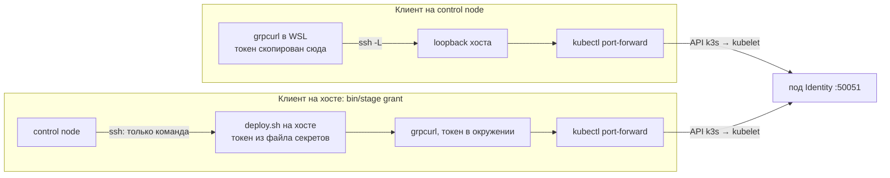

# Доступ к сервису кластера снаружи

Сервисы stage живут в подах k3s, и снаружи до них не достать: порты подов не опубликованы, в namespace стоит `default-deny`, а host guard не пускает к сетям подов и сервисов процессы хоста, кроме root ([k3s.md](k3s.md#host-guard-правило-по-владельцу-процесса)). Человеку при этом нужен разовый вызов: выдать набор мейнтейнера, открыть базу, наполнить аукцион. Файл объясняет два транспорта, которыми такой вызов доходит до пода, — `kubectl port-forward` и `ssh -L`, — и почему для вызова с секретом важнее не транспорт, а то, на какой машине работает клиент. Правило stage — [stage.md](../../development/stage.md), раздел «Администратор»; как Identity проверяет сам секрет — [grpc/unary-server.md](../grpc/unary-server.md).

## Механика

### `kubectl port-forward` идёт через API, а не через сеть

`kubectl port-forward svc/identity-service 15051:50051` открывает на машине, где запущен kubectl, порт `15051` на `127.0.0.1` и `[::1]`. Каждое соединение на этот порт kubectl не отправляет по сети кластера, а везёт потоком через API-сервер k3s к kubelet узла, и уже kubelet доставляет байты на порт `50051` внутри пода. Пакета «процесс хоста → адрес пода» при этом не возникает, поэтому ни ClusterIP, ни NetworkPolicy, ни host guard этот путь не видят.

Проверено на хосте stage под `ops` в одну минуту:

```text
прямой TCP от ops до ClusterIP identity-service:50051   → отказ (host guard)
kubectl get networkpolicy                                → default-deny, allow-same-namespace, …
port-forward + grpcurl -plaintext 127.0.0.1:15052 list   → identity.v1.IdentityService, grpc.health.v1.Health, …
```

Отсюда следствие: право `pods/portforward` в Role по силе равно сетевому доступу к поду. Его держит kubeconfig учётки выкатки, а kubeconfig среды хост не покидает ([ADR-055](../../decisions/ADR-055-k3s-runtime-from-aspire-chart.md)). Поэтому `port-forward` к stage запускается только на хосте.

`svc/<имя>` — не балансировка. kubectl один раз выбирает под сервиса и все соединения ведёт в него: `kubectl port-forward --help` прямо говорит, что под выбирается автоматически, а сессия кончается вместе с ним. На stage `-v=6` показывает выбор в URL запроса — `pods/identity-deployment-…/portforward`. Перезапуск пода Identity посреди вызова рвёт туннель, и команду надо запустить заново.

Что именно kubelet делает внутри пода, командой не проверялось. По документации соединение открывается на порт пода изнутри его сетевого пространства, то есть приходит как локальное. Проверь сам, когда будет чем: во время `port-forward` посмотреть соединения пода отладочным контейнером, `kubectl debug -it <под> --image=<образ с ss> -- ss -tn`, и найти соединение на `:50051` с адреса `127.0.0.1`.

### `ssh -L` переносит порт хоста к себе

`ssh -L 50051:127.0.0.1:50051 ops@<хост>` делает другое. Клиент ssh слушает порт `50051` на своей машине, каждое соединение отправляет внутрь уже открытого зашифрованного соединения ssh, а sshd на хосте открывает соединение на `127.0.0.1:50051`. Адрес назначения разрешается **на стороне хоста**, поэтому `127.0.0.1` здесь — loopback хоста, а не control node.

Прежний ручной рецепт выдачи мейнтейнера складывал оба транспорта в цепочку: `grpcurl` в WSL → `ssh -L` → loopback хоста → `kubectl port-forward` на хосте → под Identity. Так 2026-10-15 после сброса базы stage был выдан набор `maintainer`: ответ `{"changed": true}`. `ssh` доставляет до хоста, `port-forward` — с хоста внутрь кластера. Ни один из них не заменяет другой: без `ssh -L` клиенту на control node не до чего дотянуться, без `port-forward` loopback хоста пуст.

`-o ExitOnForwardFailure=yes` нужен потому, что по умолчанию ssh, не сумев занять локальный порт, только предупреждает и продолжает работать без переброски. Следующий шаг рецепта тогда стучится в чужой процесс на этом порту. Но и с флагом есть ловушка, проверенная в WSL на занятом `127.0.0.1:15999`:

```text
-L 15999:…                         bind [127.0.0.1]:15999: Address already in use   → команда идёт, exit 0
-L 15999:…  ExitOnForwardFailure   то же предупреждение                              → команда идёт, exit 0
-L 127.0.0.1:15999:…               Could not request local forwarding.              → команда идёт, exit 0
-L 127.0.0.1:15999:…  ExitOnForwardFailure                                          → exit 255, команда не запускалась
```

Без адреса привязки ssh слушает `localhost`, то есть и `127.0.0.1`, и `[::1]`. Чужой процесс занял только IPv4-половину, IPv6-половина поднялась, и для ssh переброска состоялась — флаг молчит. А клиент, который ходит на `127.0.0.1`, попадает в чужой процесс. Флаг держит слово, только когда адрес привязки назван явно: `-L 127.0.0.1:50051:127.0.0.1:50051`.

### Где работает клиент, там и секрет

Транспорт отвечает на вопрос «как дойти до пода». Вопрос «где лежит секрет» решает другое: на какой машине запущен клиент. Заголовок `authorization: Bearer <токен>` собирает клиент, значит токен должен быть у него в памяти.

- **Клиент на control node.** Токен лежит в файле секретов хоста, поэтому рецепт сначала копировал его по ssh: `token=$(ssh … 'grep ^IDENTITY_MAINTAINER_TOKEN= …')`. Секрет покидал хост при каждой выдаче и жил в переменной оболочки WSL.
- **Клиент на хосте.** `bin/stage grant <ник>` по ssh отправляет только команду: `deploy.sh` на хосте читает файл секретов, поднимает `port-forward` на один вызов и зовёт `grpcurl` там же. Обратно приходит `{"changed": …}`. Секрет не уходит дальше машины, на которой лежит, — по тому же правилу, по которому helm и kubectl работают на хосте с kubeconfig, который хост не покидает.

Цена второго варианта — `grpcurl` на хосте. Его ставит задача ansible с закреплённой суммой, как helm.

### Секрет в argv виден всем пользователям хоста

У каждого процесса Linux есть два файла в `/proc`: `cmdline` — аргументы запуска и `environ` — окружение. Проверено на хосте stage, где `/proc` смонтирован без `hidepid`:

```text
stat -c '%a %U' /proc/<свой pid>/cmdline   → 444 ops    читает любой пользователь
stat -c '%a %U' /proc/<свой pid>/environ   → 400 ops    только владелец и root
tr '\0' ' ' < /proc/1/cmdline  (под ops)   → /sbin/init  argv процесса root виден
cat /proc/1/environ            (под ops)   → отказ
```

Поэтому `grpcurl -H "authorization: Bearer $token"` выкладывает секрет в argv, и его видит `ps` любого пользователя хоста — а на хосте есть учётки разработчика и агента. `grpcurl -expand-headers -H 'authorization: Bearer ${IDENTITY_MAINTAINER_TOKEN}'` в одинарных кавычках оставляет в argv только шаблон: подставляет значение сам `grpcurl` из своего окружения, которое читают лишь `ops` и root. Тест ops-репозитория `tests/stage.sh` держит это заглушкой `grpcurl`: она пишет argv и окружение раздельно, и тест требует токен во втором и не в первом.

Аналог из .NET: `ProcessStartInfo.Arguments` против `ProcessStartInfo.Environment`. Правило то же, потому что оно принадлежит ОС, а не языку.

## Урок

- **Для вызова с секретом сначала выбирают машину клиента, потом транспорт.** Туннель решает доставку, но не место секрета: идеальный туннель с клиентом на ноутбуке всё равно везёт секрет на ноутбук. Секрет остаётся там, где лежит, если клиент приходит к нему, а не наоборот.
- **`port-forward` — дыра через API.** Он обходит NetworkPolicy и firewall хоста, поэтому право `pods/portforward` выдаётся как сетевой доступ к поду, а не как «удобная отладка».
- **Флаг «упади при отказе» проверяют на частичном отказе.** `ExitOnForwardFailure` честен ровно настолько, насколько однозначен запрошенный адрес: два слушателя за одним именем `localhost` превращают «не получилось» в «получилось наполовину». Тот же вопрос задаётся любому «fail fast» на сервере, который слушает несколько адресов.
- **Секрет не передают аргументом.** На многопользовательском хосте argv публичен. Окружение, файл с правами 0600 или stdin — да; `-H "...$token"` — нет.

## Почему так, а не иначе

| Вариант | Цена |
|---|---|
| Клиент на control node через `ssh -L` (прежний рецепт README ops) | секрет копируется с хоста на control node при каждой выдаче; `grpcurl` нужен на control node |
| Подкоманда хоста, которая печатает токен для `bin/stage` | то же копирование, только автоматическое; классификатор режима агента остановил её как выдачу учётных данных, и вариант отвергнут |
| Разовый под с `grpcurl` в namespace | образ из реестра, место в квоте `test`, Pod Security `restricted` и отдельная политика поверх `default-deny` к Identity; токен уходит в спецификацию пода через API |
| Опубликовать порт Identity наружу | открывает служебный метод сети; [ADR-056](../../decisions/ADR-056-service-calls-per-caller-token-and-closed-network.md) держит сеть среды закрытой |
| `grpcurl` на хосте через `port-forward` (выбрано) | одна задача ansible и бинарь на хосте; вызов идёт с машины, где лежат секрет и kubeconfig |

## Схема



## Первоисточники

- [kubectl port-forward](https://kubernetes.io/docs/reference/kubectl/generated/kubectl_port-forward/) — зачем идти: выбор одного пода для `svc/` и `deployment/` и конец сессии вместе с ним.
- [Use Port Forwarding to Access Applications in a Cluster](https://kubernetes.io/docs/tasks/access-application-cluster/port-forward-access-application-cluster/) — зачем идти: что `port-forward` соединяется с подом, а не с сервисом, и как это выглядит на примере.
- [ssh(1), `-L`](https://man.openbsd.org/ssh#L) — зачем идти: где разрешается адрес назначения переброски.
- [ssh_config(5), `ExitOnForwardFailure`](https://man.openbsd.org/ssh_config#ExitOnForwardFailure) — зачем идти: поведение ssh, когда локальный порт занят.
- [proc_pid_cmdline(5)](https://man7.org/linux/man-pages/man5/proc_pid_cmdline.5.html), [proc_pid_environ(5)](https://man7.org/linux/man-pages/man5/proc_pid_environ.5.html) и опция `hidepid` в [proc(5)](https://man7.org/linux/man-pages/man5/proc.5.html) — зачем идти: кто читает argv и окружение чужого процесса.
- [grpcurl README](https://github.com/fullstorydev/grpcurl) и `grpcurl -help` — зачем идти: `-expand-headers` и синтаксис `${NAME}` в заголовке.
- [ADR-037](../../decisions/ADR-037-identity-maintainer-shared-secret.md) — зачем идти: что за секрет и почему его утечка равна праву выдачи; [ADR-055](../../decisions/ADR-055-k3s-runtime-from-aspire-chart.md) — почему kubeconfig не покидает хост.

## Проверь себя

- **Пустит ли host guard процесс `ops` напрямую к ClusterIP Identity?** Нет. Проверка на хосте под `ops`: `timeout 4 bash -c 'exec 3<>/dev/tcp/<ClusterIP>/50051'` отказывает, а `kubectl port-forward svc/identity-service 15052:50051` и `grpcurl -plaintext 127.0.0.1:15052 list` в ту же минуту выдают список сервисов. Проверено на stage 2026-10-15.
- **В какой под ведёт `port-forward svc/identity-service`?** В один, выбранный при старте. Проверка: `kubectl port-forward svc/identity-service 15052:50051 -v=6` печатает URL `pods/identity-deployment-…/portforward`. Проверено.
- **Что значит `127.0.0.1` в `ssh -L 50051:127.0.0.1:50051`?** Loopback хоста, потому что назначение разрешает sshd. Проверено выдачей набора через такой туннель к `port-forward`, слушающему loopback хоста: `{"changed": true}`.
- **Остановит ли `ExitOnForwardFailure=yes` туннель `-L 15999:…`, если `127.0.0.1:15999` занят?** Нет: IPv6-половина поднимается, и ssh выполняет команду с кодом 0. С `-L 127.0.0.1:15999:…` — да, код 255. Проверка: `python3 -m http.server 15999 --bind 127.0.0.1 &`, затем `ssh -o ExitOnForwardFailure=yes -L 15999:127.0.0.1:1 <хост> 'echo ran'; echo $?` и то же с `-L 127.0.0.1:15999:…`. Проверено в WSL 2026-10-15.
- **Увидит ли учётка агента токен, переданный `grpcurl -H "authorization: Bearer $token"`?** Да, если её процесс на том же хосте: argv лежит в `/proc/<pid>/cmdline` с правами 444, а `/proc` без `hidepid`. Проверка: `grep ' /proc proc ' /proc/mounts` и `stat -c %a /proc/<pid>/cmdline /proc/<pid>/environ` → `444` и `400`. Проверено на хосте.
- **На какой машине `bin/stage grant` читает секрет?** На хосте: функция `preset` в `stage/deploy.sh` ops-репозитория зовёт `load_secrets` и `grpcurl` в одном процессе, а `bin/stage` передаёт по ssh только `deploy.sh grant <ник>`. Проверка: `grep -n 'load_secrets\|grpcurl\|port-forward' stage/deploy.sh` и `grep -n 'deploy.sh \$1' bin/stage` в ops-репозитории.
