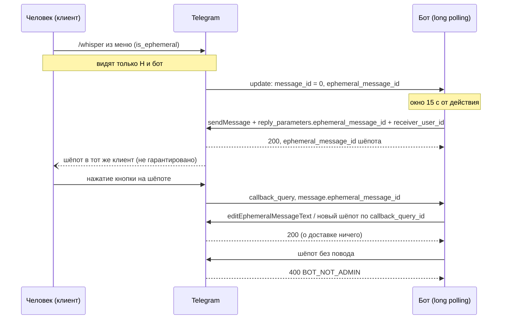

# Эфемерные сообщения и невидимые команды Bot API

Bot API — HTTP-интерфейс, через который бот говорит с Telegram: метод — POST на `https://api.telegram.org/bot<токен>/<метод>` с JSON-телом, ответ — `{ok, result}` или `{ok: false, description}`. С версии 10.2 в нём есть способ поговорить с одним человеком прямо в группе, не показывая разговор остальным: невидимая команда от человека к боту и эфемерный ответ, «шёпот», от бота к человеку.

Файл объясняет эту механику на зонде [`tools/telegram-rich-probe/whisper.mjs`](../../../tools/telegram-rich-probe/whisper.mjs) и живом прогоне 26 октября 2026 года ([RFC-003, «Шёпот в группе»](../../rfcs/RFC-003-bot-presentation-rich-blocks.md#шёпот-в-группе)). Что бот хаба из этого делает и почему — [ADR-078](../../decisions/ADR-078-hub-bot-whispers-in-community-chat.md); как grammY принимает update и зовёт методы — [grammy/bot-adapter.md](../grammy/bot-adapter.md).

## Механика

### Эфемерное сообщение — не строка истории чата

Обычное сообщение группы — строка общей истории с номером `message_id`, по которому его правят, удаляют и на него отвечают. У эфемерного сообщения `message_id` равен нулю, а адрес другой — пара «получатель + `ephemeral_message_id`». В логе прогона невидимая команда `/whisper` пришла боту так (ключи без значений):

```
message_id (= 0), ephemeral_message_id, from, chat (type = "group"), date, receiver_user, text, entities
```

а обычная `/loud` из той же группы — без `ephemeral_message_id` и `receiver_user`. `receiver_user` у входящей команды — сам бот: команду видят только отправитель и он. Справочник добавляет, что `ephemeral_message_id` может достаться другому шёпоту после удаления или истечения прежнего, то есть это не вечный ключ.

Аналогия из .NET — не строка в общей таблице, а уведомление SignalR, отправленное `Clients.User(id)`: оно адресовано одному человеку и в общем журнале не лежит. Отличие: SignalR знает о подключениях, а бот о клиентах человека не знает ничего, и об этом ниже.

Поэтому правят и удаляют шёпот отдельными методами с тремя адресными параметрами, а не `editMessageText`:

```js
await call("editEphemeralMessageText", {
  chat_id: chatId,
  receiver_user_id: query.from.id,
  ephemeral_message_id: ephemeralMessageId,
  text: `PER-680 шёпот отредактирован в ${new Date().toISOString()}`,
  reply_markup: whisperKeyboard,
});
```

### Невидимой команду делает запись в меню, а не текст

Невидимость не написана в тексте `/whisper` — её объявляет бот, когда ставит список команд:

```js
const commands = [
  { command: "whisper", description: "PER-680 невидимая", is_ephemeral: true },
  { command: "late", description: "PER-680 ответ с задержкой", is_ephemeral: true },
  { command: "loud", description: "PER-680 обычная" },
];
const scope = { type: "chat", chat_id: Number(groupChatId) };
await call("setMyCommands", { scope, commands });
```

`scope` ограничивает список одной группой: у бота может быть разный список в личке, в группах вообще и в конкретном чате. Человек выбирает команду из меню, клиент видит `is_ephemeral` и отправляет её невидимо; в меню у такой команды значок. Список — состояние на сервере Telegram, а не в процессе бота: он переживает остановку. Поэтому зонд сначала читает прежний список (`getMyCommands`) и возвращает его на `SIGINT`/`SIGTERM`, иначе в меню группы остались бы команды, которых никто не обрабатывает.

### Право шептать — повод с окном в 15 секунд

Бот без прав администратора не может шепнуть кому угодно когда угодно. Справочник: шепнуть можно в течение 15 секунд после действия человека, и шёпот придёт в тот клиент, где действие совершено. Повод называется одним из двух указателей:

```js
// ответ на невидимую команду
reply_parameters: { ephemeral_message_id: message.ephemeral_message_id },
ephemeral_message_parameters: { receiver_user_id: message.from.id },

// ответ на нажатие кнопки
ephemeral_message_parameters: {
  receiver_user_id: query.from.id,
  callback_query_id: query.id,
  replace_callback_query_message: query.data === "per680:replace",
},
```

Без повода сервер отказывает: живой вызов вернул `400 Bad Request: BOT_NOT_ADMIN`. Администратор может шептать без повода, и тогда шёпот может прийти на несколько клиентов человека, но и ему доставку никто не обещает.

Это знакомая форма: право на ответ привязано к входящему событию и истекает. Похоже на `response_url` в Slack или на одноразовый токен ответа, только здесь токена нет — есть идентификатор события, и сервер сам сверяет время. Следствие для кода: всё, что бот делает между командой и ответом — разрешение личности, чтение сервисов, — укладывается в 15 секунд. Ручной `curl` в окно не попадал, поэтому прогон шёл автоответчиком на long polling.

### Окно — повод не держать цикл update'ов

`/late` отвечает с задержкой, чтобы проверить шёпот человеку, который уже закрыл приложение. Ждать внутри цикла `getUpdates` нельзя: пока цикл спит, остальные команды и нажатия лежат непрочитанными, и их собственные 15 секунд истекают. Поэтому задержка идёт без `await`:

```js
sleep(lateDelayMs)
  .then(() => whisperBack(message))
  .catch((error) => print("late-failed", String(error)));
```

В .NET это `_ = Task.Run(...)` без ожидания, и там необработанное исключение такой задачи по умолчанию ничего не роняет. В Node иначе: начиная с версии 15 отказ промиса, на который никто не повесил обработчик, завершает процесс. Проверено на Node 26:

```
node -e 'new Promise(r=>setTimeout(r,10)).then(()=>{throw new Error("network")})'
# Error: network … EXIT=1
```

Первая версия зонда `catch` здесь не имела, и сетевой отказ `fetch` в отложенном ответе уронил бы процесс мимо восстановления команд группы. Тот же отказ на самом `getUpdates` тоже обходил восстановление: `call` бросает, а проверка `updates.ok` до него не доходит. Оба места исправлены в этом разборе.

### Окно идёт от команды, а не от начала обработки

Бот хаба, в отличие от зонда, отвечает внутри цикла: grammY разбирает пачку update'ов строго по очереди и ждёт каждый обработчик (`node_modules/grammy/out/bot.js`, `handleUpdates`):

```js
// handle updates sequentially (!)
for (const update of updates) {
    this.lastTriedUpdateId = update.update_id;
    try {
        await this.handleUpdate(update);
```

В .NET это похоже на `foreach` с `await` над очередью сообщений, а не на `Parallel.ForEachAsync`. Следствие для шёпота: команда, пришедшая третьей в пачке, начнёт обрабатываться, когда первые две уже потратили своё время на Identity и Meetups. Бюджет «пять секунд от начала обработчика» у неё полный, но окно Telegram к этому моменту наполовину съедено. Первая версия каркаса шёпота считала дедлайн сервисов так, и ось корректности ревью это поймала:

```ts
deadlineAt: Date.now() + actionBudgetMs,
```

Отсчёт окна у сервера идёт от самой команды, а у команды есть свой момент — поле `date` сообщения, секунды Unix по часам Telegram. Каркас (`apps/hub-bot/src/surfaces/hub/presentation/community-whisper.ts`) берёт меньший из двух сроков и оставляет секунду на сам вызов `sendMessage`:

```ts
deadlineAt: Math.min(
  Date.now() + actionBudgetMs,
  command.sentAt + whisperWindowMs - sendReserveMs,
),
```

Второй источник опоздания — хвост очереди после рестарта. Процесс зовёт `bot.start` без `drop_pending_updates` (`apps/hub-bot/src/core/process.ts`), и grammY передаёт это значение в `deleteWebhook` как есть. Значит, команды, отправленные, пока бот лежал, придут при старте, и окно у них давно закрыто. На такую команду каркас не ходит ни в Identity, ни в Meetups, а пишет `info` `community whisper window expired`:

```ts
if (Date.now() >= command.sentAt + whisperWindowMs) {
```

У `date` точность — секунда, и `date * 1000` лежит не позже настоящего момента команды: окно по нему выходит не длиннее настоящего, то есть с запасом. Обратная сторона — часы бота. Если они спешат относительно часов Telegram, окно съедается на величину ухода, и бот пропускает команду, на которую ещё успел бы ответить. Если отстают, окно растягивается: бот ходит в Identity и Meetups и шлёт шёпот, который сервер уже отвергнет, — ровно тот вызов, которого проверка окна должна избегать.

### У нажатия нет своего момента, и окно правку не ограничивает

У команды момент есть: поле `date`. У нажатия кнопки его нет. Тип `CallbackQuery` в `@grammyjs/types` 5.0.0 несёт только эти поля:

```ts
id: string;
from: User;
message?: MaybeInaccessibleMessage;
inline_message_id?: string;
chat_instance: string;
data?: string;
game_short_name?: string;
```

`date` внутри `message` есть, но это момент самого шёпота, то есть сообщения с кнопкой, а не нажатия. Он даёт только нижнюю границу: нажали не раньше, чем шёпот отправлен. Поэтому каркас отсчитывает срок нажатия от приёма update (`community-whisper.ts`, `pressBack`):

```ts
// Окно правки идёт от нажатия, а `date` у нажатия нет: отсчёт от приёма.
const receivedAt = Date.now();
…
deadlineAt: Math.min(
  receivedAt + actionBudgetMs,
  receivedAt + whisperWindowMs - sendReserveMs,
),
```

У команды отсчёт от `date` даёт запас: окно по нему не длиннее настоящего. У нажатия всё наоборот: приём наступает позже нажатия, на время очереди grammY. Если бы окно правки действовало, нажатие из хвоста очереди нельзя было бы ни отсеять, ни узнать, что его окно прошло.

Живой прогон 19 ноября 2026 года снял этот вопрос иначе ([RFC-003, «Шёпот в группе»](../../rfcs/RFC-003-bot-presentation-rich-blocks.md#шёпот-в-группе)). `editEphemeralMessageText` по нажатию вернул `200` и дошёл до человека в трёх случаях: сразу после нажатия, после 102 секунд над шёпотом до нажатия и через 20 секунд после нажатия. Пятнадцать секунд ограничивают новый шёпот, то есть повод `reply_parameters` или `callback_query_id`, а правку уже отправленного шёпота не ограничивают. Каркас отвечает на нажатие правкой (`editWhisper` → `ctx.api.editEphemeralMessageText`), значит, нажатие из очереди сервер не отвергнет.

Член окна в `Math.min` при этом ничего не меняет. `actionBudgetMs` равен 5 секундам (`waiting.ts`), а `whisperWindowMs - sendReserveMs` — 14, и меньшим всегда выходит бюджет. Срок нажатия на деле — пять секунд от приёма.

В том же прогоне выяснилось, что нажатие несёт содержимое шёпота. `callback_query.message` пришёл с `text`, `entities`, `reply_markup`, `date` и `reply_to_message`, а `reply_to_message` — это сама невидимая команда со своим `text` и `date`. Поэтому ссылку и название из `/attach`, которые не помещаются в 64 байта `callback_data`, бот читает обратно из нажатия (`parseWhisperPress`), без памяти процесса. Заодно у такого нажатия появляется момент команды (`replied.data.date * 1_000`): это нижняя граница, а не момент нажатия.

В .NET похоже на сообщение очереди без собственной метки времени: известна только метка исходного документа и момент, когда сообщение взял обработчик. Отличие в том, что здесь срок проверяет чужой сервер, и ему важен вид вызова, а не возраст события.

### Параллельный вызов во время long polling

Первая версия зонда `attach.mjs` отправляла правку «сразу» без `await`, пока цикл уже висел в следующем `getUpdates`. На машине прогона правка доходила только со следующим нажатием, то есть ждала, пока `getUpdates` вернётся. Исправленный зонд ждёт правку внутри обработчика, как это делает бот на grammY, и укорачивает long poll до секунды:

```js
if (delay === 0) {
  await edit();
  return;
}
…
const updates = await call("getUpdates", { offset, timeout: 1, … })
```

Сам `fetch` в Node параллельные запросы к одному адресу не выстраивает в очередь. Проверено на Node 26.4.0 скриптом из двух вызовов: медленный запрос висит 4 секунды, через 300 мс к тому же адресу уходит быстрый, соединение прогрето заранее. Быстрый ответил за 34 мс на локальном HTTP-сервере и за 150 мс по HTTPS к `httpbin.org` с той же машины. Пул `fetch` открывает под второй запрос новое соединение, а не ставит его за висящим. В .NET так себя ведёт `HttpClient` с `SocketsHttpHandler`: соединений на хост по умолчанию сколько угодно.

Почему правка ждала именно рядом с `getUpdates` к `api.telegram.org`, не установлено. Этого не объясняют ни `fetch`, ни HTTPS этой машины в целом. Вывод для кода не зависит от причины: правку отправляют внутри обработчика, до следующего `getUpdates`, как grammY, и тогда параллельного вызова нет.

### `200` значит «принято», а не «доставлено»

Сервер ответил `200` на все вызовы прогона, включая три, которые до человека не дошли:

| Вызов | Ответ сервера | Что увидел адресат |
|---|---|---|
| шёпот через 10 с, приложение закрыто | `200`, `ephemeral_message_id` | ничего, и после открытия тоже |
| `deleteEphemeralMessage`, mobile | `200`, `true` | шёпот остался |
| `deleteEphemeralMessage`, Web K | `200`, `true` | шёпот исчез |

Справочник предупреждает об этом прямо: доставка не гарантирована, особенно офлайн. Тип в grammY честен: `deleteEphemeralMessage(...)` возвращает `Promise<true>`, то есть «сервер принял», и поля под исход доставки в нём нет. Бот не может узнать, дошёл ли шёпот, — никакого update об этом не приходит.

Есть и третий способ потерять шёпот: клиент его не хранит. Web K теряет все шёпоты при перезагрузке страницы, mobile хранит их после перезапуска. Срок жизни в минутах не измерялся.

### Privacy Mode отрезает ссылку на сообщение

Privacy Mode — режим бота в группе, при котором он получает не всю переписку, а только адресованное ему: команды, ответы на его собственные сообщения, служебные события. Он включён по умолчанию и выключается в BotFather.

Обычно ответ на сообщение несёт поле `reply_to_message` — то сообщение, на которое ответили. Прогон проверил, придёт ли оно с командой, отправленной ответом на чужое сообщение: ни невидимая `/whisper`, ни обычная `/loud@бот` его не принесли, а само сообщение бот не получил. Справочник оговаривает пропуск только для ответа на эфемерное сообщение; для команды-ответа при Privacy Mode оговорки нет, и это поведение видно только живьём. Встречный факт из того же лога: шёпот, который отправил сам бот с `reply_parameters.ephemeral_message_id`, в ответе сервера `reply_to_message` несёт. Значит, поле срезает не механика шёпота, а то, что бот не должен видеть чужое сообщение.

### Команда в группе может быть адресована другому боту

В группе с несколькими ботами команду пишут с хвостом: `/whisper@solguficky_dev_bot`. Зонд разбирает команду регулярным выражением и хвост не сверяет:

```js
const match = /^\/([a-z_]+)(?:@\w+)?(?:\s|$)/.exec(text);
```

`commandOf("/whisper@other_bot")` даёт `"whisper"` — зонд ответил бы на команду чужому боту, если бы её получил. Фильтр `bot.command` в grammY сверяет хвост с именем бота (`node_modules/grammy/out/context.js`: `atTarget !== ctx.me.username.toLowerCase()` — отказ). Боту хаба, который ходит через grammY, эта ошибка не грозит; зонду — грозит, если такая команда до него дойдёт. Доходит ли команда чужому боту до бота с Privacy Mode, живьём не проверялось.

## Урок

- **Подтверждение сервера и доставка человеку — разные факты.** Где канал «по возможности», тип ответа говорит только о приёме. Решение, которое нуждается в доставке, строится на втором канале, где исход виден, — так ADR-078 оставляет надёжный путь личке и не дублирует шёпот вслепую.
- **Право ответить, привязанное к событию и времени, переворачивает бюджет обработчика.** Задержка перестаёт быть вопросом удобства: опоздавший ответ отвергается. Такой обработчик сначала считают по времени — сколько вызовов до ответа и их таймауты, — а потом пишут.
- **Невидимость задаётся адресацией, а не содержимым.** Шёпот не «скрытое сообщение группы», а отдельная сущность со своим адресом и своими методами. Перенос привычных операций — правки, удаления, ответа — на неё требует отдельных методов, и каждый из них может вести себя по-своему на разных клиентах.
- **Поля update проверяются живьём, если от них зависит сценарий.** Справочник описывает форму, но не то, что срежет режим бота. Отсутствие `reply_to_message` отменило целый кадр раскадровки, и узнать это можно было только прогоном.
- **Fire-and-forget в Node требует `catch` всегда.** В .NET потерянное исключение задачи — тихая ошибка, в Node — падение процесса.
- **Срок, который ставит внешняя сторона, считается от её события, а не от начала своей обработки.** При последовательной очереди обработчик стартует позже события на время всех предыдущих, а после рестарта — на время простоя. Свой бюджет режется по чужому сроку, а событие, чей срок уже прошёл, не обрабатывается вовсе: ответ на него сервер всё равно отвергнет.
- **Сначала выясни, на какой вызов действует чужой срок.** Окно в 15 секунд выглядело общим правилом шёпота, а оказалось правилом нового шёпота: правку по нажатию сервер принимает и позже. Срок, который ты накладываешь на всё сразу, ничего не ломает, но прячет, где ограничение настоящее, а где выдуманное.
- **Отсутствие метки времени у события — свойство протокола, а не недосмотр.** Где своей метки нет, отсчёт идёт от приёма, и он не консервативен: приём всегда позже события. Это приемлемо, только если чужой сервер сам срок не проверяет или проверяет его по другому событию.
- **Задержку, найденную зондом, сперва воспроизводят отдельно от зонда.** «Параллельный запрос ждёт long poll» не подтвердилось ни локально, ни по HTTPS к другому хосту. Вывод про устройство зонда верен и без объяснения причины, а обобщение «`fetch` в Node последователен» ложно.

## Почему так, а не иначе

- **Зонд на сыром `fetch`, а не на grammY.** grammY 1.46.0 в пакете бота уже типизирует все эфемерные методы, но зонд — один файл, который запускается `node` без установки зависимостей и печатает ровно тот JSON, что уходит на сервер. Ценой стал ручной разбор команды без сверки хвоста `@бот`, который в grammY есть даром. Бот хаба будет звать те же методы через grammY.
- **Автоответчик на long polling, а не ручные вызовы.** Ручной `curl` проще, но в 15 секунд не укладывался, а без повода сервер отвечал `BOT_NOT_ADMIN`. Автоответчик — единственный способ проверить окно, не давая боту прав администратора.
- **Права администратора, чтобы шептать без повода.** Сняли бы окно и позволили бы боту писать первым, но это расширяет права бота в чате сообщества и противоречит минимальным правам; доставку и тогда никто не обещает. ADR-078 держит бота участником без админки.
- **`replace_callback_query_message` против нового шёпота.** Замена показывает шёпот на месте исходной публичной карточки, только у нажавшего. Это удобно, но работает лишь для нажатия на обычном сообщении: для кнопки на самом шёпоте параметр обязан быть `false`, и шёпот правят `editEphemeralMessage…`.
- **Восстанавливать команды группы, а не просто ставить свои.** Без восстановления меню группы после прогона предлагало бы мёртвые команды. Цена — чтение прежнего списка до старта и обработка сигналов.
- **Окно от `date` команды против трёх соседей.** Дедлайн только от начала обработчика — проще, но под очередью и после рестарта шёпот опаздывает, а сервисы зря тратят вызовы. `drop_pending_updates` при старте отбросил бы хвост целиком, но заодно и нажатия, и сообщения лички, которым окно не грозит. Параллельная обработка update'ов (`@grammyjs/runner`) сняла бы очередь, но меняет устройство всего бота ради одного сценария: это отдельное решение, а не правка шёпота. Цена выбранного — зависимость от часов бота: спешащие часы съедают окно.
- **Срок нажатия от приёма против двух соседей.** Можно было считать от `message.date` шёпота. Это нижняя граница нажатия, и она отрезала бы человеку, который подумал над шёпотом больше 15 секунд, правку, которую сервер принимает (102 секунды в прогоне). Можно было вообще не ставить нажатию срок. Тогда зависший Identity или Meetups держал бы очередь grammY без предела. Выбранный отсчёт от приёма даёт бюджет сервисов в пять секунд. Член окна рядом с ним безвреден и сейчас не действует.
- **Правка внутри обработчика против параллельной.** Параллельная правка не держит цикл, но в зонде она ждала `getUpdates`. Правка внутри обработчика задерживает следующие update'ы на свои миллисекунды, зато уходит сразу. Отложенную правку зонд всё равно шлёт без `await`: её задержка в секундах, и короткий long poll ограничивает её ожидание секундой.

## Схема



## Первоисточники

- [Bot API, Ephemeral Messages and Commands](https://core.telegram.org/bots/api#ephemeral-messages-and-commands) — правило 15 секунд, «тот же клиент», права администратора и оговорка о недоставке офлайн.
- [Bot API, EphemeralMessageParameters](https://core.telegram.org/bots/api#ephemeralmessageparameters) — `receiver_user_id`, `callback_query_id`, `replace_callback_query_message` и почему последний запрещён для кнопки на шёпоте.
- [Bot API, ReplyParameters](https://core.telegram.org/bots/api#replyparameters) — `ephemeral_message_id` как повод и правило «ответ на эфемерное сам эфемерный».
- [Bot API changelog](https://core.telegram.org/bots/api-changelog) — версии 10.2 и 10.3: что добавлено и что переименовано в `ephemeral_message_parameters`.
- [Privacy Mode](https://core.telegram.org/bots/features#privacy-mode) — что бот получает в группе в этом режиме.
- [RFC-003, «Шёпот в группе»](../../rfcs/RFC-003-bot-presentation-rich-blocks.md#шёпот-в-группе) и таблица механик там же — условия и результаты прогона по клиентам.
- [ADR-078](../../decisions/ADR-078-hub-bot-whispers-in-community-chat.md) — что бот хаба строит на этих фактах.
- [Node.js, `--unhandled-rejections`](https://nodejs.org/api/cli.html#--unhandled-rejectionsmode) — режим `throw` по умолчанию: почему необработанный отказ роняет процесс.
- [Bot API, getUpdates](https://core.telegram.org/bots/api#getupdates) и [deleteWebhook](https://core.telegram.org/bots/api#deletewebhook) — сколько сервер держит неполученные update'ы и что делает `drop_pending_updates`.
- `apps/hub-bot/node_modules/grammy/out/bot.js`, `handleUpdates` и `start` — исходник grammY 1.46.0: последовательный разбор пачки и `drop_pending_updates` в `deleteWebhook` при старте long polling.
- [Bot API, CallbackQuery](https://core.telegram.org/bots/api#callbackquery) — полный список полей нажатия: своего момента у него нет.
- [Bot API, editMessageText](https://core.telegram.org/bots/api#editmessagetext) и раздел об эфемерных сообщениях — на что справочник распространяет окно в 15 секунд, сверяй с живым фактом RFC-003 о правке.
- [undici, Agent и Pool](https://undici.nodejs.org/#/docs/api/Pool) — пул соединений, на котором стоит `fetch` в Node: почему второй запрос получает новое соединение.
- [`tools/telegram-rich-probe/attach.mjs`](../../../tools/telegram-rich-probe/attach.mjs) — зонд прогона 19 ноября: правка внутри обработчика и long poll на секунду.

## Проверь себя

Проверялось 26 октября 2026 года: прогон в обычной группе с `@solguficky_dev_bot` без прав администратора и с Privacy Mode, Web K и mobile; grammY 1.46.0 и `@grammyjs/types` 5.0.0 из `apps/hub-bot/node_modules`; Node 26.4.0.

- Что приходит в `message_id` у невидимой команды и у шёпота? Ноль у обоих. Проверка — `just telegram-whisper-probe` с `HUB_BOT_TOKEN` и `GROUP_CHAT_ID`, затем `/whisper` в группе: строки `update` и `call` вывода.
- Что вернёт сервер на шёпот без повода от бота без админки? `400 Bad Request: BOT_NOT_ADMIN`. Вызов шёл разовым запросом вне зонда; ответ записан в RFC-003.
- Что обещает тип `deleteEphemeralMessage` в grammY? Только приём: `Promise<true>`. Проверка — `grep -n "deleteEphemeralMessage" apps/hub-bot/node_modules/grammy/out/core/api.d.ts`.
- Ответит ли разбор зонда на `/whisper@other_bot`? Да, `"whisper"`. Проверка — `node -e` с регулярным выражением `commandOf` из зонда; сверка хвоста в grammY — `sed -n '22,62p' apps/hub-bot/node_modules/grammy/out/context.js`.
- Что делает Node 26 с отказом промиса без обработчика? Завершает процесс с кодом 1. Проверка — команда `node -e` из раздела про окно.
- Разбирает ли grammY пачку update'ов параллельно? Нет, по одному с `await`. Проверка — `grep -n "handle updates sequentially" -A5 apps/hub-bot/node_modules/grammy/out/bot.js`.
- Отбрасывает ли бот хаба при старте update'ы, накопленные за простой? Нет: `bot.start` идёт без `drop_pending_updates`. Проверка — `grep -n "bot.start" -A8 apps/hub-bot/src/core/process.ts`.
- Что делает каркас шёпота с командой, чьё окно прошло, и где кончается дедлайн сервисов у команды, ждавшей в очереди 12 секунд? Пропускает её без Identity, а дедлайн ставит на `date + 14 с`. Проверка — `cd apps/hub-bot && npx vitest run src/surfaces/hub/presentation/community-whisper.test.ts -t "window"`: три теста зелёные.

Проверялось 19 и 20 ноября 2026 года: прогон зонда `attach.mjs` на dev-боте в обычной группе продакшн-среды, Telegram Desktop ([RFC-003](../../rfcs/RFC-003-bot-presentation-rich-blocks.md#шёпот-в-группе)); типы из `@grammyjs/types` 5.0.0; Node 26.4.0.

- Есть ли у нажатия своё поле времени? Нет: у `CallbackQuery` поля `id`, `from`, `message`, `inline_message_id`, `chat_instance`, `data`, `game_short_name`. Проверка — `awk '/export interface CallbackQuery /,/^}/' apps/hub-bot/node_modules/@grammyjs/types/markup.d.ts`.
- Примет ли сервер правку шёпота через 20 секунд после нажатия? Да, `200`, и человек её видит. Проверка — `just telegram-attach-probe` с `HUB_BOT_TOKEN` и `GROUP_CHAT_ID`, затем `/attach <ссылка> <название>` и кнопка правки через 20 с; строка `probe` с `question: 2` и `ok: true`.
- Какой срок у нажатия в каркасе бота хаба? Пять секунд от приёма: `Math.min(receivedAt + 5_000, receivedAt + 14_000)`. Проверка — `grep -n "actionBudgetMs = " apps/hub-bot/src/surfaces/hub/presentation/waiting.ts` и `grep -n "receivedAt" -A3 apps/hub-bot/src/surfaces/hub/presentation/community-whisper.ts`.
- Ждёт ли `fetch` в Node быстрый запрос, пока к тому же адресу висит медленный? Нет: 34 мс локально и 150 мс по HTTPS при висящем четырёхсекундном. Проверка — скрипт из двух `fetch` с прогревом соединения: сервер `node:http` на `127.0.0.1` с задержкой 4 с на `/slow`, затем `/fast` через 300 мс; для HTTPS — `https://httpbin.org/delay/4` и `https://httpbin.org/get`.

Открытые вопросы, из-за которых статус «вернуться»:

- Почему правка зонда ждала висящий `getUpdates` к `api.telegram.org`, если `fetch` к другим адресам параллелится. Проверь сам, когда будет чем: тот же скрипт из двух `fetch`, где медленный — `getUpdates` dev-бота с `timeout: 10`, а быстрый — его же `getMe`. Затем повтори с другой машины или сети, чтобы отделить сервер Telegram от пути этой машины.
- Действует ли правило «правка вне окна» на mobile и Web K. Прогон 19 ноября шёл только в Telegram Desktop.

- Отвергает ли сервер шёпот позже 15 секунд. Живьём проверены только 10 секунд — `200`. Проверь сам: `LATE_DELAY_MS=20000 just telegram-whisper-probe`, затем `/late`; ожидание по справочнику — отказ, текст ошибки не известен.
- Сколько шёпот живёт на mobile и доходит ли офлайн-шёпот на desktop. Не измерялось; причины — в ячейках таблицы механик RFC-003.
- Насколько расходятся часы бота и `date` Telegram на проде. Не измерялось. Проверь сам, когда будет чем: в логе бота сравни время записи `community whisper sent` с `date` той же команды из зонда `just telegram-whisper-probe` (строка `update`).
- Получает ли бот с Privacy Mode команду `/whisper@другой_бот`. Проверь сам: второй бот в тестовой группе, команда с его именем, и смотри, есть ли строка `update` в выводе зонда.
