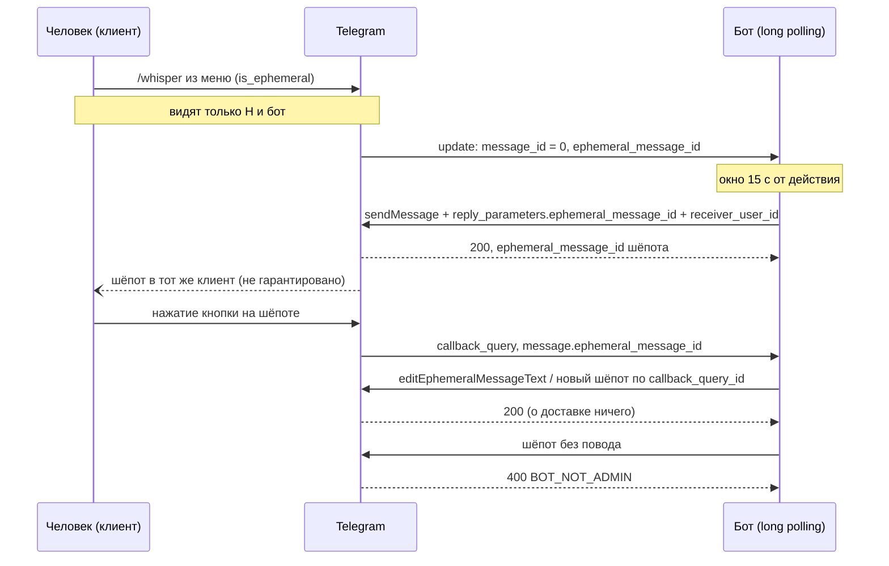

# Эфемерные сообщения и невидимые команды Bot API

Bot API — HTTP-интерфейс, через который бот говорит с Telegram: метод — POST на `https://api.telegram.org/bot<токен>/<метод>` с JSON-телом, ответ — `{ok, result}` или `{ok: false, description}`. С версии 10.2 в нём есть способ поговорить с одним человеком прямо в группе, не показывая разговор остальным: невидимая команда от человека к боту и эфемерный ответ, «шёпот», от бота к человеку.

Файл объясняет эту механику на зонде [`tools/telegram-rich-probe/whisper.mjs`](../../../tools/telegram-rich-probe/whisper.mjs) и живом прогоне 26 октября 2026 года ([RFC-003, «Шёпот в группе»](../../rfcs/RFC-003-bot-presentation-rich-blocks.md#шёпот-в-группе)). Что бот хаба из этого делает и почему — [ADR-078](../../decisions/ADR-078-hub-bot-whispers-in-community-chat.md); как grammY принимает update и зовёт методы — [grammy/bot-adapter.md](../grammy/bot-adapter.md).

## Механика

### Эфемерное сообщение — не строка истории чата

Обычное сообщение группы — строка общей истории с номером `message_id`, по которому его правят, удаляют и на него отвечают. У эфемерного сообщения `message_id` равен нулю, а адрес другой — пара «получатель + `ephemeral_message_id`». В логе прогона невидимая команда `/whisper` пришла боту так (ключи без значений):

```
message_id (= 0), ephemeral_message_id, from, chat (type = "group"), date, receiver_user, text, entities
```

а обычная `/loud` из той же группы — без `ephemeral_message_id` и `receiver_user`. `receiver_user` у входящей команды — сам бот: команду видят только отправитель и он. Справочник добавляет, что `ephemeral_message_id` может достаться другому шёпоту после удаления или истечения прежнего, то есть это не вечный ключ.

Аналогия из .NET — не строка в общей таблице, а уведомление SignalR, отправленное `Clients.User(id)`: оно адресовано одному человеку и в общем журнале не лежит. Отличие: SignalR знает о подключениях, а бот о клиентах человека не знает ничего, и об этом ниже.

Поэтому правят и удаляют шёпот отдельными методами с тремя адресными параметрами, а не `editMessageText`:

```js
await call("editEphemeralMessageText", {
  chat_id: chatId,
  receiver_user_id: query.from.id,
  ephemeral_message_id: ephemeralMessageId,
  text: `PER-680 шёпот отредактирован в ${new Date().toISOString()}`,
  reply_markup: whisperKeyboard,
});
```

### Невидимой команду делает запись в меню, а не текст

Невидимость не написана в тексте `/whisper` — её объявляет бот, когда ставит список команд:

```js
const commands = [
  { command: "whisper", description: "PER-680 невидимая", is_ephemeral: true },
  { command: "late", description: "PER-680 ответ с задержкой", is_ephemeral: true },
  { command: "loud", description: "PER-680 обычная" },
];
const scope = { type: "chat", chat_id: Number(groupChatId) };
await call("setMyCommands", { scope, commands });
```

`scope` ограничивает список одной группой: у бота может быть разный список в личке, в группах вообще и в конкретном чате. Человек выбирает команду из меню, клиент видит `is_ephemeral` и отправляет её невидимо; в меню у такой команды значок. Список — состояние на сервере Telegram, а не в процессе бота: он переживает остановку. Поэтому зонд сначала читает прежний список (`getMyCommands`) и возвращает его на `SIGINT`/`SIGTERM`, иначе в меню группы остались бы команды, которых никто не обрабатывает.

### Право шептать — повод с окном в 15 секунд

Бот без прав администратора не может шепнуть кому угодно когда угодно. Справочник: шепнуть можно в течение 15 секунд после действия человека, и шёпот придёт в тот клиент, где действие совершено. Повод называется одним из двух указателей:

```js
// ответ на невидимую команду
reply_parameters: { ephemeral_message_id: message.ephemeral_message_id },
ephemeral_message_parameters: { receiver_user_id: message.from.id },

// ответ на нажатие кнопки
ephemeral_message_parameters: {
  receiver_user_id: query.from.id,
  callback_query_id: query.id,
  replace_callback_query_message: query.data === "per680:replace",
},
```

Без повода сервер отказывает: живой вызов вернул `400 Bad Request: BOT_NOT_ADMIN`. Администратор может шептать без повода, и тогда шёпот может прийти на несколько клиентов человека, но и ему доставку никто не обещает.

Это знакомая форма: право на ответ привязано к входящему событию и истекает. Похоже на `response_url` в Slack или на одноразовый токен ответа, только здесь токена нет — есть идентификатор события, и сервер сам сверяет время. Следствие для кода: всё, что бот делает между командой и ответом — разрешение личности, чтение сервисов, — укладывается в 15 секунд. Ручной `curl` в окно не попадал, поэтому прогон шёл автоответчиком на long polling.

### Окно — повод не держать цикл update'ов

`/late` отвечает с задержкой, чтобы проверить шёпот человеку, который уже закрыл приложение. Ждать внутри цикла `getUpdates` нельзя: пока цикл спит, остальные команды и нажатия лежат непрочитанными, и их собственные 15 секунд истекают. Поэтому задержка идёт без `await`:

```js
sleep(lateDelayMs)
  .then(() => whisperBack(message))
  .catch((error) => print("late-failed", String(error)));
```

В .NET это `_ = Task.Run(...)` без ожидания, и там необработанное исключение такой задачи по умолчанию ничего не роняет. В Node иначе: начиная с версии 15 отказ промиса, на который никто не повесил обработчик, завершает процесс. Проверено на Node 26:

```
node -e 'new Promise(r=>setTimeout(r,10)).then(()=>{throw new Error("network")})'
# Error: network … EXIT=1
```

Первая версия зонда `catch` здесь не имела, и сетевой отказ `fetch` в отложенном ответе уронил бы процесс мимо восстановления команд группы. Тот же отказ на самом `getUpdates` тоже обходил восстановление: `call` бросает, а проверка `updates.ok` до него не доходит. Оба места исправлены в этом разборе.

### `200` значит «принято», а не «доставлено»

Сервер ответил `200` на все вызовы прогона, включая три, которые до человека не дошли:

| Вызов | Ответ сервера | Что увидел адресат |
|---|---|---|
| шёпот через 10 с, приложение закрыто | `200`, `ephemeral_message_id` | ничего, и после открытия тоже |
| `deleteEphemeralMessage`, mobile | `200`, `true` | шёпот остался |
| `deleteEphemeralMessage`, Web K | `200`, `true` | шёпот исчез |

Справочник предупреждает об этом прямо: доставка не гарантирована, особенно офлайн. Тип в grammY честен: `deleteEphemeralMessage(...)` возвращает `Promise<true>`, то есть «сервер принял», и поля под исход доставки в нём нет. Бот не может узнать, дошёл ли шёпот, — никакого update об этом не приходит.

Есть и третий способ потерять шёпот: клиент его не хранит. Web K теряет все шёпоты при перезагрузке страницы, mobile хранит их после перезапуска. Срок жизни в минутах не измерялся.

### Privacy Mode отрезает ссылку на сообщение

Privacy Mode — режим бота в группе, при котором он получает не всю переписку, а только адресованное ему: команды, ответы на его собственные сообщения, служебные события. Он включён по умолчанию и выключается в BotFather.

Обычно ответ на сообщение несёт поле `reply_to_message` — то сообщение, на которое ответили. Прогон проверил, придёт ли оно с командой, отправленной ответом на чужое сообщение: ни невидимая `/whisper`, ни обычная `/loud@бот` его не принесли, а само сообщение бот не получил. Справочник оговаривает пропуск только для ответа на эфемерное сообщение; для команды-ответа при Privacy Mode оговорки нет, и это поведение видно только живьём. Встречный факт из того же лога: шёпот, который отправил сам бот с `reply_parameters.ephemeral_message_id`, в ответе сервера `reply_to_message` несёт. Значит, поле срезает не механика шёпота, а то, что бот не должен видеть чужое сообщение.

### Команда в группе может быть адресована другому боту

В группе с несколькими ботами команду пишут с хвостом: `/whisper@solguficky_dev_bot`. Зонд разбирает команду регулярным выражением и хвост не сверяет:

```js
const match = /^\/([a-z_]+)(?:@\w+)?(?:\s|$)/.exec(text);
```

`commandOf("/whisper@other_bot")` даёт `"whisper"` — зонд ответил бы на команду чужому боту, если бы её получил. Фильтр `bot.command` в grammY сверяет хвост с именем бота (`node_modules/grammy/out/context.js`: `atTarget !== ctx.me.username.toLowerCase()` — отказ). Боту хаба, который ходит через grammY, эта ошибка не грозит; зонду — грозит, если такая команда до него дойдёт. Доходит ли команда чужому боту до бота с Privacy Mode, живьём не проверялось.

## Урок

- **Подтверждение сервера и доставка человеку — разные факты.** Где канал «по возможности», тип ответа говорит только о приёме. Решение, которое нуждается в доставке, строится на втором канале, где исход виден, — так ADR-078 оставляет надёжный путь личке и не дублирует шёпот вслепую.
- **Право ответить, привязанное к событию и времени, переворачивает бюджет обработчика.** Задержка перестаёт быть вопросом удобства: опоздавший ответ отвергается. Такой обработчик сначала считают по времени — сколько вызовов до ответа и их таймауты, — а потом пишут.
- **Невидимость задаётся адресацией, а не содержимым.** Шёпот не «скрытое сообщение группы», а отдельная сущность со своим адресом и своими методами. Перенос привычных операций — правки, удаления, ответа — на неё требует отдельных методов, и каждый из них может вести себя по-своему на разных клиентах.
- **Поля update проверяются живьём, если от них зависит сценарий.** Справочник описывает форму, но не то, что срежет режим бота. Отсутствие `reply_to_message` отменило целый кадр раскадровки, и узнать это можно было только прогоном.
- **Fire-and-forget в Node требует `catch` всегда.** В .NET потерянное исключение задачи — тихая ошибка, в Node — падение процесса.

## Почему так, а не иначе

- **Зонд на сыром `fetch`, а не на grammY.** grammY 1.46.0 в пакете бота уже типизирует все эфемерные методы, но зонд — один файл, который запускается `node` без установки зависимостей и печатает ровно тот JSON, что уходит на сервер. Ценой стал ручной разбор команды без сверки хвоста `@бот`, который в grammY есть даром. Бот хаба будет звать те же методы через grammY.
- **Автоответчик на long polling, а не ручные вызовы.** Ручной `curl` проще, но в 15 секунд не укладывался, а без повода сервер отвечал `BOT_NOT_ADMIN`. Автоответчик — единственный способ проверить окно, не давая боту прав администратора.
- **Права администратора, чтобы шептать без повода.** Сняли бы окно и позволили бы боту писать первым, но это расширяет права бота в чате сообщества и противоречит минимальным правам; доставку и тогда никто не обещает. ADR-078 держит бота участником без админки.
- **`replace_callback_query_message` против нового шёпота.** Замена показывает шёпот на месте исходной публичной карточки, только у нажавшего. Это удобно, но работает лишь для нажатия на обычном сообщении: для кнопки на самом шёпоте параметр обязан быть `false`, и шёпот правят `editEphemeralMessage…`.
- **Восстанавливать команды группы, а не просто ставить свои.** Без восстановления меню группы после прогона предлагало бы мёртвые команды. Цена — чтение прежнего списка до старта и обработка сигналов.

## Схема



## Первоисточники

- [Bot API, Ephemeral Messages and Commands](https://core.telegram.org/bots/api#ephemeral-messages-and-commands) — правило 15 секунд, «тот же клиент», права администратора и оговорка о недоставке офлайн.
- [Bot API, EphemeralMessageParameters](https://core.telegram.org/bots/api#ephemeralmessageparameters) — `receiver_user_id`, `callback_query_id`, `replace_callback_query_message` и почему последний запрещён для кнопки на шёпоте.
- [Bot API, ReplyParameters](https://core.telegram.org/bots/api#replyparameters) — `ephemeral_message_id` как повод и правило «ответ на эфемерное сам эфемерный».
- [Bot API changelog](https://core.telegram.org/bots/api-changelog) — версии 10.2 и 10.3: что добавлено и что переименовано в `ephemeral_message_parameters`.
- [Privacy Mode](https://core.telegram.org/bots/features#privacy-mode) — что бот получает в группе в этом режиме.
- [RFC-003, «Шёпот в группе»](../../rfcs/RFC-003-bot-presentation-rich-blocks.md#шёпот-в-группе) и таблица механик там же — условия и результаты прогона по клиентам.
- [ADR-078](../../decisions/ADR-078-hub-bot-whispers-in-community-chat.md) — что бот хаба строит на этих фактах.
- [Node.js, `--unhandled-rejections`](https://nodejs.org/api/cli.html#--unhandled-rejectionsmode) — режим `throw` по умолчанию: почему необработанный отказ роняет процесс.

## Проверь себя

Проверялось 26 октября 2026 года: прогон в обычной группе с `@solguficky_dev_bot` без прав администратора и с Privacy Mode, Web K и mobile; grammY 1.46.0 и `@grammyjs/types` 5.0.0 из `apps/hub-bot/node_modules`; Node 26.4.0.

- Что приходит в `message_id` у невидимой команды и у шёпота? Ноль у обоих. Проверка — `just telegram-whisper-probe` с `HUB_BOT_TOKEN` и `GROUP_CHAT_ID`, затем `/whisper` в группе: строки `update` и `call` вывода.
- Что вернёт сервер на шёпот без повода от бота без админки? `400 Bad Request: BOT_NOT_ADMIN`. Вызов шёл разовым запросом вне зонда; ответ записан в RFC-003.
- Что обещает тип `deleteEphemeralMessage` в grammY? Только приём: `Promise<true>`. Проверка — `grep -n "deleteEphemeralMessage" apps/hub-bot/node_modules/grammy/out/core/api.d.ts`.
- Ответит ли разбор зонда на `/whisper@other_bot`? Да, `"whisper"`. Проверка — `node -e` с регулярным выражением `commandOf` из зонда; сверка хвоста в grammY — `sed -n '22,62p' apps/hub-bot/node_modules/grammy/out/context.js`.
- Что делает Node 26 с отказом промиса без обработчика? Завершает процесс с кодом 1. Проверка — команда `node -e` из раздела про окно.

Открытые вопросы, из-за которых статус «вернуться»:

- Отвергает ли сервер шёпот позже 15 секунд. Живьём проверены только 10 секунд — `200`. Проверь сам: `LATE_DELAY_MS=20000 just telegram-whisper-probe`, затем `/late`; ожидание по справочнику — отказ, текст ошибки не известен.
- Сколько шёпот живёт на mobile и доходит ли офлайн-шёпот на desktop. Не измерялось; причины — в ячейках таблицы механик RFC-003.
- Получает ли бот с Privacy Mode команду `/whisper@другой_бот`. Проверь сам: второй бот в тестовой группе, команда с его именем, и смотри, есть ли строка `update` в выводе зонда.
